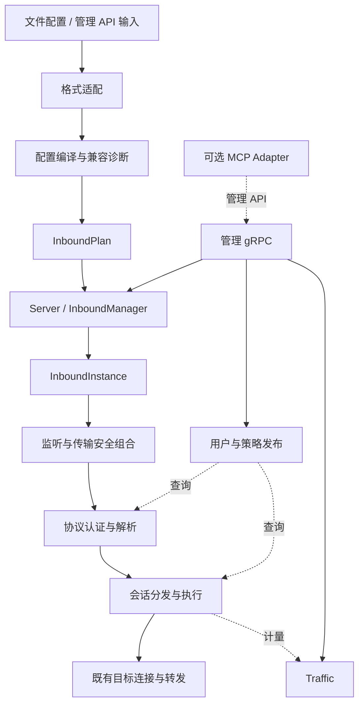
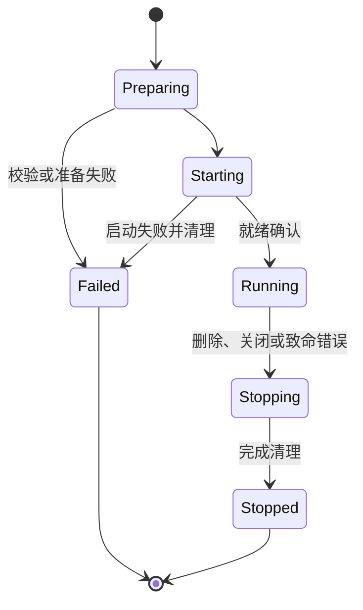

# Chimera Server 架构设计与演进规范

- 文档版本：1.4
- 更新日期：2026-10-06
- 定位：后续架构设计与渐进迁移的首要参考；不是已实现功能清单。
- 实施状态：目标设计已形成，本文不表示代码迁移已经完成。
- 适用范围：Chimera_Server 服务端，当前以 inbound 为主。

## 1. 目标与使用方式

Chimera 的最终目标是完整兼容 xray-core 的服务端行为，使现有客户端无需改变协议配置即可使用 Chimera，并使支持范围内的 Xray 服务端配置保留等价语义。在实现这一目标的同时，改善模块职责、状态所有权、生命周期、资源控制和可维护性。

后续贡献者应先阅读 [AGENTS.md](AGENTS.md)、[需求、架构演进与维护手册](ITERATION_GUIDE.md) 和本文，再检查任务涉及的实际代码与参考实现。手册补充已确认优先级、迁移切片选择、故障排查和交接方法；本文仍是内部设计的首要参考。架构相关改动应说明所属模块、状态所有者、影响的兼容行为和验证方式。本文中的类型与目录名称是设计名称，迁移完成前不得假设它们已经存在。

用户当前明确指令优先；AGENTS 规定贡献流程；本文规定内部设计方向；固定版本的 Xray 源码与互通结果规定外部兼容行为。遇到分歧应明确记录：代码现状不自动推翻目标设计，目标设计也不允许未经验证改变 Xray 行为。例行局部实现不需要反复请求架构确认；重大边界调整应先更新设计理由。

### 1.1 当前范围

- Inbound 协议、传输、安全握手、认证、回落、监听、socket 选项、sniffing。
- 与 inbound 直接相关的用户策略、动态管理、统计和任务生命周期。
- Inbound 正常工作所必需的目标连接、DNS、TCP/UDP 转发及现有路由衔接。
- 用户已明确启动 VLESS Reverse 专项设计；后续实现使用当前 VLESS Reverse 字段与 wire behavior，
  不恢复 legacy `reverse.bridges` / `reverse.portals`。第一阶段优先交付公网 Chimera Portal + 内网
  Xray Bridge 的固定 TCP 端口暴露；完整边界见
  [VLESS Reverse 支持设计与实施计划](VLESS_REVERSE_DESIGN.md)。
- 用户于 2026-10-03 启动 Reverse 站点到站点网关专项：以现有 VLESS Reverse 为站点隧道，在 Server 中逐步加入 Linux TUN 网关和 Overlay 目标映射；TUN 网络栈优先复用 Chimera_Client `clash-netstack/`（Cargo package `watfaq-netstack`）。该专项与完整 Xray TUN inbound 兼容分开声明。当前 Linux TUN 数据面已由隔离 namespace 验证 IPv4/IPv6 单站点 veth LAN 路径、重复 LAN 双站点选择、两 Edge site policy 对 TCP/UDP 的真实目标拒绝、4 KiB UDP 和 SIGTERM 清理；可选 `tunGateway.ipv6Address` 由 Server 绑定；Chimera-only `tunGateway.mtu` 默认 1500、允许 1280–9000，并同时设置设备和 netstack；Gateway 本机可选择使用 `routes`、`routeFrom` 与 `routeInputInterface` 做源/入接口限定路由，上游 LAN 路由仍由部署方设置。站点路径支持 Chimera-only VLESS Reverse `HALF_CLOSE` option，使 TCP 单向 FIN 后仍能传回对向数据；无该扩展位的 Xray 标准 `END` 仍整流关闭，Xray 对端不会获得该扩展语义。Server vendored 了 netstack 异步 shutdown/join 与敏感日志脱敏修复，并在 service owner 退出包循环后 await TCP packet engine。物理 LAN/生产路由、更广分片异常、Xray TUN 互通和更大 UDP 的 Mux 分片仍未验收；隔离 Linux namespace 已有 60 秒四流 TCP/UDP 持续负载及 CPU/RSS 采样，并新增两台独立 Office host 各两流的并发 TCP/UDP 烟测；这些是合成 namespace 基线，不等于生产设备容量验收，详见 13.66–13.68。
  设计与当前实施状态见 [站点到站点网关设计](SITE_TO_SITE_DESIGN.md)。
- 2026-10-05 VLESS Reverse TCP/REALITY 已在固定 Xray 26.9.9 下双向验证：Xray Bridge → Chimera Portal 与 Chimera Bridge → Xray Portal。Bridge client 同时提供 X25519MLKEM768 与 X25519 fallback，并处理所选 hybrid ServerHello；Xray v26.9.9 锁定的 XTLS/REALITY `v0.0.0-20260908062103-8cdf7bf9c7f0` 服务端在 admission 阶段要求 hybrid share。该能力仅由 `vless-reverse-reality` 显式编译启用，验证覆盖错误 shortId 拒绝、TCP echo 与 Portal 重启后的 Bridge reconnect；其他安全/传输组合仍须逐项认证，站点网关及完整 Xray TUN 目标仍为 Partial。
- 2026-10-03 网关安全传输切片：普通静态 VLESS outbound 现可在 `vless` + `tls` features 下使用 RAW/TCP + TLS，并拒绝未编译 TLS feature 的相同配置。固定 Xray 26.9.9 namespace 路径使用 SAN 信任根验证 Office Gateway→Hub Portal 与 Xray Edge Bridge→Hub Portal 两条 TLS 链路，承载双栈 TCP/UDP 与 4 KiB UDP，并验证 TLS Hub 重启后 Xray Reverse worker 重新挂接、Office TCP/UDP 恢复；随后在 Hub/Gateway 持续运行时单独重启 TLS Edge，验证 Portal 新 worker 挂接及 Office TCP/UDP 恢复；Rust TLS 负向测试确认错误信任根与错误 SNI 均拒绝握手；隔离 namespace 的完整 TUN 路径还验证错误 SNI 时双栈 TCP/UDP 不抵达 Edge LAN、恢复正确 SNI 后双栈转发恢复。更广的普通 VLESS outbound 传输/security 组合未实现，站点网关整体仍为 Partial。
- 保护现有 outbound、Chimera 扩展和部署行为。

### 1.2 后置事项与非目标

- 完整 outbound 协议生态和大规模路由功能扩展后置。WireGuard 仍是后期目标；当前仅落地 Linux 服务端 inbound 的 system-TUN 纵向切片，与完整 outbound、userspace IP stack 和跨平台支持分开推进。
- WireGuard 和广泛的 Xray outbound 扩展仍是独立目标，先后次序未定。新启动的 Reverse 站点网关专项使 Linux TUN 成为限定范围内的当前目标；这不授权广泛 outbound 重写，也不代表完整 Xray TUN 兼容。详见手册第 12 节。
- MCP 可做可不做，不是核心交付或发布门槛。若保留，优先独立 Adapter 调用管理 gRPC，复用内部管理服务；现有实现的迁出或删除需纳入具体任务。
- 当前不引入微服务、通用插件平台、分布式控制协议或全局依赖注入容器。
- 不以重构名义改变协议字节、认证规则、默认超时、回落表现或统计口径。
- 不把 Rust、更多 trait、更多 crate 或更短文件视为架构质量的直接证明。
- 不承诺未验证的性能优势；不把参考项目的全部设计视为最优解。

## 2. 参考体系与适用边界

| 参考 | 采用的思路 | 不直接继承的内容 |
| --- | --- | --- |
| xray-core | 配置、线上协议、失败处理和管理 API 的兼容契约 | 具体语言机制和未经分析的内部耦合 |
| clash-rs | 外部配置到内部模型、InboundManager、会话分发的分工 | Clash 配置及默认值 |
| sing-box | inbound 管理与分阶段生命周期 | Go 服务注册机制和整套功能范围 |
| Envoy | listener 就绪/排空、连接与请求作用域、传输和过滤职责 | xDS 全套体系、固定 worker 模型和复杂插件机制 |
| shadowsocks-rust | 协议核心、服务实现与程序入口分离 | 将单一协议抽象直接套用到所有 Xray 组合 |
| Pingora / Leaf | 公共网络能力、协议与传输接口的局部设计 | 用 HTTP 模型统一所有会话，或替换 Xray 行为标准 |

本次设计核对的本地基线：

- `ref/xray-core`：Xray-core `v26.10.10`，提交 `701af60772cda123492f86e383e1fdba066614a9`。
- `ref/clash-rs`：`c6f25ab847a15bf7628d34108eab6a171325dadb`。

后续兼容工作须重新记录实际参考提交和客户端二进制版本。这些基线不是“永远最新”的声明；外部链接可能随分支更新，具体移植前必须固定所用版本。

### 2.1 独立设计原则

参考项目是证据与备选方案，不是 Chimera 内部架构的强制模板。允许并鼓励基于本项目约束提出原创方案；内部结构不必与任何参考项目一一对应。Xray 的外部兼容契约仍然有效。

设计决策从问题出发：先说明状态归属、必须保持的不变量和真实维护成本，再决定模块、接口与并发机制。比较保留现状、借鉴参考和本地简化方案；根据问题规模记录必要的取舍，不为每个小修复增加形式化负担。

优先评估：改变一个行为需要触及多少责任中心、失败后能否恢复一致状态、接口是否暴露过多能力、方案能否独立测试，以及迁移和运行成本。新增抽象应对应真实变化点或不变量；不为了模仿成熟项目或追求原创而增加复杂度。

本设计的独立判断包括：以四种作用域分析状态，同时允许跨连接会话脱离严格父子树；使用实例代次隔离同 tag 重建；数据面获取窄能力而非全局管理状态；先稳定核心库内边界再考虑拆 crate。这些方向应由代码和测试持续检验，不因写入本文而成为不可修订的结论。

## 3. 代码现状与设计动机

以下是初版设计时的结构性动机，不是当前缺口清单，也不是运行故障或性能回归的完整证明。部分问题已在第 12 节记录的迁移中解决；开始新任务时应核对实际代码和手册第 4 节，不能依照此表重新实施已完成工作。

| 当前结构 | 维护风险 | 目标边界 |
| --- | --- | --- |
| `lib.rs` 的 validate 与启动、gRPC 的配置转换分别组织校验 | 默认值和支持范围可能分叉 | 共用配置编译入口 |
| `ServerProxyConfig` 部分分支持有 `SocksUserStore` 共享可变状态 | 配置克隆与运行状态共享的语义不同 | 计划与用户运行状态分离 |
| `RuntimeState` 同时持有配置、任务、路由、策略和事件 | 连接层能依赖过多管理能力 | 管理能力与数据侧查询能力分离 |
| gRPC handler 直接登记、启动、回滚和停止 inbound | 生命周期规则绑定在 API 实现中 | InboundManager 统一编排 |
| `beginning` 同时负责监听、sniffing、分发与转发 | 修改一个流程需要理解多个层次 | 按职责渐进提取 |
| handler 的 `Completed` outcome 只表示当前连接已同步处理完成 | outcome 不再隐含 detached/spawned task 的所有权转移 | 后台任务必须在返回前登记到 connection/session owner |
| 协议与安全/传输层共用递归枚举 | 多处递归匹配容易重复规则 | 明确组合计划及能力边界 |

代码入口： [lib.rs](chimera_server_lib/src/lib.rs)、[runtime.rs](chimera_server_lib/src/runtime.rs)、[配置类型](chimera_server_lib/src/config/server_config/types.rs)、[gRPC Handler](chimera_server_lib/src/grpc/handler.rs)、[连接处理结果](chimera_server_lib/src/handler/tcp/tcp_handler.rs)。

现有 handler、TCP/UDP 消息流区分、路由快照和真实客户端测试是迁移基础。本文不要求推翻这些实现。协议覆盖应查阅并核验 [兼容矩阵](examples/xray-compatible/README.md)，不在此维护易过时的“未实现协议”列表。

## 4. 总体结构与依赖方向



图表示职责调用关系，不规定所有网络包都经过相同线性链路。QUIC、XHTTP、REALITY/Vision 的组合必须单独表达。

### 4.1 模块契约

| 逻辑模块 | 输入与输出 | 拥有的内容 | 禁止承担的职责 |
| --- | --- | --- | --- |
| config | 外部配置 → 已验证计划或诊断 | 字段规则、默认值、组合校验 | listener、连接任务、动态授权状态 |
| server | 启动计划 → ServerHandle | 组件装配、整体就绪、进程级关闭 | 协议帧解析 |
| inbound | 计划与管理命令 → 实例/操作结果 | 实例注册、启停、资源准备协调 | protobuf 解码、业务路由匹配 |
| transport | 网络接入 → 流/消息与传输上下文 | listener、传输状态、安全握手资源 | 代理协议业务目标决策 |
| protocol | 流/消息与凭据查询 → 会话请求/回落结果 | 认证和协议编解码 | 全局服务增删 |
| session | 会话请求 → 转发与完成结果 | 会话任务、超时、取消、半关闭 | JSON/protobuf 格式 |
| identity / policy | 管理更新 → 可查询版本 | 用户、授权规则、策略发布 | socket 启停 |
| control | API 请求 ↔ 内部命令与响应 | API 适配与错误映射 | 独立实现启动事务 |
| traffic | 计量记录 → 聚合/查询 | 统计状态 | 决定认证和连接结束 |
| outbound | 目标请求 → 既有连接能力 | 已有出站实现 | 本轮扩展新协议体系 |

配置编译可依赖纯协议选项校验；运行模块不反向依赖外部配置格式。控制面可调用管理能力，但协议/会话层不依赖 gRPC/MCP。跨模块公共类型只提取稳定的小型值对象，不建立容纳所有状态的 `common` 大模块。

## 5. 配置、计划与运行实体

### 5.1 三阶段模型

| 对象（设计名） | 作用 | 不变量 |
| --- | --- | --- |
| XrayInboundConfig | 表达原始输入，包括别名与省略值 | 不把未指定值过早变成默认值 |
| InboundPlan | 表达编译完成的监听、传输、协议和初始用户设置 | 不持有活跃 socket、任务或可变授权集合 |
| InboundInstance | 表达实际运行的 inbound | 资源、动态状态和清理责任明确 |

计划不等于可公开打印的数据：它仍可能包含凭据，必须采用安全摘要或脱敏 Debug。不要持久保存无必要的原始配置副本。

### 5.2 单一语义入口

文件和 gRPC 各自解码，再汇入共用的内部描述及编译逻辑。两种格式不必具有相同字段，但相同含义必须得到相同默认值与组合检查。API 侧需保留 protobuf presence 等输入语义，不能无条件绕经 JSON 导致信息丢失。

检查分三个阶段：

1. 配置编译：字段、默认值、feature 支持及协议组合。
2. 资源准备：证书、密钥、必要文件和平台能力；昂贵或阻塞工作离开转发路径。
3. 启动：实际绑定端点、启动任务、确认就绪。

`--check` 的检查深度应在迁移时记录并用测试固定；它不等同于端口可绑定。共享编译过程不应启动后台任务或安装日志订阅器。

### 5.3 兼容诊断

- 区分已支持、部分支持、仅格式保留、服务端不适用和未支持。
- 已识别但未执行的行为不能无声成为“支持”；安全关键选项未实现时应拒绝。
- 未知字段的处理对照 Xray，不通过全局严格模式随意改变接受范围。
- 诊断包含安全的字段路径和错误类别，不回显配置原文、私钥、密码或认证帧。
- 偏离 Xray 的安全强化应声明影响，尤其关注认证失败响应和回落行为。

## 6. 四个生命周期作用域

| 作用域 | 典型所有者 | 资源与状态 | 结束条件 |
| --- | --- | --- | --- |
| 服务器 | ServerHandle | 组件管理器、控制服务、根取消信号 | 组件完成关闭或达到明确清理期限 |
| Inbound 实例 | InboundManager / InboundInstance | 监听、用户存储、实例任务组 | 停止接入并完成规定的清理 |
| 物理连接 | ConnectionHandle | TCP/QUIC 连接、握手状态、传输子任务 | 传输关闭且所属任务收尾 |
| 逻辑会话 | SessionHandle 或会话注册表 | 目标连接、消息通道、策略引用、计量 | 协议规定的关闭、超时或取消 |

这些作用域不是严格的四层树：HTTP/2 和 QUIC 一条连接可承载多会话；XHTTP 会话可能关联多条 HTTP 请求；XUDP 的跨连接重关联可能要求会话状态由 inbound 级注册表持有。明确谁拥有持久会话、谁仅持有引用，禁止在连接退出时误删可重关联状态。

### 6.1 Inbound 状态机与实例身份



- tag 是外部寻址属性，不是唯一内部身份。内部实例 ID/代次应能区分同 tag 的删除重建；无 tag 和重复 tag 的合法性遵循 Xray。
- 管理器统一维护实例及状态，避免配置表与任务表由不同调用者分别更新。
- 同一目标的变更须串行化或做版本检查；不持有全局阻塞锁执行异步启动。
- 旧实例任务回调只能影响自己的代次，不能删除新实例。
- 对外 API 何时返回成功、是否暴露准备状态，按 Xray 合同确定；内部就绪状态不自动新增外部 API。

### 6.2 关闭与任务所有权

任务生成必须有 owner；任务移交要带登记与完成通知。Drop 不能完成异步排空，丢弃 JoinHandle 也不是取消。设计应提供显式关闭流程，并处理调用方取消管理操作时的资源清理。

区分停止接受新连接、结束逻辑会话、关闭底层传输。是否排空既有连接及其期限按协议/API 兼容行为确定，不能默认所有删除都立即 abort，也不能默认永远保留旧连接。清理超时后仍应记录未完成项并处理资源，不把取消信号已发送当作关闭成功。

## 7. 传输、安全与协议边界

监听端点与代理协议分开建模；计划明确合法的安全/传输组合，构建阶段选取实现。避免每个管理操作都重复递归匹配整个协议枚举。

但不强制固定的“TCP → TLS → HTTP → 协议”顺序：QUIC 自带安全握手；REALITY 具有回落职责；Vision 依赖安全状态与底层转发能力。传输上下文通过明确能力提供 SNI、ALPN、来源地址及必要状态，不把完整 RuntimeState 交给协议。

原始 TCP 转发等优化仅在能力与安全前提满足时启用。快速路径必须保持计量、取消、半关闭及协议边界；缺少能力时使用已验证的常规路径。

协议返回结果应表达 TCP、固定目标 UDP、多目标 UDP、会话型 UDP、回落或可跟踪的协议自主管理任务。保留现有不同消息流抽象，不用单一字节流隐藏消息边界，也不建立覆盖所有协议细节的巨大 trait。

## 8. 身份、策略、分发与统计

- 初始用户属于计划；可变用户与授权状态属于运行存储。存储可共享实现，但协议特定凭据和认证流程保留在对应模块。
- 认证身份由协议产生，再用于策略、目标选择与统计；不能依靠统计上下文充当认证的唯一事实来源。
- 数据面仅持有查询/执行能力，管理面持有发布/变更能力。优先使用具体窄接口，确有替换或测试需求时再引入 trait。
- 路由与关联数据应作为一致版本发布；现有 RoutingPublication 可逐步复用。
- 每项用户/策略变更注明影响新握手、新请求、新消息还是既有会话。不可统一假定整条连接只读取一次，也不可按字节获取全局锁。
- 流量在定义明确的位置计量，传输层和会话层避免重复计数；失败、回落、取消和快速路径同样验证 Xray 对应口径。
- 继续复用 traffic、tracing 和管理 gRPC，不另设观测体系；MCP 为可选适配能力。

## 9. 关键流程

### 9.1 初始启动

解码与编译 → 准备必需资源 → 创建组件与 inbound 实例 → 绑定并等待就绪 → 按既有部署契约暴露服务就绪。

阶段失败由 server 统一执行已创建资源的反向清理；清理责任不能依赖 CLI 进程恰好退出。部分启动是否允许必须明确，默认不能把关键 inbound 失败报告为整体健康。

### 9.2 动态增加与删除 inbound

控制适配 → 共用配置编译 → 管理器预留实例身份 → 准备与启动 → 发布运行状态 → 映射 API 结果。失败撤销预留并清理资源；相同 tag 的并发变更不能绕过一致性规则。

删除按实例身份进入停止流程，API 状态和返回时机保持兼容。不得直接由 gRPC 分别删除配置、abort listener、修改统计来拼凑操作。

### 9.3 连接与会话

接入 → 传输/安全处理 → 协议认证与目标解析 → sniffing/策略/分发 → 目标连接 → 会话转发 → 计量及资源收尾。

该流程表达逻辑责任，不改变协议规定的成功响应时机、认证顺序和回落原始字节重放。握手、目标连接、空闲以及单向关闭分别拥有超时语义。

### 9.4 动态用户更新

输入适配 → 协议用户校验 → 发布更新版本 → 按指定边界读取新版本。失败不发布半成品；跨字段更新应原子可见。既有连接是否继续有效按参考行为测试。

## 10. 资源与错误模型

资源预算按适当作用域分配，重点覆盖未认证握手、连接、UDP 会话、XHTTP 待配对数据、队列和缓存。限额同时定义释放条件、过载行为和配置默认值。新增限额不得隐式破坏合法客户端流量。

控制更新和慢速统计消费者不阻塞转发。明确背压或丢弃策略：允许丢弃的观测事件不能被误用于认证、流量结算或生命周期事实。重放缓存也不能因普通缓存淘汰策略失去安全保证。

内部错误至少在责任上区分配置、资源准备、协议、连接和生命周期失败；沿用已有错误类型渐进演化，不要求一次重写全部错误枚举。控制面映射 Status，CLI 映射退出与诊断；内部模块不直接决定外部 API 错误格式。

## 11. 目录演进与工程边界

第一阶段保留现有四个 workspace crate：主应用、核心库、CLI 工具、专用 TCP REALITY 服务。先在核心库内部建立边界，稳定后再依据独立依赖、复用或编译需求决定是否拆 crate。

| 当前位置 | 目标职责归属（不是立即移动指令） |
| --- | --- |
| lib.rs 的装配与启动 | server |
| config 与各入口重复转换 | config 的适配、编译、计划 |
| beginning 的 listener 创建 | inbound / transport |
| beginning 的 sniffing、分发、转发 | session |
| handler 的代理协议 | protocol |
| handler 的 WS、gRPC、TLS 等包装 | transport 及安全子模块 |
| RuntimeState 的实例与任务表 | inbound 管理组件 |
| 配置内动态用户状态 | identity / inbound 实例 |
| gRPC 的启停事务 | inbound 管理组件 |
| gRPC/MCP 的格式适配 | control |

专用服务入口和公共 library API 是需要保护的使用方，不因为主 CLI 通过就视为迁移完成。优先提取职责和收窄可见性，再移动文件；不做大规模纯重命名。

迁移状态（2026-09-13）：`session` 目录已开始承接会话域职责。第一步将 `beginning::stream_session` 中的 sniffing 解析、目标覆盖与 route-plan 纯逻辑，以及前缀读取/回放 helper 收敛到 `session::sniff`；随后将 setup outcome 规范化、routing identity 投影与核心 `process_stream_with_context` 分发收敛到 `session::dispatcher`。普通 TCP、gRPC transport 与 XHTTP 现已直接调用 `session::dispatcher`；handler setup 与 routed outbound connector 的薄 adapter 也已收进 dispatcher，原 `beginning::stream_session` 过渡模块已删除。TCP/UDP relay helper 仍暂由 `beginning` 窄接口提供，因此 `beginning` 尚未完成迁移，listener、connection/session task owner、响应时机与 relay 行为均未改变。

### 11.1 功能隔离：模块、Cargo feature 与运行时配置

目标是让能力可隔离、可验证，并帮助缩小线上故障范围。模块和类型负责职责与依赖；Cargo feature 负责构建时裁剪可选能力；运行时配置负责选择已编译能力的启用方式。不能通过增加 feature 数量代替职责拆分，也不要求每个模块对应一个 feature。

| 能力类别 | 划分建议 | 约束 |
| --- | --- | --- |
| 入站协议 | 按独立协议提供可选 feature | 启用时包含必需认证与协议校验 |
| 可选传输 | WS、HTTPUpgrade、gRPC transport、XHTTP 等按需要隔离 | 声明组合要求，不暗示所有协议均能使用 |
| 安全能力 | TLS、REALITY 等显式表达依赖 | 未编译时拒绝相关配置，不降级为明文 |
| 控制面 | Xray gRPC API、MCP 可独立裁剪 | 区分管理 API 与 gRPC 传输，数据面不依赖管理服务 |
| 可选优化 | 编译选择配合必要的运行时路径选择 | 常规路径须保持等价协议、安全和计量语义 |
| 诊断能力 | 昂贵跟踪与实验探针单独控制 | 不自动进入普通生产构建，不泄露凭据 |
| 核心保障 | 生命周期、取消、必要校验与错误处理保持必需 | 不能作为关闭后“更快”或“更容易排障”的选项 |

上表是目标分类，不是现有 feature 清单。当前 manifest 已包含协议/传输 feature、`full`、`minimal-vless`、`minimal-vless-tls` 等组合；XHTTP、MCP 是否独立裁剪等事项仍需审计。先验证既有边界是否真实有效，再决定新增或调整 feature；本文件不授权立即重命名或修改默认构建。

### 11.2 依赖与能力记录

- Feature 以增加能力为原则，避免表示“关闭某行为”的负向 feature，以及隐含优先级的互斥组合。确需选择不同实现时，优先在合法构建中通过明确配置选择。
- 默认依赖及其他使用方可能使依赖 feature 被合并启用。最小构建必须明确 package、target 和 feature 集合，检查最终依赖图，不能根据 `--no-default-features` 或组合名称推断隔离成功。
- 应用 crate 向库转发 feature 时保持语义一致；共享辅助实现不应因为某个协议关闭而意外消失，也不应为复用辅助函数而启用无关服务器。
- 对影响行为的已识别能力，区分“未编译”“已编译但未启用”和“不支持该组合”。配置应给出明确诊断，不能通过条件编译移除字段后静默忽略用户意图。
- 保留现有发布构建和默认值；变更默认 feature 是部署兼容变更，需要单独说明。

为涉及的能力在对应 Cargo.toml 注释、配置说明或兼容矩阵记录：责任模块、所属 package、编译 feature、必需/共享依赖、运行时入口、平台限制、未编译时行为、验证命令和已验证版本。不要求在多处重复维护同一清单；通过链接关联构建能力与协议兼容矩阵。

### 11.3 构建与行为验证矩阵

不穷举所有 feature 排列，但每项公开支持的构建组合应有可追溯验证。覆盖至少包含：

| 构建范围 | 验证目的 |
| --- | --- |
| 指定 package 的最小支持组合 | 发现对默认/full 隐含依赖，验证该组合实际可用 |
| 常用生产组合 | 验证真实部署配置和所需控制面能力 |
| 默认与 full 组合 | 防止对现有发行方式的回归 |
| all-features | 检查全部已声明特性的共存，不等同生产推荐构建 |
| 本次影响的重要交互组合 | 协议 × 传输 × 安全，以及控制面或优化路径交互 |
| 禁用相关能力的组合 | 已识别配置明确失败，无静默安全降级 |

有意义的验证包含编译、针对性行为测试与必要互通，不只检查 feature 名称存在。测试依赖与 feature 合并可能掩盖生产二进制缺少依赖的问题，需同时检查实际部署目标。降低 feature 后问题消失，只能证明与构建差异相关，不能直接认定某模块有 bug。

以下命令对应当前应用 manifest，仅展示如何查看和检查最小 VLESS 构建，不表示本次文档更新已执行或认证这些组合：

```sh
cargo tree -p chimera_server_app --no-default-features --features minimal-vless -e features
cargo check -p chimera_server_app --no-default-features --features minimal-vless
cargo check -p chimera_server_app --no-default-features --features minimal-vless-tls
```

针对部署补充相同 target 与实际构建参数；追踪某依赖是谁启用时可进一步使用反向依赖查询。确认相关测试真正执行，不能把零测试、被忽略测试或全特性下通过当成最小组合验证。

### 11.4 线上问题的两级缩减流程

1. 保存原始证据：源码提交、二进制标识、工具链、lockfile 状态、package/target、启用 feature、构建参数、安全配置摘要、客户端版本与请求、负载和故障现象。不要记录凭据原文。
2. 在复现或灰度环境优先使用同一二进制，减少无关 inbound、停用不影响复现的可选服务，或切换已有的等语义常规转发路径。每次只改变一个维度，并确认请求仍经过原故障路径。
3. 必要时制作最小 feature 构建：保留故障协议、传输、安全能力及其依赖，检查实际启用图；保持其余构建和运行条件可比。
4. 恢复被移除能力并重复观察，检查是否为功能交互或时序变化；对并发性问题重复运行，记录频率与负载。减少并发后不复现不等于问题修复。
5. 定位后增加对应组合的回归验证，并在原始部署组合复验。保留可回退版本，生产切换遵循现有部署授权与流程。

禁止以关闭认证、重放保护、必要校验或资源安全保障的方式取得“通过”结果。该排障流程不是任意停用生产服务的授权。使用现有日志与构建记录，不为此默认增加遥测服务或公开诊断 API。

## 12. 渐进迁移路线与验收

本文建立路线，不自动授权执行所有阶段。后续任务按当前用户范围选择一个切片；迁移与新增协议分别验收。具体选择流程与调整后的迁移阶段见 [维护手册第 15–16 节](ITERATION_GUIDE.md#15-每轮迭代如何选择任务)。优先实际责任、必要契约和 owner，不以文件行数或目录移动作为必经门槛；下方历史完成状态不因新手册建立而重置。

| 阶段 | 交付 | 最小验收 |
| --- | --- | --- |
| M0 | 固定现有行为与入口测试、记录依赖边界 | 基线和未验证范围可追溯 |
| M1 | 一个现有 inbound 的共用编译与计划边界 | 文件/检查/API 等价输入规则一致，准备不启动任务 |
| M2 | 管理器接管该 inbound 的初始启动和动态增删 | 绑定失败回滚、重复操作、取消、同 tag 重建 |
| M3 | 配置计划与动态用户状态分离 | 克隆隔离、原子更新、认证及删除用户语义 |
| M4 | 连接/会话任务归属明确 | EOF、半关闭、超时、重关联、取消和计量收尾 |
| M5 | 提取传输/协议组合边界 | 所涉及的 TLS/REALITY/传输组合互通不变 |
| M6 | 收窄 RuntimeState 与依赖，扩展到其余 inbound | 无控制面格式进入数据面，公共调用方保持可用 |

实施状态（2026-09-11）：M2/M3/M4/M5/M6 已按本文当前验收边界完成。`InboundManager` 已把运行时 inbound 发布记录收敛为实例级 `InboundInstance`：同一 generation 内由一个对象共同持有配置、生命周期、协议运行时用户存储与 listener task handles，不再维护可与配置漂移的独立 task 注册表；并已接管 gRPC Add/Remove/Alter 的启动、停止和失败回滚事务；同 tag 操作通过有界 hash-lock 分片串行化，运行实例使用 generation 区分同 tag 重建，旧 generation 的 task 注册或停止不能影响新实例。Add 仅在 listener 启动成功后发布配置与 task，Remove 在摘除实例后 abort/await task，非原地 Alter 重启失败时按既有行为尝试恢复旧实例。固定 Xray baseline 的 untagged inbound 语义现也已显式落地：空 tag 不参与非空 tag 唯一性约束，多个空 tag inbound 可按 generation 独立启动并共存；批量启动在 bind 前显式拒绝重复的非空 tag，避免 generation 化启动误放宽命名唯一性；动态 AddInbound 接受空 tag，而 RemoveInbound 仍不能用空 tag 寻址，与 Xray `untaggedHandlers`/`RemoveHandler("")` 行为一致。HandlerService 的 lifecycle failure gRPC code 也已用同一双端 harness 实测对齐固定 Xray baseline：重复非空 tag 的 AddInbound、缺失 tag 的 RemoveInbound、缺失 tag 的有效 AlterInbound 均返回 `Unknown`；Chimera 保留自己的简洁错误文本，不复制 Xray 内部 error wrapping 链。M2 的成功时机与既有连接处理也已完成 closure：动态 Add 只有在 bind/listen 成功并取得 `BoundInboundTasks` 后才返回成功，Remove 会同步停止并 await owning listener task、确认端口已释放后返回；真实 Xray/Chimera 双端 SOCKS5 测试进一步锁定 Remove 后新连接被拒绝而既有 TCP tunnel 继续传输。固定 Xray baseline 在动态 Add 的 bind 失败时会先把 handler 留在 manager map，导致失败 tag 仍可列出且释放端口后同 tag 重试仍失败；Chimera 按本文 M2 的事务/rollback 约束有意不复刻该失败残留，失败实例不发布且端口恢复后可重试。这是明确记录的 lifecycle safety deviation，而不是未验证差异。对只有一个 VLESS UserManager 的 inbound，初始用户仍来自配置计划，但可变用户集合现由实例级运行时存储持有；管理查询把该快照投影回配置视图，VLESS/TLS/REALITY/Vision 数据面在新握手时读取最新用户快照。direct TLS/REALITY 到 VLESS 的 handler 拓扑现不再由初始用户是否包含 `xtls-rprx-vision` 决定：两者始终构造 mixed-capable VLESS security handler，在每个新请求上读取 runtime user snapshot 并按该用户的 flow 选择普通 VLESS 或 Vision，因此 AddUser/RemoveUser 包括首次加入或删除最后一个 Vision 用户都无需重启 listener，与固定 Xray baseline 的单 handler validator 更新语义一致；XHTTP/WebSocket/gRPC/HTTPUpgrade 等不支持 Vision 的 transport 不会因动态用户变化切换 transport handler。单一 VMess UserManager 也已使用实例级运行时存储；VMess handler 与管理器共享预编译的 AuthID 认证材料，AddUser/RemoveUser 在控制面更新时重新编译并原子发布，新握手无需重建 listener，邮箱匹配和相同 UUID 的最后写入认证优先级按固定 Xray 基线处理。单一 Trojan UserManager 现同样使用实例级运行时存储，并分离 email 管理索引与 password-hash 认证索引；动态 AddUser/RemoveUser 不重启 listener，保留原始 password/email 文本，非空 email 按大小写不敏感语义唯一，空 email 用户可认证但不进入 GetUsers/GetCount，同 password 后写覆盖认证索引以及删除后不恢复旧 credential 的行为均按固定 Xray 基线锁定。单一 Hysteria2 UserManager 也已分离为实例级 validator store；QUIC/H3 listener 保持不变，新认证直接读取共享运行时授权索引，动态 AddUser/RemoveUser 无需重启 listener。raw auth 与 UUID masked-ID 二级索引按固定 Xray 基线维护，UUID 字节 6..7 仅携带 VLESS route、碰撞时后写覆盖，删除碰撞用户不会恢复旧 masked-ID 映射；transport-level auth 仅在真实 validator 为空时作为 fallback，删除最后一个动态用户后重新生效；管理面的 email 删除保持大小写敏感、只删除一个匹配用户且 missing 为 no-op。单一 Shadowsocks UserManager 现也使用实例级运行时 store，TCP 新握手与 UDP 新数据包都读取共享的预编译用户状态，动态 AddUser/RemoveUser 无需重启 listener，同时既有连接、已认证 UDP 请求以及 replay/salt/session 状态不会因用户表更新被重建。legacy Shadowsocks AddUser 按 Xray 直接 append，并从新增 account 自身的 `cipherType` 解析 AEAD method，因此同端口可动态加入不同 AEAD cipher；RemoveUser/GetUser 的 email 匹配大小写不敏感。Shadowsocks 2022 EIH identity 保持不可变配置，只动态更新用户 key；非空 email 仅完全相同时拒绝重复，空 email 可重复，删除与单用户查询仍大小写不敏感，GetUsers 保留 user level。Chimera 扩展允许一个 wrapper 中出现多个嵌套 user-manager target；这没有对应的单一 Xray inbound `proxy.UserManager` 语义，当前仍保留 restart fallback 以避免合并不同认证作用域，不作为 Xray-compatible M3 的阻塞项。固定 baseline 中当前 inbound 目标实现 UserManager 的 VLESS、VMess、Trojan、Hysteria2、Shadowsocks/2022 均已完成实例级动态状态分离、配置视图投影和新握手/新数据包生效；WireGuard UserManager 不在当前 inbound compatibility matrix 范围。初始 data-plane 启动现也由 `InboundManager` 事务化接管：`lib.rs` 只触发整批配置启动，后续任一 inbound 绑定失败会 generation-aware 地停止本批此前已启动的 listener，批次 future 被取消时同样通过启动 guard 清理已发布 task。非原地 Alter 在旧 task 摘除后由 generation-aware recovery guard 覆盖管理 future 取消，且 `start_servers` 对已产出的启动中 listener task 使用临时所有者，在取消或中途失败时主动 abort，避免半启动实例阻塞恢复。实例级生命周期状态的第一层也已落地：已登记配置显式记录 `Prepared/Starting/Running/Stopping/Recovering`，配置批量启动、task 发布/停止以及非原地 Alter/取消恢复按 generation 更新该状态，并用回归测试锁定失败回滚和恢复后的状态不变量。动态 Add 的未发布阶段现使用 generation-aware `Starting` reservation，绑定失败或管理 future 取消会清除 reservation，成功时再一次性发布 `Running` 配置与 task；Remove 摘除公开配置后保留 `Stopping` tombstone，并由 cleanup guard 持有已 abort 的 `JoinHandle`，即使管理 future 被取消也会后台 await 完成后才释放 tombstone，因此同 tag 不会在旧 listener 清理完成前被重新占用。兼容保留的 `RuntimeState::register_inbound_tasks` 现在也只能把 task 附着到已存在实例，不存在 tag 时会主动 abort handles，不能再形成只有 task 没有配置的幽灵状态。当前各 `start_servers` 路径均在返回前完成 socket bind/listen；manager 专用启动路径现进一步返回不可公开构造的 `BoundInboundTasks`，只有所有要求的 bind/listen 步骤成功后才能取得该就绪令牌并发布 `Running`，令牌在 publication 前被丢弃会主动 abort 已绑定 listener，避免 ready-but-unpublished 实例脱离生命周期所有者。公开 `start_servers` 仍保留原 `Vec<JoinHandle>` 兼容签名。该边界已把“绑定完成”编码为 manager 的 readiness capability，但还没有协议/传输层更细的 accept-loop health 或首个服务请求就绪信号。M5 已完成传输/协议组合边界闭环：配置编译现在按 Xray 的 effective network 语义只选择一个 transport，未选中的 `wsSettings` 等 transport settings 不再叠加执行；WebSocket、gRPC、HTTPUpgrade 与 XHTTP 在省略对应 settings 时使用固定 Xray 26.2.6 验证过的默认配置，`raw`/`tcp` 与 `xhttp`/`splithttp` 别名保持等价。运行时新增单一 listener transport plan，一次把兼容保留的递归 `ServerProxyConfig` wrapper 分类为普通 stream、gRPC 或 XHTTP，并携带唯一 TLS/REALITY security 与 leaf protocol；`beginning` 不再分别用 `is_grpc_server_protocol`/`is_xhttp_server_protocol` 重复递归探测，gRPC/XHTTP transport 也不再各自重新解析 wrapper。TCP protocol factory 已与 WebSocket/HTTPUpgrade/TLS/REALITY transport wrapper factory 分离，协议 leaf 构造不再承担 transport/security 组合知识。固定 Xray client 已重新实测 VLESS raw TCP、WebSocket、WebSocket+TLS、gRPC、HTTPUpgrade，以及 XHTTP none/TLS/REALITY/HTTP3 均保持互通；workspace all-feature Clippy、locked 全测试与 minimal VLESS 构建同时通过。M4 已完成本阶段的连接/会话任务归属闭环：普通 TCP listener、gRPC transport、XHTTP TCP(H1/H2)、XHTTP HTTP/3、Hysteria2 QUIC 以及 Chimera TUIC QUIC accept 后的顶层连接处理不再由 listener-local detached task/`JoinSet` 隐式持有，而由 `RuntimeState` 中 server-level `ConnectionTaskOwner` 通过 `TaskTracker` 跟踪其完整生命周期；任务 owner 只负责生命周期归属与后续 server drain 能力，不统一决定 listener 删除时是否取消既有连接，各传输仍按固定基线或既有协议语义执行自己的关闭策略。gRPC transport 的 plain/TLS/REALITY 顶层连接均进入同一 owner，connection-scope 的 stream/upload 子任务仍由既有 guard 管理；XHTTP TCP listener 停止时也不再通过 listener Drop 广播 shutdown，因此既有 keep-alive 连接可继续处理请求，而新连接已停止接受，与固定基线 `splithttp.Listener.Close()` 只关闭底层 TCP listener、不调用 `http.Server.Close()` 的行为一致。Hysteria2 仍保留 Xray 对应的 QUIC transport-close 语义：删除 listener 会关闭底层 endpoint/transport，server-level owner 只负责记录连接任务生命周期，不额外把它改造成 TCP 式 drain；其已认证 H3 connection 内的 0x401 TCP stream handler 现由 connection-local `JoinSet` 持有，正常 connection 收尾会 abort/drain 残留 stream task，connection future 被 sibling UDP/H3 failure 或 server shutdown 取消时也会通过 `JoinSet` Drop 终止子任务，不再形成 detached stream。TUIC 的顶层 QUIC connection task 也进入同一 owner；其 connection 内部的 bidirectional/unidirectional stream、UDP remote relay 与 session cleanup 子任务现进一步由 connection-local `TaskTracker` 和 server-level owner 双重跟踪，正常 connection 收尾会统一 cancel/await，父 connection 被强制取消时 connection owner 的 Drop 也会触发子任务 cancellation，避免子任务依赖 `quinn::Connection`/UDP socket 克隆脱离父生命周期；固定 Xray baseline 不提供 TUIC，因此该迁移仅用于 Chimera 内部生命周期一致性，不构成 Xray compatibility 声明。REALITY probe/auth fallback 也已从 detached relay 改为显式 connection continuation：SNI 不匹配、客户端不支持 TLS 1.3、目标站 TLS 握手不完整或 REALITY 认证失败时，fallback 判定仍处于原握手 deadline 内，但一旦决定转发，双向 relay 会由原 server-owned connection future 持有直到 EOF/错误收尾，不再 `spawn` 后让父 future 提前返回；因此既保留 Xray probe fallback 可持续转发的外部语义，也让 whole-server drain/cancel 能准确覆盖该连接。XHTTP 的 stream-one upload pump、stream-one/stream-down logical handler 以及未配对 split session 的 TTL cleanup 现也进入 server-level connection/session owner，不再在 HTTP handler 返回后成为 detached task；TCP listener 删除仍不触发 XHTTP shutdown token，因此既有 keep-alive/logical session 可按固定 Xray TCP listener-close 语义自然结束，而 whole-server drain/cancel 能覆盖这些跨请求任务。若 server 已关闭新任务登记，新建 split session 会立即从 store 摘除并关闭 upload queue，避免留下无 owner 的幽灵 session。XHTTP HTTP/3 顶层 QUIC connection task 仍监听该 XHTTP listener 的 shutdown token；listener 停止会终止这些 H3 连接任务、connection-owned request tasks 以及上述 logical/session tasks，保持固定 Xray `http3.Server.Close()` 的 server-close 语义，而不是套用 TCP keep-alive drain。XUDP frame reader task 则继续由 `XudpMessageStream` 本身持有 `JoinHandle`：显式 message-stream shutdown 会 abort/await，Drop 也会 abort，因此它属于物理 XUDP stream owner，不迁入跨连接 GlobalID registry。MultiDirectional UDP 中按目标创建的普通 direct/Trojan UDP 子会话现由当前物理连接持有 connection-scoped `TaskTracker`：父 relay 的正常 EOF 与错误退出都会先释放 session senders，再关闭并等待子任务完成后返回；GlobalID XUDP 明确保留 inbound/global registry 所有权，不因当前连接退出而被纳入该 tracker，以维持跨连接重附着语义。SessionBased local direct/Trojan worker 现通过显式 cancellation 进入统一 cleanup 并 await task；GlobalID worker 的 replacement、显式 termination 与 detached TTL expiry 都在 per-GlobalID gate 下先从 registry/map 摘除，再释放 global mutex 后 abort/await，TTL timer 本身由 global registry 的 `TaskTracker` 持有；Dokodemo logical UDP tasks 与 Shadowsocks per-packet tasks 也已进入 server-level owner，同时保留 listener 停止后既有处理自然结束的语义。Shadowsocks TCP 的 legacy AEAD 与 2022 AEAD codec worker 现由返回给 relay 的 `TaskBackedStream` 显式持有：plaintext write-half shutdown 会等待 encrypt worker 完成 encrypted write-half shutdown，但不会中断独立 decrypt/read half，从而保留 Xray request/response 双向并行与半关闭语义；整个 wrapper Drop 时同时 abort decrypt/encrypt worker，因此父 connection 被取消或提前结束时不会留下仍阻塞在客户端 socket 上的 codec task。server shutdown 的第一层统一 drain/cancel 策略现已落地：SIGINT/SIGTERM 会先关闭 server-level connection owner 的新任务登记，停止控制面/观测面与全部 inbound listener，再给既有 server-owned connection/session task 10 秒自然 drain 窗口，超时后通过共享 cancellation token 取消并等待残留任务；GlobalID XUDP 仍保持 global registry 所有权，不被错误归入物理连接 tracker，但在整个 server 退出时会单独清空 worker/registry 并取消 expiry maintenance task。server runtime 的第二层 shutdown 状态现也已落地：生命周期显式记录 `Starting/Running/Draining/Stopped/Failed`，只有所有要求的服务完成启动后才发布 `Running`；收到退出信号或服务异常后在停止 listener 前先进入 `Draining`，正常信号清理完成进入 `Stopped`，异常服务/信号监听失败清理完成进入 `Failed`。既有 `GetSysStats` readiness probe 只在 `Running` 返回成功，在 startup/drain/terminal 状态返回 `Unavailable`，避免控制面端口已绑定但数据面尚未 ready，或 shutdown 已开始后仍被外部视为 ready。Chimera 根配置扩展 `shutdown.gracePeriodSeconds` 可覆盖 server-owned connection/session 的自然 drain 窗口，缺省保持 10 秒，`0` 表示不等待自然 drain、直接取消残留任务；该扩展不改变 Xray 协议/传输配置语义。per-inbound lifecycle 的下一层 health 也已接入：运行实例增加 `Draining/Failed` 状态，server-wide shutdown 在 abort/await listener 前先把正常运行实例标成 `Draining`；`Running` generation 下任何 listener `JoinHandle` 非预期结束都会被 generation-aware health watcher 检出并标成 `Failed`，正常 remove/alter/shutdown 因会先离开 `Running` 而不会误报。server 顶层同时等待该故障信号，命中后记录具体 tag/generation、把整体 readiness 拉低并按失败路径统一 shutdown；`GetSysStats` 在整体 runtime 仍短暂处于 `Running` 的竞态窗口也会直接检查 per-inbound health，并以 `Unavailable` 返回具体故障 tag/generation。当前 watcher 使用低成本周期检查现有 manager-owned listener handles，不改变各协议 listener 的 Xray 关闭语义。TCP accept-loop health 的第一层也已接入普通 TCP、gRPC transport 与 XHTTP TCP：`ConnectionAborted/ConnectionReset/Interrupted` 等单连接级错误不污染 listener health，`WouldBlock` 只做短退避；其余可重试错误使用 25ms 起步、500ms 封顶的指数退避，只有连续至少 8 次、持续至少 5 秒且期间没有一次成功 accept 才结束 listener task，并复用 generation-aware watcher 将 inbound 标为 `Failed`。明确不可恢复的 listening-socket 状态会立即结束 task。该策略保留固定 Xray 对 accept 错误持续重试及资源压力时退避的韧性方向，同时避免永久错误 busy-loop。QUIC endpoint health 也已按 Quinn 0.11.9 的真实 failure surface 接入：UDP socket I/O 错误会终止 Quinn 内部 `EndpointDriver`，随后 `Endpoint::accept()` 返回 `None`；XHTTP HTTP/3、Hysteria2 与 TUIC listener 现统一把这种自然结束显式转为 listener failure，再复用 generation-aware watcher 将 inbound 标为 `Failed`。正常 remove/shutdown 仍通过 abort owning listener task，不调用 `Endpoint::close()`，因此不会把主动停止误报为 endpoint fault；并用可控失败 `AsyncUdpSocket` 回归锁定 driver-loss → readiness failure 链路。Quinn 不公开 send-only/degraded 健康状态，因此当前不增加虚构 heartbeat；首个请求级 readiness 与更底层 UDP/QUIC degraded 证据仍待后续切片，这些属于 readiness/health 的后续工作，不阻塞 M4。按本阶段验收边界，EOF/半关闭、策略超时、XUDP GlobalID 重关联、listener/connection/session/task owner、whole-server drain/cancel 与既有 traffic 计量收尾均已有显式实现和回归覆盖；当前 M2/M3/M4 均标记为完成。M6 的 RuntimeState/依赖收窄也已闭环：server lifecycle 与 routing mutation 串行化继续只由 `RuntimeState` 持有；数据面新增独立的 `DataPlaneRuntime`/私有 `DataPlaneState` capability，只共享转发所需的 inbound 运行时用户存储、当前 routing publication、policy、user-domain enforcement、balancer snapshot、routing event/observation 与 connection task owner，不再通过包装整个 `RuntimeState` 间接持有 lifecycle 或 routing-update lock。普通 TCP、UDP、QUIC/TUIC/Hysteria2、gRPC transport、XHTTP request/session 及协议 handler/outbound 路径在 listener/装配边界后均只接收该 capability；gRPC request 与 XHTTP `AppState`/`SessionStore` 不再携带完整 runtime。数据面模块审计未发现 Xray gRPC/MCP 控制请求类型进入 forwarding；`outbound.rs` 保留的 protobuf TypedMessage 解码属于 outbound 配置/传输参数，不是控制面格式。公开 `start_servers` 及各既有 server 启动入口仍保留兼容签名，由装配层负责降权。运行时回归锁定已持有的 data-plane capability 会继续观察到 policy 动态发布；workspace all-feature Clippy、1367 个 library tests、`minimal-vless`/`minimal-vless-tls` 构建均通过，并以固定 Xray 26.2.6 客户端重新实测 VLESS raw TCP、gRPC 与 XHTTP none 代表路径保持互通。因此 M6 按“无控制面格式进入数据面、公共调用方保持可用”的当前验收标准标记完成。

每轮按单一职责、可独立验证、可回滚和易审阅原则选择边界；以本轮开始时的工作区为基线，
不把他人的历史未提交改动计入本轮成果。若一个切片混合多个责任中心、无法用聚焦检查证明，
或失败回滚边界不清楚，则继续拆分；不能以删除测试或省略生命周期处理换取表面上的小改动。

协议兼容验收使用版本固定的真实客户端，必要时同案对照 Xray 服务端。覆盖正向请求和相关异常行为，记录准确命令；`#[ignore]` 测试必须显式执行才算验证。性能变更另做等语义基准。编译、Clippy、单元测试通过不等于全协议兼容。

执行 [AGENTS.md](AGENTS.md) 规定的格式、lint、测试和发布门禁。不能以架构迁移跳过“单一主要协议目标、发布后部署验证”的节奏。

## 13. 决策记录与待验证事项

### 13.0 Reverse site-to-site gateway scope (2026-10-03)

用户要求持续迭代 Reverse 站点到站点能力，并优先考虑复用 Chimera_Client 的 `clash-netstack`。当前设计将办公室侧 TUN 视为设备型 inbound：TUN → netstack TCP/UDP 会话 → 现有 Server routing/policy/outbound → Hub VLESS inbound → Reverse Portal → 站点 Bridge → LAN 目标。Overlay 目标应保留到站点侧最终出站，再做前缀映射和实际目标 ACL；不在网关入口提前改写以免丢失 Hub 的站点选择信息。

持续迭代批次和验收条件维护在 [SITE_TO_SITE_DESIGN.md](SITE_TO_SITE_DESIGN.md)。Server 初始验证的 Client `clash-netstack` 基线为 `6e951d59976c22a65238e8a70069971a6dfea4ae`；当前 `tun-gateway` 使用 `/vendor/watfaq-netstack` 中的 `0.26.3` 源码快照，来源和两项上游修复记录在该目录 `UPSTREAM.md`。这样构建不依赖相邻 Client checkout 或尚未公开的分支；依赖仍仅在 Linux 且启用可选 feature 时编译。

本地代码核对发现现有 Reverse Portal/Bridge 与 TCP/UDP packet session 已提供隧道基础，但通用 VLESS outbound 路径和 UDP-to-Reverse routing 尚缺端到端行为，因此已先补足普通 VLESS UDP client path、Reverse UDP routing 与站点 Edge policy，再接入 netstack。公开 `watfaq-netstack` 基线的 TCP listener Drop 仅 abort 内部 task，malformed TCP/UDP 日志会格式化完整包片段。Server vendored snapshot 包含 Client 候选 `925d4b1b66a543956c61239776196cd9d17e5c5d` 的异步 shutdown/join 与 UDP 日志脱敏，以及 `8fc9b2b3821a571f806cda6cc4df68bef8ad1b46` 的 TCP/trace 日志脱敏；`run_server` 现在在退出包循环后调用并 await `TcpListener::shutdown`。队列、缓冲与 MTU 仍由 netstack 固定，Server 需继续控制准入并验证过载。Server 的 `wireguard` feature 可评估复用系统 TUN 设备后端，但不可共享 WireGuard peer/协议状态。

首个迭代范围依序验证：固定配置基线和三节点 TCP 路径 → VLESS UDP client 与 Reverse UDP routing → Linux TUN TCP/UDP ingress → 站点侧等长前缀映射与最终目标 ACL → 多站点、资源/关闭、平台和真实 Xray 互通证据。首版 TUN/系统路由范围、Xray 字段语义与对应支持矩阵须随实现同步确认；在完成 UDP 与反向目标地址测试前，不得标记站点网关完整。

2026-10-03 初始迭代状态（Edge policy 切片前）：VLESS command `0x02` 的固定目标 UDP stream 与 session-based XUDP→Reverse 基础路径已落地。Xray 26.9.9 默认 cone-mode SOCKS UDP 经 VLESS inbound、Reverse Portal/Bridge 到 UDP echo 的单目标用例通过；当时 Overlay 映射、TUN、GlobalID 重附着与多目标覆盖仍未完成。

2026-10-03 Edge policy 切片：已在简化 VLESS outbound 的 `reverse.siteToSite` 下加入 Chimera-only 的 Edge policy。配置编译会拒绝缺失映射/ACL、未知字段、不同地址族或前缀长度、重叠映射、无效协议/CIDR/端口；映射与规则数量有界。Reverse Bridge worker 保留 Hub 发来的 Overlay target，在 TCP/UDP dispatch 前映射并按物理 LAN IP/port 做默认拒绝 ACL；UDP 回复源按目的前缀映回 Overlay。真实 loopback TCP/UDP socket tests 已经过 `DataPlaneRuntime` 和 Reverse Mux worker，覆盖实际拨号及 UDP 回复源地址。

该边界区别于附带开发指南提出的 `Freedom.finalRules` / `prefixRedirect`：独立 `siteToSite` 只约束配置了该策略的 Reverse Edge，不更改普通 Freedom outbound；因此它是 Chimera 站点网关扩展，不宣称 Xray 配置兼容。固定参考 `ref/xray-core/proxy/freedom/freedom.go` 确认 Freedom `finalRules` 位于最终 connect/send，且 VLESS Reverse inbound 默认 block-all；Server 现另有受限的通用 `finalRules` 实现，见 13.19，不能由 Edge policy 代替。配置说明位于 [config README](chimera_server_lib/src/config/README.md)，能力状态同步在 [兼容矩阵](examples/xray-compatible/README.md) 与 [站点网关设计](SITE_TO_SITE_DESIGN.md)。Edge 切片验证：映射/ACL loopback Reverse Mux 用例 3 passed；完整 `cargo test -p chimera_server_lib --lib` 1613 passed；workspace all-target/all-feature Clippy 通过；`vless-reverse` 和 `minimal-vless` 精简构建通过（只出现既有 `runtime.rs` unused import 警告）；Xray 26.9.9 RAW VLESS Reverse UDP 回归 1 passed。

TUN 依赖核查已确认公开基线可按 `git` revision 固定；下一片开始接入实际 packet/data path，保持依赖可复现且不使用本机路径。基线 README 仍将库标为非生产用途：TCP packet engine Drop abort 且不可 await、MTU 固定 1500、队列容量固定、512 条 TCP stream 的缓冲内存估计上限约 512 MiB。Server 接入前需把可行的准入/MTU/packet overload 边界写入配置和任务 owner；真实 Linux TUN 与 OS route 生命周期仍须单独验证。

### 13.1 WireGuard inbound first slices (2026-09-21–2026-10-02)

当前实现选择 WireGuard 服务端 inbound 作为第一切片：配置编译和 key/peer/AllowedIPs 校验进入 `wireguard` Cargo feature，Linux runtime 使用 userspace `boringtun` 协议状态加系统 L3 TUN 设备，UDP listener 与 TUN 生命周期由同一个 inbound task 持有。2026-09-21 已用无特权 loopback UDP + 内存 `PacketDevice` harness 验证握手、解密包写入 TUN、服务端回复加密和 task abort；真实 system TUN 权限/路由创建与版本化 Xray 客户端互操作仍未验证。2026-10-02 针对固定 Xray-core `v26.9.9` peer 配置语义修正并测试了空 `AllowedIPs`：peer 可完成握手，但不接受任何内层 IP 源地址，也不参与目的地址路由；此前 Chimera 将空列表误作 catch-all。

2026-10-02 增加了实例级 `WireGuardPeerStore`，由 `InboundInstance` 持有，UDP worker 在每个数据面事件读取短锁保护的 peer runtime 快照；Xray `HandlerService.AlterInbound` 的 AddUser/RemoveUser 直接变更此 store，不重启 UDP/TUN listener，管理查询通过配置快照投影反映最新 peer。TypedMessage 只接受固定基线的 `xray.proxy.wireguard.PeerConfig`，使用当前字段编号；AddUser 按公钥替换、RemoveUser 按大小写敏感的原始 email 删除且 missing 为 no-op，GetUsers/GetCount 基于 peer 集合。loopback UDP + 内存 TUN 测试覆盖运行中的增删 peer 不重启 worker，gRPC handler 测试覆盖 modern account 编解码、API 查询、重复公钥替换、email 匹配/幂等性和未运行状态拒绝；精简组合 `cargo test -p chimera_server_lib --no-default-features --features api,wireguard --lib wireguard::tests -- --nocapture`（5 passed）及对应 UserManager 定向测试（1 passed）通过。该证据仅是本地实现测试，不是 Xray 互操作认证；固定 Xray 基线仍为 v26.9.9，未运行真实 Xray gRPC client/server 双端测试。`noKernelTun`、userspace IP stack、Xray routing/outbound 注入、IPv6-only TUN 和非 Linux 后端尚未完成，不能据此宣称完整 WireGuard/Xray 兼容。

本次状态更新取代 2026-09-11 M3 汇总中“WireGuard UserManager 不在当前 compatibility matrix 范围”的旧表述：它现在列为本地 runtime/API 已实现，但在完成固定版本 Xray 双端测试前仍不标记为互操作已验证。

### 13.2 VLESS Reverse capability boundary (2026-09-21)

用户已将当前 Xray VLESS Reverse 提升为明确专项。目标只接受 VLESS inbound user 和简化 VLESS
outbound 内的当前 `reverse` 字段；根级 `reverse.bridges` / `reverse.portals` 按 Xray 当前行为明确
拒绝。构建隔离采用 additive `vless-reverse = ["vless"]`：library/app 的 `full` 包含它，现有
`minimal-vless` 与 `minimal-vless-tls` 保持基础 VLESS，不被 Xray Mux、Reverse registry、连接池和
后台任务依赖扩张。2026-09-22 的 Batch A 已在首个真实配置消费者切片中加入该 feature：当前字段
会被类型化识别并 fail closed，而不是形成无运行时消费者的占位开关。Batch B 随后对齐 VLESS account
`reverse = 7` 与 command `0x04` 的无地址 header，并固定普通/Reverse 用户的命令授权边界。Batch C
补齐独立的 Xray Reverse Mux frame/control wire codec，包括 source/local metadata、ACTIVE/DRAIN control、
transfer type 和重复 session ID 的 fail-closed 校验。Batch D 在此基础上加入 standalone Mux TCP session
core：session manager、bounded client worker、least-loaded picker、`udp://reverse:0` control lifecycle、
Xray END 全关闭语义与物理连接关闭传播均已有定向测试。Batch E 已把该 core 接入 DataPlane-owned
Portal registry/routing：`reverse.tag` 发布为动态 `vless-reverse` outbound capability，`0x04` 物理流注册
worker，DokodemoDoor 固定 TCP route 可选择 ACTIVE worker 并携带 source/local metadata。

运行时边界选择由数据面 owner 持有 Reverse registry 和 Bridge monitor；VLESS handler 只完成认证、
command `0x04` 编解码与显式 Reverse outcome，不直接维护全局 outbound 表或 detached task。公网侧
`reverse.tag` 作为动态 outbound 能力，内网侧 tag 作为逻辑 inbound identity 进入现有 routing；TCP、
UDP/XUDP、源地址、sniffing、断线恢复和关闭都必须经过现有 policy/traffic/lifecycle 边界。完整字段、
模块、批次和互操作验收见 [VLESS Reverse 支持设计与实施计划](VLESS_REVERSE_DESIGN.md)。当前已完成
Batch A–I 已落地：除 Portal/Bridge TCP roles 外，现有实现还包括 RAW Reverse UDP、Bridge sniffing、
VLESS Reverse 动态用户管理与 XHTTP TLS/H2 `auto`（解析为 packet-up）、`stream-up`、`packet-up`。固定 Xray-core `v26.9.9`
双向互操作覆盖 RAW/TLS TCP、RAW UDP、WebSocket（无 early data）以及 XHTTP `auto`、`stream-up`、`packet-up`；
packet-up 用例还验证自定义 header sequence/data placement 与 payload chunking。2026-10-01 的 RAW acceptance
又在两个角色方向锁定 256 KiB 连续回显、4 路并发 TCP session 与 Xray Mux `END` 的整会话关闭语义；
Xray Bridge -> Chimera Portal 还验证错误 UUID 不建立可路由 worker、不拨号目标且 listener 可继续接受随后正确凭据。
Bridge 的失败重试、Portal 重启重连和 packet-up 本地 H2 字节流回环均有覆盖。Reverse 整体仍为部分兼容：H1/H3、
`stream-one`、xmux、`downloadSettings`、WebSocket early data、HTTPUpgrade/gRPC/REALITY 及其他
未列 transport/security 组合不能据此宣称支持；详见支持矩阵和实施记录。

交付顺序进一步收缩为 Portal-first。第一阶段复用现有 DokodemoDoor 固定 TCP 目标和
`inboundTag -> outboundTag` routing：公网 Chimera 暴露普通 TCP 端口，内网固定版本 Xray 主动建立
VLESS Reverse Bridge，外部访问者不需要 Xray 客户端。该阶段仍必须实现 Xray-compatible command
`0x04`、Mux TCP frame、Reverse 控制 session、worker picker 与生命周期，不能使用私有 tunnel wire。
Batch F 及后续切片已补齐 Chimera Bridge 的 RAW/TLS、WebSocket、XHTTP TLS/H2 主动角色、Reverse UDP、
sniffing 与动态管理；H1/H3、`stream-one`、xmux、`downloadSettings` 和更广 transport 矩阵仍后置。
尚未实现的当前字段或组合必须明确报错，不能静默接受。此顺序不改变最终双角色兼容目标，
也不让 Reverse 绕过 routing 或 TUN。

### 13.3 Legacy RuntimeState inbound mutation facade deprecation (2026-10-02)

`RuntimeState::with_inbound_mut`、`add_inbound`、`remove_inbound`、`register_inbound_tasks` 和
`stop_inbound_tasks` 属于早期兼容 facade：它们分别直接修改配置视图或 task handles，不能提供
当前 `InboundManager` 的 bind-before-publish、generation 检查、失败回滚和 remove cleanup 事务。
为避免在 0.9 系列中直接破坏可能存在的库调用方，本轮不删除或改变其运行行为，而是在非测试构建中
标记为 deprecated，并明确引导调用方使用配置化 startup 或管理 API。仓库内部生命周期生产路径已经
不依赖这些 facade；现有单元测试仍可用它们构造故障和 owner 场景。后续只有在完成公开替代路径和版本
迁移说明后，才考虑缩小可见性或删除。该调整只收紧 API 契约，不改变 Xray wire、listener、认证、路由或关闭语义。

### 13.4 Server shutdown orchestration migration (2026-10-02)

第四批目录责任迁移从 `lib.rs -> server` 开始。首个切片迁移进程级退出与关停编排：shutdown signal、
非 inbound service task 异常结束、inbound failure 汇合，以及 listener/connection/GlobalID XUDP 的统一
shutdown/drain 顺序。第二个切片继续把 startup resource assembly/transaction 归到 `server.rs`：MCP、configured
inbounds、VLESS Reverse monitor、observatory、gRPC 按原顺序启动，任一阶段失败仍复用同一 rollback，只有全部
启动成功后才执行 `Starting -> Running` 发布。第三个切片把运行监督循环也收口到 `server.rs`：signal、service-task
退出与 inbound failure 的竞争等待、shutdown 日志和最终 `Error` 映射由同一 server owner 处理，并把这些内部 helper
从 crate-visible 收回为模块私有。`lib.rs` 现在继续负责日志初始化、配置编译、API resolve、RuntimeState 初始数据发布，
随后只调用 server startup/supervision 边界；没有修改 listener 启动实现、协议 wire、超时数值或资源 owner。后续不再
为形式上的 `lib.rs` 变短继续拆生命周期细节，下一批可转到 `beginning -> transport/session` 或 TLS/REALITY security。

### 13.5 TCP relay session migration (2026-10-02)

第四批 `beginning -> transport/session` 从 TCP relay 会话责任开始：`tcp_relay` 的 userspace copy、raw handoff、
Linux splice/downlink-splice/auto backend、buffer/backend 环境配置、relay result，以及直接依赖这些结果的
policy idle/uplink-only/downlink-only timeout wrapper 一起迁入 `session`。这样 half-close、超时和 relay backend
仍由同一会话边界持有，不为跨目录访问扩大内部可见性。`session::dispatcher` 直接调用新的 session 模块；
`beginning` 删除对应实现模块和内部 re-export，没有保留第二份 facade。迁移只改变 Rust 模块归属与测试路径，
不改变 copy buffer、splice 阈值、handoff 时机、timeout、计量结果或 EOF/半关闭语义。

### 13.6 Listener transport plan migration (2026-10-02)

第四批继续把 listener transport 分类责任从 `beginning/transport_plan.rs` 迁入 `transport/listener_plan.rs`。
该 plan 只负责把兼容保留的递归 `ServerProxyConfig` 一次分类为 stream、gRPC 或 XHTTP，并携带唯一
TLS/REALITY security 与 leaf protocol；listener 启动仍由现有 `beginning`/具体 transport 实现执行。
`beginning`、gRPC transport 和 XHTTP 现在消费 `crate::transport` 暴露的 crate-private plan 类型与编译函数，
没有保留旧模块 facade。跨父模块访问要求这些内部项从 `pub(super)` 调整为 `pub(crate)`，但不形成公开 API。
本切片不改变 effective transport 选择、security 组合、配置解析、listener bind 或协议 wire。UDP 当前仍同时混合
listener、Dokodemo、targeted session、GlobalID XUDP 与 worker/routing owner，因此没有在本切片做大范围机械迁移。

### 13.7 gRPC transport migration (2026-10-02)

第四批继续把 gRPC listener transport 从 `beginning/grpc_transport` 整体迁入 `transport/grpc`，包含 HTTP/2
setup guard、request handling、gRPC framing codec 和对应测试。该 codec 同时被 outbound gRPC 与 routing
observatory 测试复用，因此归入 transport 比继续挂在 inbound startup facade 下更符合共享责任。listener startup
只把 `start_grpc_server` 从 sibling-only 可见性调整为 crate-private，并直接依赖 `transport::tcp` 的 listener、accept
health 与 socket policy helper；`beginning` 只根据已编译的 listener plan 调用 `transport::grpc`，不保留旧 facade。
outbound 与测试调用也改为新的共享 transport 路径。本切片不改变 service path、HTTP/2 settings、setup/deadline
超时、metadata 校验、framing、TLS/REALITY 选择、listener bind、socket policy 或 logical session owner。

### 13.8 XHTTP logical session migration (2026-10-02)

第四批继续把 XHTTP 的 logical session/store 从 `beginning/xhttp/session.rs` 迁入 `session/xhttp.rs`。该模块
持有 session map、TTL cleanup、stream-down cleanup guard、upload reader/packet reassembly、logical duplex stream
和 session-level pipe capacity；HTTP request/response dispatch、HTTP/1.1/2/3 listener 与 H3 transport 仍保留在
当前 XHTTP transport 实现中。由于 owner 跨出 `beginning::xhttp`，原 sibling-only `pub(super)` 项统一放宽为
crate-private `pub(crate)`，不形成公开 API；pipe capacity 也随 session owner 迁移，避免 `session -> beginning`
反向依赖。本切片不改变 TTL、buffer limits、sequence ordering、queue close、logical stream half-close/cancel、
connection task ownership 或 XHTTP wire。剩余 XHTTP transport 将在独立切片评估后迁移，不与 session owner 混做。

### 13.9 XHTTP transport migration (2026-10-02)

在 logical session owner 独立后，第四批把剩余 XHTTP HTTP transport 从 `beginning/xhttp` 整体迁入
`transport/xhttp`：HTTP/1.1/2 request/response dispatch、HTTP/3 adapter、listener security、padding/request
metadata helpers 和对应 transport tests 归到同一 transport owner；`session::xhttp` 继续独立持有 session/store。
outbound XHTTP 对 padding/range helper 的共享调用也改为 `transport::xhttp`，不再经 `beginning` facade。
为避免 `transport -> beginning` 反向依赖，QUIC endpoint accept-health helper 同时迁到 `transport`，Hysteria2、
TUIC 和对应 health test 只更新调用路径；其 BrokenPipe 判定和日志语义保持不变。此前 `beginning` 对 TCP
listener/accept/socket-policy/proxy-header helper 的内部 re-export 也已归零，相关生产调用直接依赖
`transport::tcp`。本切片不改变 XHTTP mode、HTTP settings、header/TLS timeout、H3 flow control/congestion、
padding、request classification、listener bind/socket policy、TLS/REALITY 选择或 logical-session 生命周期。

### 13.10 Generic QUIC listener startup migration (2026-10-02)

第四批继续把通用 QUIC listener startup wrapper 从 `beginning/quic.rs` 迁入 `transport/quic.rs`。该模块只读取
`ServerQuicConfig` 的证书/私钥/ALPN/client fingerprint，构造共享 rustls server config，并按已编译
`ServerProxyConfig` 把启动委托给 Hysteria2 或 TUIC protocol server；不持有 routing、logical session 或协议
wire 状态。`beginning` 的 `Transport::Quic` 分支现在直接调用 `transport::quic::start_quic_server`，旧模块
不保留 facade，函数从私有子模块中的 `pub` 收紧为显式 crate-private。本切片不改变证书读取顺序、ALPN、
fingerprint、TUIC sockopt fail-closed、Hysteria2 socket-policy 传递、task ownership 或错误文本。Hysteria-only
稀疏 feature 构建通过；TUIC-only 仍暴露既有 outbound cfg 缺口（TUIC wrapper 调到仅 hysteria gate 的 helper），
该问题与目录迁移无关且未在本切片扩展修复。

### 13.11 mKCP transport and UDP socket primitives migration (2026-10-02)

第四批继续把完整 mKCP transport owner 从 `beginning/mkcp` 迁入 `transport/mkcp`。packet codec、session demux、
sending/receiving window、connection state machine、byte-stream adapter、UDP server driver 和对应测试保持同一
模块树，不拆散 KCP 状态机；server driver 仍只在形成逻辑 byte stream 后把连接交给 session dispatcher。mKCP
原先复用的 `beginning::udp` bind/socket-policy helper 同时提取为 `transport::udp` 通用 socket primitives，
现有 Dokodemo/Shadowsocks UDP listener 和 WireGuard 也直接复用这一份实现；UDP routing、GlobalID XUDP、
Dokodemo session 与 targeted session 仍留在原 owner，本切片不扩大 UDP 迁移范围。mKCP 六个实现文件与迁移前
内容逐字一致，UDP helper 函数体也保持逐字一致；旧 `beginning::mkcp` 和 `beginning::udp` helper facade
调用归零。此前用于保留未直接生产调用状态机 API 的模块级 dead-code allowance 随 mKCP owner 一并迁移。
本切片不改变 mKCP segment wire、conversation demux、ACK/RTO/cwnd、重传次数与延迟、stream backpressure、
UDP bind/socket policy、original-destination fail-closed、connection task ownership 或 sniffing/session dispatch。

### 13.12 Targeted UDP logical-session migration (2026-10-02)

第四批继续把 multi-directional targeted UDP relay 从 `beginning/udp/targeted_session.rs` 迁入
`session/udp/targeted.rs`，并由 `session::udp::run_multi_directional_udp` 直接拥有 TaskTracker wrapper。
dispatcher 与 VLESS Reverse 不再经 `beginning::udp` facade；Dokodemo、Shadowsocks/Trojan UDP cleanup 和
现有 session-based worker 需要的 targeted-message shutdown helper 也直接调用新的 session owner。targeted relay
自己的 direct-session key、buffer/channel capacity 与 60s idle timeout 跟随 owner 内聚，数值与迁移前保持一致；
除 owner/import/visibility 与这些本地常量定义外，relay 实现保持机械不变。当前 `session_worker` 与
`global_xudp` 仍共享 attachment、generation、worker registry 与 GlobalID detach/reattach 生命周期，因此没有
在本切片强拆；它们将与 `run_session_based_udp` 作为后续完整 session slice 处理。本切片不改变 outbound
selection、user-domain policy 顺序、Trojan proxy session reuse、message boundaries、idle timeout、task drain、
traffic accounting、shutdown semantics 或 targeted UDP wire。

### 13.13 Session-based UDP and GlobalID XUDP lifecycle migration (2026-10-02)

第四批继续把 `run_session_based_udp`、`session_worker` 与 `global_xudp` 作为一个完整 logical-session owner
迁入 `session/udp`。三者共同拥有 session generation、local/Trojan/global worker replacement、GlobalID
attachment token、detach/reattach、expiry timer、stale response filtering、pending downlink buffer 和 worker
cleanup；因此没有继续拆成跨目录互相引用的半套生命周期。server shutdown 现在直接调用
`session::udp::shutdown_global_xudp_workers`，dispatcher 与 VLESS/VMess/XUDP 测试调用也直接使用
`session::udp::run_session_based_udp`，旧 `beginning::udp` facade 与子模块路径归零。为保持现有
`beginning/udp/tests.rs` 的生命周期回归覆盖，原 sibling-only worker/global internals 从 `pub(super)` 统一
放宽为 crate-private `pub(crate)`；不形成公开 API。两个 moved worker 文件除该可见性变化外逐字一致，
session-based 主循环及 session-message read/write/flush/shutdown helpers 从旧父模块原块迁移。session owner
保留与旧实现相同的 64 KiB buffer、8192-byte proxy message buffer、64-slot channel 与 60s idle timeout；
listener/Dokodemo 仍保留其现有同值常量，后续只有在 owner 明确时才统一。本切片不改变 GlobalID registry
语义、generation 单调性、takeover/stale sender 拒绝、detach buffer、DNS/user-domain policy 顺序、Trojan
GlobalID fail-closed、traffic accounting、idle expiry、task cancellation/drain 或 XUDP/session-message wire。

### 13.14 Bidirectional UDP logical-session migration (2026-10-02)

第四批继续把 `run_bidirectional_udp` 及其 blackhole/direct/Trojan message relay、message read/write/flush/shutdown
helpers 从 `beginning::udp` 迁入 `session::udp::bidirectional`。dispatcher 与 VLESS UDP 测试路径现在直接依赖
`session::udp::run_bidirectional_udp`，旧 `beginning::udp` relay facade 归零；现有 UDP listener 与 Dokodemo
实现继续留在 `beginning::udp`，避免把 listener startup 和 logical session 混为同一切片。机械比对按旧文件中
“主函数区间 + helper 尾段”重组，除新模块的 `use super::*` 与 Trojan 类型局部 import 外内容一致。
`beginning::udp` 父模块因此只保留 listener/Dokodemo 的共享 buffer/channel/idle 常量及 test harness，生产构建
不再携带 bidirectional relay 的 routing/resolver/message-stream imports。本切片不改变 outbound selection、
user-domain policy 顺序、Freedom UDP bind/connect、Blackhole accounting、Trojan tunnel 建立/关闭、message
boundary、flush/shutdown、traffic accounting、错误文本或 UDP wire。

### 13.15 Dokodemo UDP flow/session migration (2026-10-02)

第四批继续把 Dokodemo Door 的 UDP flow/session owner 从 `beginning/udp/dokodemo.rs` 迁入
`session/udp/dokodemo.rs`。该模块持有 client/target/outbound 维度的 session key、Freedom/Trojan/VLESS
Reverse session reuse、response loop、idle expiry、original-destination datagram handling、routing 与
user-domain policy 选择；UDP listener 仍只把已绑定 server socket 和 Dokodemo 配置交给该 session owner。
`beginning/udp/listener.rs` 直接调用 `session::udp::dokodemo::run_dokodemo_udp_server`，不保留旧 sibling
facade；为保留现有 lifecycle/routing 测试，`UdpOutboundAction`、`run_dokodemo_udp_server` 与
`select_udp_outbound` 从 sibling-only `pub(super)` 放宽为 crate-private `pub(crate)`，不形成公开 API。
除前序 targeted-session 路径调整、该可见性变化与格式化 import 顺序外，moved 文件与旧实现机械一致。
Dokodemo 原先使用的 64-slot session channel 现在直接来自 `session::udp` owner，`beginning::udp` 删除已无使用
的旧常量副本。本切片不改变 followRedirect/original-destination、session key、Freedom/Trojan/VLESS Reverse
路由、user-domain policy 顺序、idle timeout、response source filtering、traffic accounting、task ownership、
错误文本或 UDP wire。

### 13.16 Shadowsocks UDP relay/session migration (2026-10-02)

第四批继续把 Shadowsocks UDP 的 packet/session owner 从 `beginning/udp/listener.rs` 剥离到
`session/udp/shadowsocks.rs`。listener 现在只负责 bind、Shadowsocks UDP codec 构造、inbound tag/runtime
传递与 server task 启动；packet receive loop、动态 user store codec 刷新、每包 connection task ownership、
outbound routing、Freedom/Blackhole/Trojan relay、response timeout 与加密响应全部由 session owner 持有。
`run_shadowsocks_udp_server` 与 `relay_shadowsocks_udp_packet` 从 sibling-only `pub(super)` 放宽为
crate-private `pub(crate)`，供 listener 与既有 lifecycle/routing 测试直接调用，不形成公开 API。机械比对确认
两函数实现除可见性外与迁移前 block 一致；原 `beginning::udp` 中 64 KiB buffer 与 60s idle timeout 副本随
最后一个使用者迁出后删除，统一使用 `session::udp` owner 的同值常量。本切片不改变动态 Shadowsocks user
publication、decrypt/encrypt wire、routing/user-domain 输入、Freedom target resolution、Blackhole accounting、
Trojan tunnel、per-packet task ownership、listener-stop 后既有 packet task 生命周期、response timeout、错误文本
或 UDP wire。

### 13.17 UDP listener startup migration (2026-10-02)

第四批完成剩余 UDP listener startup 从 `beginning/udp/listener.rs` 到
`transport/udp/listener.rs` 的迁移。该模块现在只负责 UDP transport 的协议分发、bind/socket-policy、
Dokodemo target 预解析与 listener task 启动，以及 Shadowsocks UDP codec 构造后把 packet loop 交给
`session::udp::shadowsocks`；Dokodemo flow/session 继续由 `session::udp::dokodemo` 持有。
`beginning::start_server_tasks` 的 `TcpAndUdp` 与 `Udp` 分支直接调用
`transport::udp::start_udp_server`，旧 `beginning::udp` 不再参与生产构建，仅以 `cfg(test)` 保留现有
UDP 生命周期/路由回归 harness。函数级机械比对确认 `start_udp_server` 与
`start_shadowsocks_udp_server` 函数体未改变，唯一 owner 级变化是前者从旧模块 `pub` 收紧为
crate-private `pub(crate)`。本切片不改变 socket bind/options、original-destination、followRedirect 平台
fail-closed、Dokodemo target resolution、Shadowsocks codec 构造、listener task ownership、错误文本或 UDP
session/wire 行为。

### 13.18 VLESS UDP 与 Reverse XUDP 接通（2026-10-03）

为站点网关先补齐 TUN 之前的 UDP 数据路径：普通 VLESS UDP outbound 使用 Xray command `0x02`、正常 response header 和 2-byte packet length；固定目标 packet stream 接入双向 message relay 和 session-based XUDP worker。路由层允许 VLESS 的 UDP 分类，普通 XUDP 会话根据每包目标建立对应固定目标 VLESS stream；Hub routed-to-Reverse 使用 GlobalID worker 保持单一 Reverse packet session，并在 Reverse Mux 中保留 Xray 标准的 source/local 元数据。

GlobalID 仅由 Hub 的 session owner 用于 XUDP attach/detach/reattach 生命周期，不透传至 Reverse Mux：Xray 26.9.9 在携带 Reverse source/local 元数据的 New UDP frame 中不会同时读取 GlobalID。Global worker 将 XUDP 每包目标作为 Reverse Keep target override 传递，从而兼容 Xray Bridge 的 Reverse Mux 解码方式；这避免添加私有 wire。真实 Xray 用例证明默认 cone-mode 的同一 SOCKS UDP association 可向两个不同目标发送 UDP，经 VLESS inbound → Hub Reverse → 两个本地 UDP echo，并校验回复源 IP/端口；重连后同 GlobalID 保留 Reverse session、idle 清理、断线/无 worker、负向认证和更广泛客户端/传输组合仍未实测。

验证：`cargo test -p chimera_server_lib --lib vless_udp_outbound -- --nocapture`（5 passed）、
`cargo test -p chimera_server_lib --lib handler::vless_reverse:: -- --nocapture`（59 passed）、
`cargo test -p chimera_server_lib --lib session::dispatcher_tests::bidirectional_udp_route_round_trips_through_reverse_portal_worker -- --exact`（1 passed）、
`cargo test -p chimera_server_app --test vless_reverse_xray_e2e xray_bridge_round_trips_public_dokodemo_udp_over_raw_vless_reverse -- --exact --nocapture`（Xray 26.9.9，1 passed；同一 association 两个目标及回复 source 均通过）、
`cargo check -p chimera_server_app --no-default-features --features vless-reverse` 和
`cargo check -p chimera_server_app --no-default-features --features minimal-vless`。最小构建仍有 `AlterInboundError` 的既存 unused-import 警告；本切片的 `bytes::Bytes` feature import 已按 `vless-reverse` 收窄。Xray test binaries 未设置时该集成测试会 skip；本机 Xray 二进制可用，未 skip。

TUN 依赖核查与当前状态（2026-10-03）：Client 的包名 `watfaq-netstack`、版本 `0.26.3`，不是 crates.io 包。公开基线 `6e951d59976c22a65238e8a70069971a6dfea4ae` 曾用临时精确 Git probe 验证可构建；随后 Server 将 Client 候选 `8fc9b2b3821a571f806cda6cc4df68bef8ad1b46` 的完整 crate 源码 vendored 到 `vendor/watfaq-netstack`，不依赖本机 Client 路径。该快照增加显式 TCP packet-engine shutdown/join，并把 malformed TCP/UDP 与 IP trace 摘要限制为端点、协议和长度元数据。公开基线的固定容量仍为 MTU 1500、packet/device RX queues 各 4096、accept queue 128、最多 512 条 TCP stream，每方向 256 KiB 的 smoltcp 与应用缓冲估算上限约 512 MiB；Server 默认 TCP 并发 64（约 64 MiB 缓冲），上限 512，并为 Dokodemo UDP 设置有界 session/relay queue。Vendored 依赖本身的完整单测、集成测试和 Clippy 在 Client checkout 对应提交上通过；Server 的 TUN 定向组和两种真实 namespace smoke 已在 vendored 依赖上复验。后续仍需压测、检查更广 malformed/fragment 行为和验证生产 LAN 路由；这些测试不能证明生产就绪。

### 13.19 Freedom `finalRules` 的受限实现（2026-10-03）

Reverse gateway 的实际最终出口依赖 Freedom 目标策略，因此在 `outbound/freedom_rules.rs` 增加有序 `finalRules` 子集，并从通用 `select_direct_outbound_for_location` 与 Dokodemo UDP 专用 route 分支调用同一纯规则匹配器，覆盖 TCP、普通 UDP、新建会话和每包路由。支持 action、network、port、正向字面 IPv4/IPv6 CIDR；域名在拨号前检查全部 resolver 候选，任一候选按首条匹配/默认策略被阻断就拒绝。静态配置和管理 API 输入共用 protobuf decoder 校验；Xray 默认 `vless-reverse` block-all，以及 VLESS/VMess/Trojan/Hysteria/WireGuard/Shadowsocks 私网阻断已编码并由本地规则测试覆盖。站点 Edge 的 `reverse.siteToSite` 仍是另一层映射后 ACL，不与通用 Freedom 出口规则混用。

此实现是 Partial：GeoIP/ext、IP reverse-match、`blockDelay`、redirect/destinationOverride、非默认 domain/target strategy、非零 user level、fragment/noise 和 Freedom socket/dialer settings 明确拒绝。Xray 对 Block 的默认/自定义 30–90 秒延迟 blackhole 尚未复现；Chimera 当前在 TCP route 处关闭，在 UDP route 处丢弃。固定 Xray 26.9.9 客户端经 VLESS 验证指定私网 TCP 目标被规则放行、未列入规则的另一个私网端口被默认策略拒绝；后续 `scripts/test_tun_gateway_xray_edge_netns.sh` 又验证了 Xray Edge 自身 `finalRules` 在真实 Reverse/TUN 拓扑内对双栈 TCP/UDP 的 allow/block 行为，但不验证 Chimera 的 UDP management API 输入及该配置的其他传输组合。因此 Chimera Freedom 的 Xray 兼容矩阵仍保持 Partial。验证基线固定为本地 `ref/xray-core` v26.9.9 / commit `52a412d9e2f5c2a5142b1b4e2ab3771dacb8b120`。本切片验证：`cargo test -p chimera_server_lib --lib`（1623 passed）；`cargo clippy --workspace --all-targets --all-features -- -D warnings`；`cargo check -p chimera_server_app --no-default-features --features vless-reverse` 与 `minimal-vless`；固定版本客户端测试 `cargo test -p chimera_server_app --test xray_client_proxy_e2e xray_client_vless_freedom_final_rules_allow_and_block_tcp_targets -- --ignored --exact --nocapture`（1 passed，Xray 26.9.9）；另有 `cargo test -p chimera_server_app --test vless_reverse_xray_e2e xray_bridge_round_trips_public_dokodemo_udp_over_raw_vless_reverse -- --exact --nocapture`（1 passed）。精简构建出现的 `AlterInboundError` unused-import warning 是既存警告。

已选定的方向：单核心库内渐进分层；共用配置语义入口；计划与运行实体分离；管理器拥有生命周期；数据面仅接收必要能力；复用既有观测面。

实施前需按切片验证，而非臆定：

- 用户与策略更新对既有连接/会话的生效边界。
- 各入口已有的 `--check`、资源加载和 readiness 约定。
- 共享锁是否形成实际瓶颈；采用分片或无锁发布前先测量。

重大调整在本文追加决策：问题、证据、备选方案、选择理由、兼容影响、迁移与验证方式。完成阶段时更新实施状态和代码映射；普通局部修复不要求重写整份设计。

2026-09-16 身份策略边界决策：`TrafficContext.identity` 继续表示 Xray routing 使用的用户字段（通常是 email），不再复用它承载协议认证凭据。新增的 `policy_identities` 由认证层填充 UUID 或密码，并在 TCP、VLESS/VMess UDP、Trojan UDP、Hysteria2 TCP/UDP 的 outbound 选择前交给 `userDomainAccess`；没有别名的旧调用仍按原 identity 判断。选择该边界是为了同时保留 Xray `routing.user` 语义和 Chimera 扩展的协议身份匹配能力，避免把 UUID/密码泄漏到路由用户字段。验证：`cargo check -p chimera_server_lib --all-features --lib`、`cargo test -p chimera_server_lib --lib user_domain::tests::policy_matches_any_authenticated_protocol_identity -- --exact`、VLESS/VMess 定向握手测试、Xray 26.2.6 VLESS/VMess/Trojan/Hysteria2 TCP 与 XUDP 允许拒绝测试、VLESS TCP unknown-target 审计测试、Xray 26.2.6 VLESS TCP 原生 `routing.rules` `user + domain` 测试及 `cargo check -p chimera_server_lib --no-default-features --lib`。

2026-09-16 未知目标域名决策：`userDomainAccess` 只在目标域名可用且可规范化时执行用户域名 allow/reject；IP-only、缺失域名或无法规范化的目标始终放行，并在启用策略时记录不包含认证凭据的结构化审计日志。旧 `unknownTargetAction` 字段继续接受以兼容已有 Chimera 发布物，但其 `reject` 值不再改变该语义，策略加载时会明确告警。该规则不覆盖 Xray 原生 `routing.rules` 对 IP/端口等其他条件的独立匹配。验证：`cargo test -p chimera_server_lib --lib user_domain::tests::unknown_targets_are_always_allowed_and_recorded -- --exact`，以及 Xray 26.2.6 VLESS TCP 直接 IP 放行并捕获 `user_domain_access_unknown_target` 审计事件的真实客户端测试。

2026-09-16 resolver 所有权决策：DNS 配置在应用启动边界编译为 `RuntimeState` 持有的共享 resolver，主要 routing、`TestRoute` 和数据面从该实例解析，避免“配置已解析但数据面仍使用另一个系统 resolver”。当前实现 Xray `dns.hosts` 的自定义域名规则到 IP 映射：默认/`full:`、`domain:`、`keyword:`、`regexp:` 和 `dotless:`，多个命中规则合并结果；并沿用现有缓存、地址排序和超时包装。`proxiedDomain` 已按 Xray 的域名替换语义实现有界递归，替换后未命中静态 hosts 时对最终别名继续执行底层 resolver；plain UDP `servers` 已支持单个 IP、`IP:port`、字符串数组和基础对象的 `address`、`port`、`domains`、单服务器 `queryStrategy`、`timeoutMs`、`expectedIPs`/`expectIPs`/`unexpectedIPs`、`skipFallback`/`finalQuery`，并实际执行 A/AAAA 查询、nameserver 超时和响应地址筛选；全局 `queryStrategy` 的 `UseIP`、`UseIPv4`、`UseIPv6`、`UseSystem` 已接入系统和 plain UDP resolver，DNS 顶层 `disableFallback`/`disableFallbackIfMatch` 已接入 nameserver 选择，单服务器策略可覆盖全局值，匹配的 nameserver 按 Xray `domains` 规则优先选择，筛选后为空会继续尝试下一个 nameserver；响应码 host 值已实现，其他 fallback 字段、URL、DoH/DoT 等字段仍显式报错。为保持切片可审查，REALITY fallback 和 observatory 的独立 resolver 暂未纳入该配置切片，XUDP session 的目标解析已改由 session routing 使用共享 resolver，兼容矩阵仍保留 Partial。验证：hosts/`proxiedDomain`/response-code host/plain UDP nameserver 规则定向测试、基础对象、`domains` 选择、单服务器策略、nameserver timeout、IP 筛选和 fallback 控制定向测试、`cargo test -p chimera_server_lib --lib`（1464 passed）、`cargo check --workspace --all-targets --all-features`、`cargo check -p chimera_server_lib --no-default-features --lib`。

2026-09-16 XUDP 目标保留决策：XUDP frame reader 不得在策略判断前把 `NetLocation::Hostname` 转换成 `SocketAddr`。本地旧路径在 `handler/xudp/message_stream.rs::run_reader` 解析目标后只向 `SessionMessage` 传递 IP，`beginning/udp.rs::run_session_based_udp` 因而无法把 XUDP 域名交给 `userDomainAccess`，形成可复现的域名策略绕过。现在 `SessionMessage::Data.target` 保留完整 `NetLocation`，session UDP 使用 `select_direct_outbound_for_location` 先执行用户域名检查和原生 routing，再按 Freedom/Trojan 的实际需要使用共享 resolver；Blackhole 拒绝路径不触发目标 DNS。该内部消息类型变化不改变 XUDP wire format，符合 Xray routing 必须看到原始目标的外部语义。验证：`cargo test -p chimera_server_lib --lib beginning::udp::tests::session_udp_checks_xudp_domain_before_resolving_it -- --exact`、`cargo test -p chimera_server_lib --lib`，以及 Xray 26.2.6 的 VLESS/VMess/Trojan/Hysteria2 TCP 和 VLESS XUDP 用户域名允许/拒绝测试均通过；VLESS TCP 直接 IP unknown-target 审计测试也通过，其他协议身份及更多传输组合尚未验证。

2026-09-16 动态域名策略发布决策：`UserDomainAccessService` 的 `ApplyPolicy`、`RollbackPolicy` 和 `GetPolicyStatus` 继续直接操作 `RuntimeState` 共享的策略存储；完整策略先完成解析、校验和版本检查，再以一次 active publication 替换数据面可见状态，统计和 unknown-target 审计去重状态随新激活版本重置。这样控制面不会把半套规则暴露给新会话，同时不要求重建 listener。验证：服务层测试、Linux 实际 TCP gRPC 进程的三项 RPC 测试、下发策略后 `TestRoute` 返回 `user-domain-access`，真实 SOCKS TCP 新建域名请求在更新前允许、更新后拒绝，以及真实 Xray XUDP 新建域名请求在远程更新后拒绝。该决策仍不宣称既有连接、GlobalID 重附着、跨节点一致性或高并发控制面压测的完整兼容。
2026-09-16 动态 XUDP 策略验证：共享 `DataPlaneRuntime` 在 session-based XUDP relay 已经处理第一条域名会话后仍能读取新发布的 `UserDomainAccessStore` active publication；第二条新 session 会在 DNS/UDP worker 创建前被拒绝。该测试锁定“新建 session 读取最新策略”的边界，不改变 XUDP wire format，也不把策略快照复制到连接级状态。验证：本地运行时测试和 Xray 26.2.6 客户端经 TCP gRPC `ApplyPolicy` 更新后的真实 XUDP 测试均通过。GlobalID 重附着、既有 session 生命周期和跨节点/高并发控制面语义仍未宣称完成。
2026-09-16 并发策略发布验证：`UserDomainAccessStore::apply` 在 active publication 的版本检查和替换上使用同一写锁；两个任务并发提交同一版本时恰好一个成功，另一个返回 `FailedPrecondition`，不会产生两个 active revision。验证：`user_domain::tests::concurrent_same_version_activation_has_one_winner` 通过。该证据只覆盖本地存储的原子版本闸门，不宣称跨节点一致性、真实 gRPC 高并发吞吐或所有不同版本到达顺序下的性能。
2026-09-16 真实远程 XUDP 动态策略验证：Xray 26.2.6 客户端先通过 XUDP 完成允许域名请求，再经 TCP gRPC `UserDomainAccessService/ApplyPolicy` 发布拒绝策略；Chimera 正在运行的 XUDP 数据面对随后新建的拒绝域名 session 不返回成功回显。该路径复用现有共享 `RuntimeState`，不重建 listener，也不改变 XUDP wire format。验证：`xray_client_proxy_e2e::xray_client_remote_policy_update_reaches_new_xudp_session` 在 Linux 通过。该证据不覆盖既有 session、GlobalID 重附着、跨节点一致性、并发 gRPC 压测或其他协议/传输组合。
2026-09-16 DNS 失败统计决策：resolver 返回错误或空地址时，`TestRoute` 和共享 outbound routing 路径返回明确 DNS 错误，并通过 `UserDomainAccessStore` 的 `dns_failures` 统计记录；该结果不进入 `rejected`，避免把基础设施故障伪装成用户域名授权拒绝。`GetPolicyStatus.stats.dnsFailures` 作为 protobuf 新字段暴露，旧客户端可安全忽略。验证：`grpc::routing::tests::routing_test_route_records_dns_failure_separately_from_rejection` 和 `outbound::tests::tcp_domain_dns_failure_is_recorded_separately_from_policy_rejection` 通过。真实上游故障和统计查询压测仍未覆盖。
2026-09-16 审计查询决策：unknown-target 的结构化审计事件由 `UserDomainAccessStore` 在有界 `VecDeque` 中保留，控制面新增 `UserDomainAccessService/GetAuditEvents` 只读接口，默认 100 条、最多 1000 条，事件字段限制长度并仅返回 routing user 的 SHA-256 摘要。激活新策略或回滚时清空旧激活事件，查询按最新优先返回；审计队列不参与授权决策，满载时丢弃最旧事件。验证：`user_domain::tests::audit_events_keep_safe_context_and_return_newest_first`、服务层测试及 Linux 实际 TCP gRPC `user_domain_access_service_applies_reports_and_rolls_back_policy` 通过。该接口是 Chimera 运维扩展，不是 Xray 原生 RPC。
2026-09-16 domainStrategy 原始目标边界决策：`RoutingInput` 增加内部 `target_ips_are_resolved` 标记，区分入站/route-only sniffing 保留的原始目标 IP 与 resolver 返回的候选 IP。Xray 的 `AsIs` 不应因为存在 route-only 域名就丢弃原始 IP；`IpIfNonMatch` 首轮使用原始路由上下文，域名未命中后再解析并进行第二轮 IP 匹配；`IpOnDemand` 在存在域名时不能仅依据原始 IP 非空就跳过按需解析。真实 outbound 路径在 DNS 替换 target IP 后设置该标记；`TestRoute` 对调用方显式提供的 IP 标记为已解析候选，以保持其既有命令接口语义。该标记不进入 Xray wire format，也不改变实际 Freedom 连接仍使用原始 IP 的 route-only 行为。选择该边界是为了匹配 `ref/xray-core/app/router/router.go` 的首轮/二轮匹配和 `features/routing/dns/context.go` 的解析上下文，同时不把原始目标误当成 DNS 结果。验证：`routing_state` 79 个测试、`cargo test -p chimera_server_lib --lib` 1446 个测试、AsIs/IpIfNonMatch/IpOnDemand route-only outbound 定向测试和 Xray 26.2.6 VLESS TCP route-only HTTP `Host` allow/reject 测试均通过；其他协议/传输的该特殊组合仍未验证。

2026-09-16 plain UDP nameserver timeout 决策：基础 Xray nameserver 对象支持 `timeoutMs`，并在配置编译时保留其是否省略；运行时对当前 nameserver 的整次 A/AAAA 查询使用该值，省略或显式 `0` 采用 Xray 的 4000ms 默认值。该超时只限制当前 nameserver 的等待，不改变既有 server 顺序、`skipFallback`、`finalQuery` 或全局 fallback 语义；超时仍作为当前 server 的失败结果交给后续允许的 fallback server。负数和非整数显式拒绝，避免把配置错误变成无限等待或静默默认。验证：配置有效/无效值测试及静默 UDP fixture 的 per-server timeout 测试通过；共享 resolver 和 Xray DNS 基线的其他 nameserver 传输仍未在本切片实现。

2026-09-16 dns.hosts 响应码决策：`dns.hosts` 的值支持 Xray 的 `#<rcode>` 形式，并在配置编译时校验为非负 `u16`；`#0` 映射为空响应，其他值以保留 rcode 的 DNS 错误返回。命中静态响应码时，`HostsResolver` 立即结束 hosts 查询，不访问上游 nameserver，避免把 Xray 明确配置的 DNS 结果错误地变成普通 fallback。该能力属于 resolver，不改变用户域名策略的“未知目标放行并审计”语义。验证：配置有效/无效响应码测试、大小写/尾部点命中测试和无上游调用回归测试通过；Xray geosite/ext hosts 规则与 nameserver 加密传输仍未在本切片实现。

2026-09-16 DNS clientIp 决策：顶层 `dns.clientIp` 作为 plain UDP nameserver 的共享 ECS 来源，nameserver 对象的 `clientIp` 在对应 server 上覆盖顶层值；运行时在每个 A/AAAA 查询中生成与 Xray `genEDNS0Options` 等价的 OPT/ECS 记录，IPv4 使用 source prefix `/24`，IPv6 使用 `/96`，scope 为 0。配置解析、地址校验、运行时优先级和实际 UDP query bytes 均由共享 resolver 覆盖；DoH/DoT 等其他 nameserver 传输不因该字段提前宣称支持。选择在 resolver 内手工编码是为了保持现有 plain UDP 实现的依赖边界，同时保留 Xray 的外部 DNS 查询语义。验证：`config::def::tests::compiles_xray_dns_client_ip_and_rejects_invalid_values`、`resolver::tests::dns_query_adds_xray_edns_client_subnet`、`resolver::tests::udp_dns_resolver_sends_xray_client_ip_with_server_override` 通过；真实外部 DNS 的 ECS 回显行为仍待环境允许时验证。
2026-09-16 DNS disableCache 决策：顶层 `dns.disableCache` 由配置编译边界传入共享 `NativeResolver`；启用时只保留 resolver 的超时、地址排序和 hosts/上游逻辑，绕过 `CachedResolver` 的结果缓存与请求合并，省略或显式 `false` 保持原有缓存行为。nameserver 对象级 `disableCache` 暂不接受，避免在尚未具备 per-server cache ownership 时产生静默 no-op。选择在最外层共享 resolver 控制缓存，是因为当前 routing、`TestRoute` 和数据面共享同一个 resolver；该切片不改变 DNS wire 或 fallback 顺序。验证：`config::def::tests::accepts_xray_top_level_dns_disable_cache` 与 `resolver::tests::disabling_xray_dns_cache_queries_upstream_each_time` 通过。
2026-09-16 DNS 并行查询决策：顶层 `dns.enableParallelQuery` 由配置编译边界传入共享 `NativeResolver`，默认 `false` 保持原有顺序查询。启用后，当前 nameserver 选择结果按相邻且配置策略等价的 server 分组；所有分组的查询同时启动，但只有当前优先组全部失败后才接受后续组的成功结果，组内则返回先完成的成功结果。该边界对齐 Xray `parallelQuery` 的 policy-group 选择，同时限制实现范围为当前直连 UDP/TCP nameserver，不提前扩展 DoH/DoT 或 dispatcher。验证：`config::def::tests::accepts_xray_enable_parallel_query`、`resolver::tests::udp_dns_resolver_parallel_query_returns_fast_same_policy_server` 和 `resolver::tests::udp_dns_resolver_parallel_query_preserves_policy_group_priority` 通过。

2026-09-16 用户域名策略协议诊断决策：`InboundRoutingMetadata` 新增实际入站协议字段，并与
sniffing 得到的 payload 协议分离；统一 outbound 策略检查点优先使用实际入站协议识别本轮
VLESS、XHTTP、Hysteria2、Socks5、Trojan 目标范围。VMess、TUIC、HTTP、Shadowsocks 等
非本轮目标协议不会被误报为已验证支持；命中时按 `inbound_tag + protocol` 有界去重并输出
`user_domain_access_unsupported_protocol` warning。该诊断只提示范围，不改变已有策略结果，
也不记录 UUID、密码或其他认证材料；Shadowsocks 后续扩展保持暂停。选择 warning 而不是阻断
是为了保留已有部署行为，同时避免把未完成的协议组合静默包装成兼容能力。验证：
`cargo test -p chimera_server_lib --lib user_domain::tests::unsupported_protocol_diagnostic_is_explicit_and_deduplicated -- --exact`、
`cargo test -p chimera_server_lib --lib user_domain::tests -- --nocapture`。

2026-09-16 Hysteria2 UDP 域名策略顺序决策：Hysteria2 UDP 新 session 的首次目标和完整分片
后的目标变更，必须在 `resolve_single_address` 前通过 `userDomainAccess`；拒绝时不创建
session、不触发目标 DNS。转发前保留第二次统一 outbound 检查，以覆盖策略动态更新和
session 内目标变化；该检查复用 Hysteria2 的认证 password policy identity，并把入站协议
固定标为 `hysteria2`。选择局部前置检查是为了修复拒绝路径的 DNS/资源副作用，同时不重构
现有分片和 session 生命周期。验证：
`cargo test -p chimera_server_lib --lib handler::hysteria2::connection::tests::hysteria2_udp_domain_policy_rejects_target_before_resolution -- --exact --nocapture`、
`cargo test -p chimera_server_lib --lib handler::hysteria2::connection::tests`；真实 Xray
26.2.6/Linux 的 `xray_client_hysteria2_domain_access_policy_allows_and_rejects_target`
同时覆盖 Hysteria2 TCP/UDP allow/reject，结果为 `1 passed; 0 failed`。随后完整
`cargo test -p chimera_server_lib --lib` 通过 1477 个测试。

2026-09-16 Socks5 UDP 用户域名策略验证决策：Socks5 的 UDP ASSOCIATE 继续复用统一的
`select_direct_outbound_for_location`，认证后的用户名保持为 routing user；服务端必须显式
启用 `settings.udp`，否则按现有 Xray 兼容语义拒绝 UDP ASSOCIATE。没有新增独立的 UDP
matcher 或放宽认证边界。验证：Xray 26.2.6/Linux 的
`xray_client_socks5_username_domain_access_policy_allows_and_rejects_target` 覆盖同一用户
的 TCP/UDP allow/reject，结果为 `1 passed; 0 failed`；此前完整库测试为 1477 个通过。

2026-09-16 Trojan UDP 用户域名策略验证决策：Trojan 的 `CMD_UDP_ASSOCIATE` 继续进入
targeted UDP relay，并在创建目标 session 前复用统一的 `select_direct_outbound_for_location`；
认证 password identity 通过既有 `TrafficContext.policy_identities` 参与用户策略匹配。
没有新增独立 UDP matcher。验证：Xray 26.2.6/Linux 的
`xray_client_trojan_domain_access_policy_allows_and_rejects_target` 覆盖同一用户的
TCP/UDP allow/reject，结果为 `1 passed; 0 failed`。

2026-09-20 XHTTP 用户域名策略与上行方法语义决策：XHTTP 的 TLS/H2、TLS/HTTP/3
（`stream-one`、`packet-up`、`stream-up`）和 REALITY/TCP 层继续包裹既有 VLESS 认证与
XHTTP session，不复制或改变用户域名策略；VLESS UUID 仍是策略身份来源。域名允许、拒绝、
直接 IP 放行及审计事件已由 Xray 26.9.9/Linux 真实客户端组合测试覆盖。`uplinkHTTPMethod`
保留 Xray 的配置/管理语义，但它是客户端生成上行请求时使用的字段；服务端根据实际 HTTP
方法和序号分类请求，因此 Chimera 不把它作为服务端强制覆盖项。该语义与固定参考中的
`splithttp/dialer.go`、`hub.go` 一致。验证：
`xray_client_xhttp_tls_domain_access_policy_allows_and_rejects_target`、
`xray_client_xhttp_http3_domain_access_policy_allows_and_rejects_target`、
`xray_client_xhttp_reality_domain_access_policy_allows_and_rejects_target`、
`xhttp_security_http3_packet_up` 和 `xhttp_security_http3_stream_up` 均通过。

2026-09-16 数据面启动入口收窄决策：`beginning` 的 TCP、UDP、gRPC transport、XHTTP、QUIC
和 mKCP listener/会话启动函数现在只接收 `DataPlaneRuntime`；`RuntimeState` 仅在 server、
inbound manager 和 control 管理边界保留。`start_bound_servers` 与 `start_tcp_server` 继续
保留原有 facade，在进入具体 listener 前完成一次 capability 投影。这样避免传输层通过
`RuntimeState` 间接获得配置、生命周期或控制面操作，同时复用同一个共享 resolver、策略、
用户运行时存储和连接任务 owner。该切片不改变 listener bind、协议握手、路由、计量或关闭
语义。验证：`git diff --check`、`cargo check --workspace --all-targets --all-features`、
`cargo test -p chimera_server_lib --lib`（1477 passed）；最小 feature 和真实客户端对 QUIC/
mKCP 的互通仍待后续受影响组合单独验证。

2026-09-16 observatory 能力边界决策：后台 routing observatory 现在接收 `DataPlaneRuntime`，
通过窄接口读取 outbound 快照、查询观测结果并发布主动探测结果；探测目标连接复用数据面
共享 resolver，不再在 observatory 内创建独立的 `NativeResolver`。控制面仍可通过
`RuntimeState` 构造服务，但不再把完整管理 facade 传入后台探测任务。这样保证配置 DNS、
`TestRoute`、普通转发和 observatory 的解析来源一致，同时保留观测结果进入 routing
publication 的现有语义。验证：`cargo fmt --all -- --check`、
`cargo test -p chimera_server_lib --lib routing_observer::tests`（27 passed）；QUIC/mKCP
和外部真实 observatory 部署组合仍需单独验证。

2026-09-16 第一阶段配置计划与启动事务决策：新增 `ValidatedServerPlan` 作为应用装配边界，
统一消费文件配置的 inbound/outbound、DNS、路由、用户域名策略、API/MCP、observatory 和
关闭参数。`validate` 只解析并编译该计划，不再创建 `RuntimeState`；`prepare_server_runtime`
和正式 startup 复用相同的编译结果，准备阶段不绑定 listener、不启动 task。正式启动把 MCP、
inbound、observatory 和 gRPC 纳入同一个 startup transaction，任一后续阶段失败都会调用
统一 shutdown 清理已创建资源；MCP 的更新循环与 HTTP 服务共用一个可取消 owner。API 的
protobuf 输入仍保留其 presence 语义，由既有 adapter 转成 `ServerConfig` 后进入共用的
`InboundPlan` 结构校验；更深的 protobuf 字段编译仍由 adapter 保持，避免强制序列化成 JSON。
未编译的 API feature 现在返回显式配置错误。选择该切片是为了先固定“配置语义一次编译、资源准备无副作用、
启动失败可回收”三个可观察不变量，而不是移动目录制造形式进度。验证：
`cargo test -p chimera_server_lib --lib`（1480 passed）、
`cargo check -p chimera_server_app`、`cargo test -p chimera_server_lib --lib tests::prepare_server_runtime_does_not_bind_inbound_listeners -- --exact`；
真实 Xray 客户端互通组合未因本切片改变，QUIC/mKCP 等已标记未验证范围保持不变。

2026-09-17 第三阶段 TCP transport 归位决策：将 TCP listener、accept health、socket policy、
原始目标地址读取、TCP connection task 启动和 PROXY header helper 从 `beginning/mod.rs`
迁移到 `transport/tcp.rs`。`beginning` 暂时保留 `start_servers`、`start_bound_servers`、
`start_tcp_server` 以及 gRPC/XHTTP 所需的窄 facade，避免调用方和生命周期发布规则同时变化；
本切片不迁移 UDP、relay 或协议行为。验证：`cargo check -p chimera_server_lib`、
`cargo test -p chimera_server_lib --lib beginning::tests`（18 passed）、
`cargo test -p chimera_server_lib --lib`（1480 passed）、`git diff --check`；
日志、listener bind、connection/session owner 和既有兼容入口保持不变。

### 13.20 Linux Reverse site-to-site TUN TCP/UDP ingress（2026-10-03）

新增可选、默认关闭的 `tun-gateway` feature（app/library forwarding 均显式）。顶层 Chimera-only `tunGateway` 编译为设备服务 plan，由 `start_server_resources` 在普通 inbound bind 后启动；设备创建失败复用已有 startup rollback。入口在 Linux 创建 L3 TUN（`mtu` 默认 1500、允许 1280–9000），配置必需 IPv4 地址及可选 `ipv6Address`；默认不添加系统路由，源/入接口限定的可选本机路由见 §13.43；NAT/DNS 仍由部署管理；IPv4/IPv6 packet 交给 vendored Client `watfaq-netstack@0.26.3`。未配置 managed routes 时静态路由仍由部署方配置。TCP session 转成带原始目标的 Dokodemo `followRedirect` stream，UDP datagram 复用 Dokodemo outbound selector 和 session relay；两者进入既有 runtime routing、policy、outbound 与任务 owner。TCP 并发默认 64、上限 512；UDP 活跃目标 session 默认 256、上限 1024。

`tunGateway` 在未编译 feature 时显式报错；非 Linux 目标在 plan 校验时拒绝；extension 内未知字段拒绝。`prepare_server_runtime` / `prepare_server_inbounds` 不拥有设备生命周期，配置该扩展时显式报错。设备和包 shuttle 由 server service task 持有，server 关闭时通过 `CancellationToken` 让 TUN 包循环退出并 await 外层 task；内存设备测试覆盖 task 完成与 device drop。TUN loop 将协作取消作为正常完成返回，将设备/netstack 致命故障作为 typed I/O error 上报给 server supervisor；监督器执行 failed shutdown 并把原始错误返回启动方。Server service task 在 TUN 包循环退出后显式调用并 await vendored `TcpListener::shutdown`，关闭逻辑 TCP streams 并 join packet engine；内存设备测试覆盖外层 task 完成与 device drop。Vendored snapshot 的 malformed TCP/UDP 日志和 IP TRACE summary 只保留端点、协议与长度元数据，修复来源见 `vendor/watfaq-netstack/UPSTREAM.md`。默认静态路由由部署配置；可选本机 policy routes 见 §13.43。无宿主设备的内存 packet harness 已验证 TCP SYN/SYN-ACK 与本机 Freedom echo、普通 Reverse Portal/Mux 往返，以及完整 Hub Reverse → Edge prefix map/allow ACL → loopback TCP/UDP LAN sockets 后回到 TUN stack；两站点测试还验证不同 IPv4 `/24` 与 IPv6 `/64` Overlay prefix 选到不同 Reverse tag、两 Edge policy 可映射到相同 IPv4 `/24` 与 IPv6 `/64` 模拟 LAN；双栈响应仍恢复各自 Overlay/client tuple，真实 namespace 同时覆盖两站点 TCP/UDP ACL 拒绝。TCP 与 UDP 入口配额测试分别验证超限 flow 不触发第二个目标拨号、超限 UDP 不到达第二个目标；分片测试把 4 KiB UDP 切为 IPv4 fragments 并逆序注入，验证重组后完整进入 Reverse Portal，另验证截断和冲突重叠 IPv4 UDP fragments 不转发且后续合法 UDP 可恢复。Reverse UDP 单包上限 8192 bytes、8193 bytes 结束当前逻辑 packet session 的边界行为已测试；更大 UDP 不会被 Mux 层拆分。这与固定 Xray v26.9.9 `common/mux/reader.go` 的 `PacketReader.ReadMultiBuffer` 上限一致：它拒绝大于 `common/buf.Size`（8192）的 packet；`common/mux/writer.go` 仅对 stream transfer 分块，packet transfer 保留单个数据报。这与固定 Xray v26.9.9 `common/mux/reader.go` 的 `PacketReader.ReadMultiBuffer` 上限一致：它拒绝大于 `common/buf.Size`（8192）的 packet；`common/mux/writer.go` 仅对 stream transfer 分块，packet transfer 保留单个数据报。`bash scripts/test_tun_gateway_netns.sh` 另外在隔离 namespace 证明 Linux 内核 TUN 创建、direct Freedom TCP/UDP echo、真实 TUN→Office VLESS→Hub Reverse→Edge prefix map/ACL→veth 到独立 LAN namespace 接口地址的 IPv4/IPv6 TCP/UDP echo、IPv4/IPv6 4 KiB UDP 双向回显、IPv6 Overlay prefix mapping、Overlay UDP source restoration 和 SIGTERM device cleanup。smoke 由 Server 绑定配置中的 TUN IPv6 地址、由测试 fixture 配置路由，不证明 IPv6-only TUN、生产物理 LAN/route policy、其他分片异常、真实设备负载或 Xray client interoperability。Vendored netstack 的分片状态每个重组器最多 64 组，30 秒未更新后由活动期间每秒触发的 expiry scan 清理，并在容量上限淘汰最旧项；UDP 与 TCP/ICMP paused-time 单测验证静默期回收。真实 namespace 已覆盖 IPv4、IPv6 UDP 各 65 组压力下保留的 64 组完整往返；持续设备负载与内存量化仍未验证。`VlessUdpStream` 在开始读取第一个 datagram 前会 flush Xray v26.9.9 要求的 response header，防止标准 VLESS UDP client/server 首包等待互锁。新增验证命令：`cargo test -p chimera_server_lib --no-default-features --features tun-gateway,vless-reverse --lib tun_gateway::tests::tun_udp_ipv4_fragments_reassemble_before_reverse_forwarding --locked -- --exact --nocapture`（1 passed），`cargo test -p chimera_server_lib --no-default-features --features tun-gateway,vless-reverse --lib tun_gateway::tests::tun_udp_conflicting_ipv4_overlap_is_dropped_and_service_continues --locked -- --exact --nocapture`（1 passed），`cargo test -p chimera_server_lib --no-default-features --features vless-reverse --lib mux_io::tests --locked -- --nocapture`（7 passed）。本轮完整 TUN 定向组 `cargo test -p chimera_server_lib --no-default-features --features tun-gateway,vless-reverse --lib tun_gateway --locked -- --nocapture`（19 passed，含乱序重组、异常分片和 8192/8193-byte UDP 边界）；相关验证包括 fmt/diff 检查、TUN+Reverse app check、两条隔离 namespace smoke、workspace all-feature Clippy、service supervisor、Dokodemo UDP session limit 和 stale-session 测试；基线 `watfaq-netstack` 源码的 `fragment::tests` 6 passed，其中包括 active-state 上限淘汰测试（精确命令与提交记录见 `SITE_TO_SITE_DESIGN.md`）。feature-only test 构建有既有 unused/dead-code warnings；Clippy 的 all-feature `-D warnings` 通过。启动回滚用例在 `tun-gateway` 精简 feature 和 all-features 各 1 passed，默认无 feature 的 service-supervisor 测试也通过。本轮故障上报切片另由 `cargo test -p chimera_server_lib --no-default-features --features tun-gateway,vless-reverse --lib` 全量验证（858 passed），覆盖注入的 TUN 读错误被保留、service-task wait path 返回错误，以及协作取消仍以成功结束；`cargo fmt --all -- --check` 通过。本轮 `bash scripts/test_tun_gateway_netns.sh` 也通过，UDP iperf3 发送/接收 375,600 bytes 且报告 0% loss，TCP 报告 61,472,768 bytes sent、58,064,896 received；这仍是短时功能探针，不是性能基准。 后续 session-churn 切片将 session idle timeout 收敛为 `UdpRelayState` 所有的不可变时长；生产构造仍使用 60 秒默认值，测试专用构造注入 250 ms，并在完整内存 Reverse/Edge/TUN-forwarder 路径上连续验证三次同源同目标过期、permit/task 回收和重新建会话。该测试不改变线上超时或 Mux 行为。

2026-10-03 双站点真实网络切片：`bash scripts/test_tun_gateway_duplicate_lan_netns.sh` 通过。真实 Linux TUN 流量经 Office VLESS 和 Hub Reverse，两个 Edge Bridge 分别运行在独立 network namespace；各自把不同 Overlay `/24` 映射至同一个 `198.18.0.0/24` LAN。相同 LAN IP/port 的 site-marker TCP、普通 UDP 和 4 KiB UDP echo 均证明目标到达正确 Edge，UDP response source 还原成对应 Overlay IP，SIGTERM 后 TUN 设备删除。测试仅在 disposable namespace 关闭 `rp_filter`；LAN 服务是 namespace 内 loopback fixture，不是物理 LAN 或生产路由证据。

2026-10-03 单站点 LAN 路由切片：`bash scripts/test_tun_gateway_netns.sh` 通过。Edge 将映射后的 `198.18.0.20/32` 经 veth 路由至独立 LAN namespace，TCP、UDP 与 4 KiB UDP 服务绑定在 veth 接口地址；真实 TUN→Office VLESS→Hub Reverse→Edge mapping/ACL 的三类流量成功往返，Overlay UDP source 还原和 SIGTERM TUN 清理也通过。所有路由与 veth 都在 disposable user/network namespaces 内。该 fixture 验证接口/路由出站，不代替真实物理 NIC、交换网络或生产策略验证。

2026-10-03 IPv6 单站点路由切片：同一 `scripts/test_tun_gateway_netns.sh` 现验证 Overlay `2001:db8:44::/64` 经 TUN、Office VLESS、Hub Reverse 和 Edge prefix map/ACL 后映射到 LAN `fd18:198:18::/64`，再经 veth 到独立 LAN namespace。IPv6 TCP、UDP 与 4 KiB UDP 往返成功，UDP source 保留 Overlay 地址。该条记录的是本地 IPv6 地址配置能力加入前的初版烟测；后续 13.34 已增加 `tunGateway.ipv6Address`，由 Server 绑定本地地址，静态路由仍由 fixture 配置。

2026-10-03 IPv4 分片拒绝路径：`tun_udp_conflicting_ipv4_overlap_is_dropped_and_service_continues` 通过。测试把被截断的 IPv4 UDP fragment 和内容冲突的重叠 fragment 注入内存 TUN，确认两者均未到达 Reverse；随后注入合法 UDP datagram，确认同一服务仍能正常转发。该证据只覆盖 IPv4 UDP 的截断/冲突重叠组合。固定 netstack revision `6e951d59976c22a65238e8a70069971a6dfea4ae` 每个重组器最多保留 64 组分片，后续分片处理时清理超过 30 秒的状态并在容量上限淘汰最旧项；固定 revision 的淘汰单测通过。该清理不是定时任务，静默期间回收、其他 IPv4/IPv6 异常组合和真实设备负载仍未验收。

Dokodemo UDP 各 outbound 的 per-flow map 由 sender channel 表示当前 session；worker 结束及 task 启动失败时，只有 map 中仍是该 channel 才能删除 key，防止旧任务清理已替代的 session。`session::udp::dokodemo::tests::stale_udp_session_cleanup_keeps_replacement_channel` 覆盖旧 channel 晚清理的竞态。该切片复验 `cargo test -p chimera_server_lib --no-default-features --features tun-gateway,vless-reverse --lib --locked`（848 passed）、`cargo test -p chimera_server_lib --lib --locked`（1630 passed）、workspace all-target/all-feature Clippy、隔离 namespace TUN TCP/UDP Hub→Reverse→Edge smoke，以及 Xray 26.9.9 `xray_bridge_round_trips_public_dokodemo_udp_over_raw_vless_reverse`（1 passed）。 `tun_gateway::tests::global_xudp_reattach_reuses_reverse_site_session_and_edge_socket` 验证 Hub GlobalID detach/reattach 复用 Reverse Mux session 和 Edge UDP socket，并把回复送到新 attachment；新增固定 Xray 26.9.9 `xray_socks_udp_reattaches_global_id_after_vless_tcp_disconnect` 则经可控 TCP proxy 强制切断 client→Hub VLESS 连接，确认同一 SOCKS UDP association 建立新连接并重附着 GlobalID，再切换到第二 UDP target 后核对回包 source。该 Xray 互操作证据仅覆盖 RAW TCP；TLS/XHTTP 等传输、安全组合、idle expiry、no-worker 与负向认证仍未覆盖。

2026-10-03 TUN TCP admission 验证：`scripts/test_tun_gateway_netns.sh` 的真实单站点 Reverse 路径将 `maxTcpConnections` 设为 2，同时保持两条到 Edge LAN 的 TCP 连接，再发起第三条并确认它未到达目标服务；关闭已准入连接后，新连接成功，且 Server 输出 configured-limit 拒绝诊断。隔离 namespace smoke 连续运行三次通过。此结果覆盖真实 TUN→VLESS→Reverse 路径上的并发配额和 permit 回收，不代表持续吞吐、峰值内存或设备级压力测试已完成。

2026-10-03 TUN UDP session admission/expiry 验证：真实 namespace smoke 将 `maxUdpSessions` 设为 5，先经 direct Freedom、IPv4 Reverse、IPv6 Reverse 建立三个仍活跃的 UDP session，再从两个不同 Overlay source port 建立额外 Reverse session 并收到 LAN 回包；第三个新 source tuple 达到配额后被丢弃，Server 记录 configured-limit warning，Edge fixture 未记录超限 marker。随后 62 秒静默等待后，新 Reverse UDP source tuple 成功进入 Edge 并返回正确 Overlay source，验证真实 TUN/Office VLESS/Hub Reverse/Edge 链路经历一次 idle expiry 后能回收并复用 slot；完整 smoke 连续通过两次。`freedom_udp_idle_expiry_removes_session_and_releases_permit` 另用 Tokio paused-time 推进 60 秒 worker timer，验证 session map 删除和 permit 归还。持续设备负载和长时间重复 session churn 仍未验收。

2026-10-03 TUN active UDP shutdown ownership 验证：`tun_udp_session_limit_drops_new_flow_before_target_send` 保持一个已建立的 UDP relay task 等待 idle expiry，在取消内存 TUN service 后关闭 connection owner 并以零宽限 drain，确认至少一个 task 被取消且 tracked count 归零（精简 `tun-gateway,vless-reverse` feature 定向测试 1 passed）。真实进程 SIGTERM 的设备删除仍由 namespace smoke 验证；该切片没有将应用日志字段作为行为断言。

2026-10-03 Reverse Bridge Hub restart 与存量 TCP close 验证：更新后的 `bash scripts/test_tun_gateway_netns.sh` 先保持一条 TUN→Office VLESS→Hub Reverse→Edge veth LAN TCP flow 活跃，再以 `shutdown.gracePeriodSeconds: 1` 对 Hub 发送 SIGTERM；Hub 退出后，TUN 客户端在 8 秒 read timeout 内观察到 EOF 或 reset。另一个预先建立、保持打开的 UDP socket 在 Hub 重连后用相同 source tuple 发 datagram 并收到回包，且随后新建 TCP/UDP flow 也成功。之后在 Hub/TUN Gateway 不动的情况下单独重启 Edge Bridge；新 TCP flow 自动恢复，同一 UDP socket 的首个重启后 datagram 未出现在 Edge LAN，紧接着的同源重发成功并收到回包。完整隔离 namespace smoke 通过一次，最终 Edge recovery 用了两个 datagram。该结果覆盖受控有界关闭后的存量 TCP close、Hub/Edge 两种单进程重启后的数据面恢复；它不证明既有活动 stream/datagram 无损续传，也不承诺 UDP 故障期间零丢包。首个 Edge-restart datagram 未到达的具体 stale-session 清理时序仍待定位；任意网络分区/丢包、连续重启或多 Hub failover 也未覆盖。

2026-10-03 netstack lifecycle/security slice：Server 将 Client `watfaq-netstack@0.26.3` 的源码快照 vendored 到 `vendor/watfaq-netstack`，来源基线与两个本地修复提交、同步流程见该目录 `UPSTREAM.md`。选择 vendoring 是因为异步 TCP engine shutdown/join 与 malformed TCP/UDP payload-log 脱敏仅存在于 Client 本地分支，Server 无法复现地引用未发布 Git revision；相邻仓库 path dependency 也不能用于部署构建。`run_server` 在退出 TUN packet loop 后调用并 await `TcpListener::shutdown`，再释放设备。Vendored crate 的 16 unit + 28 integration tests 及 all-target/all-feature Clippy `-D warnings` 通过；Server `tun_gateway` 定向组 19 passed，单站点双栈 veth namespace 和重复 LAN 双站点 namespace smoke 通过；`cargo fmt --all -- --check`、workspace all-target/all-feature Clippy `-D warnings` 与 `git diff --check` 通过。Vendored tree 的 src/tests/examples 与 Client 提交 `8fc9b2b3821a571f806cda6cc4df68bef8ad1b46` 逐文件一致。该措施解决当前 payload-log 与 engine-join 缺口，但第三方 netstack 仍固定队列、buffer 与 MTU，资源压力和生产 LAN 尚待验证。

### 13.21 Ordinary Office-LAN clients and TUN UDP fragmentation (2026-10-03)

The single-site namespace smoke now includes an ordinary Office-LAN host with no proxy client. Its IPv4 and IPv6 routes point at the Gateway; Linux forwarding is enabled only inside the disposable namespace. TCP, UDP, and 4 KiB UDP round trips pass across TUN → Office VLESS → Hub Reverse → Edge prefix map/ACL → a veth-connected LAN namespace, including verification that UDP replies retain the Overlay source endpoint. The smoke leaves host routes and sysctls untouched. This closes the main topology gap between a Gateway-local test client and a normal routed LAN client; it does not validate a physical router, production firewall policy, or deployed route ownership.

The ordinary LAN test exposed that vendored `watfaq-netstack` UDP output wrote a 4 KiB IP packet as one frame. That frame could reach a Gateway-local client but exceeded the 1500-byte veth MTU on the forwarded return path. `SplitWrite` now source-fragments oversized IPv4 and IPv6 UDP packets to the fixed 1500-byte TUN MTU. It reserves capacity for the complete fragment batch before publishing packets; queue pressure drops the whole UDP datagram without blocking or leaking a partial fragment set. The vendored integration suite covers both-family reassembly and atomic full-queue drop. This is a documented Server-only delta from the Chimera Client snapshot, not a change to the shared Client tree.

Verification for this slice: `bash scripts/test_tun_gateway_netns.sh` passed with ordinary dual-stack Office-host TCP/UDP and 4 KiB traffic, Hub/Edge restart recovery, and SIGTERM device cleanup; `bash -n scripts/test_tun_gateway_netns.sh` and `git diff --check` passed. The TUN capability remains partial: IPv6 interface/route setup stays operator-owned, forwarding/firewall configuration is external, and physical LAN behavior, sustained load, broader fragment attacks, ICMP, full Xray TUN-inbound compatibility, and mapped Xray Edge targets are unverified; fixed Xray Edge dual-stack passthrough is recorded in §13.24. See `SITE_TO_SITE_DESIGN.md`, the config README, and `vendor/watfaq-netstack/UPSTREAM.md` for the tested contract and patch provenance.

### 13.22 Reverse-site health status through Observatory (2026-10-03)

The existing Xray Observatory probe can monitor a real HTTP endpoint behind the Edge Bridge by routing its selected VLESS outbound through Hub Reverse and the Edge prefix-map/ACL. The literal Xray spelling `probeURL` is accepted alongside Chimera's serialized `probeUrl`; both parse to the same runtime field. The isolated network-namespace smoke observes the remote endpoint transition online → unavailable → recovered over the real Reverse path. A separate app integration test uses a local HTTP fixture and queries `ObservatoryService.GetOutboundStatus` to verify alive → down → recovered at the management API boundary; the two tests jointly cover the Reverse path and RPC projection, but the RPC transition test does not traverse the site topology.

Verification: `cargo test -p chimera_server_lib --lib config::def::tests::parses_xray_observatory_probe_url_spellings -- --exact` passed; `cargo test -p chimera_server_app --test grpc_all_interfaces_e2e observatory_grpc_reports_probe_health_transitions -- --exact --nocapture` passed; `bash scripts/test_tun_gateway_netns.sh` passed with `probeURL` over the site path. This reports selected-outbound endpoint health, not a distinct Bridge/worker registry, per-LAN host inventory, or physical site availability; those remain outside the current capability contract.

### 13.23 Preserve Linux TUN startup error identity (2026-10-03)

`tun::create_as_async` failures are converted into the server's typed I/O error while preserving the operating-system error kind and source chain. The server logs the safe interface name, I/O kind, raw OS code when present, and error text. In particular, an existing incompatible interface name no longer appears to be a permission failure. The Linux startup rollback test exercises the `lo` name conflict, checks the error kind/source chain, and verifies that an inbound listener bound earlier in startup is released.

Verification: the focused rollback test passed with `tun-gateway` only and with `--all-features`; workspace all-target/all-feature Clippy (`-D warnings`), `cargo fmt --all -- --check`, and `git diff --check` passed. The reduced-feature test build still emits existing unused/dead-code warnings unrelated to this change.

### 13.24 Fixed Xray Edge Bridge over the Chimera TUN Gateway (2026-10-03)

A dedicated disposable user/network-namespace smoke adds an ordinary Office-LAN host with a static route and no proxy client, the Chimera Linux TUN Gateway, a Chimera VLESS Reverse Hub Portal, the recorded Xray 26.9.9 Bridge, and a separate LAN namespace. IPv4/IPv6 TCP, UDP, 4 KiB UDP, and the UDP reply source endpoint pass through TUN → Hub Reverse → Xray Edge Bridge → LAN echo. The fixture uses identical Overlay and LAN target addresses; Xray does not consume the Chimera-only `siteToSite` map/ACL extension here. The Xray Edge `finalRules` allow TCP 39641 and UDP 39642 for both address families; live LAN listeners on TCP 39643 and UDP 39644 remain untouched when probed through the same path. This verifies standard RAW/TCP Reverse forwarding and the Xray-side final target policy through the Gateway, not Xray's own TUN inbound, subnet translation, other transports, IPv6 route automation, physical-LAN routing, or production deployment behavior.

Verification: `bash scripts/test_tun_gateway_xray_edge_netns.sh` passed twice on Linux with `Xray 26.9.9 Custom (go1.27rc2 linux/amd64)`; the script runs Xray's config check, waits for the Hub's Reverse Portal worker-attach event, verifies allowed round trips and that the four live disallowed TCP/UDP listeners receive no IPv4/IPv6 probe, and checks TUN device removal after SIGTERM. The feature-only app build emitted the existing unused `AlterInboundError` import warning in `runtime.rs`.

### 13.25 Site-to-site ACL denial at the real TUN/Reverse boundary (2026-10-03)

The duplicate-LAN namespace smoke now tests Chimera's own `reverse.siteToSite` mapping and deny path through a real Linux TUN, Hub routing and two live Edge Bridge processes. The two policies map distinct IPv4 `/24` and IPv6 `/64` Overlay prefixes to the same IPv4 `/24` and IPv6 `/64` LAN prefixes and allow ports 39641–39642; the underlying Freedom `finalRules` explicitly allow 39641–39644 so the negative case isolates the Edge policy. Separate IPv4/IPv6 LAN listeners are active on TCP 39643 and UDP 39644 in each site namespace. Probes for those ports from both Overlay prefixes and both address families receive no response and produce no LAN-side marker, while the allowed dual-stack TCP/UDP and 4 KiB echo cases still identify the correct site and preserve the UDP Overlay source tuple.

Verification: `bash -n scripts/test_tun_gateway_duplicate_lan_netns.sh` and two consecutive dual-stack runs of `bash scripts/test_tun_gateway_duplicate_lan_netns.sh` passed. Each run builds `chimera_server_app` with `tun-gateway,vless-reverse`; it emitted the preexisting feature-only unused `AlterInboundError` warning. This is isolated Linux namespace evidence for dual-stack route selection and TCP/UDP ACL enforcement, not physical LAN, production routing or load evidence.

### 13.26 Reverse UDP stale-worker cleanup and retry (2026-10-03)

Dokodemo Reverse UDP now carries a per-datagram completion result from the local `ReversePacketSession::send` operation. If the selected Mux worker is already closed, the packet session returns `BrokenPipe` before enqueueing; the Reverse UDP task removes its cached session and releases its session permit before reporting that failure. The flow owner may then open a fresh Reverse session and retry that datagram once for a locally confirmed transport error. Closing an already-closed packet session skips writing an END frame to its dead worker.

This result only confirms local Mux enqueue to a live worker. It does not acknowledge receipt by the Edge LAN service, so a datagram whose delivery became ambiguous during a physical disconnect is not replayed. The namespace smoke still observes that one UDP datagram can be lost during Edge restart while the next datagram on the same source tuple recovers; a further datagram on that recovered session also succeeds. Support remains Partial and does not promise lossless UDP continuity.

Verification: `cargo test -p chimera_server_lib --lib --locked` passed all 1635 tests; the focused closed-worker and stale-session-cleanup tests passed; `cargo clippy --workspace --all-targets --all-features -- -D warnings` passed; `bash scripts/test_tun_gateway_netns.sh` passed with the expected one-datagram restart window; and Xray 26.9.9 test `xray_bridge_round_trips_public_dokodemo_udp_over_raw_vless_reverse` passed. See `SITE_TO_SITE_DESIGN.md` for the recorded operational boundary.

### 13.27 Repeated Edge restart recovery with one UDP tuple (2026-10-03)

The namespace smoke now keeps Hub and TUN Gateway running while it restarts only the Edge Bridge three times in sequence. One Office UDP socket retains the same source tuple and destination throughout. After each restart the client sends a uniquely marked datagram every 500 ms, for at most 12 attempts (6 seconds), and requires a reply from the expected Overlay endpoint; it then sends a separate stable marker and requires another correct reply before the next restart. All three cycles passed; the final cycle recovered on attempt 6. The run also retained the existing TCP recovery probe on the first Edge restart.

Verification: `bash scripts/test_tun_gateway_netns.sh` passed in isolated Linux user/network namespaces; `bash -n scripts/test_tun_gateway_netns.sh`, embedded client Python compilation, and `git diff --check` passed. The feature-only app build emitted the existing unused `AlterInboundError` warning. This verifies bounded eventual recovery across three controlled Edge process restarts and subsequent same-tuple traffic; UDP packets sent while no ACTIVE Reverse worker exists can still be lost, and this does not establish lossless continuity, arbitrary network partition recovery, sustained churn or production load. TUN/site-gateway support remains Partial.

### 13.28 IPv6 UDP fragment ingress and rejection (2026-10-03)

The in-memory TUN/Reverse regression suite now injects an out-of-order, MTU-sized IPv6 fragment set carrying a 4 KiB UDP datagram. It verifies that the netstack reassembles one UDP payload before Reverse forwarding, that the returned UDP packet preserves the original IPv6 source tuple, and that a truncated IPv6 fragment plus a conflicting overlap do not reach Reverse. A later valid datagram from the overlapping case's source tuple still opens and reaches a fresh Reverse session.

Verification: `cargo test -p chimera_server_lib --no-default-features --features tun-gateway,vless-reverse --lib tun_gateway --locked` passed all 20 TUN gateway tests; `cargo fmt --all -- --check` and `git diff --check` passed. The feature-only build reports existing unused/dead-code warnings. This is an in-memory IPv6 UDP fragment test; it does not establish every IPv6 extension-header/fragment variant, live-device reassembly pressure, production routes or full Xray TUN compatibility. TUN/site-gateway support remains Partial.

### 13.29 Same-source-port UDP to distinct Overlay targets (2026-10-03)

The in-memory TUN/Hub Reverse/Edge Mux integration test now sends UDP from one client source port to two Overlay IPs at the same destination port. The Edge maps the Overlay `/24` to the loopback `/24`; two real UDP sockets listen on the translated LAN IPs using that shared port. The test verifies each datagram reaches its intended socket and that each reply is presented to TUN with the corresponding original Overlay source. This exercises distinct source/target session keys and target mapping across the full server data path.

Verification: `cargo test -p chimera_server_lib --no-default-features --features tun-gateway,vless-reverse --lib tun_gateway --locked` passed all 20 tests, including the expanded same-port multi-target case; workspace all-target/all-feature Clippy, formatting and `git diff --check` passed. The test uses an in-memory TUN and Portal/Bridge byte stream with real local UDP sockets; it does not replace a multi-target client test over a real Linux namespace or physical LAN. TUN/site-gateway support remains Partial.

### 13.30 Real namespace same-port multi-target UDP (2026-10-03)

The Linux namespace smoke now gives the Edge LAN two live IPv4 addresses, `198.18.0.20` and `198.18.0.21`, each with a UDP service on port 39642. A normal Office LAN host with one UDP socket sends to Overlay `10.44.0.20:39642` and `10.44.0.21:39642`; the test verifies each request reaches the corresponding veth-connected LAN address and the returned source tuple is the matching Overlay target. This covers the actual Office forwarding, TUN, VLESS, Hub Reverse, Edge mapping, route and LAN socket chain.

Verification: the full `bash scripts/test_tun_gateway_netns.sh` passed, including existing admission/idle expiry, Hub and three Edge restart tests, observatory transitions and SIGTERM cleanup. `bash -n scripts/test_tun_gateway_netns.sh` and `git diff --check` passed. The setup stays in disposable Linux user/network namespaces; it does not establish physical LAN or production route behavior. TUN/site-gateway support remains Partial.

## 14. 参考资料

- [Xray inbound 管理源码（本地）](ref/xray-core/app/proxyman/inbound/inbound.go)：外部管理行为的核对入口。
- [clash-rs 配置入口（本地）](ref/clash-rs/clash-lib/src/lib.rs)、[InboundManager（本地）](ref/clash-rs/clash-lib/src/app/inbound/manager.rs)：内部模型与管理分工。
- [sing-box Inbound Manager](https://raw.githubusercontent.com/SagerNet/sing-box/testing/adapter/inbound/manager.go)、[Lifecycle](https://raw.githubusercontent.com/SagerNet/sing-box/testing/adapter/lifecycle.go)：组件管理和分阶段生命周期。
- [Envoy: Life of a Request](https://www.envoyproxy.io/docs/envoy/latest/intro/life_of_a_request.html)：listener 状态、连接和请求作用域。
- [shadowsocks-rust](https://github.com/shadowsocks/shadowsocks-rust)：协议库、服务库和可执行入口划分。
- [Pingora](https://github.com/cloudflare/pingora)：基础网络能力与代理逻辑的职责边界。
- [Leaf 协议接口](https://raw.githubusercontent.com/eycorsican/leaf/master/leaf/src/proxy/mod.rs)：流、消息与 handler 抽象的补充参考。

这些资料提供设计依据，不构成对其全部实现的质量背书，也不替代 Xray 兼容测试。


### 13.31 Real namespace UDP DNS through TUN and Reverse (2026-10-03)

The single-site Linux namespace smoke now sends a real UDP DNS-format A query from the TUN-side Office client to Overlay `10.44.0.53:53`. Hub Reverse selection and Edge prefix mapping deliver it to `198.18.0.53:53` on the veth-connected LAN namespace; separate Edge `siteToSite` and Freedom allow rules admit UDP/53. A deterministic fixture validates the query ID, `example.test` QNAME, A/IN type and class, then returns a complete DNS response for `192.0.2.53`. The client compares the full response bytes and verifies that its source tuple is restored to the Overlay endpoint. This case runs after 62 seconds of UDP silence, so it also replaces the generic idle-recovery echo with a protocol-shaped DNS packet while retaining the configured session-cap recovery check (currently `maxUdpSessions: 8`; the preceding limit-5 test remains historical evidence).

Verification: the complete `bash scripts/test_tun_gateway_netns.sh` passed with UDP DNS, the existing IPv4/IPv6 TUN and ordinary Office-LAN paths, same-port multi-target UDP, admission limits, Hub/Edge restarts, Observatory transitions, held TCP close and SIGTERM device cleanup. `bash -n scripts/test_tun_gateway_netns.sh` and `git diff --check` passed. This is a deterministic LAN fixture, not a recursive resolver or DNS proxy test; other DNS record types, resolver failure/retry behavior, production routes and physical LANs remain unverified. TUN/site-gateway support remains Partial.


### 13.32 Concurrent ordinary Office UDP clients (2026-10-03)

The real Linux namespace smoke now has two distinct ordinary Office client namespaces, each with a static route through the Gateway. Both send UDP concurrently to Overlay `10.44.0.20:39642`; client A opens two sockets with distinct source ports, and client B sends from a separate source IP. Each client checks its echo and expected Overlay source; the Edge fixture logs all three markers, and each client holds its sockets briefly so the sessions overlap. This exercises per-source session ownership across forwarded LAN traffic rather than only multiple sockets originating in the Gateway namespace.

For the admission test, the disposable config sets `maxUdpSessions: 8`. Direct Freedom, IPv4 Reverse and IPv6 Reverse establish three baseline sessions; two additional local Reverse sockets and the three Office-client tuples fill the remaining five slots. A ninth new tuple receives no reply, the Edge sees no excess marker, and the server records the configured-limit warning. After 62 seconds of silence, a fresh DNS A query is admitted and completes through the same Reverse path.

Verification: `bash scripts/test_tun_gateway_netns.sh` passed with both client namespaces, all three Edge-side markers, the full-capacity rejection and later DNS idle recovery, along with the existing dual-stack, multi-target, restart, health and shutdown checks. `bash -n scripts/test_tun_gateway_netns.sh` and `git diff --check` passed. This establishes session isolation and admission for these bounded concurrent flows; it does not characterize sustained iperf or load. TUN/site-gateway support remains Partial.


### 13.33 UDP iperf3 and TCP integrity checks over the routed site path (2026-10-03)

The namespace smoke starts an iperf3 server on Edge LAN `198.18.0.20:5201` and runs the ordinary Office-LAN client against Overlay `10.44.0.20:5201`. A narrow Edge `siteToSite` rule and Freedom `finalRules` admit TCP and UDP for that mapped address/port; UDP iperf3 uses TCP control plus 1200-byte datagrams at 1 Mbit/s for 3 seconds, below the VLESS Reverse 8192-byte datagram limit. Earlier TCP iperf3 runs returned valid reports, including 63,963,136 bytes sent and 60,293,120 received, but later runs sometimes ended with a control-result EOF after the Edge fixture had processed payload. The current full smoke therefore keeps UDP iperf3 as the UDP traffic probe and uses a deterministic 4 MiB TCP echo with exact byte comparison and client write-half-close; this verifies TCP integrity and directional FIN handling, not TCP throughput. The latest UDP run transferred 375,600 bytes in each direction with 0% reported loss.

Verification: the full `TUN_GATEWAY_MTU=1280 bash scripts/test_tun_gateway_netns.sh` passed with the UDP probe, byte-verified TCP echo, concurrent Office clients, DNS idle recovery, dual-stack forwarding, same-port multi-target UDP, restarts and teardown. The full run's TCP echo transferred and compared 4,194,328 bytes including its marker on both Office and Edge, then observed EOF after client write-half-close. `bash -n` passed. The manual smoke requires `iperf3` for its UDP test. These are functionality probes, not comparable throughput benchmarks, sustained load, loss-recovery characterization or production performance evidence. TUN/site-gateway support remains Partial.


### 13.34 Server-managed local IPv6 address for the Linux TUN gateway (2026-10-03)

`tunGateway.ipv6Address` is an optional IPv6 CIDR. When set, Linux route-netlink binds it to the TUN interface after device creation and before the service task starts. The Server still leaves static Overlay/client routes, forwarding, NAT and DNS to deployment configuration. A netlink failure returns an I/O startup error; normal startup rollback drops the device and releases inbounds already bound by the same transaction. Omitting the field preserves the existing IPv4-only interface setup.

Verification: parser tests accept a valid IPv6 CIDR and reject missing prefixes, IPv4 input and invalid prefix lengths. The isolated namespace smoke confirms the configured address appears on the created TUN. Its negative case starts an ordinary SOCKS inbound, creates the TUN, then supplies multicast `ff02::1/64`; netlink rejects the address, startup reports one stopped inbound, the TUN disappears and the same listener port can be rebound. The full single-site smoke passed, including TCP/UDP iperf3 after the directional half-close fix (375,600 UDP bytes at 0% reported loss; TCP 63,963,136 sent / 60,293,120 received). `cargo fmt --all -- --check` and `git diff --check` passed. IPv6-only mode, external physical LANs, and route management remain outside this slice; site-gateway support remains Partial.


### 13.35 Directional TCP half-close for Chimera VLESS Reverse peers (2026-10-03)

The observed site-path iperf3 client closes its TCP write side while waiting for the Edge control response. The previous Reverse session pumps treated every Mux `END` as a full close and discarded the still-open response direction. Keep the Xray wire contract unchanged for `END` without the extension bit: the recorded Xray `v26.9.9` source (`52a412d9e2f5c2a5142b1b4e2ab3771dacb8b120`) closes the complete logical session. Chimera peers may additionally set reserved Mux option bit `0x04` on `END` to mean directional TCP half-close; the receiving Portal/Bridge shuts down only its write side, continues relaying the other direction, and releases the session after both directions close. This extension is additive for Chimera-to-Chimera traffic. An Xray peer ignores the option bit and keeps Xray full-close behavior, so half-close interoperability with an Xray endpoint is not claimed. UDP/session error END behavior is unchanged.

Verification: `cargo test -p chimera_server_lib --no-default-features --features tun-gateway,vless-reverse --lib handler::vless_reverse --locked` passed all 65 Reverse tests, including one Portal and one Bridge directional-half-close regression plus the test that standard Xray END closes both halves. `bash scripts/test_tun_gateway_netns.sh` passed real TUN→Hub→Chimera Edge TCP/UDP forwarding and iperf3 (UDP 375,600 bytes at 0% reported loss; TCP 63,963,136 sent / 60,293,120 received). `bash scripts/test_tun_gateway_xray_edge_netns.sh` passed with the fixed Xray `26.9.9 Custom (go1.27rc2 linux/amd64)` binary, including dual-stack TLS TCP/UDP and restart recovery; it does not test Xray half-close interoperability. The duplicate-LAN two-site namespace smoke also passed after the state-machine change, covering TCP/UDP/4 KiB UDP through two Edge workers. Formatting and shell syntax checks passed. TUN/site-gateway and broader Reverse compatibility remain Partial.

### 13.36 Asserted Reverse UDP session expiry and reuse (2026-10-03)

The in-memory TUN → Hub Reverse Portal/Mux → Edge mapping/ACL integration now asserts that each of three same-tuple churn cycles owns exactly one tracked UDP relay through the echo response. It then waits for the test-only 250 ms idle timeout to remove that task before admitting the next cycle with `maxUdpSessions: 1`; the next successful session proves the slot was returned and a fresh session can be created. The production idle timeout remains 60 seconds.

Verification: `cargo test -p chimera_server_lib --no-default-features --features tun-gateway,vless-reverse --lib tun_gateway --locked` passed all 24 TUN gateway tests, including the strengthened three-cycle case. The focused exact test passed separately. `cargo clippy --workspace --all-targets --all-features --locked -- -D warnings`, `cargo fmt --all -- --check` and `git diff --check` passed. This is controlled in-memory lifecycle evidence; the real namespace smoke still verifies one recovery after its production 60-second idle timeout, not repeated production-timeout churn or sustained device load. TUN/site-gateway support remains Partial.

### 13.37 Three production-timeout UDP session expiry cycles (2026-10-03)

The single-site namespace smoke now keeps one UDP socket open on the Office client and sends to the same Overlay DNS endpoint across three cycles. Each cycle waits 62 seconds without sending after the prior response, then sends an `example.test A` query with a distinct transaction ID. The Edge LAN fixture validates each complete query and replies; the client validates the response bytes and restored Overlay source tuple every time. This traverses the real Linux TUN, `watfaq-netstack`, Office VLESS, Hub Reverse, Edge prefix mapping/ACL, veth LAN and reply path. The TUN config retains `maxUdpSessions: 8`; the repeated DNS flow therefore demonstrates slot reuse on the production 60-second idle timeout without changing runtime configuration.

Verification: `bash scripts/test_tun_gateway_netns.sh` passed all three 62-second expiry/recovery cycles and the rest of the existing single-site checks, including TCP/UDP iperf3, concurrent Office clients, Hub and three Edge restarts, health transitions, and SIGTERM device cleanup. Each cycle restored the expected DNS response and Overlay source; iperf3 reported 375,600 UDP bytes each direction at 0% loss and TCP 61,472,768 bytes sent / 58,851,328 received. `bash -n scripts/test_tun_gateway_netns.sh` and `git diff --check` passed. This verifies three controlled cycles on the default timeout, not sustained/high-frequency load or physical LAN and production route behavior; site-gateway support remains Partial.


### 13.38 Live TUN IPv4 UDP fragment-set admission boundary (2026-10-03)

The namespace acceptance script now drives the vendored UDP fragment reassembler at its configured 64-active-set limit through the real Office-LAN → Linux TUN → Reverse → Edge LAN path. It injects 65 incomplete IPv4 UDP sets with distinct IDs, then supplies tails only for IDs 64 through 1. The test checks every retained 1,192-byte UDP payload and the restored Overlay source tuple, and captures the netstack oldest-entry eviction warning. This verifies the live parser/reassembler/forwarding behavior at one bounded admission boundary; the implementation remains the vendored `FRAGMENT_MAX_ACTIVE = 64` with oldest-entry eviction, not a configurable server setting.

Verification: the complete `bash scripts/test_tun_gateway_netns.sh` passed, including three 62-second production-timeout DNS recoveries, the 64-of-65 fragment pressure case, dual-stack TCP/UDP, UDP iperf3 (375,600 bytes in each direction, 0% reported loss), TCP iperf3 (63,832,064 sent / 59,899,904 received), Hub/Edge restart recovery, and SIGTERM TUN cleanup. `bash -n scripts/test_tun_gateway_netns.sh` and `git diff --check` passed. The test enables the `watfaq_netstack=warn` filter so the vendor eviction diagnostic is observable. Sustained/long-duration load, memory bounds under arbitrary payload patterns, IPv6 live pressure, quiet-period expiry, and physical LAN/production routes remain unverified; site-gateway support remains Partial.


### 13.39 Dual-stack live fragment pressure and idle expiry cleanup (2026-10-04)

The vendored reassembler retains its 64-active-set limit and 30-second TTL. UDP SplitRead and the shared TCP/ICMP packet loop now run a one-second expiry scan only while their reassembler contains state; empty UDP readers do not wake periodically. Persistent deadlines survive cancellation of an outer receive future. Tokio paused-time tests inject an incomplete IPv4 UDP or ICMP datagram, leave the consumer idle for 31 seconds, then send the tail and confirm no datagram is reconstructed.

The Linux namespace smoke separately injects 65 incomplete IPv4 UDP sets and 65 incomplete IPv6 UDP sets through the ordinary routed Office host and real TUN. In each family, only IDs 64 through 1 receive tails; all 64 complete 1,192-byte payloads return with the expected Overlay source tuple, while the oldest set is evicted and its diagnostic is recorded. Verification: `cargo test --manifest-path vendor/watfaq-netstack/Cargo.toml` (18 unit, 31 integration passed); vendor all-target/all-feature Clippy with `-D warnings`; `cargo test -p chimera_server_lib --no-default-features --features tun-gateway,vless-reverse --lib tun_gateway --locked` (24 passed); `bash -n scripts/test_tun_gateway_netns.sh`; and a passing full `bash scripts/test_tun_gateway_netns.sh` rerun. The first full attempt had a transient TCP iperf3 result-channel EOF after the data transfer; the rerun produced a valid report (62,390,272 sent / 59,113,472 received), UDP reported 375,600 bytes each way at 0% loss, all three production-timeout DNS recoveries passed, and the script confirmed restart recovery and TUN removal. Sustained device load, measured memory bounds, physical LAN/production routes, other malformed fragment combinations and Xray TUN inbound compatibility remain unverified; site-gateway support remains Partial.


### 13.40 Repeated Reverse TCP final-response relay regression (2026-10-04)

An in-memory integration regression now runs 16 sequential application → Portal Mux → Bridge Mux → TCP target relay sessions over one physical Mux connection. For every session, the application half-closes after its request, the Bridge target observes EOF, then returns a 4 KiB final response before closing its own write side. The test checks the response bytes and relay counters, waits for the application to observe EOF, and confirms both Portal and Bridge release the logical session before the next iteration. This covers the complete local session path associated with the earlier iperf3 result-channel EOF observation; it does not establish the cause of that earlier transient failure or Xray interoperability for Chimera's half-close extension.

Verification: the exact repeated-relay test passed; the reduced `tun-gateway,vless-reverse` Reverse suite passed all 66 tests; `cargo clippy --workspace --all-targets --all-features -- -D warnings`, `cargo fmt --all -- --check`, and `git diff --check` passed. A complete `bash scripts/test_tun_gateway_netns.sh` rerun also passed three 62-second UDP idle-expiry/recovery cycles, IPv4 and IPv6 64-of-65 fragment pressure, TCP/UDP forwarding and iperf3 (UDP 375,600 bytes each way at 0% reported loss; TCP 62,783,488 sent / 59,244,544 received), Hub and Edge recovery, and TUN cleanup. This is one additional successful real-path run; the earlier transient EOF remains an observed but unreproduced event, and site-gateway support remains Partial.

### 13.41 Hub-side identity-scoped Overlay authorization (2026-10-04)

Keep Hub authorization in the existing Xray-shaped ordered `routing.rules` path. The Hub receives the authenticated VLESS user and the original Overlay destination, so a rule can combine inbound tag, user, network, CIDR and port before selecting a Reverse outbound. Follow it with a `blackhole` rule for the protected Overlay prefix and place both rules before broader fallbacks. The Edge `reverse.siteToSite` policy remains a separate second boundary over the mapped LAN target. This reuses the existing router and keeps pre-dispatch identity authorization distinct from final-destination ACL enforcement; a new custom Hub ACL engine would duplicate the same routing decision.

Verification: the fixed Xray 26.9.9 SOCKS client e2e test `cargo test -p chimera_server_app --test vless_reverse_xray_e2e xray_clients_are_isolated_by_hub_overlay_access_rules_before_edge_dispatch --locked -- --exact --nocapture` passed. One authorized identity reaches two local IPv4 `/24` prefixes and one IPv6 `/64` prefix: two IPv4 addresses in the first prefix, one in the second, and one IPv6 address. TCP succeeds at each target; one SOCKS UDP association reaches all targets across VLESS UDP carried over the client TCP link. A disallowed port and a second VLESS identity are denied for TCP and UDP at all targets before Edge dispatch, while Edge ACL and Freedom rules deliberately permit every probe. The IPv6 subcase passed with `bash scripts/test_hub_overlay_ipv6_xray_netns.sh`, which enables IPv6 loopback in a disposable namespace and sets `REQUIRE_HUB_IPV6_OVERLAY=1` so it cannot silently skip. The checked binary reports `Xray 26.9.9 Custom (go1.27rc2 linux/amd64)`; the repository compatibility baseline is `ref/xray-core` commit `52a412d9e2f5c2a5142b1b4e2ab3771dacb8b120`. Scope is static IPv4 `/24` and one IPv6 `/64` with local loopback targets on Linux. More IPv6 prefixes/targets, other transport/security combinations, management-driven changes and physical LAN behavior remain unverified; support stays Partial.

### 13.42 Hub authorization in the real Office TUN path (2026-10-04)

The Hub's configured `routing.rules` now have a focused real-device acceptance path in addition to the fixed-Xray SOCKS test. In the disposable Linux namespace, a normal Office-LAN host with no proxy client sends TCP and UDP through the Chimera `tun-gateway`, Office VLESS identity and Hub VLESS inbound. An email-, inbound-, Overlay-, network- and port-scoped allow rule selects the dynamic Reverse tag; a following Overlay blackhole catches the rest. The Edge test policy and Freedom final rules explicitly allow mapped IPv4 `198.18.0.20:39647` and IPv6 `[fd18:198:18::20]:39647` over both TCP and UDP, with echo listeners active, while the Hub route port allowlist excludes 39647. The focused scenario also allows IPv4 TCP/39641 and UDP/39642 plus IPv6 TCP/39644 and UDP/39645 through the same authenticated Office identity. A second registered VLESS user has a dedicated Office outbound allowed only for IPv4 TCP/UDP port 39646; its TCP/UDP attempt at port 39644 is rejected by the scoped Hub rule. A third registered user has a separate outbound routed to IPv4 TCP/UDP port 39645, which the Hub identity rules reject even though the mapped Edge targets remain explicitly allowed. This keeps identity selection and Hub deny upstream of the independent Edge mapped-target policy.

Verification: `bash scripts/test_tun_gateway_netns.sh --hub-policy-only` passed on Linux kernel `6.18.35`, rustc `1.98.0`, Chimera Server `0.9.1`. The allowed Office host's IPv4 TCP/39641 and UDP/39642 plus IPv6 TCP/39644 and UDP/39645 markers reached and returned from the Edge LAN. Denied TCP/UDP 39647 got no reply over either address family, and none of the four markers appeared at the Edge despite explicit Edge `siteToSite` and Freedom allows. The TUN scenario also verified a second registered identity's IPv4 TCP/UDP allow at port 39646, denied its out-of-scope TCP/UDP access to port 39644, and rejected a third registered identity's TCP/UDP requests at port 39645 before their live Edge targets, despite Edge allows. The fixed Xray 26.9.9 SOCKS e2e covers wrong-user and wrong-port rejection on both networks. More identity profiles, additional routes/sites, production LAN and dynamic management updates remain open. Two broader namespace attempts reached the TCP iperf3 results stage but the client exited with a result-channel EOF after the receiver processed data, so only the focused mode is claimed as passing here.

### 13.43 Source-scoped local routes for the Linux TUN gateway (2026-10-04)

The original TUN slice left all host routes to deployment configuration. Add an opt-in Chimera extension for a bounded list of specific destination CIDRs (`tunGateway.routes`), forwarded client source CIDRs (`tunGateway.routeFrom`), and an existing ingress device (`tunGateway.routeInputInterface`). The server installs destination routes into a dedicated Linux route table and rules matching both source and ingress interface at a configured priority; defaults are table 10001 and priority 10001. It rejects default routes, duplicates, family mismatches, TUN-address matches, invalid/missing ingress interfaces, reserved table/priority values, a non-empty selected route table, or an occupied rule priority. This avoids writing to `main` and keeps locally originated Server connections out of the policy even if its LAN address belongs to a listed client subnet: local output lookups have no Office ingress device and therefore do not match the ingress rule. Routes are installed before rules, removed rules-before-routes on graceful shutdown, and partially installed routes are rolled back if a later rule operation fails. On abrupt process termination, Linux removes routes with the TUN link, but an orphan source rule may remain; because the dedicated table is empty, lookup falls through to the later rules. The stale rule causes a future startup using the same priority to fail until an operator removes it. An occupied route table or priority is treated as startup failure; no existing system rule or route is replaced.

This behavior is a Chimera site-gateway extension and is not Xray TUN schema compatibility. The checked-out Xray reference supports its own `autoSystemRoutingTable` behavior (`ref/xray-core/proxy/tun/README.md`); Chimera deliberately scopes its route automation to explicit source prefixes and a separate table so a gateway can route Office-client traffic while leaving the Server's ordinary outbound lookup unchanged. Upstream Office routers, host forwarding/firewall policy, NAT and DNS remain deployment-owned.

Verification: `cargo test -p chimera_server_lib --no-default-features --features tun-gateway,vless-reverse --lib tun_gateway::tests::managed_tun_routes --locked -- --nocapture` passed both route-plan validation tests. `scripts/test_tun_gateway_managed_routes_netns.sh` built the feature-only app and passed real IPv4/IPv6 TCP and UDP echoes from an Office client through the TUN to a separate LAN namespace. Forwarded source/interface lookups selected the managed table; Server-local IPv4/IPv6 TCP and UDP sockets explicitly bound to addresses from those same Office prefixes also reached the LAN echo service over the ordinary LAN route. The smoke confirmed no managed route in either `main` table, removed routes and rules on SIGTERM, and injected a rule-priority collision after route creation to verify startup rollback while preserving the operator's existing rule. It also pre-populated a separate table, verified startup rejected it and removed the new TUN device, and confirmed the existing blackhole route was untouched. `bash -n scripts/test_tun_gateway_managed_routes_netns.sh` passed. This validates local Linux namespace behavior, not physical LAN deployment, arbitrary operator policy interactions, or other platforms; abrupt SIGKILL can leave a stale source rule, and TUN/site-gateway support remains Partial.

### 13.44 Xray RoutingService CIDR wire format and live Hub policy updates (2026-10-04)

Correct the dynamic `RoutingService.AddRule` parser to follow the pinned Xray v26.9.9 protobuf schema: `RoutingRule.ip`/`source_ip`/`local_ip` contain `IPRule` oneofs, where a literal network is nested under `custom → CIDRRule.cidr → CIDR`. The previous flattened `GeoIPPayload` shape could pass locally constructed unit fixtures but did not decode Xray's real CIDR wire representation. GeoIP code rules continue to use the configured geodata; a non-empty custom GeoIP file path is now rejected explicitly because the runtime resolver does not load per-rule databases. CIDR byte lengths and prefix bounds are validated before routing publication.

Verification: a fixed protobuf-byte fixture copied from the checked-in reference schema proves `10.42.0.0/16` matches and a neighboring prefix does not. Ten focused `grpc::routing::tests::routing_add_rule*` tests passed, including default GeoIP-code resolution, reverse CIDR matching and explicit rejection of custom GeoIP files. `bash scripts/test_hub_overlay_ipv6_xray_netns.sh` passed with fixed Xray `26.9.9 Custom (go1.27rc2 linux/amd64)`: over a live Hub gRPC API, AddRule replaces the static table with identity/inbound-scoped IPv4 CIDR authorization, an IPv6 `/64` grant becomes usable for new TCP/UDP traffic, and RemoveRule revokes it before Edge dispatch. A TCP stream selected before rule removal continues to carry data, while a fresh stream is denied. UDP associations keep their previously selected target; fresh associations and a different target on an existing association are denied by Chimera after removal. A second RAW VLESS test runs the pinned Xray 26.9.9 server and client with the live RoutingService: the same attached UDP association continues after RemoveRule, while a fresh association is denied, matching `ref/xray-core/common/mux/server.go::ServerWorker.handleStatusNew`. The same test verifies wrong identity and out-of-scope IPv4 targets remain blocked and `ListRule` reports installed tags. Xray baseline is `ref/xray-core` commit `52a412d9e2f5c2a5142b1b4e2ab3771dacb8b120`. A focused fixed-Xray test now also verifies the same static and live CIDR policy over TLS/TCP and XHTTP/TLS `packet-up` Hub inbounds, including TCP/UDP and certificate pinning. Other RoutingService mutation shapes, REALITY/WebSocket/other XHTTP profiles and physical LAN behavior remain unverified; Hub/site-gateway support remains Partial.

### 13.45 TLS client ingress for Hub Overlay policy (2026-10-04)

The Hub access-policy test now runs the same authorized and denied office identities through a second VLESS inbound protected by TLS/TCP, while the Edge Reverse Bridge remains on its existing RAW link. Both static routing rules and the live RoutingService CIDR rules match the RAW, TLS and XHTTP inbound tags, so client transport does not bypass identity, network, port or protected-prefix policy. The Xray client pins the generated test certificate SHA-256; the pinned Xray 26.9.9 build has removed `allowInsecure`, so that obsolete option is not used.

Verification: `bash scripts/test_hub_overlay_ipv6_xray_netns.sh` passed with Xray `26.9.9 Custom (go1.27rc2 linux/amd64)` and the checked-in Xray baseline `52a412d9e2f5c2a5142b1b4e2ab3771dacb8b120`. The same real client e2e verifies TLS/TCP and XHTTP/TLS `packet-up` TCP/UDP allows, wrong-identity and wrong-port denials, IPv4/IPv6 AddRule changes, and RemoveRule revocation on new sessions before Edge dispatch. This is a TLS client-to-Hub ingress result, not TLS on the Reverse Bridge link. Existing UDP associations preserve their selected target after removal; the parallel RAW VLESS reference-server test confirms the same active-session behavior against Xray 26.9.9. REALITY/WebSocket/other XHTTP profiles and physical LAN remain unverified; support remains Partial.

### 13.46 XHTTP/TLS client ingress for Hub Overlay policy (2026-10-04)

Extend the Hub authorization matrix from RAW/TCP and TLS/TCP to XHTTP/TLS `packet-up`. The additional Hub inbound uses the same authenticated Office identities and routes protected Overlay destinations through the existing policy rules. Static and runtime rules include all three inbound tags; XHTTP transport therefore cannot bypass the same user, original CIDR, network, port or protected-prefix checks. The fixed Xray client pins the generated TLS certificate.

Verification: `bash scripts/test_hub_overlay_ipv6_xray_netns.sh` passed with the fixed Xray `26.9.9 Custom (go1.27rc2 linux/amd64)` and reference commit `52a412d9e2f5c2a5142b1b4e2ab3771dacb8b120`. XHTTP/TLS `packet-up` covers TCP and UDP against all current IPv4 and IPv6 test targets, denies a wrong identity and unlisted ports before Edge, permits dynamic IPv4/IPv6 CIDR updates, and denies new flows after IPv6 RemoveRule. The Edge Bridge stays RAW in this test. An existing XHTTP UDP association continues to its selected target after removal, while a fresh association and a different target on the existing association are denied. XHTTP profiles other than TLS `packet-up`, REALITY, WebSocket, additional listener/security combinations and physical LAN remain unverified; site-gateway support stays Partial.


### 13.47 UDP route ownership after dynamic rule removal (2026-10-04)

Session-based UDP routing now keeps an active worker on its already-selected outbound when the packet belongs to the same session/global ID and target. A different target still runs through current route and access policy; active reuse compares the original logical target (hostname comparison is ASCII case-insensitive, and port must match), not only the resolved socket address. A fresh association also selects against the newly published rule table. This matches Xray's connection/session ownership model without allowing a live association to create a new target under a removed authorization.

Verification: the fixed Xray-client Hub test sends further IPv6 UDP datagrams through established RAW, TLS and XHTTP/TLS `packet-up` associations after `RoutingService.RemoveRule`; all reach the already-selected target. It also verifies that fresh associations and a new target on the existing association do not reach Edge. `bash scripts/test_hub_overlay_ipv6_xray_netns.sh` passed in an IPv6-enabled disposable Linux namespace. A separate test starts the pinned Xray `26.9.9 Custom (go1.27rc2 linux/amd64)` reference server and client, installs an allow plus protected-prefix deny through the reference `RoutingService`, removes the allow while an XUDP association is active, then confirms the active association still echoes and a fresh association is denied. The Xray source baseline is `52a412d9e2f5c2a5142b1b4e2ab3771dacb8b120`; this test compares RAW VLESS only and uses an explicit Freedom UDP `finalRules` loopback allow for the deterministic echo fixture. TLS/XHTTP behavior on the Xray server side, other rule updates and physical LAN remain outside this evidence; support remains Partial.

### 13.48 Dokodemo/TUN UDP route lifetime follows its worker (2026-10-04)

The TUN packet adapter feeds UDP into Dokodemo's source-and-destination flow key. Pin the selected route action to that exact UDP worker channel: a live source/target tuple keeps the outbound chosen when its worker started, while a new tuple goes through the current routing table. When the worker closes after idle expiry (60 seconds by default), it removes only the route entry that references its own channel. This avoids both a policy change interrupting an active flow and an older worker racing to erase a replacement worker's route. TUN IPv4/IPv6 packets use literal targets; the flow key also carries `NetLocation` so logical target identity is retained.

Verification: a paused-time Dokodemo UDP relay test sends through Freedom, publishes a new blackhole routing table, confirms the same active tuple still reaches the local UDP target, and confirms a new client tuple is dropped. After the accelerated idle timeout, the worker and route pin are removed; the original tuple then selects the current blackhole rule. A separate channel-replacement regression confirms stale worker cleanup preserves a replacement route pin. `ref/xray-core/app/proxyman/inbound/worker.go` selects and retains a UDP worker for the client/original-destination key, which is the reference ownership model; this is local behavior coverage, not an Xray TUN/Dokodemo interoperability claim. TUN/site-gateway compatibility remains Partial.

### 13.49 Live Hub RoutingService update through the Linux TUN path (2026-10-04)

The Hub's Xray-compatible `RoutingService.AddRule` can now be exercised while ordinary Office-LAN TCP and UDP traffic flows through the real Linux TUN → Office VLESS → Hub Reverse → Edge LAN path. The namespace fixture establishes one UDP source/target tuple and one TCP stream, receives echoes on both, then replaces Hub routing with an authenticated-user/inbound-scoped TCP/UDP deny for the protected Overlay `/24`. Both established flows continue on their already selected workers; a new TCP connection, a new UDP destination on the existing socket, and the original UDP destination from a new source socket are denied before Edge. The probe uses the checked-in Xray wire schema for `RoutingRule`/nested `IPRule.custom → CIDRRule → CIDR`; its tiny Rust example is test support only. This confirms dynamic control-plane publication and active-session ownership on the same data path, without adding a parallel TUN ACL system.

Verification: `bash scripts/test_tun_gateway_netns.sh --hub-policy-only` passed this live API scenario together with the existing dual-stack static identity policy checks in an isolated Linux user/network namespace. The focused run was repeated after extending the probe to TCP and UDP; the full `bash scripts/test_tun_gateway_netns.sh` had separately passed with the full-feature/API build: three production-timeout UDP expiry cycles, IPv4/IPv6 64-of-65 fragment pressure, UDP iperf3 (375,600 bytes sent and received, 0% loss), TCP iperf3 (63,700,992 bytes sent / 60,162,048 received), TUN UDP session expiry before restart probes, Hub shutdown/reconnect, three Edge-only restarts (last UDP recovery on retry 6), and SIGTERM teardown. The harness now allows the configured 60-second UDP idle timeout to release session slots before starting the held restart probe; earlier runs confirmed the 8-session cap was rejecting that new probe as configured. By default, the TUN management test sends the pinned Xray wire shape through a local protobuf client. With `XRAY_BIN=./xray`, the same live TUN scenario instead uses the pinned Xray 26.9.9 `api adrules` CLI to parse a JSON routing config and call `AddRule`, then `api lsrules` confirms publication before the data-plane assertions resume; this fixed-Xray management-client variant passed on 2026-10-06. Physical LAN, long-duration dynamic-policy churn, Xray TUN inbound, and non-Linux TUN behavior remain unverified; support stays Partial.

### 13.50 Xray Hub/Portal with mapped Chimera Edge and lazy VLESS response headers (2026-10-04)

The namespace harness explicitly unsets `CHIMERA_TCP_RELAY_BACKEND` for the Office Gateway process, so this path also passes through the server's default TCP relay selection rather than a test-forced copy backend.

Final checks passed: `cargo test -p chimera_server_lib --lib --all-features --locked` (1,675 passed), `cargo clippy --workspace --all-targets --all-features --locked -- -D warnings`, `cargo fmt --all -- --check`, `bash -n scripts/test_tun_gateway_xray_hub_netns.sh`, `git diff --check`, and the namespace interoperability script.

The complete `bash scripts/test_tun_gateway_netns.sh` smoke was rerun after the shared VLESS change and passed: three 62-second UDP idle-expiry/recovery cycles, IPv4/IPv6 64-of-65 fragment pressure, UDP iperf3 (375,600 bytes sent and received, 0% reported loss), TCP iperf3 (64,225,280 sent / 60,293,120 received), Hub restart recovery, three sequential Edge restarts, and SIGTERM cleanup. The build emitted the existing Hysteria2 `ack_rate` dead-code warning; all-feature Clippy with warnings denied passed. This is regression evidence for the current Linux namespace path, not a claim about sustained production load or physical LAN behavior.

The complementary `bash scripts/test_tun_gateway_xray_edge_netns.sh` also passed after this shared VLESS change: fixed Xray 26.9.9 Edge Bridge → Chimera Hub/Portal kept dual-stack TCP/UDP and 4 KiB UDP working, recovered after Hub and Edge restarts, blocked wrong Office TLS SNI, and recovered after restoring the trusted SNI. This rerun checks the opposite Xray/Chimera role placement.

Static VLESS TCP and UDP outbounds now return after writing and flushing the request. `VlessResponseHeaderStream` validates and removes the response version/addons on the first downstream read, while allowing uplink data to flow first. This matches the Xray Reverse Portal behavior observed in the pinned baseline: the Portal can defer its response header until Edge data arrives, so eagerly reading the header before forwarding uplink traffic deadlocks both TCP and UDP. Focused TCP and UDP outbound regressions make the fake server wait for the first uplink payload before sending the response header.

The initial `bash scripts/test_tun_gateway_xray_hub_netns.sh` probe passed with Xray `26.9.9 Custom (go1.27rc2 linux/amd64)` and the checked-in `ref/xray-core` baseline `52a412d9e2f5c2a5142b1b4e2ab3771dacb8b120`. That initial run used TCP/TLS on both Chimera connections to the Xray Hub/Portal. In disposable Linux namespaces, IPv4/IPv6 TCP, UDP and 4 KiB UDP traversed the TUN, VLESS Hub inbound, Xray Reverse Portal, Chimera Edge Bridge, explicit Overlay-to-LAN prefix maps and LAN veth fixture. The Edge `siteToSite` ACL denied TCP/UDP ports 39643/39644 even though Freedom `finalRules` allowed every port for the mapped fixture addresses; the probes did not reach the LAN listeners. SIGTERM removed the TUN device. The script later gained WebSocket/TLS coverage, recorded in 13.51. This initial evidence does not establish Xray TUN-schema compatibility, production routing, physical-LAN behavior or other Reverse transport/security combinations. Site-gateway support remains Partial.

### 13.51 Static VLESS WebSocket/TLS from the Office TUN (2026-10-05)

The ordinary static VLESS outbound compiler now accepts `network: ws`/`websocket` with `security: tls` when both `vless`, `tls` and `ws` capabilities are compiled. The application manifest exposes `ws` by forwarding it to `chimera_server_lib/ws`; a reduced build without either required capability fails configuration explicitly. Host, path, headers, SNI and trust-root settings pass through the existing transport compiler. Other VLESS transport/security combinations remain rejected, and nonempty unsupported TCP/socket options remain fail-closed.

`bash scripts/test_tun_gateway_xray_hub_netns.sh` passed with the fixed Xray `26.9.9 Custom (go1.27rc2 linux/amd64)` and reference commit `52a412d9e2f5c2a5142b1b4e2ab3771dacb8b120`. In disposable Linux namespaces, Office IPv4 uses the existing VLESS RAW/TLS outbound and IPv6 uses VLESS WebSocket/TLS to distinct Xray Hub inbounds; both carry TCP, UDP and 4 KiB UDP through the Xray Reverse Portal, Chimera Edge `siteToSite` prefix maps/ACL and LAN veth listeners. A wrong SNI and an unknown VLESS UUID are each routed to separate live IPv4 targets that both Edge policy and Freedom `finalRules` permit; neither marker reaches those targets. The existing denied-port probes and TUN SIGTERM cleanup also pass. Xray 26.9.9 emits a WebSocket deprecation warning and recommends XHTTP, so this is a compatibility path rather than a recommendation for new deployments.

Focused config tests passed for WebSocket/TLS sender settings and for explicit missing-`ws` / missing-`tls` errors. `cargo fmt --all -- --check`, `bash -n scripts/test_tun_gateway_xray_hub_netns.sh`, and `git diff --check` passed. Only the recorded RAW/TLS IPv4 plus WebSocket/TLS IPv6 Hub/Portal topology is verified; the support matrix remains Partial, and this does not implement Xray TUN inbound, other security combinations, physical LAN behavior or production routing.

### 13.52 Static VLESS XHTTP/TLS from the Office TUN (2026-10-05)

The site-gateway path uses the existing ordinary static VLESS outbound and shared sender/transport compiler for XHTTP/H2, rather than adding a TUN-specific transport path. The XHTTP sender is already part of the compiled transport runtime and therefore does not get a separate Cargo feature; TLS remains an explicit capability requirement. `network: xhttp`/`splithttp` with TLS now reaches the existing XHTTP config encoder in ordinary VLESS configuration. The transport decoder requires TLS ALPN H2; its supported `auto`, `packet-up`, and `stream-up` modes retain their existing validation. The static config boundary fails closed for Xray `finalmask`, nonempty `tcpSettings`, and `sockopt` instead of silently dropping recognized options.

Verification: focused all-feature compiler tests passed for XHTTP packet-up encoding, explicit CA roots, and unsupported fields; `static_vless_xhttp_tls_explicitly_rejects_h3_alpn` confirms H3 ALPN returns `Unsupported` instead of falling back to H2. A VLESS-only reduced build passed the missing-TLS error test. The fixed Xray `26.9.9 Custom (go1.27rc2 linux/amd64)` namespace test `bash scripts/test_tun_gateway_xray_hub_netns.sh` passed against the recorded `ref/xray-core` commit `52a412d9e2f5c2a5142b1b4e2ab3771dacb8b120`: Office IPv4 RAW/TLS, separate IPv4 XHTTP/TLS `packet-up`, `stream-up`, and `auto` targets, plus IPv6 WebSocket/TLS, each forwarded TCP, UDP and 4 KiB UDP through the Hub Reverse Portal, Edge prefix map/ACL and LAN veth. Wrong SNI and unknown UUID over all three XHTTP/TLS H2 profiles and WebSocket/TLS did not reach live mapped LAN targets allowed by Edge policy and Freedom `finalRules`; denied-port probes and SIGTERM TUN cleanup passed. `cargo test -p chimera_server_lib --lib --all-features --locked` passed 1,678 tests; `cargo test -p chimera_server_app --locked` passed; workspace all-target/all-feature Clippy with `-D warnings`, `cargo fmt --all -- --check`, shell syntax, and `git diff --check` passed. `cargo check -p chimera_server_app --no-default-features --features minimal-vless,tun-gateway`, the matching `minimal-vless-tls,tun-gateway` build, and `cargo check -p chimera_server_app --all-features` passed; feature-only imports/helpers are gated to `wireguard` and `vless-reverse`. Static VLESS XHTTP explicitly rejects TLS ALPN `h3`; XHTTP H3 is not implemented. Physical LAN, production routing, and Xray TUN inbound remain unverified. The TUN/site-gateway support matrix remains Partial.

### 13.53 Static VLESS XHTTP/TLS H3 on the Office TUN (2026-10-05)

This slice supersedes the H3 rejection recorded in 13.52 and extends the ordinary static VLESS outbound transport boundary used by the Office TUN. XHTTP configuration accepts a single TLS ALPN of `h2` (the existing TCP/HTTP2 path) or `h3`; it does not infer a fallback between them. The H3 branch resolves the configured peer, opens a family-matched UDP socket, builds QUIC TLS from the shared outbound trust roots and server name, then runs the existing XHTTP URI/header/session policy over HTTP/3. VLESS command framing and deferred response-header validation remain outside the HTTP transport. H3 `packet-up`, `stream-up`, and `auto` each own the request sender, HTTP/3 connection driver, UDP endpoint and paired upload/download tasks through explicit abort handles; `auto` follows packet-up. XHTTP xmux remains rejected. H3 is not enabled for the distinct VLESS Reverse Bridge transport role; that path continues to return an explicit unsupported error.

Verification: `cargo test -p chimera_server_lib --lib xhttp --locked` passed 130 tests and `cargo test -p chimera_server_lib --lib --locked` passed 1,650 tests. `cargo check -p chimera_server_app --no-default-features --features minimal-vless,tun-gateway --locked` and the corresponding `minimal-vless-tls,tun-gateway` check passed; `cargo clippy --workspace --all-targets --all-features --locked -- -D warnings`, `cargo fmt --all -- --check`, `git diff --check`, and shell syntax passed. Config compilation accepts `alpn: [h3]` and preserves the selected protocol in `outbound::tests::static_vless_xhttp_tls_accepts_h3_alpn_without_falling_back_to_h2`. The fixed Xray `26.9.9 Custom (go1.27rc2 linux/amd64)` namespace run `XRAY_BIN=./xray bash scripts/test_tun_gateway_xray_hub_netns.sh` passed for H3 `packet-up`, `stream-up`, and `auto`: each carries TCP, UDP and 4 KiB UDP from Office TUN through the Xray Hub/Reverse Portal, Chimera Edge prefix map/ACL and LAN fixture. Wrong SNI and unknown UUID requests over both H3 profiles did not reach LAN targets explicitly allowed by Edge policy. The test uses `ref/xray-core` commit `52a412d9e2f5c2a5142b1b4e2ab3771dacb8b120`. Nondefault QUIC tuning, physical LAN/production routes, other Reverse security/transport combinations and Xray TUN inbound behavior remain unverified. Site-gateway support remains Partial.

### 13.54 Static VLESS TCP/REALITY from the Office TUN (2026-10-05)

The ordinary static VLESS outbound now compiles TCP/RAW + REALITY through the existing sender and REALITY transport path. The application exposes a reduced `minimal-vless-reality` feature; the optional Linux gateway composes it with `tun-gateway`. This keeps transport ownership in the static outbound compiler and leaves the TUN packet adapter transport-agnostic. The supported client settings for this slice are `serverName`, URL-safe Base64 `publicKey`, hexadecimal `shortId`, default/explicit `chrome` fingerprint and default/explicit `/` spider path. Unsupported REALITY controls, nonempty `tcpSettings` and `sockopt` fail explicitly; a build without the `reality` capability also errors instead of dropping security.

Verification: `cargo test -p chimera_server_lib --lib --all-features --locked static_vless_tcp_reality` passed the config-to-transport test, and `cargo test -p chimera_server_lib --lib --no-default-features --features vless --locked static_vless_tcp_reality` passed the explicit missing-feature test. `XRAY_BIN=./xray bash scripts/test_tun_gateway_xray_hub_netns.sh` passed with Xray `26.9.9 Custom (go1.27rc2 linux/amd64)` and the recorded `ref/xray-core` commit `52a412d9e2f5c2a5142b1b4e2ab3771dacb8b120`: REALITY carries TCP, UDP and 4 KiB UDP through the Linux TUN, Xray Hub/Reverse Portal, Edge map/ACL and mapped LAN fixture; wrong short-ID and public-key probes do not reach live allowed targets. The same smoke rechecks the previously covered TLS, WebSocket and XHTTP H2/H3 profiles and TUN cleanup. This establishes one Office-client → Xray-Hub REALITY site path, not server-side REALITY coverage, all REALITY options, physical LAN behavior, production routes or Xray TUN compatibility. Site-gateway support remains Partial.

### 13.55 REALITY client ingress for Hub Overlay authorization (2026-10-05)

The Hub authorization interop now includes an Xray REALITY/TCP client connecting to a Chimera VLESS REALITY inbound, with the Edge Reverse Bridge and its LAN policy kept on the existing RAW path. Static ordered rules bind authenticated email, REALITY inbound tag, original Overlay CIDR, network and port. The same inbound tag is included in live `RoutingService.AddRule` and `RemoveRule` policy updates; this confirms REALITY does not bypass the Hub policy boundary. The REALITY fallback in the test config points to a local TLS listener, so invalid authentication/fallback probes stay inside the disposable test process rather than dialing an external decoy.

Verification: `bash scripts/test_hub_overlay_ipv6_xray_netns.sh` passed with Xray `26.9.9 Custom (go1.27rc2 linux/amd64)` and reference commit `52a412d9e2f5c2a5142b1b4e2ab3771dacb8b120`; the script requires IPv6 inside an isolated user/network namespace. Allowed and unprivileged Xray identities exercise TCP and VLESS UDP-over-TCP across the current IPv4 and IPv6 Overlay targets; a valid identity's unlisted ports and the unprivileged identity's allowed ports remain absent at Edge. The live Hub CIDR replacement allows the configured IPv4 prefix and denies a second prefix, then allows IPv6 and revokes it. An already attached REALITY UDP association retains its selected target after revocation, while a new association and a new target on the old association are denied. This covers the tested REALITY/TCP client ingress and Xray VLESS UDP command path, not REALITY on the Reverse Bridge link, other key/SNI option combinations, physical LAN or production routes; site-gateway support remains Partial.


### 13.56 WebSocket/TLS client ingress for Hub Overlay authorization (2026-10-05)

The fixed-Xray Hub authorization topology now includes a Chimera VLESS WebSocket/TLS inbound with a pinned-certificate Xray client. Static routing and live `RoutingService.AddRule`/`RemoveRule` updates carry the same identity, inbound tag, original Overlay CIDR, network and port constraints across WebSocket/TLS. TCP and VLESS UDP-over-TCP are checked for allowed targets, wrong identity and unlisted ports; the IPv6 rule-removal case also confirms an attached UDP association keeps its selected target while a fresh association and a new target are denied. The Reverse Bridge and Edge remain on the existing RAW path, isolating the client-to-Hub ingress transport.

Verification: `bash scripts/test_hub_overlay_ipv6_xray_netns.sh` passed with Xray `26.9.9 Custom (go1.27rc2 linux/amd64)` and reference commit `52a412d9e2f5c2a5142b1b4e2ab3771dacb8b120`; IPv6 was required inside the disposable network namespace. This establishes WebSocket/TLS client ingress for the tested policy flows, not WebSocket early data, other security combinations, physical LAN or production route behavior. Hub/site-gateway support remains Partial.


### 13.57 XHTTP/TLS modes for Hub Overlay authorization (2026-10-05)

The Hub ingress authorization interop now runs three independent Chimera XHTTP/TLS listeners configured as `packet-up`, `stream-up`, and `auto`, each with fixed-Xray allowed and unprivileged clients. The server `stream-up` listener is tested with an Xray `stream-up` client. The `auto` listener accepts the Xray `auto` client; the pinned Xray H2 client resolves this to packet-up when no REALITY download settings are present, consistent with `ref/xray-core/transport/internet/splithttp/dialer.go`. Static ordered rules and live `RoutingService.AddRule`/`RemoveRule` updates are exercised for TCP and VLESS UDP-over-TCP over each mode, including IPv4 allow/deny, IPv6 grant/revoke, identity and port denial, and active UDP association continuity.

Verification: `bash scripts/test_hub_overlay_ipv6_xray_netns.sh` passed with Xray `26.9.9 Custom (go1.27rc2 linux/amd64)` and reference commit `52a412d9e2f5c2a5142b1b4e2ab3771dacb8b120`; IPv6 is required inside the disposable namespace. The server/client mode pairings and tested policy behavior are verified; other XHTTP settings/transports, other site security combinations, physical LAN and production routing remain outside this evidence. Hub/site-gateway support remains Partial.

### 13.58 XHTTP/TLS H3 client ingress for Hub Overlay authorization (2026-10-05)

The Hub Overlay integration now includes a Chimera VLESS XHTTP/TLS inbound selecting HTTP/3 via TLS ALPN `h3`, with fixed-Xray clients using XHTTP `packet-up`. This exercises the existing QUIC/H3 inbound dispatch at the Hub and the existing VLESS Reverse/Edge path; no separate H3-specific policy path was added. Static ordered rules and live `RoutingService.AddRule`/`RemoveRule` updates match the same user, inbound tag, original Overlay CIDR, network and port constraints. The Edge Reverse Bridge remains RAW in this topology, isolating the Office-client → Hub transport change. Coverage includes TCP and SOCKS UDP requests encoded as VLESS UDP commands over H3, IPv4 and IPv6 Overlay targets, valid but unauthorized identity/port denial plus unregistered UUID TCP/UDP rejection before Edge; IPv4/IPv6 dynamic allow/revoke, established IPv6 UDP association continuity after rule removal, and rejection of a fresh association or a new target on the existing association. Only H3 `packet-up` is included; `stream-up`, `auto`, custom QUIC tuning and other H3 security/transport combinations remain unverified.

Verification: `bash scripts/test_hub_overlay_ipv6_xray_netns.sh` passed (1 test, 0 failures, 55.29 seconds) with the pinned Xray `26.9.9 Custom (go1.27rc2 linux/amd64)` and `ref/xray-core` commit `52a412d9e2f5c2a5142b1b4e2ab3771dacb8b120`; the script requires IPv6 in a disposable Linux network namespace. TLS clients pin the generated test certificate. This certifies the tested Hub ingress and policy path, not physical LAN routing, the separate VLESS Reverse Bridge H3 role, or Xray TUN compatibility. Hub/site-gateway support remains Partial.

### 13.59 XHTTP/TLS H3 stream-up and auto for Hub Overlay authorization (2026-10-05)

The Hub policy matrix now pairs Chimera H3 `stream-up` and `auto` inbounds with fixed-Xray clients using the matching modes, alongside the previously verified H3 `packet-up` case. H3 `auto` follows the pinned Xray client's packet-up behavior. Static ordered rules and live `RoutingService.AddRule`/`RemoveRule` cover TCP and VLESS UDP-over-H3 for IPv4 and IPv6; both new modes enforce identity, port and prefix policy before Edge. Dynamic IPv6 authorization permits new TCP/UDP flows, and revocation preserves each already-selected UDP target while denying a fresh association, a fresh TCP flow and a new target on an existing association. The unregistered-UUID H3 negative case remains specifically verified on `packet-up`; the new mode cases use valid but unauthorized identities. The Edge Reverse Bridge remains RAW, isolating Hub H3 ingress. The test UDP echo fixture now has a 90-second idle timeout so rejection-only phases do not stop it before later dynamic IPv6 checks.

Verification: `bash scripts/test_hub_overlay_ipv6_xray_netns.sh` passed (1 test, 0 failures, 67.86 seconds) with Xray `26.9.9 Custom (go1.27rc2 linux/amd64)` and reference commit `52a412d9e2f5c2a5142b1b4e2ab3771dacb8b120`; IPv6 runs inside the disposable Linux namespace. The expanded test target compiled with `cargo test -p chimera_server_app --test vless_reverse_xray_e2e --no-run --locked`. Custom QUIC settings, unregistered UUID probes for H3 stream-up/auto, the Reverse Bridge H3 role, physical LAN and production routing remain unverified. Hub/site-gateway support remains Partial.

### 13.60 Unregistered UUID rejection across Hub XHTTP/TLS H3 modes (2026-10-05)

The H3 `packet-up`, `stream-up`, and `auto` Hub inbounds now each have a real Xray client using an unregistered VLESS UUID. TCP and UDP requests through every mode produce no bytes at the otherwise-permitted Edge targets. The corresponding allowed clients had already completed static and dynamic-policy traffic, and all Xray client processes remain alive after the negative probes. This closes the H3-mode authentication coverage gap without changing runtime behavior.

Verification: `bash scripts/test_hub_overlay_ipv6_xray_netns.sh` passed (1 test, 0 failures, 69.19 seconds) with fixed Xray `26.9.9 Custom (go1.27rc2 linux/amd64)` and reference commit `52a412d9e2f5c2a5142b1b4e2ab3771dacb8b120`. `cargo test -p chimera_server_app --test vless_reverse_xray_e2e --no-run --locked` passed. The test requires IPv6 in the disposable Linux namespace. Wrong UUID behavior is verified for these three H3 modes only; other inbound/security combinations retain their own compatibility evidence and gaps. Hub/site-gateway support remains Partial.


### 13.61 Configurable Linux site-to-site TUN MTU (2026-10-05)

`tunGateway.mtu` is a Chimera-only extension, defaults to 1500 bytes, and accepts 1280–9000. The minimum preserves IPv6 link MTU requirements; the cap bounds packet buffers and matches common jumbo-frame deployments. The validated plan applies one value to the Linux TUN device, the receive buffer, `watfaq-netstack`'s smoltcp device capability, and IPv4/IPv6 UDP output fragmentation. Vendor `NetStack::new()` retains its 1500-byte behavior; `new_with_mtu` validates and propagates explicit values.

The server TUN memory integration exercises out-of-order IPv4 and IPv6 4 KiB fragments at 1280 bytes, including reassembly and the existing UDP/Mux boundary checks. Vendored tests verify 1280-byte output fragments in both IP families and expose the MTU through smoltcp capabilities. `TUN_GATEWAY_MTU=1280 bash scripts/test_tun_gateway_managed_routes_netns.sh` verifies that Linux creates the interface at the configured MTU and that managed IPv4/IPv6 TCP/UDP routes still work. Verification passed: `cargo test -p chimera_server_lib --no-default-features --features tun-gateway,vless-reverse --lib tun_gateway::tests --locked` (24 tests), `cargo test --manifest-path vendor/watfaq-netstack/Cargo.toml` (20 unit + 34 integration tests), vendor and workspace all-target/all-feature Clippy with warnings denied, and the namespace smoke above. This does not make `tunGateway` an Xray TUN schema or establish Xray TUN interoperability; site-gateway support remains Partial.

The full Reverse site path was subsequently rerun with `TUN_GATEWAY_MTU=1280 bash scripts/test_tun_gateway_netns.sh` and passed. The real TUN interface and Office routes used MTU 1280; the scenario covered dual-stack LAN TCP/UDP, 4 KiB UDP, IPv4/IPv6 fragment admission pressure, three 62-second UDP idle-expiry recoveries, UDP iperf3 (375,600 bytes sent and received, 0% loss), Hub recovery, three Edge-only restarts, and TUN teardown. A 4 MiB TCP echo was byte-compared at Office and Edge and completed after client write-half-close; both sides reported 4,194,328 bytes and SHA-256 `4b7d55b3179211492095a48e98d3e3175c48a0f4ba9e27b934cd15a10f7d3f99`. The smoke now admits eight concurrent TCP flows, rejects the ninth before Edge, and verifies admission recovers. TCP iperf3 is not used as a pass criterion: previous runs sometimes received a control-result EOF after the Edge fixture had processed payload, so this smoke verifies TCP integrity and half-close but does not claim a TCP throughput result. This remains isolated Linux namespace evidence, not production LAN/load evidence or Xray TUN compatibility; support remains Partial.

The declared upper MTU bound was separately exercised with `TUN_GATEWAY_MTU=9000 bash scripts/test_tun_gateway_managed_routes_netns.sh`. The real TUN interface and managed IPv4/IPv6 routes reported 9000, forwarded TCP/UDP for Office sources, preserved Server-local LAN routing, and cleaned up after shutdown and startup rollback. This verifies managed-route operation at the upper bound; the full Reverse site topology has not been rerun at MTU 9000.

### 13.62 Reverse Bridge stale-session isolation and TCP iperf3 result recovery (2026-10-05)

The full TCP iperf3 probe intermittently transferred its payload but lost the final control result. The Bridge Mux reader treated a failed channel send to a logical session whose receiver had just exited as a physical-reader error, cancelling every session on that VLESS Reverse link. `KEEP` delivery now responds with a standard per-session `END` when the session disappears during dispatch, matching Xray v26.9.9 `common/mux/server.go` `handleStatusKeep`; failed delivery of Chimera's directional `END|HALF_CLOSE` similarly closes only that logical session. Both paths leave other Mux sessions active. The reader's failure log now includes status, data and half-close bits for future protocol diagnostics. This does not change the existing compatibility boundary: reserved option bit `0x04` remains a Chimera peer extension and is not claimed as Xray half-close interoperability.

`mux_server_keeps_physical_worker_alive_for_closed_logical_routes` injects both stale `KEEP` and directional-close routes, checks their per-session `END` replies, then verifies a following valid TCP `NEW` still reaches its target. The 40-test Mux-filtered unit group passed. Five separate `bash scripts/test_tun_gateway_netns.sh --tcp-iperf-diagnostic` runs passed with iperf3 3.20, each returning nonzero sent/received bytes in valid JSON. The full path then passed at MTU 1280 with `TUN_GATEWAY_MTU=1280 bash scripts/test_tun_gateway_netns.sh`; its TCP iperf3 sent 59,899,904 bytes and received 58,064,896 bytes at 154.1 Mbit/s, while UDP iperf3 transferred 375,600 bytes each way with 0% loss. The same run passed IPv4/IPv6 fragment pressure, 4 MiB TCP byte comparison and half-close, three UDP idle-expiry cycles, Hub recovery, three Edge restarts and SIGTERM TUN cleanup. These are controlled namespace functionality checks, not a performance benchmark or physical-LAN claim. `cargo clippy --workspace --all-targets --all-features --locked -- -D warnings`, `cargo fmt --all -- --check`, `git diff --check` and `bash -n scripts/test_tun_gateway_netns.sh` passed. The site-gateway compatibility status remains Partial.

After this change, `XRAY_BIN=./xray bash scripts/test_tun_gateway_xray_hub_netns.sh` also passed with Xray `26.9.9 Custom (go1.27rc2 linux/amd64)` and the fixed `ref/xray-core` baseline. The isolated path covered IPv4 RAW/TLS and REALITY, XHTTP/TLS H2 and H3 modes, IPv6 WebSocket/TLS, TCP/UDP and 4 KiB UDP, explicit prefix mapping, and the existing wrong-credential/security and ACL denials. This confirms the stale-session handling change did not regress those standard Xray Hub/Portal flows; it does not certify Xray support for Chimera's reserved half-close bit.

### 13.63 Full Reverse site path at the configured jumbo MTU (2026-10-05)

The first full MTU-9000 attempt showed that the Office test host advertised route MTU 9000 while its paired veth remained at the Linux default MTU 1500; a 4 KiB Office-LAN UDP request could not reach the Gateway. This was an inconsistent namespace fixture, not evidence of a server forwarding failure. The smoke now sets and asserts the Office route and both veth endpoints to the requested MTU. `TUN_GATEWAY_MTU=9000 bash scripts/test_tun_gateway_netns.sh --hub-policy-only` passed the focused dual-stack, 4 KiB UDP and live-policy checks; the full `TUN_GATEWAY_MTU=9000 bash scripts/test_tun_gateway_netns.sh` then passed TCP/UDP forwarding, TCP/UDP iperf3, 4 KiB Office-LAN UDP, IPv4/IPv6 fragment pressure, three UDP idle-expiry recoveries, Hub reconnect, three Edge restarts, and TUN cleanup. TCP iperf3 sent 69,861,376 bytes and received 67,895,296 bytes at 180.9 Mbit/s; UDP iperf3 transferred 375,600 bytes each way with 0% loss. These are controlled functional probes, not throughput claims. The 9000 test configures the disposable Office host-to-Gateway veth as a jumbo link; physical LAN PMTU, mixed-MTU networks and production routes remain unverified. Site-gateway support remains Partial.

### 13.64 Reap completed Reverse Mux session task handles (2026-10-05)

Both `MuxClientWorker` (Portal) and `MuxServerWorker` (Bridge) previously appended one `JoinHandle` per spawned session task to a worker-owned vector and retained every completed handle until the physical worker closed. A long-lived Reverse link with repeated short sessions could therefore grow bookkeeping with lifetime session count. The shared `session_core::track_task` now removes handles for finished tasks before recording each new TCP or UDP task. Active tasks remain registered for worker shutdown/abort, and the vector's retained session history is bounded by its concurrent high-water mark rather than total session churn. Portal packet sessions remain owned by returned `ReversePacketSession` values and do not spawn JoinHandle tasks.

`completed_task_handles_are_reaped_when_new_tasks_are_tracked` creates 512 sequentially completed tasks and confirms the tracked handle vector stays at one. The repeated Portal→Bridge TCP final-response/half-close test and 40-test Mux-filtered group passed after the change. `cargo check -p chimera_server_app --no-default-features --features vless-reverse --locked`, workspace all-target/all-feature Clippy with warnings denied, formatting, shell and diff checks passed. The fixed Xray `26.9.9 Custom (go1.27rc2 linux/amd64)` namespace suite `XRAY_BIN=./xray bash scripts/test_tun_gateway_xray_hub_netns.sh` passed after the change for RAW/TLS, REALITY, XHTTP/TLS H2/H3 and WebSocket/TLS Hub/Portal paths. This bounds retained handle history, not active session counts or payload memory; site-gateway support remains Partial.

### 13.65 Keep Reverse site ACL targets stable under sniffing (2026-10-05)

The Edge Bridge applies `reverse.siteToSite` prefix translation and mapped-target ACL before `BridgeTcpDispatcher::open_tcp`. That dispatcher may sniff HTTP/TLS and, when `routeOnly` is false, replace the actual dial target with the sniffed hostname. Combining those options could therefore dial an address that never passed the configured site map/allow policy. Reverse endpoint compilation now rejects active `sniffing.destOverride` (`http`/`tls`) with `siteToSite` unless `routeOnly: true`; route-only mode retains the checked mapped IP as the dial target while allowing sniffed-domain route metadata. Configurations without the Chimera site policy retain existing Xray-shaped sniffing behavior.

`static_vless_reverse_site_to_site_rejects_target_override_without_route_only` confirms the bypass-capable combination fails during configuration compilation and the route-only combination remains accepted. It passed under both all features and the reduced `vless-reverse` build. `cargo fmt --all -- --check` and `git diff --check` passed. This is a Chimera extension constraint, not a change to Xray's ordinary Reverse sniffing; the site-gateway compatibility status remains Partial.

### 13.66 Sustained site-gateway TCP and UDP traffic probe (2026-10-06)

The namespace harness adds `--iperf-stress-only` with a configurable 10–3600 second interval. A 60-second, four-stream run passed across the live Linux TUN → Office VLESS → Hub Reverse → Edge `siteToSite` mapping/ACL → LAN path: four parallel TCP streams sent 1,230,635,008 bytes and received 1,222,639,616 bytes; four parallel UDP streams, each configured for 5 Mbit/s with 1200-byte payloads, sent and received 150,004,800 bytes with 0.00% reported loss. The checker requires both directions to cover at least 95% of the requested interval and rejects UDP loss above 1%. Validation used `TUN_GATEWAY_STRESS_SECONDS=60 bash scripts/test_tun_gateway_netns.sh --iperf-stress-only` (pass), `bash -n scripts/test_tun_gateway_netns.sh` (pass), and an invalid two-second setting (correctly rejected with exit 2). The maximum six-stream setting also passed a 10-second live run: TCP sent 215,875,584 bytes and received 204,734,464; UDP sent/received 37,504,800 bytes with 0% loss. The JSON checker verifies the reported stream count matches the requested count. Environment: Linux kernel 6.18.35, rustc 1.98.0, iperf3 3.20, server package 0.9.1.

This is sustained functional evidence inside disposable namespaces, not a comparable performance benchmark. CPU/RSS samples are recorded separately in 13.67; physical LAN behavior, production routing, longer runs and larger multi-client/session concurrency remain unverified. The site-gateway support status remains Partial.

### 13.67 Sample process CPU and RSS during live TUN stress (2026-10-06)

`--iperf-stress-only` now samples `/proc/<pid>/status` RSS and sums per-thread user/system ticks from `/proc/<pid>/task/*/stat` every 100 ms for the Office Gateway, Hub and Edge processes. A repeat of `TUN_GATEWAY_STRESS_SECONDS=60 TUN_GATEWAY_STRESS_PARALLEL=4 bash scripts/test_tun_gateway_netns.sh --iperf-stress-only` passed. During the 60-second TCP phase, sampled peak RSS was 58,508 KiB (Gateway), 48,876 KiB (Hub) and 43,936 KiB (Edge); aggregate thread CPU time was +66.62, +8.55 and +6.99 seconds respectively. During the UDP phase, sampled peak RSS was 59,312, 49,308 and 44,976 KiB; aggregate thread CPU time was +18.20, +10.03 and +23.40 seconds. The TCP report sent 1,224,998,912 bytes and received 1,216,610,304. UDP sent 150,004,800 and received 150,001,200 bytes; iperf3 rounded the reported loss to 0.00% (a 3,600-byte difference, below the 1% gate).

These are 100 ms sampled process RSS and aggregate thread-time readings from disposable namespaces with local fixtures. They include the specific server build, allocator, kernel and synthetic route, and do not establish production capacity, physical NIC cost, host-wide memory, or a comparable benchmark. Resource samples are diagnostic evidence only; support remains Partial.

### 13.68 Two independent Office clients under concurrent TUN load (2026-10-06)

The namespace harness now accepts `TUN_GATEWAY_STRESS_CLIENTS=2` and runs independent Office client namespaces against separate mapped Edge targets at the same time. `TUN_GATEWAY_STRESS_SECONDS=10 TUN_GATEWAY_STRESS_CLIENTS=2 TUN_GATEWAY_STRESS_PARALLEL=2 bash scripts/test_tun_gateway_netns.sh --iperf-stress-only` passed: each host sustained two TCP streams for 10 seconds (aggregate 211,025,920 bytes sent / 203,948,032 received), then two UDP streams per host at 5 Mbit/s per stream with 1200-byte payloads (25,003,200 bytes sent and received, 0.00% reported loss). Per-client JSON checks require the requested streams and at least 95% of the requested duration; each UDP client must report no more than 1% loss. The test also sampled Gateway/Hub/Edge resources during each phase. A 10-second single-host/four-stream regression passed immediately afterward (TCP 210,763,776 / 203,554,816 bytes; UDP 25,003,200 / 25,003,200 bytes, 0.00% loss). `bash -n scripts/test_tun_gateway_netns.sh` passed.

The 10-second case exercises two distinct source namespaces and target mappings with two streams per host. A second run used one stream per host for the full 60 seconds: TCP sent 1,199,439,872 / received 1,194,459,136 bytes; UDP sent/received 75,002,400 bytes at 5 Mbit/s per host with 0.00% reported loss. Sampled Gateway/Hub/Edge RSS peaks were 53,852/46,660/43,116 KiB during TCP and 54,524/46,944/44,316 KiB during UDP. This remains synthetic namespace evidence; it does not establish production throughput, hardware capacity, physical LAN behavior, broader concurrency or stability beyond 60 seconds. Site-gateway support remains Partial.

### 13.69 Reject conflicting IP fragment end lengths (2026-10-06)

The vendored `FragmentReassembler` regression constructs IPv4 and IPv6 sets with a non-final first fragment, then two final fragments declaring different packet end offsets. Both cases reject the conflicting tail and clear all state; valid fragments with the same key subsequently reassemble byte-for-byte. The full vendor suite passed (20 unit, 34 integration), its all-target/all-feature Clippy check passed with warnings denied, and the Server reduced-feature `tun_udp_` suite passed (5 tests), retaining TUN-path truncated/overlap rejection and service recovery coverage. Root and vendor formatting checks and `git diff --check` passed. This does not close other malformed-fragment combinations, sustained live reassembly pressure, physical LAN or production routing; site-gateway support remains Partial.


### 13.70 Conflicting fragment-tail recovery through the TUN service adapter (2026-10-06)

The MemoryTun Server regression `tun_udp_conflicting_fragment_end_lengths_are_dropped_and_recover_for_both_families` verifies IPv4 and IPv6 conflict handling at the service boundary: no UDP payload reaches the Reverse Mux while final fragments disagree on packet length, and a valid fragment set reusing the same identification subsequently reaches the expected target with intact payload. `cargo test -p chimera_server_lib --no-default-features --features tun-gateway,vless-reverse --lib tun_udp_ --locked -- --nocapture` passed (6 tests). `cargo clippy --workspace --all-targets --all-features --locked -- -D warnings`, `cargo fmt --all -- --check`, and `git diff --check` passed. The reduced-feature test build emitted four existing unused-import warnings. This is MemoryTun service-adapter coverage, not live kernel-TUN, Xray TUN interoperability, or physical-network evidence; additional malformed-fragment cases remain open and site-gateway support remains Partial.


### 13.71 Conflicting fragment tails over a live Linux TUN (2026-10-06)

The ordinary Office-host raw-packet probe in `scripts/test_tun_gateway_netns.sh` now injects an IPv4 and IPv6 UDP fragment set whose final fragments declare different packet end offsets. Each malformed set must produce no echo; correct fragments that reuse the same IP fragment ID must then reassemble through the real system-TUN → Reverse → Edge path, return the exact UDP payload, and appear once in the Edge fixture log. The probe reuses the existing fragment-pressure source tuple so it does not alter the configured UDP session-capacity case. The full namespace smoke passed on Linux kernel 6.18.35 / rustc 1.98.0 / iperf3 3.20 / Server 0.9.1, including existing reassembly pressure, TCP/UDP forwarding, idle expiry, restart and TUN teardown checks. `bash -n scripts/test_tun_gateway_netns.sh` and `git diff --check` passed. This is disposable namespace evidence, not physical-LAN, production-capacity, Xray TUN or other malformed-fragment coverage; support remains Partial.


### 13.72 Live TUN TCP and UDP fail closed without an Edge Bridge (2026-10-06)

`bash scripts/test_tun_gateway_netns.sh --reverse-offline-only` now checks the live Office→Linux system TUN→Hub path when its sole Chimera Edge Bridge is stopped. A new TCP attempt returns no payload and does not reach the Edge LAN; UDP receives no response and likewise leaves no Edge marker. After Bridge reattachment, a fresh TCP connection and the same UDP socket/source port/Overlay target both recover. The test passed in three consecutive runs on Linux kernel 6.18.35 with rustc 1.98.0 and Chimera Server 0.9.1; the script builds with `full,tun-gateway`, and `bash -n scripts/test_tun_gateway_netns.sh` passed. Existing `ack_rate` dead-code warnings occur during the app build. This is controlled Chimera-to-Chimera namespace evidence, not physical network partition or Xray TUN interoperability; UDP loss during outages is not ruled out and site-gateway support remains Partial.

### 13.73 Linux Xray TUN inbound and auto-route lifecycle (2026-10-08)

Added the opt-in `xray-tun` capability, sharing Linux device and vendored `watfaq-netstack` runtime dependencies with the separate `tun-gateway` extension. `protocol: "tun"` compiles into a device-backed server plan rather than a socket listener; the static Linux plan applies Xray defaults (`mtu: 1500`, generated `utun10`–`utun1024` name), configures `gateway` interface addresses, carries inbound tag/user level and TCP sniffing into the shared dispatcher, and is supervised by the existing server service-task owner. Local IPv4/IPv6 ICMP Echo replies use the vendored stack behavior. Linux `autoSystemRoutingTable` now installs Xray-shaped main-table routes with metric 1 and removes them during startup rollback and shutdown. Default routes are accepted to match Xray, with an operational warning because they can capture the server's own outbound connections. The Linux Xray baseline ignores `desc`, `dns`, and `autoOutboundsInterface`, so Chimera preserves that behavior. At this stage, QUIC sniffing was rejected; the follow-up route-only SNI slice is recorded below. The shared netstack requires MTU 1280–65535, so invalid values fail during plan compilation before creating resources. Active TCP and UDP sessions are bounded at 512 and 1024. Non-Linux builds and builds without `xray-tun` fail explicitly.

Validation: `cargo test -p chimera_server_lib --no-default-features --features xray-tun --lib xray_tun --locked -- --nocapture` passed (9 tests), covering config defaults/validation including MTU boundaries, route construction and metric, disabled capability errors, validated-plan separation from socket inbounds, MemoryTun TCP/UDP echo through the shared Dokodemo dispatcher, and local IPv4/IPv6 ICMP Echo replies. `bash scripts/test_xray_tun_routes_netns.sh` passed in a disposable Linux user/network namespace: a live kernel TUN installed IPv4/IPv6 main-table routes with metric 1, an Office-namespace client completed TCP and UDP echo through the TUN/netstack/Dokodemo/Freedom path for both address families, a conflicting second route triggered partial-install rollback while preserving the pre-existing route, and SIGTERM shutdown removed routes, gateway addresses, and the interface. The reduced-feature build emits unrelated existing unused/dead-code warnings. This verifies raw dual-stack TUN traffic against isolated echo targets, not Xray 26.9.9 client/runtime interoperability. This remains partial Linux static TCP/UDP and local Echo support, not a full compatibility claim: QUIC sniffed-domain routing, ICMP errors, a broader TCP/UDP/security matrix, dynamic management, and real Xray-reference traffic comparison remain open; keep the Xray TUN matrix Partial.

Final workspace validation after preserving the existing `tunGateway` startup-error context: `cargo test -p chimera_server_lib --lib --all-features --locked` passed (1705 tests), `cargo clippy --workspace --all-targets --all-features --locked -- -D warnings`, `cargo fmt --all -- --check`, and `git diff --check` passed. The focused live namespace test was rerun and passed after this adjustment.

### 13.74 Route-only QUIC SNI matching for Linux Xray TUN (2026-10-08)

The TUN UDP path honors `sniffing.enabled`, `destOverride: ["quic"]`, and `routeOnly: true` for QUIC v1, v2, and draft-29 Initial packets. It decrypts Initial CRYPTO data and supplies the ClientHello SNI only to routing while preserving the packet's original IP:port as its actual destination. CRYPTO fragments are reassembled across coalesced packets and subsequent UDP datagrams. An incomplete probe buffers at most 8 datagrams / 8 KiB for up to 500 ms; completion pins the SNI route for the UDP idle lifetime, while timeout or resource-cap fallback uses the original IP route. The parser follows Xray's QUIC ECH behavior and uses an available outer SNI even when an ECH extension is present; the separate TCP TLS sniffer remains ECH-conservative. Non-routeOnly QUIC destination rewriting remains an explicit configuration error. This follows pinned Xray behavior in `ref/xray-core` v26.9.9 commit `52a412d9e2f5c2a5142b1b4e2ab3771dacb8b120`: `proxy/tun/handler.go` passes sniffing to UDP dispatch, and `app/dispatcher/default.go` preserves the original target while using `RouteTarget` for route-only matching; `common/protocol/quic/sniff.go` assembles CRYPTO data and reads SNI from the outer ClientHello.

Validation: parser tests pass for pinned upstream QUIC v1/v2 Initial fixtures, a captured Xray `26.9.9` XHTTP/H3 ClientHello split across two UDP datagrams, malformed/truncated input, varint boundaries, and conflicting CRYPTO fragments. The MemoryTun integration uses those captured Initials to verify the first fragment is held, the second completes `www.google.com` SNI, the domain rule selects `blocked` ahead of direct UDP fallback, and later packets on the same tuple stay blackholed. `XRAY_BIN=./xray bash scripts/test_xray_tun_routes_netns.sh` passed with Xray `26.9.9 Custom (go1.27rc2 linux/amd64)` and the pinned `ref/xray-core` v26.9.9 server: the client Initial is blocked by the `www.google.com` SNI rule; a separate TLS-trusted XHTTP/H3 `packet-up` VLESS session then completes through the live TUN to the reference server, returning both SOCKS TCP and UDP echo payloads. The script asserts Chimera logged the `site-tls.test` route-only flow, and the ordinary dual-stack TCP/UDP echo, route-conflict rollback, and shutdown cleanup also pass. This verifies one fixed Xray client/server, XHTTP/H3 `packet-up`, route-only SNI, and IPv4 TCP/UDP target combination; other versions, profiles, target families, ICMP errors, and transport/security combinations remain unverified. The support matrix remains Partial.

The current Xray TUN claim is still limited to Linux static forwarding, QUIC v1/v2/draft-29 route-only SNI, and the exact probes above. Full Xray client/server session interoperability is verified only for the single fixed XHTTP/H3 `packet-up` TCP/UDP case; other ICMP error behavior, dynamic management and broader protocol/security/transport combinations remain open.

Final validation for the preceding implementation slice: `cargo test -p chimera_server_lib --lib --all-features --locked` passed (1713 tests); `cargo clippy --workspace --all-targets --all-features --locked -- -D warnings`, `cargo check -p chimera_server_app --no-default-features --features tun-gateway,vless-reverse --locked`, `cargo fmt --all -- --check`, `git diff --check`, and `bash -n scripts/test_xray_tun_routes_netns.sh` passed. The focused `xray-tun` MemoryTun test passed. The reduced-feature application build has existing unused/dead-code warnings; the all-feature Clippy run is warning-free. The subsequent full pinned-Xray probe and its exact interoperability scope are recorded above.

### 13.75 Full Xray H3 VLESS session through Linux Xray TUN (2026-10-08)

Extended the optional live namespace probe to start the pinned Xray 26.9.9 reference VLESS/XHTTP H3 server and connect to it with a pinned Xray client using a test-trusted certificate. The client uses SOCKS TCP and UDP requests to exercise VLESS TCP and UDP through the XHTTP H3 `packet-up` transport; both echo payloads return through the Chimera TUN. The probe keeps a separate SNI blackhole check and requires the Chimera log to show the `site-tls.test` route-only UDP flow. Its reference Freedom outbound explicitly allows only the fixture IP (`198.18.44.20/32`), so this test exception does not broaden the production Chimera server policy. The existing live IPv4/IPv6 TCP/UDP TUN echo and lifecycle checks also pass. This verifies one Linux/Xray 26.9.9 client-server/profile combination only; support remains Partial and ICMP errors, dynamic TUN management, other address/protocol/security/transport combinations, and broader client versions remain open.

### 13.76 Unknown IP protocol errors through Linux Xray TUN (2026-10-08)

Unknown IP protocol numbers were previously dropped in the vendored packet classifier before the IP stack could produce an error. The classifier now forwards unrecognized IPv4 protocol and IPv6 Next Header values through the stack path; when the TCP listener finds no parsed transport, it reinjects the packet into the IP device so smoltcp can generate the protocol error. Known unsupported IPv6 extension headers remain explicitly dropped. This matches the pinned Xray TUN behavior for the tested unknown value 252: IPv4 returns ICMP Destination Unreachable/Protocol Unreachable (type 3/code 2), while IPv6 returns ICMPv6 Parameter Problem/Unrecognized Next Header (type 4/code 1). Other ICMP errors, PMTU behavior, and extension-header handling are not covered by this slice.

The baseline is `ref/xray-core` v26.9.9 at commit `52a412d9e2f5c2a5142b1b4e2ab3771dacb8b120`; the comparison binary reports `26.9.9 Custom (go1.27rc2 linux/amd64)`. `vendor/watfaq-netstack/tests/integration_test.rs::unknown_ip_protocols_return_family_specific_icmp_errors` checks both response types and reversed address tuples. The Xray TUN MemoryTun test covers the same behavior at the server adapter, and `XRAY_BIN=./xray bash scripts/test_xray_tun_routes_netns.sh` injects raw IPv4/IPv6 protocol-252 packets through the live Linux TUN and checks the corresponding errors from both Chimera and pinned Xray. Vendor and server focused tests plus the live namespace probe passed. This closes only unknown-protocol error generation; broader ICMP and Xray TUN compatibility remain Partial.

### 13.77 Linux Xray TUN PMTU errors follow the device MTU (2026-10-08)

The configured MTU is applied to the Linux TUN interface and to the user-space packet stack. For routed Office traffic whose IP packet exceeds that interface MTU, Linux's forwarding route produces the PMTU response before the packet reaches the TUN reader; the server does not need a second user-space ICMP generator. This matches the pinned Xray Linux implementation: `proxy/tun/tun_linux.go::setup` sets the link MTU and `newEndpoint` passes the same MTU to gVisor. Chimera's `start_xray_tun_server` likewise configures the device MTU and passes it to `NetStack::new_with_mtu`.

The live namespace probe uses a 1400-byte TUN, sends 1500-byte IPv4 UDP with DF and 1500-byte IPv6 UDP through the routed Office link, then verifies the quoted source/destination tuple and that IPv4 Fragmentation Needed (type 3/code 4) and IPv6 Packet Too Big (type 2/code 0) both advertise MTU 1400. `XRAY_BIN=./xray bash scripts/test_xray_tun_routes_netns.sh` passed for Chimera and Xray `26.9.9 Custom (go1.27rc2 linux/amd64)`, using `ref/xray-core` v26.9.9 commit `52a412d9e2f5c2a5142b1b4e2ab3771dacb8b120`; shell syntax and diff checks passed. This verifies Linux routed-TUN PMTU signaling at MTU 1400 in isolated namespaces. Other configured MTUs, PMTU changes learned from downstream networks, ICMP filtering, and physical-network behavior remain unverified; Xray TUN support remains Partial.

### 13.78 Downstream UDP send errors are not converted into TUN ICMP (2026-10-08)

The pinned Xray baseline is `ref/xray-core` v26.9.9 at commit `52a412d9e2f5c2a5142b1b4e2ab3771dacb8b120`. Its `proxy/tun/stack_gvisor_icmp_handler.go::handleICMPEchoPacket` consumes non-Echo ICMP without generating a TUN response. Its UDP adapter in `proxy/tun/udp_fullcone.go` carries UDP payloads through `writePacket`; it does not translate an outbound UDP socket error into a client-facing ICMP Fragmentation Needed or Packet Too Big packet. Chimera's `run_freedom_udp_session` similarly logs an outbound `send_to` failure and ends that UDP flow without constructing or injecting an ICMP response. No runtime code change is needed to preserve this observed Xray boundary.

The live namespace probe now sends 1400-byte IPv4/IPv6 UDP packets through each TUN to a downstream fixture. For every received datagram, the fixture emits the matching IPv4 Fragmentation Needed or IPv6 Packet Too Big message with MTU 1280 and a quote of the server's outbound UDP tuple. An `AF_PACKET` capture on the server's egress veth confirms both ICMP families reach the server namespace. Chimera and pinned Xray 26.9.9 return neither a UDP payload nor a matching PTB to the TUN client. Chimera's session log shows no outbound UDP send/receive error for these probes. A direct unconnected UDP control also sees no `POLLERR` and no error on a later send when `IP_RECVERR`/`IPV6_RECVERR` is disabled; enabling those options lets `recvmsg(MSG_ERRQUEUE)` report the expected ICMP type/code and MTU 1280 for both families. This matches Linux's opt-in error-queue contract ([`udp(7)`](https://man7.org/linux/man-pages/man7/udp.7.html), [`IP_RECVERR`](https://man7.org/linux/man-pages/man2/IP_RECVERR.2const.html), [`IPV6_RECVERR`](https://man7.org/linux/man-pages/man2/IPV6_RECVERR.2const.html)). The pinned Xray TUN adapter does not enable or consume that queue and does not translate those errors into client-facing ICMP. `XRAY_BIN=./xray bash scripts/test_xray_tun_routes_netns.sh` passes with Xray `26.9.9 Custom (go1.27rc2 linux/amd64)` and baseline `ref/xray-core` v26.9.9 commit `52a412d9e2f5c2a5142b1b4e2ab3771dacb8b120`. This verifies the tested PTB-to-egress-interface/no-client-PTB behavior and direct Linux error-queue control, not general PMTU learning, other MTUs, or physical-network behavior. The Xray TUN matrix remains Partial.

### 13.79 Non-Echo ICMP Destination Unreachable is consumed (2026-10-08)

The pinned Xray TUN ICMP handlers answer Echo Requests and consume other ICMP messages without sending a packet back. The Xray TUN MemoryTun regression injects valid IPv4 Destination Unreachable (type 3/code 3) and IPv6 Destination Unreachable (type 1/code 4) packets carrying quoted UDP, and asserts that neither produces TUN output. The live namespace probe repeats both error inputs against Chimera and pinned Xray 26.9.9; both consume them without a reply, while the existing unknown-protocol and PMTU probes still pass. `XRAY_BIN=./xray bash scripts/test_xray_tun_routes_netns.sh` passed with client/server `26.9.9 Custom (go1.27rc2 linux/amd64)` and baseline `ref/xray-core` v26.9.9 commit `52a412d9e2f5c2a5142b1b4e2ab3771dacb8b120`. The following iteration extends this evidence to Time Exceeded and Parameter Problem; other codes and malformed ICMP remain unverified. The Xray TUN matrix remains Partial.

### 13.80 Time Exceeded and Parameter Problem are consumed by Linux Xray TUN (2026-10-08)


The Xray TUN MemoryTun regression now also injects IPv4 Time Exceeded (type 11/code 0), IPv4 Parameter Problem (type 12/code 0), IPv6 Time Exceeded (type 3/code 0), and IPv6 Parameter Problem (type 4/code 0), each with a quoted UDP packet, and asserts no TUN output after each. The Linux namespace probe injects these four packets through both the Chimera TUN and pinned Xray 26.9.9 TUN; all are consumed without a reply. Existing IPv4/IPv6 Destination Unreachable, unknown-protocol, local-MTU PMTU, downstream PTB, dual-stack TCP/UDP and XHTTP/H3 interoperability checks also pass. `XRAY_BIN=./xray bash scripts/test_xray_tun_routes_netns.sh` passed with Xray `26.9.9 Custom (go1.27rc2 linux/amd64)` and baseline `ref/xray-core` v26.9.9 commit `52a412d9e2f5c2a5142b1b4e2ab3771dacb8b120`. The test covers only the stated ICMP types/codes on Linux; alternate codes, malformed/truncated ICMP, extension-header interactions and other platforms remain unverified. Xray TUN support remains Partial.

### 13.81 Truncated ICMP Echo Requests are silently dropped by Linux Xray TUN (2026-10-08)

The Xray TUN MemoryTun regression and the live namespace probe now inject IPv4 and IPv6 Echo Requests containing only the four-byte type/code/checksum prefix, with valid outer IP headers. Neither Chimera nor pinned Xray 26.9.9 emits a TUN reply. This matches the reference `proxy/tun/stack_gvisor_icmp_handler.go::handleICMPEchoPacket`, which consumes ICMP packets that cannot be parsed as Echo Requests. No runtime change was required.

Validation: `cargo test -p chimera_server_lib --lib --all-features xray_tun_stack_matches_echo_and_unknown_protocol_icmp_behavior` passed (1 test). `XRAY_BIN=./xray bash scripts/test_xray_tun_routes_netns.sh` passed for Chimera and Xray `26.9.9 Custom (go1.27rc2 linux/amd64)`, using baseline `ref/xray-core` v26.9.9 commit `52a412d9e2f5c2a5142b1b4e2ab3771dacb8b120`; the probe also retained its existing dual-stack TCP/UDP, QUIC, PTB, XHTTP/H3 and shutdown checks. This verifies one four-byte truncated Echo form for each IP family on Linux; other malformed ICMP lengths, invalid checksums, extension-header interactions and other platforms remain unverified. Xray TUN support remains Partial.

### 13.82 Xray TUN IPv4 Echo replies tolerate an invalid request checksum (2026-10-08)

The pinned Xray v26.9.9 `proxy/tun/icmp/packet.go::ParseEchoRequest` validates ICMP message length, type and code but does not verify an ICMPv4 checksum; the live reference TUN therefore answers a complete IPv4 Echo Request with an invalid ICMP checksum and recomputes a valid reply checksum. The same probe confirms a bad ICMPv6 checksum is dropped by Xray's IPv6 stack path. Chimera's shared smoltcp device rejects the bad IPv4 checksum before its Echo handler, so the Xray TUN adapter now repairs only an invalid, unfragmented IPv4 Echo Request checksum immediately before stack input. Valid packets, other ICMP types, fragments, IPv6 and the separate Chimera `tun-gateway` forwarding plan are unchanged.

The MemoryTun regression verifies that an invalid-checksum IPv4 Echo Request receives an Echo Reply with the original payload, while invalid-checksum IPv6 Echo still produces no response. The live probe verifies the same behavior against Chimera and Xray 26.9.9, including the IPv4 reply checksum; existing valid Echo, truncated-message, ICMP-error, PMTU, dual-stack forwarding, QUIC and XHTTP/H3 checks pass. Validation used `cargo test -p chimera_server_lib --lib --all-features xray_tun_stack_matches_echo_and_unknown_protocol_icmp_behavior` and `XRAY_BIN=./xray bash scripts/test_xray_tun_routes_netns.sh` with `ref/xray-core` v26.9.9 commit `52a412d9e2f5c2a5142b1b4e2ab3771dacb8b120`. This is Linux evidence for complete unfragmented Echo messages only; malformed lengths, fragmented Echo checksum handling, extension-header interactions and other platforms remain unverified. Xray TUN support remains Partial.

### 13.83 Fragmented IPv4 Echo checksum behavior matches pinned Xray (2026-10-08)

The checksum compatibility normalization now runs in the vendored TCP/IP packet pump after IP fragment reassembly and before smoltcp device injection. `NetStack::new_with_mtu_accepting_invalid_ipv4_icmp_echo_checksum` opts Xray TUN into this behavior; existing constructors remain strict, so Chimera's separate `tun-gateway` path does not change. The policy repairs only a complete IPv4 Echo Request with a bad ICMP checksum. Other ICMPv4 messages and IPv6 remain governed by the stack's normal validation.

The vendor integration regressions send IPv4 fragments out of order, verify default mode drops the bad checksum, verify Xray-compatible mode replies with a correct checksum and unchanged reassembled payload, and verify the opt-in mode still drops a fragmented IPv6 Echo with an invalid checksum. The namespace probe sends the same malformed IPv4/IPv6 cases to Chimera and pinned Xray 26.9.9; both answer IPv4 and drop IPv6. For this odd-length raw-socket IPv4 fixture, both live Linux TUN paths return the same trailing zero byte, while direct in-memory netstack tests preserve the reassembled payload byte-for-byte. This observed fixture detail is recorded so future changes compare equivalent device-path behavior rather than assuming the in-memory adapter includes Linux packet framing effects.

Validation: `cargo test --manifest-path vendor/watfaq-netstack/Cargo.toml --test integration_test fragmented_ipv4_icmp -- --nocapture` passed (2 tests); `cargo test -p chimera_server_lib --lib --all-features xray_tun_stack_matches_echo_and_unknown_protocol_icmp_behavior` passed (1 test); `XRAY_BIN=./xray bash scripts/test_xray_tun_routes_netns.sh` passed for Chimera and `26.9.9 Custom (go1.27rc2 linux/amd64)`, using `ref/xray-core` v26.9.9 commit `52a412d9e2f5c2a5142b1b4e2ab3771dacb8b120`. This closes only the tested out-of-order two-fragment Echo checksum behavior on Linux; other fragment shapes, malformed lengths, extension-header interactions, and other platforms remain unverified. Xray TUN support remains Partial.

### 13.84 Fragmented IPv6 Echo behind a padding-only Hop-by-Hop header (2026-10-08)

The IPv6 fragment reassembler accepts a padding-only Hop-by-Hop Options header before the Fragment header and removes it from the reconstructed packet before transport processing. A focused netstack integration test now verifies out-of-order ICMPv6 Echo fragments through that path, including Echo identifier, sequence, and payload. The live namespace probe sends the same shape through the Chimera Xray TUN and pinned Xray 26.9.9 TUN; both return the original Echo payload with a valid ICMPv6 checksum. This validates only a padding-only Hop-by-Hop header before Fragment. Semantic options and other extension-header orderings remain outside this evidence; the support matrix stays Partial.

Validation: `cargo test --manifest-path vendor/watfaq-netstack/Cargo.toml --test integration_test fragmented_ipv6_icmp_echo_after_padding_hop_by_hop_reassembles -- --exact --nocapture` passed. `XRAY_BIN=./xray bash scripts/test_xray_tun_routes_netns.sh` passed with Xray `26.9.9 Custom (go1.27rc2 linux/amd64)` and baseline `ref/xray-core` v26.9.9 commit `52a412d9e2f5c2a5142b1b4e2ab3771dacb8b120`; it also reran the existing ICMP error/checksum, MTU-1400 PMTU, dual-stack forwarding, QUIC route-only, XHTTP/H3 TCP/UDP interoperability and shutdown cleanup probes. The reduced `xray-tun` build reports existing unused/dead-code warnings.

### 13.85 Padding-only Destination Options after IPv6 Fragment (2026-10-08)

The existing vendored IPv6 fragment reassembler parses padding-only Destination Options in the reassembled fragmentable payload (`IPv6 → Fragment → Destination Options → ICMPv6`). No runtime behavior changed. A new regression places an eight-byte Destination Options header (PadN only) at the start of the fragmentable payload, then sends the second fragment before the first. The test asserts the ICMPv6 Echo Reply identifier, sequence, unchanged application payload, and valid IPv6 pseudo-header checksum. The live Linux TUN probe now tests both this ordering and the previously covered `IPv6 → Hop-by-Hop → Fragment → ICMPv6` ordering independently, using distinct Echo sequence/payload markers. Chimera and pinned Xray 26.9.9 both return a checksum-valid Echo Reply with the original payload for the Destination Options case.

Validation: `cargo test --manifest-path vendor/watfaq-netstack/Cargo.toml --test integration_test fragmented_ipv6_icmp_echo_with_padding_destination_options_reassembles -- --exact --nocapture` passed (1 test); `XRAY_BIN=./xray bash scripts/test_xray_tun_routes_netns.sh` passed against pinned Xray `26.9.9 Custom (go1.27rc2 linux/amd64)` at `ref/xray-core` commit `52a412d9e2f5c2a5142b1b4e2ab3771dacb8b120`, including the previous dual-stack routing, QUIC SNI, XHTTP/H3, PMTU, ICMP and cleanup probes. This verifies only padding-only Destination Options immediately after Fragment with a two-fragment out-of-order ICMPv6 Echo on Linux; semantic options, multiple extension headers and alternative ordering combinations remain unverified. Xray TUN support stays Partial.

### 13.86 Unknown IPv6 Destination Option action bits after Fragment (2026-10-08)

A new live Linux TUN comparison found a real compatibility gap in the `IPv6 → Fragment → Destination Options → ICMPv6 Echo` path. All four unknown-option actions were previously dropped by Chimera's strict fragment parser. Pinned Xray 26.9.9 at `ref/xray-core` commit `52a412d9e2f5c2a5142b1b4e2ab3771dacb8b120` handles the four representative unknown option types as follows: `0x1e` (action 00) skips and returns Echo Reply; `0x5e` (action 01) silently discards; `0x9e` (action 10) and `0xde` (action 11, unicast destination) send ICMPv6 Parameter Problem code 2 with pointer 42. Each probe injects two out-of-order fragments with an eight-byte Destination Options header in the fragmentable portion and checks response source, Echo payload/checksum or Parameter Problem type/code/pointer, quoted offending option and checksum.

Chimera now opts the Xray TUN netstack constructor into RFC 8200 unknown-option action processing only after IPv6 fragment reassembly. For action 00 the unknown option is skipped; for 01 the fragment set is discarded; for 10/11 a bounded ICMPv6 Parameter Problem response quotes the reassembled IPv6 packet, with the error pointer indexing the offending option in that packet. Action 11 suppresses the error for multicast. The output uses nonblocking bounded queue admission so an error reply cannot stall packet ingestion. This is a separate opt-in from the prior invalid IPv4 Echo checksum option; the `tun-gateway` default constructor retains strict rejection of all non-padding options. Recognized semantic IPv6 options are not fully implemented, and behavior outside the tested unicast two-fragment ICMPv6 path remains unverified; the feature remains Partial.

Verification: `cargo test --manifest-path vendor/watfaq-netstack/Cargo.toml --test integration_test fragmented_ipv6_unknown_destination_option_actions_are_xray_tun_only -- --exact --nocapture` passed, including strict-mode negative cases, opt-in responses, quoted data and checksum. `XRAY_BIN=./xray bash scripts/test_xray_tun_routes_netns.sh` passed after the fix with `Xray 26.9.9 Custom (go1.27rc2 linux/amd64)`, verifying four matching outcomes on both live TUNs while retaining QUIC route-only, XHTTP/H3 TCP/UDP, MTU/ICMP, route rollback and shutdown coverage. The other extension-header placements, named/recognized semantic options, multicast behavior, malformed lengths and arbitrary fragmentation layouts require independent verification.

### 13.87 Fragmented IPv6 Destination Options length overrun and zero-length boundaries (2026-10-08)

The pinned Xray TUN reference is `ref/xray-core` v26.9.9 commit `52a412d9e2f5c2a5142b1b4e2ab3771dacb8b120`, using local Xray `26.9.9 Custom (go1.27rc2 linux/amd64)`. The live Linux namespace probe now sends out-of-order two-fragment `IPv6 → Fragment → Destination Options → ICMPv6 Echo` packets with a complete eight-byte Destination Options header. Two malformed option lengths claim five data bytes even though only four bytes remain in the header: an unknown skip-action option (`0x1e`) and `PadN` (type 1). Both Chimera and pinned Xray silently drop both malformed packets without Echo Reply or matching Parameter Problem. A third packet uses the same unknown option type `0x1e` with a valid zero-length body and trailing Pad1 bytes; both implementations skip the option and return a checksum-valid Echo Reply preserving its identifier, sequence, and payload.

Existing `xray-tun` parsing already matches those three outcomes, so there is no runtime change. A new vendored netstack regression tests all three cases with out-of-order fragments in both strict-default and Xray opt-in constructors: strict mode rejects unknown option types, while Xray opt-in mode discards both malformed lengths but accepts the valid zero-length unknown option. After each malformed case the same stack accepts a valid two-fragment packet with the same fragment identification, checking reassembly state is not poisoned; reply identifier, sequence, payload and ICMPv6 pseudo-header checksum are checked.

Validation: `cargo test --manifest-path vendor/watfaq-netstack/Cargo.toml --test integration_test fragmented_ipv6_destination_option_length_boundaries_match_xray -- --exact --nocapture` passed. `XRAY_BIN=./xray bash scripts/test_xray_tun_routes_netns.sh` passed with the observational cases, retaining its QUIC route-only, H3 XHTTP TCP/UDP, PMTU, dual-stack forwarding and cleanup checks. The script now asserts the observed outcomes rather than merely printing them. These checks cover only option-body lengths within an otherwise complete eight-byte header on Linux; invalid Hdr Ext Len, truncated fragment headers, other option lengths/ordering, multicast and named semantic options remain unverified. Xray TUN support remains Partial.

### 13.88 IPv6 Destination Options Hdr Ext Len versus first-fragment header completeness (2026-10-08)

A live Linux TUN comparison against pinned Xray 26.9.9 (source `ref/xray-core` at `52a412d9e2f5c2a5142b1b4e2ab3771dacb8b120`) found a narrow compatibility gap in `IPv6 → Fragment → Destination Options → ICMPv6 Echo`. In an out-of-order two-fragment packet whose first fragment contains 16 bytes of fragmentable data, a Destination Options `Hdr Ext Len` of 1 claims a 16-byte extension despite the fixture physically placing only eight option bytes before a valid ICMPv6 Echo header. Chimera initially misinterpreted Echo type `0x80` as an unknown action-10 option and emitted ICMPv6 Parameter Problem code 2 / pointer 48; pinned Xray silently dropped the packet. Reordering the probe ahead of other ICMP cases reproduced that difference, excluding a previous-response-rate explanation. Two other malformed variants already matched Xray: a claimed 32-byte header with only 17 fragmentable bytes was dropped, and a claimed eight-byte header followed by another eight bytes of padding before ICMP was dropped.

A valid positive control isolates first-fragment header-chain completeness rather than a broad suppression of unknown option errors: a real 16-byte Destination Options header with an unknown action-10 option in its second eight bytes, followed by a complete ICMPv6 Echo header **within fragment zero** (24 fragmentable bytes in that first fragment), produces Parameter Problem code 2 / pointer 48 in both implementations. The same header shape with only 16 first-fragment bytes is dropped by pinned Xray. The small, opt-in Xray TUN fix therefore validates that an IPv6 first fragment with `Fragment.next_header = Destination Options` contains the declared options header and, when its next header is ICMPv6, the following complete eight-byte ICMPv6 header. Incomplete first-fragment header chains are dropped and pending reassembly state is removed. Ordinary `tun-gateway` and default netstack constructors retain their prior behavior. This replaces a provisional checksum-based malformed-header heuristic; it is a header-length boundary, not generic ICMPv6 permissiveness.

Verification: `cargo test --manifest-path vendor/watfaq-netstack/Cargo.toml --test integration_test fragmented_ipv6_destination_hdr_ext_len_mismatch_is_dropped -- --exact --nocapture` passes for both default and Xray constructors, all three malformed scenarios, the valid 24-byte control, recovery on a reused fragment ID, and the valid Parameter Problem quote/checksum. `XRAY_BIN=./xray bash scripts/test_xray_tun_routes_netns.sh` passes against the pinned Xray 26.9.9 binary; the live test asserts all four outcomes separately on Chimera and Xray and retains TCP/UDP, QUIC, XHTTP/H3, PMTU, route rollback and shutdown checks. This is Linux evidence for the specified Destination Options → ICMPv6 chain and first-fragment layouts only. Other extension-header sequences, upper-layer protocols, truncated fragments and broader RFC 7112 conformance remain unverified; Xray TUN stays Partial.

### 13.89 Chained Destination Options after Fragment and first-fragment completeness (2026-10-08)

A live Linux user/network namespace comparison against pinned Xray `26.9.9 Custom (go1.27rc2 linux/amd64)` (`ref/xray-core` commit `52a412d9e2f5c2a5142b1b4e2ab3771dacb8b120`) exercises `IPv6 → Fragment → Destination Options → Destination Options → ICMPv6 Echo` with two out-of-order fragments. For two padding-only eight-byte Destination Options headers and a complete eight-byte ICMPv6 header in fragment zero (24 fragmentable bytes), both Chimera and Xray return an Echo Reply preserving the identifier, sequence, payload and checksum. With the *same* header chain but only 16 fragmentable bytes in fragment zero (the ICMPv6 header arrives entirely in the second fragment), Chimera initially returned Echo while Xray silently discarded. A positive control puts an unknown action-10 option (`0x9e`) in the second Destination Options header with the full ICMPv6 header in fragment zero; both return ICMPv6 Parameter Problem code 2 / pointer 50 and a valid checksum, proving this behavior must not be disabled by a broad two-header rejection.

The bounded, opt-in Xray TUN first-fragment guard now walks consecutive Destination Options headers in fragment-zero payload and requires a complete eight-byte ICMPv6 header after their declared lengths. Each extension consumes at least eight bytes, bounding the scan to the first-fragment length without dynamic allocation or a new packet owner. If the declared chain or ICMPv6 header does not fit, the reassembly state is removed and the packet is dropped. This does not change the default netstack / Chimera-only `tun-gateway` behavior, or apply a general RFC 7112 rule to TCP, UDP or other IPv6 extension types. Existing transport-stage unknown-option actions still handle the second header and return pointer 50 when appropriate. The focused regression verifies incomplete-chain dropping, same-fragment-ID recovery, complete-chain Echo and action-10 Parameter Problem including quote/checksum.

The live script now asserts the three comparison outcomes on both TUN implementations. An initial live run completed these new checks but then hit an unrelated pre-existing non-Echo ICMP negative probe: its raw IPv6 socket misclassified an ICMPv6 Neighbor Solicitation (type 135) as a response to Time Exceeded. That probe now filters unrelated sources and informational/neighbor-discovery ICMPv6 types rather than treating them as error replies. The full `XRAY_BIN=./xray bash scripts/test_xray_tun_routes_netns.sh` then passed, including prior dual-stack, QUIC, XHTTP/H3, PMTU, route rollback and shutdown checks. `cargo test --manifest-path vendor/watfaq-netstack/Cargo.toml` passed (20 unit tests, 42 integration tests); `cargo test -p chimera_server_lib --lib --all-features tun_gateway --locked` passed (40 tests); vendor all-target/all-feature Clippy and workspace all-target/all-feature Clippy with `-D warnings`, Rust formatting, Shell syntax, `git diff --check`, and the reduced `xray-tun` feature build all passed (the reduced build retains existing unused/dead-code warnings). Validation and the remaining compatibility limits are scoped to this exact two-fragment Destination Options → ICMPv6 chain; support stays Partial.

### 13.90 Fragmented IPv6 UDP behind Destination Options: first-fragment transport header (2026-10-08)

The pinned Xray reference remains `ref/xray-core` v26.9.9 commit `52a412d9e2f5c2a5142b1b4e2ab3771dacb8b120`, with Linux binary `26.9.9 Custom (go1.27rc2 linux/amd64)`. A live Linux TUN comparison uncovered a UDP counterpart to the previously verified ICMPv6 first-fragment boundary. Four out-of-order two-fragment cases use `IPv6 → Fragment → Destination Options → UDP` or `IPv6 → Fragment → Destination Options → Destination Options → UDP`, with padding-only eight-byte options headers and correctly checksummed UDP to the existing test echo port 39644. If fragment zero contains only the extension header(s)—8 or 16 fragmentable bytes respectively—and the UDP header appears entirely in the second fragment, Chimera initially reassembled and forwarded the UDP datagram, while pinned Xray 26.9.9 silently discarded it. When fragment zero contains the complete eight-byte UDP header following the options—16 or 24 fragmentable bytes respectively—both endpoints correctly echo the original UDP payload with valid checksum and port tuple.

The bounded first-fragment options-chain scanner now checks for either an eight-byte ICMPv6 header **or** an eight-byte UDP header in fragment zero. The UDP reader owns its own fragment reassembler and previously did not enable the Xray first-fragment validation; the Xray TUN stack constructor now explicitly sets a distinct `xray_first_fragment_header_guard` on the UDP reader. This opt-in only enforces the observed Destination Options / UDP first-fragment bound and deliberately does *not* enable the TCP/ICMP parser's unknown-option action / ICMP error generation for UDP. Non-Xray netstack and site `tun-gateway` constructors preserve their original behavior. Malformed first fragments remove reassembly state so a later valid fragment set can reuse the same identification.

A focused vendored test `fragmented_ipv6_udp_destination_options_first_fragment_header_is_xray_only` verifies the one/two options variants in both default and opt-in modes, same-ID recovery, UDP payload and ports. The live `run_fragmented_ipv6_udp_destination_first_header_probe` compares and asserts all four cases on Chimera and pinned Xray. Verification: `XRAY_BIN=./xray bash scripts/test_xray_tun_routes_netns.sh` passed, including all four UDP first-fragment outcomes against both live TUN implementations, XHTTP/H3 and QUIC, PMTU, dual-stack routing and shutdown cleanup. `cargo test --manifest-path vendor/watfaq-netstack/Cargo.toml` passed (20 unit, 43 integration); `cargo test -p chimera_server_lib --lib --all-features tun_gateway --locked` passed (40); both vendor and workspace all-target/all-feature Clippy with `-D warnings`, Rust formatting, Shell syntax, `git diff --check` and the reduced `xray-tun` app build passed (the reduced build retains existing unused/dead-code warnings). This remains limited to the tested padding-only Destination Options → UDP chain, Linux first fragments and two-fragment layouts; unknown semantic option behavior on UDP, TCP first-fragment completeness, arbitrary extension header chains and broader RFC 7112 conformance remain Partial.

### 13.91 Fragmented IPv6 TCP behind Destination Options: first-fragment minimum (2026-10-09)

The pinned Xray TUN baseline remains `ref/xray-core` v26.9.9 commit `52a412d9e2f5c2a5142b1b4e2ab3771dacb8b120`, binary `26.9.9 Custom (go1.27rc2 linux/amd64)` on Linux. A live namespace comparison sent out-of-order two-fragment `IPv6 → Fragment → Destination Options → TCP SYN` traffic, using either one or two padding-only eight-byte Destination Options headers and a TCP SYN with a 24-byte TCP header including an MSS option, followed by a short payload. Fragment zero carried 0, 8, 16 or 24 TCP bytes after the options header chain. In the first trial, Chimera returned SYN-ACK even with zero TCP bytes in fragment zero, while pinned Xray silently dropped that case. More importantly, **both implementations accept TCP when fragment zero contains just eight TCP bytes**, even though a complete 20-byte fixed TCP header or 24-byte header with MSS option does not fit in that first fragment. The 16-byte and complete-header TCP first-fragment variants also return SYN-ACK on both; this observed Xray minimum must not be mistaken for full RFC 7112 TCP header-chain enforcement.

The Xray-TUN-only first-fragment scanner now requires at least eight TCP bytes following one or more declared Destination Options headers in fragment zero, in addition to the previously checked eight-byte ICMPv6/UDP boundaries. The TCP/ICMP packet pump already opts into the scanner, so only the bounded fragment parser in `vendor/watfaq-netstack/src/fragment.rs` changes. No default `tun-gateway` behavior, UDP semantics, application sessions or configuration changes are involved. The vendored `fragmented_ipv6_tcp_destination_options_requires_eight_bytes_in_first_fragment_for_xray` regression checks both options-chain lengths, default-mode compatibility, Xray drop for zero TCP bytes, SYN-ACK with eight TCP bytes and recovery after a rejected fragment using the same ID.

The live `run_fragmented_ipv6_tcp_destination_first_header_probe` exercises all eight cases in each TUN and validates matching SYN-ACK flags/acknowledgment/checksum or silent drop, while keeping existing namespace dual-stack routing, QUIC/H3, ICMP, PMTU, rollback and shutdown probes. Verification: `XRAY_BIN=./xray bash scripts/test_xray_tun_routes_netns.sh` passed against both live TUNs, including all 16 observations and prior networking/cleanup cases; `cargo test --manifest-path vendor/watfaq-netstack/Cargo.toml` passed (20 unit, 44 integration), and `cargo test -p chimera_server_lib --lib --all-features tun_gateway --locked` passed (40). Vendor and workspace all-target/all-feature Clippy with `-D warnings`, Rust formatting, Shell syntax, `git diff --check`, and reduced `xray-tun` app build also passed; the reduced build retains its existing unused/dead-code warnings. Unverified: TCP extension options and fragmented data with other TCP header layouts, additional extension types, and broad RFC 7112 behavior; Xray TUN remains Partial.

### 13.92 Fragmented TCP header length and option-boundary matrix (2026-10-09)

An extended live Linux TUN probe compared pinned `ref/xray-core` v26.9.9 (`52a412d9e2f5c2a5142b1b4e2ab3771dacb8b120`; binary `26.9.9 Custom (go1.27rc2 linux/amd64)`) against Chimera for out-of-order `IPv6 → Fragment → [one/two padding-only Destination Options] → TCP SYN` packets. Three checksum-valid TCP header shapes were tested: 20-byte fixed header with no options; 24-byte TCP header with a four-byte MSS option; and maximum 40-byte TCP header with MSS followed by 16 one-byte NOP options. The first fragment ended at 0, 8, 16 or 24 TCP bytes for the first two header shapes, and also at 32 or 40 bytes for the 40-byte shape. Each fragmented SYN carried a short payload, a unique source port and identification, and a valid IPv6 TCP pseudo-header checksum; responses were checked for SYN-ACK flags, ACK number, TCP checksum and matching ports. All cases ran on both implementations, with one and two eight-byte Destination Options headers: **zero TCP bytes in fragment zero silently drop; eight or more TCP bytes return SYN-ACK**. In particular, dividing a TCP option field across fragments did not change this result. The complete live `XRAY_BIN=./xray bash scripts/test_xray_tun_routes_netns.sh` also passed its original dual-stack forwarding, QUIC/H3, ICMP, PMTU, route rollback and shutdown checks.

Because the existing Xray-only fragment-zero guard already matched every case, **no runtime/parser change was needed**. The live script now includes the option-length matrix as checked cases, and a new vendored regression `fragmented_ipv6_tcp_option_lengths_preserve_xray_first_fragment_boundary` generates real 20/24/40-byte TCP headers with correct checksums, sends out-of-order fragments at the same header boundaries, compares the strict-default and Xray-opt-in constructors, verifies SYN-ACK where accepted, and verifies that a valid fragment set with the same fragment ID recovers after a rejected zero-TCP-byte first fragment. Validation: `XRAY_BIN=./xray bash scripts/test_xray_tun_routes_netns.sh` passed on both live TUNs with the enlarged TCP option matrix and all existing dual-stack, route rollback and shutdown probes; the focused new vendored regression passed. `cargo test --manifest-path vendor/watfaq-netstack/Cargo.toml` passed (20 unit, 45 integration); `cargo test -p chimera_server_lib --lib --all-features tun_gateway --locked` passed (40). Vendor and workspace all-target/all-feature Clippy with `-D warnings`, Rust formatting, Shell syntax, `git diff --check`, and the reduced `xray-tun` feature build passed; the reduced build retains its existing warnings. This extends only the measured well-formed TCP SYN/MSS/NOP options and one/two padding-only IPv6 Destination Options layouts; malformed TCP option lengths, other TCP flags, alternative extension headers, resource pressure, and complete RFC 7112 behavior remain unverified. Xray TUN continues to be **Partial**.

### 13.93 Fragmented IPv6 SYN malformed TCP option length acceptance (2026-10-09)

The pinned Linux TUN oracle remains Xray `26.9.9 Custom (go1.27rc2 linux/amd64)` with source `ref/xray-core` commit `52a412d9e2f5c2a5142b1b4e2ab3771dacb8b120`. A live out-of-order two-fragment `IPv6 → Fragment → [one/two padding-only Destination Options] → TCP SYN` probe covered eight 24-byte SYN option fields (four-byte MSS option or other four-byte layouts), with fragment zero containing the first 8 or all 24 TCP bytes. TCP checksums and destination ports were valid; every case used an identifiable source port and fragment ID. Valid MSS and EOL-with-trailing-padding controls return SYN-ACK in both implementations. Before this change, Chimera's smoltcp path dropped malformed MSS lengths (0, 3, and a claimed 5 beyond the four-byte options), window-scale length 2, and an unrecognized option with zero length. Pinned Xray accepted these SYNs and returned a checksum-valid SYN-ACK, including when the option bytes were entirely in the second fragment. A malformed truncated Timestamp option also returned SYN-ACK in both implementations. Importantly, an early trial with no TCP data after a complete 24-byte header resulted in an empty final IPv6 fragment, so its drops were discarded as invalid test evidence; the final fixture includes actual TCP payload in the second fragment.

The pinned gVisor `pkg/tcpip/header/tcp.go` `ParseSynOptions` stops parsing SYN options at a malformed known/unknown option, retaining any valid preceding options rather than rejecting the SYN. Chimera's smoltcp rejects several of these cases. To preserve the Xray TUN wire contract without loosening other paths, `vendor/watfaq-netstack/src/tcp_listener.rs` now performs a **bounded opt-in compatibility normalization only after a fragmented IPv6 SYN has been successfully reassembled** in the Xray TUN TCP packet pump. It checks the original IPv6/TCP sizes, SYN flag, TCP header data offset and **original pseudo-header checksum**; only when an option kind/length is malformed does it replace that option and the remaining options with inert NOPs, then recompute the TCP checksum. Valid options before the failure remain intact. This preserves gVisor's stop-at-first-error behavior without introducing a permissive parser into default `tun-gateway`, plain/unfragmented packets or other protocols. It does not establish full TCP option negotiation parity, and no malformed packet payload is logged.

The focused vendored regression `fragmented_ipv6_tcp_malformed_syn_options_follow_xray_without_bypassing_checksum` checks all eight option layouts with one/two Destination Options headers and 8/24 first-fragment TCP bytes, strict-default isolation for the five previously rejected layouts, bad checksum refusal, and same-fragment-ID recovery after an invalid checksum. The live `run_fragmented_ipv6_tcp_malformed_options_probe` compares and asserts the 32 cases on each of Chimera and pinned Xray; `XRAY_BIN=./xray bash scripts/test_xray_tun_routes_netns.sh` passed, retaining existing dual-stack forwarding, QUIC/H3, ICMP/PMTU, route rollback and shutdown checks. `cargo test --manifest-path vendor/watfaq-netstack/Cargo.toml` passed (20 unit, 46 integration), and `cargo test -p chimera_server_lib --lib --all-features tun_gateway --locked` passed (40). Vendor and workspace all-target/all-feature Clippy with `-D warnings`, Rust formatting, Shell syntax, `git diff --check` and reduced-feature `xray-tun` app build passed (the latter retains previously known warnings). Broader malformed TCP data offsets, non-SYN segments, other extension-header combinations and production workloads remain unverified, so the Xray TUN matrix remains **Partial**.

### 13.94 Fragmented IPv6 TCP SYN Data Offset limits (2026-10-09)

The pinned Xray TUN reference is `ref/xray-core` v26.9.9 commit `52a412d9e2f5c2a5142b1b4e2ab3771dacb8b120` (Linux binary `26.9.9 Custom (go1.27rc2 linux/amd64)`). Out-of-order two-fragment `IPv6 → Fragment → [one/two padding-only Destination Options] → TCP SYN` probes tested the four-bit TCP Data Offset values **0, 4, 5, 6 and 15** with original checksum-correct TCP segments and a nonempty payload. Fragment zero contained either eight TCP bytes or 24 TCP bytes; both implementations were run against the same fixture, which uses four NOP bytes at the beginning of the TCP payload to make Data Offset 6 valid. Xray and Chimera both silently drop Data Offset 0 or 4 (below the 20-byte TCP minimum) and 15 (declares a 60-byte header longer than the actual segment), and both return a checksum-valid SYN-ACK with the expected acknowledgment and port tuple for offsets 5 (normal fixed header) and 6 (valid four-byte NOP option area). This confirms that the earlier Xray-only malformed SYN **option-length** normalization must not be generalized to permit malformed TCP **Data Offset** values.

The existing `xray-tun` packet path already rejects these invalid offsets, so no runtime/parser modification is needed. The live `run_fragmented_ipv6_tcp_data_offset_probe` adds 20 checked input cases per TUN and requires the measured drop or SYN-ACK outcome; a dedicated vendored `fragmented_ipv6_tcp_data_offset_boundaries_match_pinned_xray` integration test covers all 5 × 2 × 2 combinations in both the default netstack and opt-in Xray constructor. The complete `XRAY_BIN=./xray bash scripts/test_xray_tun_routes_netns.sh` passed all 20 Data Offset cases for each live TUN alongside its existing dual-stack, XHTTP/H3, PMTU, route rollback and shutdown probes. `cargo test --manifest-path vendor/watfaq-netstack/Cargo.toml` passed (20 unit, 47 integration); `cargo test -p chimera_server_lib --lib --all-features tun_gateway --locked` passed (40). Vendor and workspace all-target/all-feature Clippy with `-D warnings`, Rust formatting, Shell syntax, `git diff --check`, and reduced-feature `xray-tun` app build passed (with its existing warnings). More exotic offsets within larger packets, truncated fixed TCP headers and non-SYN flags are not covered; this is not a general TCP/RFC 7112 parity claim and Xray TUN remains **Partial**.

### 13.95 Fragmented IPv6 non-SYN TCP malformed options and unmatched-flow RST (2026-10-09)

The pinned reference remains Xray `26.9.9 Custom (go1.27rc2 linux/amd64)`, `ref/xray-core` commit `52a412d9e2f5c2a5142b1b4e2ab3771dacb8b120`. A live Linux network-namespace probe sends out-of-order `IPv6 → Fragment → [one/two padding-only Destination Options] → TCP` packets with **ACK**, **FIN+ACK**, and **RST** flags. All packets use checksummed 24-byte TCP headers (four-byte NOP control, zero-length MSS option, or zero-length unknown option), a nonempty payload, a unique source port/fragment ID and eight or 24 TCP bytes in fragment zero. The synthetic packets have **no established TCP session**. On the pinned Xray TUN, both ACK and FIN+ACK always elicit a checksum-valid **bare RST**, with the response sequence number equal to the original ACK number, whether the TCP options are valid or malformed. An inbound RST elicits no reply. Chimera initially matched the valid options but silently dropped ACK and FIN+ACK with malformed MSS or unknown-option lengths, because the smoltcp packet decoder rejected their TCP options before the unmatched-flow RST could be generated.

The prior Xray-only fragment-reassembly TCP option compatibility normalizer already checked original packet length, header data offset, SYN flags and original IPv6 pseudo-header checksum before replacing malformed options with inert NOP bytes. Its **flag allowlist is now extended only to pure ACK (`0x10`) and FIN+ACK (`0x11`)**, retaining existing SYN handling; input RST and all other unverified flag combinations are untouched. Rewriting is only after successful IPv6 fragment reassembly inside the opt-in Xray TUN TCP packet pump; non-Xray netstack and Chimera-only site `tun-gateway` remain strict. This is an observable no-established-connection RST compatibility result, **not** validation of FIN/ACK in established streams or malformed options inside an active connection.

The live `run_fragmented_ipv6_tcp_non_syn_option_probe` asserts the reference outcome for the 3 × 3 × 2 × 2 = **36 cases per implementation**, including TCP RST reply checksum and sequence-number checks for ACK and FIN+ACK. A focused vendored integration test `fragmented_ipv6_tcp_non_syn_malformed_options_match_xray_rst` checks the same flag/option/header/split matrix for Xray opt-in versus default strict parsing: Xray mode responds with a bare RST to ACK/FIN+ACK regardless of option validity; default mode drops malformed ones; inbound RST generates no response in either mode. Validation: `XRAY_BIN=./xray bash scripts/test_xray_tun_routes_netns.sh` passed on both live TUNs, including all 36 per-implementation non-SYN cases and the pre-existing dual-stack, XHTTP/H3, ICMP/PMTU, route rollback and shutdown probes. `cargo test --manifest-path vendor/watfaq-netstack/Cargo.toml` passed (20 unit, 48 integration), and `cargo test -p chimera_server_lib --lib --all-features tun_gateway --locked` passed (40). Vendor and workspace all-target/all-feature Clippy with `-D warnings`, Rust formatting, Shell syntax, `git diff --check` and reduced-feature `xray-tun` app build also passed (existing reduced-feature warnings remain). Stateful TCP FIN/ACK/RST semantics, other flag combinations, alternate extension header chains and more extensive RFC 7112 conformance are unverified; Xray TUN remains **Partial**.

### 13.96 Established IPv6 TCP flow with fragmented malformed ACK and FIN (2026-10-09)

The reference is still pinned Xray v26.9.9, commit `52a412d9e2f5c2a5142b1b4e2ab3771dacb8b120`, Linux binary `26.9.9 Custom (go1.27rc2 linux/amd64)`. The previous unmatched-flow RST tests did not demonstrate how malformed options behave on an **established connection**. A new isolated network-namespace live fixture therefore opens real TCP sessions to the existing TCP echo service over the Chimera/Xray TUN path. It creates raw IPv6 SYN/ACK handshakes, verifies the SYN-ACK and the peer's initial TCP sequence number, and then sends out-of-order two-fragment `IPv6 → Fragment → [one/two padding-only Destination Options] → TCP ACK with data` and `FIN+ACK with tail data` packets. TCP checksums, flags, sequence/ACK numbers and echoed payloads are checked. For each TUN the 12-case matrix covers one or two Destination Options headers, fragment-zero carrying eight or 24 TCP bytes, and four-byte TCP option fields containing valid NOPs, invalid zero-length MSS, or invalid zero-length unknown options. Fragment IDs/source ports are isolated per flow. A **temporary nftables output RST-drop rule**, owned by the ephemeral client namespace and removed in `finally`, prevents the Linux TCP kernel from resetting raw-socket handshakes; it is only part of the test fixture, not production routing. A separate Python raw TCP receiver validates the TCP checksums and tuples.

On the measured reference and Chimera, the established flow accepts all three option layouts: the fragmented ACK data reaches the echo service and is echoed, and a subsequent fragmented FIN+ACK carries tail data that is also echoed. Receiving the reply's data and **acknowledging it before waiting for the peer FIN** matters. An exploratory run withheld the ACK for the FIN-tail echo while waiting for a peer FIN; Chimera's FIN was observed in the short window, whereas Xray's was not. This was an incomplete TCP test acknowledgment sequence, not sufficient evidence of a real shutdown incompatibility. The corrected probe ACKs received tail bytes immediately, then watches for a peer FIN and ACKs it if seen. On the final bounded live observation, Chimera returned a peer FIN in **12/12** cases, whereas pinned Xray returned a peer FIN in **4/12** cases within two seconds (every case still echoed both payloads). This is a remaining shutdown-timing observation rather than proof that Xray permanently withholds the FIN; detailed timeouts and propagation/ownership remain **unresolved**. The probe therefore asserts successful ACK/FIN-tail data echo but records peer-FIN presence separately instead of inventing timing parity. No TCP runtime modification is warranted from this evidence alone.

A focused vendored integration test `fragmented_ipv6_active_tcp_malformed_ack_and_fin_reach_stream_in_xray_mode` establishes an actual `watfaq-netstack` IPv6 TCP stream, reassembles malformed ACK data with one or two Destination Options headers, and checks that the application receives its bytes. In Xray-opt-in mode, a packet with corrupted **original** checksum does not reach the established stream, and resending valid fragments with the **same fragment ID** progresses correctly. The default non-Xray stack instead rejects malformed options; its valid retransmission at the same TCP sequence number succeeds. The subsequent FIN+ACK with a data tail reaches the stream and surfaces EOF in both modes (using valid options in default mode). The corrected full `XRAY_BIN=./xray bash scripts/test_xray_tun_routes_netns.sh` passed the asserted **12 established-flow data/FIN-tail echo cases per TUN** and the existing IPv4/IPv6, QUIC/XHTTP/H3, ICMP/PMTU, route rollback and shutdown-cleanup checks. The regression passes, as does the full vendor suite (20 unit, 49 integration), Chimera TUN library test suite (40), vendor/workspace strict all-feature Clippy, Rust formatting, shell syntax, reduced `xray-tun` app build, and `git diff --check`. This adds **no production runtime changes**. The sampled flow matrix is not full stateful TCP compatibility: retransmission timing, every option kind, connection resets, resource pressure, and alternate IPv6 extension sequences remain **Partial**.

### 13.97 Established TCP half-close timing and reverse-half usability (2026-10-09)

The fixed reference is Xray `26.9.9 Custom (go1.27rc2 linux/amd64)`, source commit `52a412d9e2f5c2a5142b1b4e2ab3771dacb8b120`. The 13.96 live raw-TCP probe correctly verified echoed bytes from two out-of-order IPv6 fragment chains for ACK-data and FIN+ACK-tail-data, but its two-second peer-FIN observation window was too short to conclude whether Xray failed to close. A follow-up diagnostic now records **whether the peer acknowledges the input FIN** independently of **when it emits its own FIN**, with monotonic elapsed milliseconds, valid reply TCP checksums, and correct sequence/acknowledgment numbers. It continues acknowledging each echoed tail immediately. Across the same 12 cases per implementation (one/two Destination Options headers, eight/24 first-fragment TCP bytes, valid NOP/malformed MSS/malformed unknown TCP options), all input FINs were acknowledged. Chimera's peer FIN appeared immediately (sub-millisecond at this timestamp resolution). When Xray's FIN was observed, it consistently appeared around **2000–2002 ms** after sending the client's FIN+ACK, including valid-option controls; the misses in the previous two-second window are therefore a **timing-boundary artifact**, not a demonstrated malformed-option-specific failure. A longer 8-second watch of two representative option/control cases per extension configuration observed Xray's FIN around two seconds. The asserted live probe now uses **four seconds for all 12 cases** and requires: ACK-data echo, FIN-tail echo, acknowledgment of the input FIN, and an outbound peer FIN, recording FIN delay instead of demanding Chimera/Xray have identical latency. The corrected full pinned-reference namespace comparison passed: **12/12 Chimera and 12/12 Xray flows** delivered both echoes, acknowledged input FIN and returned peer FIN. Xray peer FIN latency across those 12 cases was **2000–2002 ms**; all Chimera FINs were observed at 0 ms on the probe's millisecond-resolution timer. Previously missed two-second cases therefore reflect a test deadline straddling Xray's observed ~2-second close interval.

The corresponding vendored test `fragmented_ipv6_active_tcp_malformed_ack_and_fin_reach_stream_in_xray_mode` now additionally checks that a `watfaq-netstack` application can **write outbound data after peer FIN has surfaced as read EOF** in both default and opt-in stacks. This explicitly pins TCP half-close directionality rather than treating the inbound FIN as a full-duplex close; the emitted TCP segment must carry the expected payload without RST or FIN. Existing invalid-original-checksum refusal, same-fragment-ID retry, strict-default option rejection, and FIN-tail delivery remain covered. Validation passed: the focused half-close regression; `cargo test --manifest-path vendor/watfaq-netstack/Cargo.toml` (20 unit, 49 integration); `cargo test -p chimera_server_lib --lib --all-features tun_gateway --locked` (40); Vendor and workspace all-target/all-feature Clippy with `-D warnings`; Rust formatting, Bash syntax and `git diff --check`; and the reduced-feature `xray-tun` app build (existing reduced-feature warnings remain). The complete live `XRAY_BIN=./xray bash scripts/test_xray_tun_routes_netns.sh` passed the asserted half-close matrix and existing dual-stack TCP/UDP, QUIC/XHTTP H3, ICMP/PMTU, route rollback and shutdown-cleanup checks. No production runtime code was changed. The difference between immediate Chimera FIN and roughly two-second Xray FIN remains a *measured timing difference*; absent a stated timing contract or client-visible failure, introducing a two-second delay in Chimera would weaken prompt TCP shutdown, so it is not done. Resource pressure, other peer half-close implementations, timer configurations, and long-lived TCP flows are still outside verified Xray TUN equivalence (**Partial**).

### 13.98 Established IPv6 TCP fragmented RST+ACK, duplicate suppression and same-tuple recovery (2026-10-09)

The pinned oracle is Xray `26.9.9 Custom (go1.27rc2 linux/amd64)`, `ref/xray-core` commit `52a412d9e2f5c2a5142b1b4e2ab3771dacb8b120`. A new Linux namespace probe establishes a raw IPv6 TCP connection to the existing echo service, sends a valid fragmented ACK with data, confirms its echo, then retransmits the identical TCP payload with a fresh IPv6 fragment ID and checks that the peer does **not** echo duplicate application data. Next it injects an out-of-order two-fragment `IPv6 → Fragment → [one/two padding-only Destination Options] → TCP RST+ACK` containing a nonempty trailing payload; it then sends a SYN with a new sequence number using the **same source/destination addresses and ports** to test reset cleanup and tuple recovery. Every injected TCP segment has a valid original pseudo-header checksum. The 12-case matrix per TUN covers one/two Destination Options headers, eight/24 TCP bytes in the first fragment and option bytes containing valid NOPs, zero-length MSS or zero-length unknown options. The raw TCP kernel's unsolicited RSTs are suppressed in an ephemeral Office network namespace by a temporary nftables rule matching direct IPv6 TCP next headers, **not** the probe's IPv6-fragment next header, and the table is cleaned in `finally`. Because an intentionally ignored RST can leave an older connection alive, the test-only target echo server now serves each accepted TCP socket in its own daemon thread rather than blocking the listener while another case runs. Both fixes concern only the Linux namespace fixture, not production networking.

The first observation showed that Chimera would terminate and reopen the tuple for valid NOP options but **not** for malformed MSS or unknown options, whereas pinned Xray terminates and reopens the same tuple for all three cases; neither implementation echoed duplicate retransmitted data. In Chimera, smoltcp rejects the malformed TCP RST options before handling its reset flag. The existing Xray-only `normalize_xray_fragmented_ipv6_tcp_options` already checks the *original* TCP checksum, the IPv6/TCP sizes, the TCP Data Offset and bounded option parsing before replacing the malformed suffix with inert NOPs and recomputing the checksum. Its exact flag allowlist is now extended to **RST+ACK (`0x14`)** alongside SYN, ACK and FIN+ACK. It is still called *only after IPv6 reassembly* in the opt-in Xray TUN TCP packet pump. **Bare RST, other TCP flag mixes, unfragmented TCP and Chimera-only `tun-gateway` remain unchanged.** This is a narrowly evidenced compatibility correction rather than a permissive global TCP option parser.

The live `run_fragmented_ipv6_tcp_active_rst_reuse_probe` now asserts no duplicate data and successful SYN/SYN-ACK recovery on the same tuple. Vendor integration regression `fragmented_ipv6_active_tcp_rst_malformed_options_allow_xray_tuple_reuse` covers the 12-case matrix in both Xray-opt-in and default stacks, verifying that only the opt-in malformed RST+ACK can release/reopen the tuple; a valid RST+ACK still works in both modes. Verification: the full `XRAY_BIN=./xray bash scripts/test_xray_tun_routes_netns.sh` passed all **12/12 Chimera and 12/12 Xray** active-RST cases with no duplicate echo and successful same-tuple SYN recovery, plus its existing dual-stack, XHTTP/H3, ICMP/PMTU, route rollback and shutdown probes. `cargo test --manifest-path vendor/watfaq-netstack/Cargo.toml` passed (20 unit, 50 integration), and `cargo test -p chimera_server_lib --lib --all-features tun_gateway --locked` passed (40). Strict Vendor/workspace all-target/all-feature Clippy, Rust formatting, Bash syntax, `git diff --check` and reduced-feature `xray-tun` app check passed (pre-existing reduced-feature warnings remain). The results do not prove behavior with out-of-window RST, RST without ACK, TCP challenge ACK, packet loss, retransmission timeouts, resource-limit churn, or arbitrary extension sequences, so Xray TUN remains **Partial**.

### 13.99 Established IPv6 TCP out-of-window and bare RST option compatibility (2026-10-09)

The oracle remains local pinned Xray v26.9.9 (`52a412d9e2f5c2a5142b1b4e2ab3771dacb8b120`), not arbitrary RFC-derived TCP behavior. The 13.98 established-flow raw-socket Linux network-namespace probe is extended to separate three reset cases while preserving the same 12-case axis per implementation: one or two padding-only IPv6 Destination Options after Fragment; eight or 24 TCP bytes in fragment zero; and valid NOP, zero-length MSS or zero-length unknown four-byte TCP options. After a real handshake and successful data echo, a **fragmented RST+ACK with TCP sequence number 2²⁰ bytes beyond the next expected client sequence** is injected with its original correct TCP checksum. The probe records whether any candidate ACK is sent, then sends additional valid TCP data and requires the same active connection to echo those bytes. Only then does it send an *in-window* fragmented RST+ACK and confirm that a new SYN from the **same source/destination IPv6 address/port four-tuple** receives a SYN-ACK. After this reopened handshake, a separate *in-window fragmented bare RST* (flags `0x04`, ACK flag unset) with identical TCP-option variants is injected; a third SYN on the same tuple checks whether this reset, too, frees the connection. The diagnostic fixture uses an ephemeral per-network-namespace nftables rule to suppress **kernel-generated** direct TCP RST packets without filtering the intentionally fragmented test packets, and closes the rule table reliably; target Echo accepts each TCP socket independently. This validates active-connection reset semantics and app-data continuity, not just the lack of a response from an unopened port.

The first live comparison showed Chimera and pinned Xray both **ignore the far-out-of-window RST+ACK** (no candidate challenge ACK observed at this large positive offset) and continue to echo TCP data. Both accept the *in-window* RST+ACK (including malformed options) and permit same-tuple SYN recovery, as fixed in 13.98. However, Chimera only accepted a **bare RST** if options were valid; malformed MSS or unknown option lengths stopped the strict smoltcp parser before reset processing. Pinned Xray accepted bare RST for all three option cases and reopened the same tuple. The narrowly scoped Xray TUN IPv6 fragment-reassembly TCP-option normalizer therefore also allows exact flags **`0x04` (bare RST)** in addition to its previously verified SYN/ACK/FIN+ACK/RST+ACK cases. As before, it validates the *original* TCP checksum and TCP Data Offset, preserves valid option prefixes, replaces only a malformed suffix with inert NOP bytes, and runs **only after IPv6 reassembly in the opt-in `xray-tun` TCP pump**. Unfragmented TCP, default `tun-gateway`, and other TCP flag combinations are not changed.

The live probe now asserts: no duplicate echoed data after retransmission, no candidate ACK for this far-out-of-window RST, the established flow survives and echoes subsequent data, same-tuple recovery after in-window RST+ACK, and same-tuple recovery after bare RST. The vendored `fragmented_ipv6_active_tcp_rst_malformed_options_allow_xray_tuple_reuse` integration test now exercises **both RST flags** and a far-out-of-window RST followed by application-layer data read, in the opt-in and default constructors; default parsing continues to reject malformed TCP options even though it accepts valid bare RST. Final verification: `XRAY_BIN=./xray bash scripts/test_xray_tun_routes_netns.sh` passed **12/12 cases for Chimera and 12/12 for pinned Xray** under all five asserted properties, alongside the existing dual-stack TCP/UDP, XHTTP/H3, ICMP/PMTU, route rollback and shutdown cleanup probes. `cargo test --manifest-path vendor/watfaq-netstack/Cargo.toml` passed (20 unit, 50 integration), and `cargo test -p chimera_server_lib --lib --all-features tun_gateway --locked` passed (40). Both Vendor and full-workspace all-target/all-feature Clippy with `-D warnings`, Rust formatting, Bash syntax, `git diff --check`, and the reduced-feature `xray-tun` app check passed (the app still reports its 33 pre-existing reduced-feature warnings). No commit was made and the pre-existing dirty tree was preserved. This does not establish Challenge ACK behavior for near/in-window non-exact sequence numbers, rate limiting, other TCP flag combinations, or long-term resource reclamation; Xray TUN stays **Partial**.

### 14.00 Established IPv6 fragmented RST one-byte window boundaries (2026-10-09)

The fixed reference remains `ref/xray-core` Xray **26.9.9**, commit `52a412d9e2f5c2a5142b1b4e2ab3771dacb8b120`, binary `26.9.9 Custom (go1.27rc2 linux/amd64)`. An extension to the existing real Linux namespace raw-TCP fixture exercises **two near-window non-exact RST+ACK sequence positions** after an actual IPv6 TCP handshake: *one byte below* the next expected client sequence (`RCV.NXT - 1`), and *one byte above* (`RCV.NXT + 1`, within the advertised receive window). The probe constructs checksum-correct out-of-order two-fragment IPv6 packets with a **nonempty trailing TCP RST payload**, one/two padding-only Destination Options headers, eight/24 bytes of TCP header in fragment zero and valid NOP/malformed MSS/malformed unknown option bytes. It uses fresh fragment IDs and existing same-tuple SYN recovery after prior exact-sequence RST+ACK and bare RST to establish a third session before these near-sequence tests. The -1 RST is followed by **new valid application data that must still be echoed**; only if that succeeds is the +1 RST sent, after which a new SYN on the **same tuple must succeed**. A separately observed candidate pure ACK with the old connection's expected receive sequence records Challenge ACK behavior, rather than conflating an ACK with connection termination. This repeats all **12 cases per implementation** and preserves earlier duplicate-retransmission, very-far-out-of-window RST, exact RST+ACK and bare RST checks.

Pinned Xray/gVisor **ignores the -1 RST** even though the TCP wire segment has trailing bytes; the established connection remains alive and successfully echoes subsequent data. It **accepts the +1 RST** (a non-exact sequence inside the receive window), releases the existing TCP session and permits tuple reuse with SYN/SYN-ACK. In this test, pinned Xray emits **no candidate Challenge ACK** for either -1 or +1. Unmodified Chimera's smoltcp parser incorrectly aborted the connection on -1 RST *even with valid NOP options*, because its `Socket::process` sequence-window overlap check counts trailing TCP payload bytes, whereas the gVisor `handleReset` routine calls `rcv.acceptable(s.sequenceNumber, 0)`, treating RST as a **zero-length** window validation. The resulting premature close was directly reproduced with Chimera's actual Linux TUN and the follow-up echo failed. This is a connection-state correctness bug, not merely a cosmetic or TCP option-parsing mismatch.

The opt-in `vendor/watfaq-netstack/src/tcp_listener.rs` `normalize_xray_fragmented_ipv6_tcp_options` now **validates the original IPv6 TCP pseudo-header checksum first**, then, *only for reassembled IPv6 RST (`0x04`) or RST+ACK (`0x14`)*, strips trailing TCP data, adjusts the reassembled IPv6 payload length and pseudo-header TCP length and recomputes the TCP checksum before smoltcp observes the packet. Existing malformed-option suffix replacement with inert NOP bytes still applies when needed and remains limited to the original exact flag allowlist (SYN, ACK, FIN+ACK, bare RST and RST+ACK). For RST packets with valid TCP options, the same payload stripping is required; restricting it to malformed options would leave a safety-relevant discrepancy. This does **not** alter transmitted packets from the real network, data-carrying ACK/FIN+ACK, unfragmented RST, ordinary `tun-gateway`, or other unverified flag combinations. A vendored integration regression now also constructs a checksum-valid -1 RST with trailing payload in the Xray opt-in stack, injects it before a valid application data segment and verifies the established stream still reads the expected data, while keeping the original far-out-of-window and same-tuple reset coverage. Final validation passed: `XRAY_BIN=./xray bash scripts/test_xray_tun_routes_netns.sh` completed **12/12 Chimera and 12/12 pinned-Xray cases** with the connection-state assertions, as well as the pre-existing dual-stack TCP/UDP, XHTTP/H3, ICMP/PMTU, route rollback and shutdown-cleanup checks. The observed -1 RST ACK difference was recorded on **all 12 cases** (Chimera emitted an ACK; Xray did not), while both sides stayed alive and both sides accepted +1 resets. `cargo test --manifest-path vendor/watfaq-netstack/Cargo.toml` passed (20 unit, 50 integration), and `cargo test -p chimera_server_lib --lib --all-features tun_gateway --locked` passed (40). Strict Vendor and workspace all-target/all-feature Clippy with `-D warnings`, Rust formatting, Bash syntax, `git diff --check` and reduced-feature `xray-tun` app build also passed (with the existing 33 reduced-feature warnings). No commits were made and the pre-existing dirty tree was preserved.

**Remaining measured mismatch:** After the safer zero-length handling, Chimera's smoltcp emits a pure ACK for the -1 RST (`challenge_ack_reply` handles `RCV.NXT-1`), but pinned Xray/gVisor did not emit a matching ACK in this probe. Both now agree on the important connection-state outcome: **-1 remains alive, +1 closes**. The real TUN probe records these ACK differences but does not assert ACK parity. No unsafe sequence-number rewrite, blanket ACK suppression, or global TCP stack behavior change was introduced to hide the remaining difference. This one-byte boundary behavior does not establish general TCP Challenge ACK rate limiting or all receive-window positions; **Xray TUN remains Partial**.

### 14.01 Repeated near-window RST Challenge ACK timing and original-checksum guard (2026-10-09)

The pinned source of external behavior is still **Xray 26.9.9**, commit `52a412d9e2f5c2a5142b1b4e2ab3771dacb8b120`, using its bundled Linux gVisor TUN stack. The established-flow raw IPv6 TCP Linux namespace fixture from 14.00 now contains a **small timing control** in two representative paths per implementation: one vs two padding-only IPv6 Destination Options headers after Fragment, each with 8 TCP header bytes in fragment zero and a valid four-byte NOP option field. A real third TCP connection has first been established through the same tuple-reuse sequence used by the previous probes. The fixture sends a checksum-valid, out-of-order, **two-fragment RST+ACK** at exactly `RCV.NXT - 1` with nonempty trailing TCP data and observes any pure ACK with the correct TCP acknowledgment number; sends the same RST at that sequence with a fresh fragment ID within about 120 ms; waits **1.12 seconds**; then sends a third otherwise equivalent RST+ACK containing **no TCP payload at all** (a nonempty second fragment is still possible because the 24-byte TCP header is split after 8 TCP bytes). Each read is tuple-matched and verifies the received TCP checksum. Afterward the same established session must echo additional valid data, while the original 12-case / implementation matrix still asserts no duplicate application echo, far-out-of-window RST survival, same-tuple recovery after in-window bare RST and RST+ACK, survival at `RCV.NXT - 1`, and recovery following `RCV.NXT + 1`.

The measured **Chimera** response on each of the two timing controls is: first -1 RST **pure ACK**, immediate duplicate **no second ACK**, after the 1.12-second interval **ACK again** for the header-only RST. The installed smoltcp implementation uses `challenge_ack_reply` with a per-socket **one-second rate limiter**, which is consistent with that observation. The pinned **Xray/gVisor** returned **no pure ACK** at any of these three points on either extension layout, including after one second without trailing TCP payload. Its `Endpoint.handleReset` checks `rcv.acceptable(s.sequenceNumber, 0)` and returns without sending an ACK when the reset is unacceptable; this narrow source and live observation explains why simply waiting or dropping trailing RST bytes does not align reply semantics. Crucially, **both stacks preserved the connection and echoed the subsequent payload**. The live test deliberately *records* this remaining response divergence rather than asserting false exact-response parity or suppressing normal TCP ACK traffic. The timing controls are not a proof of global per-source/per-second rate limiting, challenge ACK behavior after other TCP flags, or broader receive-window points.

The vendored regression `fragmented_ipv6_active_tcp_rst_malformed_options_allow_xray_tuple_reuse` was separately strengthened with a **corrupt-original-checksum exact-sequence RST** in each Xray-opt-in case, covering normal NOP and malformed TCP options, bare RST and RST+ACK, one/two Destination Options chains and 8/24 TCP first-fragment lengths. It flips a trailing byte *after* calculating the original TCP checksum and confirms the connection remains alive by reading application data before the later valid in-window RST is sent. This is especially relevant because the Xray-only normalizer may rewrite malformed TCP option lengths and remove trailing RST data: neither operation is permitted to make an **originally invalid checksum** RST effective. No production runtime implementation changes are made in 14.01. Validation passed: full `XRAY_BIN=./xray bash scripts/test_xray_tun_routes_netns.sh` including **12/12 Chimera and 12/12 pinned-Xray** active-RST cases, two additional repeat-timing control cases per implementation, original dual-stack forwarding, H3, ICMP/PMTU, route rollback and shutdown cleanup; `cargo test --manifest-path vendor/watfaq-netstack/Cargo.toml` (20 unit, 50 integration); `cargo test -p chimera_server_lib --lib --all-features tun_gateway --locked` (40); strict Vendor/workspace all-feature Clippy; formatting, Bash syntax, `git diff --check`; and reduced-feature `xray-tun` app build (the existing 33 reduced-feature warnings remain). No Git commit or workspace cleanup occurred. **Xray TUN stays Partial** for exact Challenge ACK reply parity; dropping outbound ACKs in the shared packet pump risks deleting legitimate application/data ACKs and is not justified by these two controls.

### 14.02 Established IPv6 TCP invalid ACK sequence and acknowledgment-number matrix (2026-10-09)

Pinned source: Xray `26.9.9 Custom (go1.27rc2 linux/amd64)`, `ref/xray-core` commit `52a412d9e2f5c2a5142b1b4e2ab3771dacb8b120`; TUN TCP implementation uses gVisor. The 14.01 experiment established that **RST-specific** unmatched-sequence replies differ; that is not sufficient evidence for altering global ACK treatment. This iteration therefore adds `run_fragmented_ipv6_tcp_active_ack_window_probe` to the real Linux namespace TUN test. Each probe opens a **separate established IPv6 TCP connection** to the echo target by valid raw SYN/SYN-ACK/ACK, echoes a first payload, sends a **checksum-correct, out-of-order two-fragment ACK-only** TCP segment with four valid NOP TCP option bytes and one or two padding-only IPv6 Destination Options headers after Fragment, checks any candidate pure-ACK response against the correct transport tuple, expected acknowledgment number and TCP checksum, then sends a second valid application payload and requires the same TCP flow to echo it unchanged. It finally sends an in-window RST to clean up the test flow. The first IPv6 fragment carries eight TCP header bytes. The four probe cases are: (1) TCP sequence `RCV.NXT-1` with correct ACK number; (2) sequence `RCV.NXT+1` within the receive window; (3) sequence `RCV.NXT+2²⁰` well beyond the window; and (4) **exact** client sequence with an ACK number **64 bytes beyond the server's SYN-ACK-confirmed transmit sequence** (no such server data was sent). Two extension-chain layouts give **eight independent connections for each implementation**. The fixture explicitly drains delayed response packets from the initial echo before injecting each anomalous ACK to avoid misattribution.

The full fixed-Xray and Chimera live comparison measured **eight of eight surviving data flows on each side**; both implementations replied with a pure ACK for `RCV.NXT-1` and the far-out-of-window sequence, and neither replied for `RCV.NXT+1`. An **invalid future acknowledgment number** is the only observed response difference: smoltcp/Chimera emits a pure ACK, while Xray/gVisor **does not** in either extension-chain layout. This aligns with the installed smoltcp `Socket::process` path that calls `challenge_ack_reply` on ACK numbers above its allowed range, whereas the live gVisor reference silently ignores the same test case. This distinction matters: gVisor *does* send ACKs for some unacceptable **non-RST** sequence numbers, so globally suppressing all challenge ACKs to address the 14.01 RST mismatch would actively reduce compatibility.

The new live ACK probe asserts the distinct expected reply per implementation and the echo-before/echo-after data continuity for every case. A focused vendored integration regression `active_ipv6_tcp_future_ack_challenges_but_preserves_stream_data` checks the actual local smoltcp behavior in both default and Xray-opt-in constructors: inject a valid, excessive future ACK number after handshake; expect a pure TCP ACK reply; then verify actual application bytes still reach the established stream. The local test prevents an unreviewed future change from silently removing this acknowledgment or breaking data; **it does not assert that this smoltcp response matches Xray**. No production TCP state-machine/packet-pump logic or default site `tun-gateway` behavior was changed in this iteration. The reference-specific mismatch remains documented **Partial** rather than adding a risky stateless output-ACK filter. Verification passed: `XRAY_BIN=./xray bash scripts/test_xray_tun_routes_netns.sh` asserted **8/8 Chimera and 8/8 pinned-Xray** isolated pure-ACK cases and retained the existing 12/12 per-implementation fragmented RST, established TCP ACK/FIN echo, dual-stack TCP/UDP, XHTTP/H3, ICMP/PMTU, route rollback and shutdown cleanup checks. `cargo test --manifest-path vendor/watfaq-netstack/Cargo.toml` passed **20 unit and 51 integration** tests (including the new future-ACK regression); `cargo test -p chimera_server_lib --lib --all-features tun_gateway --locked` passed **40**. Vendor and workspace all-target/all-feature strict Clippy with `-D warnings`, Rust formatting, Bash syntax, `git diff --check`, and reduced-feature `xray-tun` app check also passed (with the existing 33 reduced-feature warnings). No Git commit or workspace cleanup occurred. Control cases using TCP window scaling, SACK, TCP timestamp options, send-window exhaustion, zero-window probes and rate-limits beyond this matrix are not yet verified.

### 14.03 Established IPv6 TCP zero-window probe and reopening (2026-10-09)

The fixed Xray oracle remains **26.9.9 Custom (go1.27rc2 linux/amd64)** with checked-in reference commit `52a412d9e2f5c2a5142b1b4e2ab3771dacb8b120`. This iteration adds a dedicated Linux network-namespace, raw IPv6 TCP test `run_fragmented_ipv6_tcp_zero_window_recovery_probe`, independent of the invalid-ACK and RST matrices. For each of **one or two padding-only IPv6 Destination Options extension headers** after an IPv6 Fragment header, it creates an established TCP connection with valid SYN/SYN-ACK/ACK, advertises a receive **window of zero** to the TUN-side TCP endpoint, then sends a checksum-valid out-of-order **two-fragment TCP ACK with new application data and an advertised window of zero**. The transport-layer TCP option field contains four NOP bytes and fragment zero carries eight TCP bytes. The proxy forwards the inbound application payload to an actual TCP Echo server, which attempts to send the same data back. The raw test client remains at window zero for **1.7 seconds**, verifies inbound client data was ACKed, inspects TCP reply sequence numbers and verifies each reply TCP pseudo-header checksum; it explicitly checks that no full Echo payload crossed the closed receive window. It sends zero-window ACKs in response to any data probe, without advancing its acknowledgment number. Then it sends a fragmented, checksum-valid **nonzero-window update** (4096 bytes), assembles/ACKs the original Echo payload in sequence, and sends a **second new application payload** to assert the recovered connection remains usable. An in-window fragmented RST terminates each fixture flow and nftables rules used to suppress the Office kernel's unsolicited RST packets are removed in `finally`. No external client TCP API or kernel scheduler is assumed for the peer under test.

The direct pinned Xray vs Chimera comparison showed **the same functional window/backpressure behavior** in both cases per implementation. While the TCP receive window is zero, Chimera/smoltcp sent **one one-byte data probe with sequence equal to the server's first post-SYN byte** (`ISN+1`, offset zero in the trace) during the sample; pinned Xray/gVisor sent **three one-byte probes with sequence `ISN`** (offset -1, the last byte before the stream's first unacknowledged byte) in the same sampling interval. The latter matches gVisor's `sender.sendZeroWindowProbe` implementation, which deliberately probes with `SndUna-1` rather than the next byte. Both TCP stacks held back the complete Echo payload, then sent it correctly after the advertised receive window reopened, and both echoed the second application payload without requiring a new connection. The live test asserts that at least one one-byte probe is observed, the **per-implementation one-byte probe sequence convention**, the inbound-data ACK, absence of premature full payload, recovery of every byte, and continued Echo after recovery. It does **not** demand identical probe retransmission counts or timing, which may vary with retransmission timers.

A focused vendored integration test `active_ipv6_tcp_zero_window_defers_outbound_until_window_update` also runs both the default and opt-in `NetStack` constructors without touching the Xray-only compatibility layer. It handshakes an IPv6 TCP stream, advertises zero window, buffers outbound application bytes on the established netstack stream, checks that no full application payload is emitted during the closed-window observation, then opens the advertised window and checks exact outbound payload delivery. This protects ordinary `tun-gateway` and `xray-tun` against inadvertent flow-control regressions. No production runtime logic has been changed for zero-window handling; the different probe convention does not itself prove a client-visible failure, so replacing smoltcp's shared TCP sender just for trace identity is not justified. Final verification passed: full `XRAY_BIN=./xray bash scripts/test_xray_tun_routes_netns.sh` with **2/2 Chimera and 2/2 pinned-Xray** asserted zero-window probes and recovery, plus the existing established TCP ACK/RST and half-close tests, dual-stack TCP/UDP, XHTTP/H3, ICMP/PMTU, route rollback and shutdown cleanup checks. `cargo test --manifest-path vendor/watfaq-netstack/Cargo.toml` passed (20 unit, 52 integration), `cargo test -p chimera_server_lib --lib --all-features tun_gateway --locked` passed (40), and Vendor/workspace all-target/all-feature strict Clippy, Rust formatting, Bash syntax and `git diff --check` passed. The reduced-feature `xray-tun` app check passed with its existing 33 warnings. No commits or workspace cleanup were performed. There is not yet evidence for full retransmission timeout parity, loss/reorder during reopening, SACK/window scale options, a genuinely stalled peer for minutes, or high-concurrency zero-window resource pressure, so **Xray TUN stays Partial**.

### 14.04 Lost zero-window update fragment, retransmission and duplicate Echo suppression (2026-10-09)

The oracle remains pinned Xray 26.9.9 at commit `52a412d9e2f5c2a5142b1b4e2ab3771dacb8b120`. The 14.03 established raw IPv6 TCP Linux namespace fixture now deliberately drops the *trailing IPv6 fragment* of the first nonzero-window update, forwarding only fragment zero of a checksum-correct TCP ACK advertising window 4096. It retains the zero advertised receive window for an additional 3.2 seconds, continues ACKing one-byte persist probes without advancing RCV.NXT, and requires another one-byte probe and no premature full Echo. The intentionally incomplete fragment ID is never completed. The raw client then resends the *whole* window update in two out-of-order IPv6 fragments with a **fresh** fragment ID. This distinguishes a real missing fragment from TCP's treatment of a complete but unacknowledged window update.

After the reopened window delivers the original Echo, the raw client intentionally *withholds the cumulative ACK for the first data response*. It requires the TCP server to retransmit the already-received data at the **same sequence with identical bytes** within a bounded 4.5-second sample, without appending that duplicate to the application buffer. It then ACKs the retransmission, sends a **second new fragmented application payload**, and requires its Echo at the next sequence number; the flow is closed by an in-window fragmented RST. Both test cases (one/two padding-only IPv6 Destination Options after Fragment, eight TCP bytes in fragment zero) explicitly validate output TCP checksums and tuple matching. The assertions cover acknowledgment of inbound data, one-byte window probes, a retransmitted probe after lost update, no full-data escape while the window remains zero, retransmission after the dropped data ACK, exact byte recovery, and continued stream use.

Real Linux namespace oracle comparison succeeded for **2/2 Chimera and 2/2 pinned Xray** cases. Chimera/smoltcp's one-byte probe uses the first unacknowledged server data sequence (offset 0); pinned Xray/gVisor probes SndUna-1 (offset -1), as already established in 14.03. The test asserts the respective probe shape but not equal retransmission counts or timing. Both recover correctly despite the injected fragment and ACK loss. The vendor integration regression `active_ipv6_tcp_zero_window_defers_outbound_until_window_update` now covers the same incomplete IPv6 window update in *both* default and opt-in stacks, using an intentionally missing second fragment at ID `0x55667721`, then a complete update with fresh ID `0x55667722` in reversed fragment order. Neither full Echo before reassembly nor stream loss after recovery is permitted. No production TCP flow-control code was changed. Final verification: `XRAY_BIN=./xray bash scripts/test_xray_tun_routes_netns.sh` passed with **2/2 Chimera and 2/2 pinned-Xray** asserted lost-update/ACK-loss cases plus existing established TCP ACK/RST, dual-stack TCP/UDP, XHTTP/H3, ICMP/PMTU, route rollback and shutdown checks. `cargo test --manifest-path vendor/watfaq-netstack/Cargo.toml` passed **20 unit and 52 integration**, and `cargo test -p chimera_server_lib --lib --all-features tun_gateway --locked` passed **40**. Vendor/workspace all-target/all-feature strict Clippy with `-D warnings`, Rust formatting, Bash syntax, `git diff --check`, and the reduced-feature `xray-tun` app build passed (with the existing 33 reduced-feature warnings). No Git commit or workspace cleanup was performed. Real packet loss during congestion, multi-minute backoff, SACK, window scaling, many concurrent persist sessions, and all retransmission timer equivalence remain unverified; **Xray TUN stays Partial**.

### 14.05 Extended IPv6 TCP zero-window persist backoff and data recovery (2026-10-09)

Oracle is the same pinned Xray 26.9.9 (`ref/xray-core` commit `52a412d9e2f5c2a5142b1b4e2ab3771dacb8b120`) and the live Linux namespace raw IPv6/TCP fixture from 14.04. This iteration deliberately changes **only the duration of the incomplete window-update scenario** for the two-Destination-Options case, retaining the one-option/short-block baseline for control. Both fixtures first accept client data while advertising zero TCP receive window; the first nonzero-window update is sent with its *second IPv6 fragment deliberately absent*, leaving reassembly incomplete and preventing early opening. The two-option case remains at zero advertised TCP window for approximately **1.7 + 12.0 seconds** rather than 1.7 + 3.2 seconds. The raw client sends a zero-window ACK in reply to each valid one-byte persist probe, verifies all TCP output checksums and tuples, records monotonic probe arrival offsets and checks that the **first two inter-probe gaps grow** rather than assuming both TCP stacks use identical schedules. It then sends a complete fragmented window update with a *new* fragment ID, validates the original Echo is restored exactly, deliberately withholds the first complete-data ACK to exercise a retransmission timer, and sends a second fresh application payload on the same TCP session.

The fixed implementation sources explain the expected probe-shape difference: smoltcp 0.13.1 (`src/socket/tcp.rs`, `Timer::rewind_zero_window_probe`) doubles the zero-window-probe delay after each probe, while gVisor's `sender.sendZeroWindowProbe` retransmits an already-acknowledged byte at sequence `SndUna-1` and rearms its TCP resend timer. In the first direct live long-stall measurement, Chimera sent one-byte probes at roughly **0, 2 and 6 seconds** (2 then 4 seconds between probes) and recovered its Echo and a fresh subsequent payload. The pinned Xray control sent one-byte probes at roughly **0.2, 0.6, 1.4, 3.0, 6.2, 12.6 seconds** (successive gaps of approximately 0.4, 0.8, 1.6, 3.2 and 6.4 seconds), and **also fully recovered both payloads**. However, the initial test's fixed **4.5-second** post-window data-ACK-loss retransmission deadline observed a duplicate retransmission on Chimera but *not* on the pinned Xray long-stall case, even though subsequent fresh Echo succeeded. The follow-up test therefore increases this specific long-stall ACK-loss observation horizon to **18 seconds** and measures actual post-window retransmission delay separately from the primary window recovery result; an absent retransmission by an arbitrary short deadline must not be misreported as a data-path failure. The second full fixed-oracle run confirmed the explanation: Chimera retransmitted the Echo with identical sequence/bytes approximately **1.0 second** after reopening, while pinned Xray did so approximately **12.8 seconds** after reopening in the 14-second blocked case. The short-window Xray control retransmitted after about **3.2 seconds**. **Both** implementations recovered the exact original Echo, ignored duplicates at the application layer, and echoed a fresh subsequent message on the same connection; this is a retransmission-timeout difference, not established data loss.

The vendored integration regression `active_ipv6_tcp_zero_window_defers_outbound_until_window_update` now holds the **incomplete fragmented TCP window update** for about **3.4 seconds per constructor**, instead of observing at most one frame over 200 milliseconds. It continues to check that the TCP payload length never exceeds one byte while the window remains zero; one-byte probes are answered with a zero-window ACK without advancing the acknowledgment number. At least one persist probe must be observed before the complete fresh-ID window update reopens the window and permits the original buffered data. The regression runs in both the default `tun-gateway` constructor and the opt-in Xray mode to keep the common smoltcp backpressure behavior bounded and testable. No production TCP state-machine changes are justified by the observed probe timing differences. Final verification: the full `XRAY_BIN=./xray bash scripts/test_xray_tun_routes_netns.sh` passed with **2/2 Chimera and 2/2 pinned-Xray** zero-window cases including the extended persist/backoff assertion, lost-update fragment, lost data ACK, exact retransmitted TCP bytes and second-message continuation. Its existing active TCP ACK/RST, dual-stack TCP/UDP, XHTTP/H3, ICMP/PMTU, route rollback and shutdown checks also passed. `cargo test --manifest-path vendor/watfaq-netstack/Cargo.toml` passed **20 unit and 52 integration**; `cargo test -p chimera_server_lib --lib --all-features tun_gateway --locked` passed **40**. Vendor and workspace all-target/all-feature strict Clippy with `-D warnings`, Rust formatting, Bash syntax, `git diff --check` and the reduced-feature `xray-tun` app build passed (the pre-existing **33** reduced-feature warnings remain). No Git commit or workspace cleanup was made. Multi-minute zero windows, peer disappearance, scaled TCP windows, SACK, heterogeneous RTT/RTO, large queued writes and resource limit recovery remain outside this slice; **Xray TUN stays Partial**.

### 14.06 Established IPv6 TCP Window Scale negotiation and scaled window reopening (2026-10-09)

The external reference remains the fixed local **Xray 26.9.9** binary (`26.9.9 Custom (go1.27rc2 linux/amd64)`, source `ref/xray-core` commit `52a412d9e2f5c2a5142b1b4e2ab3771dacb8b120`). This iteration adds a **third, independently established TCP connection** to the 14.05 raw IPv6 TCP namespace oracle: one padding-only Destination Options header after the IPv6 Fragment header, with eight TCP header bytes in the first fragment. The two original unscaled connections remain unchanged, including the long zero-window persist/backoff control. In the new case the raw client includes a syntactically valid TCP **Window Scale option kind 3 / length 3 / shift 3** in its SYN, with correct TCP checksum. The fixture parses the server's actual SYN-ACK TCP option bytes, requires that the server also offers a Window Scale option, and records its advertised *local receive* shift independently of the client's shift. The ACK and subsequent non-SYN segments deliberately contain only valid NOP padding, because TCP window scale is negotiated during the SYN exchange, **not** renegotiated on later TCP segments.

The scaled session follows the same zero-window and deterministic incomplete-fragment route as 14.04: complete inbound data in an IPv6-fragmented ACK, a zero advertised receive window, one-byte persist probes, first 4096-window update missing its trailing IPv6 fragment, and follow-up one-byte probes with the window still closed. After that, **instead of reopening fully**, it first sends a *complete fragmented ACK* with TCP advertised window field **1**. Since the client offered WS=3, the sender's correct interpretation is **1 × 2³ = 8 bytes** of new TCP data permitted. The test observes replies during a bounded 550 ms narrow-window interval, validates checksum and tuple, accumulates contiguous new data from the original Echo and **asserts no more than eight bytes escape** while this small window is active. It deliberately does **not** ACK these bytes during the narrow observation (which would slide the right edge of the window); afterward it ACKs the eight-byte prefix while advertising zero window once more. A complete, out-of-order fragmented ACK using a fresh fragment ID then reopens the receive window to 4096 raw units, allowing the remaining Echo payload. The raw client again intentionally withholds the first complete-data ACK and requires an exact-sequence/bytes retransmission, acknowledges without duplicating application data and sends/receives a second fresh application payload on the *same connection*. The existing two unscaled controls still test short and ~14-second persist timers and window recovery without WS.

The fixed-oracle real TUN comparison observed **Chimera's SYN-ACK advertising Window Scale 3**, whereas **pinned Xray's SYN-ACK advertised Window Scale 8**. These are *server-side receive* shifts; their values need not match the client's offered shift 3, which controls the server's **send** window based on client ACK advertisements. Both implementations correctly released **exactly eight bytes** with the client's window field 1 and shift 3, withheld the remaining Echo until the larger window update, and subsequently recovered the original and fresh payloads, including retransmission following the deliberately lost data ACK. Thus **the important send-window semantics agree despite the differing SYN-ACK options**. The test asserts a valid negotiated Window Scale, the eight-byte bound, continuing zero-window probe/fragment-loss behavior, recovered original bytes, duplicate suppression and fresh-data continuation; it does not assert the same local receive buffer, SYN-ACK shift or timer intervals. No production TCP-state-machine changes were warranted.

The vendored integration regression `active_ipv6_tcp_zero_window_defers_outbound_until_window_update` now expands to **four cases**: default and opt-in Xray netstack constructors, each with and without the client's Window Scale 3. It creates a real TCP SYN option using `etherparse::TcpOptionElement::WindowScale(3)`, requires a Window Scale option on SYN-ACK in the scaled case, holds a deliberately incomplete IPv6-fragmented 4096-window update while continuing one-byte persist probes, and verifies a scaled window field of 1 exposes only eight bytes. It then acknowledges those eight while closing the window, sends a full fragmented window update under a fresh ID, and asserts the complete outbound application byte stream. This protects both ordinary site `tun-gateway` and opt-in Xray TUN behavior, without altering their TCP senders or the existing Xray-only fragmented-option normalizer. Final verification: `XRAY_BIN=./xray bash scripts/test_xray_tun_routes_netns.sh` succeeded with **3/3 Chimera and 3/3 pinned-Xray** zero-window/Window Scale cases, including their original short/long persist-backoff, deliberately incomplete IPv6 window-update fragment, suppressed data ACK and exact retransmission, plus all existing active TCP ACK/RST, TCP half-close, dual-stack TCP/UDP, XHTTP/H3, ICMP/PMTU, route rollback and shutdown-cleanup checks. `cargo test --manifest-path vendor/watfaq-netstack/Cargo.toml` passed **20 unit and 52 integration**, and `cargo test -p chimera_server_lib --lib --all-features tun_gateway --locked` passed **40**; strict Vendor and workspace all-target/all-feature Clippy with `-D warnings`, Rust formatting, Bash syntax, `git diff --check`, and the reduced-feature `xray-tun` app check passed (with the existing **33** reduced-feature warnings). No Git commit or workspace cleanup was made. This is **not** comprehensive Window Scale compatibility for all shifts 0–14, mixed MSS/SACK/timestamp options, IPv4, multiple simultaneously stalled connections, receive-direction high-throughput backpressure or long-term memory pressure; **Xray TUN remains Partial**.

### 14.07 Window Scale 0/1/3, fragmented compound SYN with MSS/SACK/Timestamp (2026-10-09)

The external oracle remains the pinned local **Xray 26.9.9 Custom (go1.27rc2 linux/amd64)**, `ref/xray-core` commit `52a412d9e2f5c2a5142b1b4e2ab3771dacb8b120`. This iteration extends the established raw IPv6 TCP Linux network-namespace test without changing production code, the ordinary `tun-gateway`, or the two unscaled baseline TCP streams. The original WS=3 raw SYN persists. Two new connections advertise **WS=0 and WS=1** respectively; the 20-byte-payload Echo is held behind a zero advertised receive window, with one broken first IPv6-fragmented window update, one-byte persist-probe ACKs and a complete fresh-ID update. They first reopen the *client* receive window with TCP raw field **1**: effective server→client send capacity must be `1 << WS`, i.e. **1 byte for WS=0**, **2 bytes for WS=1**, and **8 bytes for the existing WS=3**. The fixture validates the exact number of contiguous bytes, never ACKs them during the narrow window so as not to slide its right edge, then ACKs the prefix with a new zero window, fully opens the window through reassembled IPv6 fragments, confirms exact recovery, deliberately withholds the first full Echo's ACK until a byte-identical TCP retransmission, then verifies a second Echo in the same TCP session. It tracks each negotiated SYN-ACK receive scale independently: the client-advertised scale, not the server's chosen scale, determines the server's send window.

The **WS=1** case additionally sends a **two-fragment, out-of-order SYN** with one/two padding-only IPv6 Destination Options headers after Fragment, where the initial fragment contains only **eight TCP header bytes** and all four **valid SYN-only TCP options** reside partly/wholly in later fragments: MSS 1280 (kind 2, length 4), SACK Permitted (kind 4, length 2), Window Scale shift 1 (kind 3, length 3), and Timestamp (kind 8, length 10), with one NOP to pad the total TCP header to 40 bytes. Original TCP/IPv6 checksums are valid. The fixture parses actual SYN-ACK options to verify WS, MSS and SACK acceptance; it records Timestamp separately, because a TCP peer may omit Timestamp from SYN-ACK and thereby decline timestamp negotiation. Subsequent ACK and fragmented data packets carry a valid Timestamp/TSecr option **only if it was negotiated by both sides**. This matters for PAWS: blindly attaching an unnegotiated timestamp is not a faithful test. The existing independent SYN-ACK and fragmented TCP option tests still cover malformed MSS/options; these new cases check *valid* combinations and send-window semantics. The first real oracle comparison confirmed that **Chimera/smoltcp's SYN-ACK advertises MSS, SACK and local receive WS=3 but no Timestamp** for the compound SYN, whereas **pinned Xray/gVisor advertises MSS, SACK, receive WS=8 and Timestamp**, echoing the offered client TSval in TSecr. Both implementations honor the client's offered WS=1: exactly two data bytes emerge with TCP advertised field 1, the rest is deferred until the full window update, and the original and second Echo are recovered. Xray's compound-Timestamp case, however, did **not** retransmit an intentionally unacknowledged full Echo within the old 4.5-second observation, despite both application payloads succeeding. The control now uses a separate **18-second** retransmission observation for this case, matching the long-persist fixture's distinction between RTO and successful data recovery. Exact cross-stack SYN-ACK local receive scale, timestamp advertisement, and retransmission timers need not be equal to establish correct application data forwarding.

The vendored regression `fragmented_ipv6_tcp_compound_syn_options_keep_stream_usable` creates **eight local cases**: each default and Xray-TUN-compatible constructor receives out-of-order fragments of the valid 40-byte TCP SYN offering MSS 1280, SACK, Timestamp and **WS shifts 0, 1, 7, 14**, then must emit SYN-ACK with MSS/SACK/Window Scale and deliver real application bytes after a correctly formed ACK+data packet using Timestamp only if actually negotiated. The pre-existing `active_ipv6_tcp_zero_window_defers_outbound_until_window_update` remains the separate data-plane regression for WS=3's exact 8-byte window after loss, long zero-window persist probes and late IPv6 fragment recovery. The vendor matrix checks that high shift values remain accepted without claiming a full large-data-window/send-congestion experiment. The installed smoltcp 0.13.1 TCP socket has a disabled timestamp generator by default; an offered Timestamp option alone does not require Chimera to include one in SYN-ACK. These option choices can differ from the pinned Xray stack; any such difference is reported rather than forcing a shared netstack TCP sender change. The complete fixed-oracle second live experiment verified **5/5 Chimera and 5/5 pinned-Xray** independent zero-window connections: two original unscaled controls (short and 14-second persist), WS=3, WS=0 and fragmented compound SYN WS=1; **all five** preserve incomplete-fragment window-update blocking, one-byte probes, exact 1/2/8-byte narrow send windows, full Echo recovery after the complete new-ID update, byte-identical retransmission following withheld ACK, and subsequent fresh Echo. The compound WS=1 Xray case retransmitted about **6.14 seconds** after reopening rather than within the earlier 4.5-second observation; Chimera's corresponding unacknowledged data retransmitted in about **1 second**. This is a transport timer difference, not data loss. The complete namespace fixture's other ACK/RST, IPv4/IPv6 TCP/UDP, H3, ICMP/PMTU, route rollback and cleanup checks are unchanged. Final verification passed: `XRAY_BIN=./xray bash scripts/test_xray_tun_routes_netns.sh` (including **5/5 Chimera and 5/5 pinned-Xray** isolated zero-window/WS cases, with out-of-order fragmented compound SYN), plus the existing active TCP ACK/RST, half-close, IPv4/IPv6 TCP/UDP, XHTTP/H3, ICMP/PMTU, route rollback and clean shutdown. `cargo test --manifest-path vendor/watfaq-netstack/Cargo.toml` passed **20 unit and 53 integration** tests, including the new 8-case compound SYN regression; `cargo test -p chimera_server_lib --lib --all-features tun_gateway --locked` passed **40**. Vendor/workspace strict all-target/all-feature Clippy, Rust formatting, Bash syntax, `git diff --check`, and reduced-feature `xray-tun` app build all passed; the existing **33** reduced-feature warnings remain. No production TCP logic change, Git commit or workspace cleanup was performed. **Xray TUN stays Partial**, especially for large advertised windows, SACK recovery during packet loss, all shifts 0–14 in live TUN, timestamp PAWS/replay, and high-volume transfer.

### 14.08 Established IPv6 TCP receiver SACK, missing segment, reordered fragment and duplicate delivery (2026-10-09)

Pinned oracle: local **Xray 26.9.9 Custom (go1.27rc2 linux/amd64)**, `ref/xray-core` commit `52a412d9e2f5c2a5142b1b4e2ab3771dacb8b120`. This iteration isolates **TCP receiver-side SACK and missing-data recovery**, rather than extending the zero-window persist, Window Scale or Timestamp controls again. The new real Linux namespace fixture `run_fragmented_ipv6_tcp_sack_gap_recovery_probe` opens four independent raw IPv6 TCP flows **per implementation**: one/two padding-only Destination Options after Fragment × SACK-Permitted present/absent in the initial SYN. The raw SYN advertises MSS 1200 and conditionally SACK Permitted. The fixture confirms SYN/SYN-ACK/ACK, injects a complete **out-of-order, two-fragment IPv6 TCP payload segment** with only eight TCP bytes in fragment zero, and deliberately withholds the preceding five application bytes (simulated lost TCP segment). The later segment's IPv6 fragments arrive in reverse order and carry valid original TCP pseudo-header checksum. The receiver's TCP next expected client sequence must remain at the gap: the oracle output must send the unchanged **cumulative ACK** and, **only if SACK was negotiated**, a TCP option kind 5 carrying the exact selective block `[RCV.NXT+5, RCV.NXT+5+tail_len)`. No TCP Echo payload is allowed to escape before the gap is filled. This proves genuine receiver SACK behavior rather than merely the SACK-Permitted bit in SYN-ACK.

The raw client next sends the *missing first TCP segment*, also as two out-of-order IPv6 fragments with a fresh Fragment ID. The now contiguous `missing_prefix + SACKed_tail` must be cumulatively acknowledged and emitted through the existing Echo service **once, in original application-byte order**. The script verifies reply TCP checksums and ports, records the complete Echo in a contiguous sequence buffer without duplicating old retransmissions, requires exact byte equality, sends a **second fresh application payload on the same live flow**, and confirms it is echoed. It then injects a fragmented in-window RST to terminate each fixture connection. The no-SACK control must not emit any SACK block, yet must still buffer and correctly recover out-of-order data (TCP's cumulative-ACK fallback).

The first real namespace reference comparison observed **4/4 Chimera and 4/4 pinned-Xray** flows behaving identically: with SACK advertised, both returned the precise block above the missing prefix, kept the ACK pinned at the prefix and did not deliver premature Echo; with SACK absent, neither generated a SACK block, but both retained the later data until the missing bytes arrived. All eight flows generated an eventual cumulative ACK, recovered the exact full Echo and continued sending a second application message. The live test initially recorded these results, then hardened its assertions to require **SACK block present exactly when negotiated** and absent otherwise, as well as no premature Echo, correct gap-fill recovery and continued data transfer. This is **receiver-side selective acknowledgment plus application ordering**, not evidence that an outbound TCP sender obeys a distant peer's SACK report or recovers efficiently after *outbound* segment loss.

The new vendored integration regression `fragmented_ipv6_tcp_sack_gap_reassembles_once_and_is_negotiated` covers the same **four** constructor/feature combinations (default site `tun-gateway` and opt-in `xray-tun` × SACK negotiated/not negotiated). It sends a SYN with MSS+optional SACK, requires matching SYN-ACK SACK permission, sends later TCP data first as reverse-arriving IPv6 fragments, requires the exact `SelectiveAcknowledgement` option and pinned cumulative ACK in negotiated flows, **asserts the TCP application stream has no bytes before gap repair**, injects the missing TCP prefix, and reads the exact once-reassembled stream. It then retransmits the already-delivered tail as a new IPv6 fragmentation ID and requires that duplicate data **not** enter the application again; a fresh subsequent segment must be delivered normally. Both constructors pass without altering shared TCP handling or the Xray-only IPv6 TCP malformed-options normalizer. The reference gVisor receiver queues out-of-order data and updates its SACK blocks; smoltcp 0.13.1 constructs its `ack_reply` SACK range from the assembler when the remote SYN offered SACK. The narrow test verifies this equivalence but does **not** establish full sender-side selective loss recovery, multi-hole SACK block ordering, DSACK, TCP Timestamp/PAWS or SACK-overflow behavior. **Xray TUN stays Partial**.

Final verification: a fresh, source-frozen `XRAY_BIN=./xray bash scripts/test_xray_tun_routes_netns.sh` **exited 0**, with **4/4 Chimera and 4/4 pinned-Xray** asserted SACK-on/off and chained/non-chained fragment cases, and the existing ACK/RST, TCP FIN, zero-window/WS, dual-stack TCP/UDP, XHTTP/H3, ICMP/PMTU, rollback and clean-shutdown probes all passed. `cargo test --manifest-path vendor/watfaq-netstack/Cargo.toml` passed **20 unit and 54 integration tests**, including the new four-combination SACK/duplicate-data regression; `cargo test -p chimera_server_lib --lib --all-features tun_gateway --locked` passed **40**. Strict Clippy on all Vendor and workspace targets/features, `cargo fmt --all -- --check`, Bash syntax and `git diff --check`, plus the reduced-feature app check all passed (existing **33** reduced-feature warnings). An initial live run overlapped an edit to the running shell script and exited with a late shell parse error even after the network checks completed; the script was then frozen, syntax checked and the entire namespace smoke rerun from scratch to a clean exit 0. No production TCP changes, Git commit or worktree cleanup were performed.

### 14.09 Established IPv6 TCP sender SACK feedback and a lost outgoing segment (2026-10-09)

The oracle remains pinned **Xray 26.9.9 Custom (go1.27rc2 linux/amd64)** at `ref/xray-core` commit `52a412d9e2f5c2a5142b1b4e2ab3771dacb8b120`. This iteration isolates the **TCP sender** response to selective acknowledgment, as distinct from the 14.08 receiver-side SACK gap and reassembly matrix. The new Linux-namespace fixture `run_ipv6_tcp_sender_sack_retransmit_probe` establishes **two independent IPv6 TCP Echo flows per implementation**, with the client offering MSS=536 and either SACK-Permitted or no SACK. The raw client injects a 2100-byte application request in multiple TCP segments, validates TCP pseudo-header checksums of every reply and the exact original Echo bytes at each TCP sequence number, then observes at least three distinct outbound server data segments. It cumulatively ACKs the first outgoing segment, treats the next as **lost from its receiver state** (the test has seen it on its raw socket but deliberately never acknowledges it), and builds a SACK range for a **subsequent data segment actually observed**. The SACK mode sends four duplicate TCP ACKs with TCP option kind 5 containing this exact later segment's start/end; the no-SACK control sends otherwise equivalent duplicate ACKs without SACK. This is deterministic raw-client *loss emulation*, not actual physical/link-layer packet dropping, and the test never fabricates SACK for unseen data.

The fixture observes the first missing segment's byte-identical retransmission, records its latency and the number of retransmissions of the SACKed segment *before gap recovery*, and separately records other repeated output. After the hole is recovered, the client **advances its cumulative ACK only over actually observed contiguous TCP data**, receives any remaining segments until the full 2100-byte Echo is present, ACKs that full sequence, and verifies a second fresh Echo message on the **same TCP flow**. Invalid checksums, corrupted retransmission bytes, resets, unrecovered data or failed follow-on Echo are errors. Unique source ports and nftables RST-suppression rules isolate the raw client from its host kernel. No production code, routing, normal TUN path, or shared TCP stack is changed.

The first pinned-oracle comparison observed **2/2 Chimera and 2/2 pinned-Xray** sender flows successfully retransmitting the simulated missing segment, assembling all 2100 bytes and echoing further data, both with and without negotiated SACK. In the tested SACK case Chimera's first observed segments started at offsets **0, 536, 1072**, while the pinned Xray's were **0, 500, 1000**; the latter is an observed segmentation difference, not a correctness failure. Neither stack retransmitted the specifically SACK-reported later segment before the missing segment in this bounded sample. Importantly, the no-SACK controls **also** recovered, so observing a retransmission and data recovery does **not** prove that smoltcp maintains the same selective sender scoreboard as gVisor. The reference gVisor sender contains a SACK scoreboard and RFC 6675 recovery path; smoltcp 0.13.1's established ACK handler uses cumulative ACK, duplicate-ACK fast retransmission (third duplicate), and retransmission timers, without an equivalent sender scoreboard in that path. Treat ACK timing and segmentation differences as diagnostic evidence, not a reason for an unscoped rewrite.

A new vendored integration regression `established_ipv6_tcp_sender_handles_sack_gap_and_cumulative_recovery` runs **four local combinations**, default vs opt-in Xray constructors crossed with SYN SACK-Permitted vs no-SACK. It uses MSS=536, writes 2100 deterministic application bytes to the established netstack stream, ACKs only the first actual outgoing segment, builds a SACK block for a later actually received segment, sends four duplicate ACKs, requires a byte-identical retransmission of the unacknowledged gap, continues cumulatively ACKing **only** observed contiguous bytes through full delivery, and then checks a second write reaches the synthetic client correctly. The test deliberately does **not** demand the same packetization, retransmission count or SACK scoreboard behavior from different TCP stacks. Final verification: `XRAY_BIN=./xray bash scripts/test_xray_tun_routes_netns.sh` **exited 0** with **2/2 Chimera and 2/2 pinned-Xray** sender SACK-on/no-SACK probes and all established receiver-SACK, ACK/RST, Window Scale/zero-window, dual-stack TCP/UDP, XHTTP/H3, ICMP/PMTU, route rollback and shutdown-cleanup checks still passing. The vendor package passed **20 unit and 55 integration** tests; the Chimera TUN library passed **40**. Vendor and workspace strict Clippy for all targets/features (`-D warnings`), `cargo fmt --all -- --check`, Bash syntax, `git diff --check`, and the reduced-feature app `xray-tun` check all passed (the existing **33** reduced-feature warnings remain). This round did not modify production TCP code, commit or clean the existing dirty worktree. Multiple independent missing segments, two SACK ranges, spurious/reneged SACK, DSACK and sender behavior under sustained real packet loss or congestion remain unverified; **Xray TUN stays Partial**.

### 14.10 Two independent outbound TCP holes, two SACK blocks and partial cumulative ACK (2026-10-09)

The pinned oracle remains the installed **Xray 26.9.9 Custom (go1.27rc2 linux/amd64)** at `ref/xray-core` commit `52a412d9e2f5c2a5142b1b4e2ab3771dacb8b120`. This slice extends the real Linux network-namespace **sender-side** SACK loss-emulation probe from 14.09, preserving its original SACK-on/off single-hole baselines. Two further independent raw IPv6 TCP flows per implementation simulate **two nonadjacent missing server→client TCP segments**, with and without SACK negotiation. The client advertises MSS=536, sends a deterministic **3500-byte** Echo request in multiple valid segments, collects at least five distinct byte-for-byte validated server responses, and ACKs only the first contiguous segment. It then explicitly **removes** two nonadjacent segments from its synthetic receive buffer, preserving two actual observed later segments separated by the missing holes; the raw socket may have seen the emulated-lost packets on the wire, but the test never treats those bytes as received by the modeled client.

For SACK-negotiated connections, the client sends **four duplicate cumulative ACKs** at the first hole with a TCP **SACK kind 5/length 18 option containing two genuine noncontiguous [start,end) blocks**, padded with NOP to 20 TCP option bytes. The SACK blocks cover only the two later segments whose valid checksums and payload bytes were actually observed. The non-SACK control sends equivalent duplicate ACKs with **no SACK option**. Each implementation must retransmit the first missing segment with its original sequence and identical payload bytes. The synthetic client then advances the **cumulative ACK only as far as the second hole**, leaving the later received bytes unacknowledged cumulatively; it sends repeated *partial* ACKs with one remaining SACK block (or no SACK, when not negotiated), and requires a retransmission of the second missing segment, regardless of whether that retransmission arrived before or after the partial ACK. The test records the observed gap retransmission order, validates each original payload byte and packet checksum, never acknowledges beyond the actual contiguous receive buffer, fully drains/ACKs the **3500-byte** Echo and successfully exchanges a **second fresh application payload on the same connection**. Valid packet content and eventual recovery are hard assertions; exact TCP segmentation, retransmission count, fast-recovery mode and RTO timing are not assumed identical across gVisor and smoltcp.

In the first real pinned-oracle run, **4/4 Chimera and 4/4 Xray** sender-side flows passed across the retained single-hole (2) and new double-hole (2) cases. Both SACK-enabled two-hole implementations retransmitted the gap offsets in observed order **[first, second]** with actual partial cumulative ACK. Chimera's first five outbound segment offsets were **[0,536,1072,1608,2144]**, while Xray/gVisor with SACK used **[0,500,1000,1500,2000]** and without SACK used **[0,536,1000,1536,2072]**; both maintained the exact original application byte stream despite those segmentation differences. Non-SACK controls also recovered, so these results show *correct double-hole and partial-ACK recovery*, not proof that the sender's SACK scoreboard utilization or optimized loss-retransmission policy matches Xray.

The new vendored integration regression `established_ipv6_tcp_sender_two_sack_holes_recover_after_partial_ack` asserts the same two-hole lifecycle under four independent combinations of ordinary/default and Xray-compatible netstack constructors crossed with SACK on/off. It writes deterministic **3500 bytes** with MSS=536, captures five actual outbound segments, validates two noncontiguous SACK blocks, removes both emulated-lost packets from the synthetic receive buffer, requires the first gap's valid retransmission, deliberately issues a partial cumulative ACK stopping at the second gap with only the later SACK block, requires the second gap retransmission, drains/ACKs the full exact byte stream and verifies a subsequent application write. The test is independent of physical packet-loss timing, and does not claim DSACK, three or more holes, SACK reneging, large-scale congestion control parity, or a complete gVisor sender-scoreboard implementation. Final verification: `XRAY_BIN=./xray bash scripts/test_xray_tun_routes_netns.sh` **exited 0**, with **4/4 Chimera and 4/4 pinned-Xray** single/double-hole sender cases plus existing receiver SACK, ACK/RST, IPv6 fragment, Window Scale/zero-window, dual-stack TCP/UDP, XHTTP/H3, ICMP/PMTU, route rollback and shutdown tests. The vendor package passed **20 unit and 56 integration** tests, including the new four-combination double-hole regression; `cargo test -p chimera_server_lib --lib --all-features tun_gateway --locked` passed **40**. Vendor and workspace all-target/all-feature strict Clippy with `-D warnings`, Rust formatting, Bash syntax, `git diff --check`, and the reduced-feature `xray-tun` app check passed (the existing **33** reduced-feature warnings remain). The first live iteration rejected an exactly adjacent SACK range/next-hole boundary as overlapping; the fixture was corrected to permit adjacent nonoverlapping ranges before the final, source-frozen full smoke run. No production TCP runtime code is changed, no Git commit is created and no worktree cleanup is performed; **Xray TUN remains Partial**.

### 14.11 SACK reneging and genuine duplicate-SACK (DSACK) on established IPv6 TCP (2026-10-09)

Pinned oracle is the same fixed **Xray 26.9.9 Custom (go1.27rc2 linux/amd64)**, `ref/xray-core` commit `52a412d9e2f5c2a5142b1b4e2ab3771dacb8b120`. This iteration adds **two new SACK-only established TCP sender scenarios per implementation** to `run_ipv6_tcp_sender_sack_retransmit_probe`, preserving the earlier single-hole and two-hole SACK-on/off baselines (six independent connections per TUN). Both are synthetically orchestrated TCP receiver behaviors over the real Linux network namespace, **not** real link-layer packet loss or resource-memory-pressure tests. Each raw packet uses the correct IPv6/TCP pseudo-header checksum, a negotiated SACK-Permitted SYN and the real Echo application's TCP stream. Exact Xray/smoltcp retransmission intervals and native sender SACK scoreboard contents are not asserted equal.

**Reneging:** request a deterministic **2100-byte Echo**, capture three actual outbound segments at validated sequence numbers and bytes, cumulatively ACK the first, report the *genuinely received* third segment in a TCP SACK option kind 5 while the second is missing, and transmit four duplicate ACKs. The synthetic receiver then explicitly discards its copy of the SACKed third segment, modelling RFC 2018 SACK reneging under receiver memory pressure; after that it sends **no further SACK** for the discarded range. It accepts a retransmission of the second (original) gap, then sends cumulative ACKs **only over actually contiguous retained/re-received data**, stopping at the reneged third segment until that exact range arrives again. It requires byte-for-byte restoration of all 2100 application bytes and a second fresh Echo on the same connection. This distinguishes a sender that permanently assumes SACK implies delivery from one that eventually recovers after the receiver discards previously selectively acknowledged data. The pinned gVisor implementation explicitly resets its sender SACK scoreboard on retransmission timeout (`tcp/snd.go`, `retransmitTimerExpired`); smoltcp 0.13.1's sender uses cumulative ACK/duplicate ACK/RTO without an analogous sender scoreboard in this path. Their implementations need not match for the recovery safety property to hold.

**DSACK:** establish a separate SACK-Permitted TCP flow and request a small Echo, then **withhold its cumulative ACK until the raw client has actually received two byte-identical TCP data segments at the same sequence** (a genuine server retransmission of previously received data). Only *after* witnessing both copies does it send a cumulative ACK covering the data **with a valid SACK kind 5 block [segment_start,segment_end) strictly below that new cumulative ACK**, the RFC 2883 DSACK shape. The test then immediately sends another fresh TCP application payload and requires a correct Echo with no reset, stale sequence confusion or lost data. An arbitrary SACK block below ACK without a duplicate would be a fabricated DSACK, so it is explicitly forbidden by the test. The first live comparison showed the duplicate after about **1.0 second for Chimera** and **0.2 second for pinned Xray**; these are controlled topology observations only, not RTO guarantees.

The vendored integration regression `established_ipv6_tcp_sack_reneging_and_dsack_preserve_stream` runs **both default `tun-gateway` and opt-in Xray-TUN netstack constructors**. It negotiates MSS 536+SACK Permitted, writes a deterministic 2100-byte payload, asserts the synthetically lost second segment and later SACKed third segment are both re-received with unchanged content after renouncing that SACK, ACKs only actually contiguous bytes, and tests a genuine DSACK on a second application write after observing two matching outbound copies. A final third write must still travel over the same stream. The regression checks TCP SYN/SYN-ACK options and resets, actual TCP sequence and payload, the true duplicate condition and later successful data; it does not assert how the server scores SACK, whether DSACK changes its congestion window or RTT estimator, or equivalence under a prolonged resource/congestion failure. No production TCP code or shared default netstack behavior was changed. Final validation: `XRAY_BIN=./xray bash scripts/test_xray_tun_routes_netns.sh` **exited 0**, with **6/6 Chimera and 6/6 pinned-Xray** sender SACK flows (the original single-/two-hole on/off controls, reneging, and genuine duplicate-triggered DSACK). All existing receiver SACK, IPv6 fragmentation/ACK/RST, TCP FIN, zero-window/Window Scale, IPv4/IPv6 TCP/UDP, XHTTP/H3, ICMP/PMTU, route rollback and shutdown cleanup checks passed. The vendor crate passed **20 unit and 57 integration** tests, including the new default/Xray-opt-in reneging/DSACK regression; `cargo test -p chimera_server_lib --lib --all-features tun_gateway --locked` passed **40**. Vendor/workspace strict all-target/all-feature Clippy (`-D warnings`), Rust formatting, Bash syntax and `git diff --check`, plus the reduced-feature `xray-tun` app check passed (the pre-existing **33** reduced-feature warnings remain). No production TCP/runtime code was changed, and no Git commit or worktree cleanup was performed. DSACK response *generation* by the receiver, forged/invalid DSACK ranges, high-load reneging and SACK reneging with multiple simultaneous holes remain unverified. **Xray TUN stays Partial**.

### 14.12 TCP Timestamp negotiation, old TSval on new data, and old-sequence replay (2026-10-09)

Pinned external oracle: the locally installed **Xray 26.9.9 Custom (go1.27rc2 linux/amd64)**, `ref/xray-core` commit `52a412d9e2f5c2a5142b1b4e2ab3771dacb8b120`, using pinned gVisor. The new `run_ipv6_tcp_timestamp_replay_probe` adds **two independent established raw IPv6 TCP connections per TUN** with a SYN offering RFC 7323 Timestamp (`TSval=40000, TSecr=0`). The SYN-ACK's *actual* TCP options are parsed and validated: the current vendored smoltcp 0.13.1 socket does **not** install a `TcpTimestampGenerator` and thus **does not negotiate Timestamp**, while the fixed Xray/gVisor **does negotiate** and echoes the client's SYN TSval in SYN-ACK TSecr. The raw test sends subsequent Timestamp options **only when Timestamp was mutually negotiated**. Chimera instead receives normal NOP-padded TCP packets; accepting such a packet is not evidence of PAWS behavior.

The control first sends a valid 41000-TSval (or unnegotiated plain) payload and verifies the exact Echo. Then the raw client sends a **new TCP sequence** carrying previously unused application bytes but a **stale TSval=40001**, lower than the accepted 41000. This is different from an old-sequence duplicate, which any TCP implementation should ignore regardless of PAWS. The stale-TS payload travels in **out-of-order, two-fragment IPv6 packets** with one or two padding-only Destination Options headers after Fragment and with only eight TCP header bytes in fragment zero. The original TCP pseudo-header checksum, IPv6 fragment offsets and TCP option lengths are valid. If the negotiated-TS peer drops this stale-TS data, the fixture retransmits the *same unacknowledged TCP sequence and application bytes* under a fresh IPv6 fragment ID with a newer valid `TSval=42000`, and requires complete recovery; if the old TS was accepted, it still validates that exact Echo, without incorrectly resending previously acknowledged data.

**Observed pinned Xray 26.9.9 behavior:** in **both** IPv6 extension-header layouts, Xray negotiated Timestamp **and accepted the new-sequence data with old TSval=40001**; the Echo was checksum-valid and byte-exact. This particular gVisor version's `tcp/rcv.go` `handleTimeWaitSegment` explicitly states PAWS is not yet supported in the TIME_WAIT case, while `endpoint.go` `updateRecentTimestamp` updates recent timestamps only on monotonic advance. The measured established-data acceptance therefore must not be described as strict RFC 7323 PAWS rejection: **negotiating TCP Timestamp is not proof that the pinned Xray enforces PAWS stale-data rejection**. Chimera's two layouts also recovered new data, but *only on non-Timestamp fallback packets* because its SYN-ACK declined the option. There is no valid measured Chimera PAWS-enabled path in these tests; enabling one would be an independent production semantic change rather than a compatibility patch justified by these observations.

After the stale-TS case, both fixtures ACK the exact cumulative bytes received and inject a **replay of the previously accepted TCP segment using its old TCP sequence**, under a **new fragment ID** (so fragment reassembly caching cannot hide the duplicate). In Xray this replay carries a newer TSval; in Chimera it carries no Timestamp because none was negotiated. **Neither** implementation delivered a duplicate Echo. Another fresh in-order application payload with valid negotiated options then echoed correctly in both implementations. Every server TCP reply is validated for IPv6/TCP pseudo-header checksum, four-tuple, flags and TCP Data Offset. The two cases per implementation protect replay suppression, established-session continuity and IPv6 extension/fragment handling; they do not claim handling of timestamp wraparound, PAWS TSrecent expiry after 24 days, pathological delay/reordering, middlebox timestamp changes, timestamp option disappearance midstream, TIME_WAIT SYN recycling or successful PAWS *rejection* parity.

The new vendored regression `established_ipv6_tcp_timestamp_decline_replay_and_recovery` runs **four local cases** (ordinary/default and Xray-opt-in netstack constructors × one/two Destination Options headers). It sends a valid Timestamp-offering SYN, explicitly requires that the SYN-ACK does **not** negotiate Timestamp with the current default smoltcp socket configuration, then sends real application TCP bytes **without unnegotiated Timestamp options**, replays the *same sequence and bytes* under a fresh IPv6 Fragment ID, verifies the application stream does **not** receive duplicate bytes, and verifies further fresh data on the same flow. Final verification: the strengthened, source-frozen `XRAY_BIN=./xray bash scripts/test_xray_tun_routes_netns.sh` **exited 0**, asserting **2/2 Chimera and 2/2 pinned-Xray** Timestamp-negotiation/stale-TS/new-sequence/old-sequence-replay/fresh-continuation cases, plus all existing sender/receiver SACK, two-hole/reneging/DSACK, TCP ACK/RST/FIN, zero-window/Window Scale, IPv4/IPv6 TCP/UDP, XHTTP/H3, ICMP/PMTU, route rollback and clean-shutdown checks. The vendor crate passed **20 unit and 58 integration** tests including the new four-layout Timestamp-decline/duplicate-replay regression; `cargo test -p chimera_server_lib --lib --all-features tun_gateway --locked` passed **40**. Vendor and workspace all-target/all-feature strict Clippy with `-D warnings`, `cargo fmt --all -- --check`, `bash -n`, `git diff --check`, and reduced-feature `xray-tun` app build all passed (the pre-existing **33** reduced-feature warnings remain). This slice adds no production TCP sender/receiver logic and does not alter the default site-gateway path, create a Git commit or clean the worktree. **Xray TUN stays Partial**.

### 14.13 RFC 7323 TSval wraparound, TSecr echo and missing Timestamp after SYN negotiation (2026-10-09)

The external oracle remains the pinned local **Xray 26.9.9 Custom (go1.27rc2 linux/amd64)**, `ref/xray-core` commit `52a412d9e2f5c2a5142b1b4e2ab3771dacb8b120` using pinned gVisor. This reviewable extension to `run_ipv6_tcp_timestamp_replay_probe` preserves the two ordinary 14.12 TCP Timestamp test connections and adds two **new, independent** IPv6 TCP flows per implementation, one with a single and one with a double padding-only Destination Options chain after Fragment. Each uses a raw SYN with Timestamp **TSval=`0xfffffff0`**, checks SYN-ACK option negotiation and the exact SYN TSecr, then sends new-sequence data at TSval **`0xfffffff8`** followed by data at **`0x00000008`** on the same established connection. This is a positive monotonic increment under 32-bit sequence-space wraparound, not a stale timestamp. The second data payload, and later tests, are carried as out-of-order IPv6 fragments with exactly **eight TCP header bytes** in fragment zero; original TCP checksums and IPv6 offsets are valid. All server TCP replies are checked for checksum, four-tuple, TCP Data Offset and absence of reset; Echo payloads are validated byte for byte.

**Negotiation asymmetry is essential.** The current vendored smoltcp 0.13.1 listener does not install `TcpTimestampGenerator` in either the default or Xray-TUN-compatible constructor; it **declines Timestamp in SYN-ACK** even when SYN offers `0xfffffff0`. The client therefore uses regular packets **without unnegotiated Timestamp** throughout Chimera's subsequent data-plane flow. That path validates connection continuity and TCP sequence replay suppression, **not** RFC 7323 PAWS on Chimera. By contrast fixed Xray 26.9.9 **negotiates TCP Timestamp** in both layouts and reflects the SYN TSval in SYN-ACK TSecr. After Xray receives client TSval `0xfffffff8`, it accepts fresh in-order data at `0x00000008`, and Echo TSecr reflects those actual values. The preliminary live comparison observed the same behavior in both one/two-chain cases. The `endpoint.go` `updateRecentTimestamp` helper uses serial-number ordering to update RecentTS across wrap boundaries. This is a bounded, **seconds-long wrap transition** constructed with test-only values, not evidence of real long-lived timestamp clock rollover, PAWS age protection, or TIME_WAIT timestamp behavior.

After the wrap, the raw client injects a **fresh-sequence data segment whose TCP header intentionally omits Timestamp**, despite Xray having negotiated it in SYN/SYN-ACK. The test records whether the receiver accepts this anomalous segment. If rejected, it retransmits **the same still-unacknowledged TCP sequence** with a valid newer Timestamp option and a new IPv6 fragment ID; it never fabricates successful delivery or skips unreceived bytes. In the first pinned-Xray namespace run, **Xray accepted and echoed the no-Timestamp data in both extension-chain layouts**, without losing its established stream; the Echo TSecr remained **`0x00000008`**, reflecting the last recorded TSval rather than inventing a value for the absent option. The subsequent fresh data at **`0x00000038`** echoed with TSecr `0x00000038`. The complete TSecr sequence of server **data** replies for each Xray wrapped case was observed as **[`0xfffffff8`, `0x00000008`, `0x00000008`, `0x00000038`]**. This is an explicit source-version observation, not a requirement that all TCP stacks accept unexpected timestamp omissions. In Chimera's no-TS-negotiation case, omitting Timestamp is the **standard** path, so the same byte-stream recovery is not evidence of analogous violation handling.

As a final independent safety property, a previously delivered application segment is **replayed at its old TCP sequence** under a new IPv6 Fragment ID; neither stack delivers a duplicate Echo. Fresh subsequent in-order data must still succeed. The original 14.12 nonwrapped controls likewise remain: pinned Xray accepts a stale TSval 40001 following 41000 on a new TCP sequence and retains the previously recorded TSecr 41000; Chimera declines Timestamp, so this is plain TCP fallback. The fixed oracle's exact behavior is tracked separately from generic RFC 7323 statements. No production TCP timestamp negotiation or gVisor-style PAWS mechanism is added to smoltcp on the basis of these samples.

The vendored `established_ipv6_tcp_timestamp_decline_replay_and_recovery` regression expands from **four to eight constructor/layout/SYN-TSval cases**: default or opt-in Xray netstack × one/two IPv6 Destination Options chains × offered SYN TSval 40000 or `0xfffffff0`. It verifies the current SYN-ACK still declines Timestamp, checks byte-exact first delivery, rejects old-sequence replay even under a fresh fragment identifier, and accepts later normal TCP data. It also deliberately sends one established TCP data packet **with an unnegotiated Timestamp option** near `u32::MAX` and records whether that packet reached the application. If it did not, a standards-compliant plain-TCP retransmission of the *same TCP sequence* must restore progress; a further plain data message must succeed. This tests robustness to an anomalous peer that violates option negotiation, not Chimera's PAWS enforcement. The existing normal `tun-gateway` path and Xray-only malformed IPv6 TCP header policy are unchanged. The fixed-oracle first full namespace measurement recorded server Echo TSecr **[41000, 41000, 44000]** for the original nonwrapped Xray controls, and **[0xfffffff8, 8, 8, 0x38]** for both wrapped Xray controls. The test was strengthened to **assert the precise TSecr on each negotiated-Timestamp Echo data response**, including monotonic wrapped `0xfffffff8 → 8`, retention of `8` after the missing-Timestamp data and the later valid `0x38` update. It also **requires the fixed oracle to accept the missing-Timestamp data** in this established-flow sample; a peer not matching the pinned reference fails rather than merely producing a diagnostic log. A subsequent **source-frozen full rerun** of `XRAY_BIN=./xray bash scripts/test_xray_tun_routes_netns.sh` **exited 0**, with **4/4 Chimera and 4/4 fixed-Xray** Timestamp flows, plus all prior sender/receiver SACK, malformed IPv6/ACK/RST, TCP FIN, zero-window/Window Scale, IPv4/IPv6 TCP/UDP, XHTTP/H3, ICMP/PMTU, route rollback and clean shutdown probes. `cargo test --manifest-path vendor/watfaq-netstack/Cargo.toml` passed **20 unit + 58 integration tests**, including the expanded 8-case Timestamp fallback regression; `cargo test -p chimera_server_lib --lib --all-features tun_gateway --locked` passed **40**. Vendor and workspace all-target/all-feature strict Clippy (`-D warnings`), `cargo fmt --all -- --check`, Bash syntax, `git diff --check`, and reduced-feature `xray-tun` app build all passed (the existing **33** reduced-feature warnings remain). No production TCP changes, Git commit or worktree cleanup were made. Timestamp option disappearance under sustained load, RFC 7323 PAWS future/past window constraints, Time Wait edge behavior, TS clock skew/expiry, wrap with genuinely long delays and production-memory-pressure effects remain outside this slice. **Xray TUN stays Partial**.

### 14.14 TCP active-close, duplicate FIN and same-four-tuple SYN after close (2026-10-09)

The external oracle remains the **fixed local Xray 26.9.9 Custom (go1.27rc2 linux/amd64)**, pinned source `ref/xray-core` at `52a412d9e2f5c2a5142b1b4e2ab3771dacb8b120` and its gVisor implementation. This iteration targets closure rather than merely stale TCP data while established. The reference gVisor `tcp/rcv.go` `handleTimeWaitSegment` ignores RST to avoid TIME_WAIT assassination, acknowledges duplicate FIN-ACK at one less than `RcvNxt` and resets its TIME_WAIT timer, and permits a higher-sequence new SYN to be redirected toward a listener. It expressly notes that this TIME_WAIT path does not implement PAWS. By contrast the vendored smoltcp 0.13.1 receiver transitions through FIN-WAIT-1/2, CLOSING, TIME-WAIT or LAST-ACK based on which endpoint sends FIN first, and the app/service's stream close forwarding determines which path is actually reachable. Thus **the fact that Xray supports a gVisor TIME_WAIT state does not mean every Xray-TUN Echo session reaches that state**.

The real isolated Linux namespace Echo target was given one **dedicated marker prefix** `chimera-timewait-active-close`: the target first echoes the exact request bytes and then **closes its TCP socket without waiting for client FIN**. All existing Echo requests and all other tests retain the previous echo-until-EOF behavior. The new `run_ipv6_tcp_timewait_reuse_probe` opens two raw IPv6 TCP connections on distinct source ports per implementation, with a valid SYN Timestamp offer and with or without two padding-only IPv6 Destination Options headers in later deliberately reverse-arriving fragmented TCP packets (only eight TCP bytes in fragment zero). It checks actual SYN/SYN-ACK Timestamp negotiation before sending subsequent options: Chimera/smoltcp declines TS, whereas the fixed Xray/gVisor agrees to it. Echo bytes, all received TCP checksums, source/destination ports, flags and sequence offsets are validated.

The primary control measures whether **the TUN-side server sends FIN before its client**. If it does, the raw client ACKs that FIN and sends its own complete out-of-order IPv6-fragmented FIN+ACK; receiving a valid final ACK of the client FIN establishes the server's **FIN-WAIT → TIME-WAIT** close direction, without introspecting private TCP socket internals. A duplicate final FIN under a **fresh fragment ID** is then replayed, observing whether a repeat ACK appears; exact duplicate-FIN ACK timing is intentionally not an equality requirement. The probe also **replays the exact previously sent application bytes under their original TCP sequence and another fresh IPv6 fragment identifier after closure**; the old TCP incarnation must not emit new application data in response. A new SYN from the **same source/destination addresses and same pair of ports**, but with client ISN substantially greater than the prior `RCV.NXT`, tests immediate four-tuple reuse. A SYN-ACK is recognized by its actual flags and ACK to the new ISN rather than any incidental ACK/RST; the raw client completes the fresh three-way handshake and verifies a genuinely new Echo. After the first live comparison established the pinned behavior, this became a **strict assertion of SYN-ACK plus new byte-exact Echo**, not only a logged observation. FIN/ACK repetition timing remains diagnostic rather than a false cross-stack equality assertion.

The initial live reference comparison exposed an important lifecycle difference: **Chimera forwarded the target's active close as a server-first FIN** (two IPv6 fragment-chain layouts, both original Echoes complete; both later same-four-tuple SYNs and fresh Echoes succeeded), but **Xray 26.9.9 forwarded the full target Echo without sending its TUN-side FIN within the fixture's original 3.2-second FIN window**. Therefore that original Xray path cannot truthfully be described as having reached server-side TIME_WAIT. The live fixture now explicitly records `active-fin` and, if the reference has not sent FIN first, **performs a legitimate client-initiated FIN/ACK shutdown and labels that path as client-first**, which corresponds to the server's CLOSE-WAIT/LAST-ACK path, not server TIME_WAIT. Both paths must finish their FIN/ACK exchange without data corruption before duplicate FIN or same-four-tuple SYN probing. Any observed attempt to reuse the old flow as new application data is an error. This is a real Xray-vs-Chimera **close propagation semantic divergence**; it is not a license to rewrite the shared TCP sender or to claim the gVisor TIME_WAIT logic itself has been externally exercised.

The new vendor regression `active_ipv6_tcp_fin_timewait_duplicate_fin_and_same_tuple_reopen` exercises **four combinations** of default netstack and opt-in Xray-TUN netstack × one/two Destination Options chains. With the real netstack TCP stream, the service performs `write_all` of a byte-exact payload followed by `shutdown()`, causing a server-first data+FIN exchange. The synthetic client ACKs the real server FIN, sends its FIN as out-of-order IPv6 fragments, requires final cumulative ACK, sends a duplicate of that FIN with a **new IPv6 Fragment ID**, then **replays a previously delivered client application payload** using its old sequence and another new fragment ID, followed by a higher-ISN SYN on **the identical four-tuple**; the accepted new stream must carry fresh data exactly once. Both constructors decline an offered Timestamp in the SYN, as already verified; this local regression tests the non-Timestamp closure path, **not** Xray/gVisor TIME_WAIT PAWS behavior. The normal `tun-gateway` path, Xray-only malformed IPv6 TCP normalizer and production TCP code are untouched. Final verification: a **source-frozen, strict-assertion** full rerun of `XRAY_BIN=./xray bash scripts/test_xray_tun_routes_netns.sh` **exited 0**, with **2/2 Chimera and 2/2 pinned-Xray** active-close/client-first fallback, duplicate FIN, old application-byte replay and exact same-four-tuple new-Echo cases. Chimera showed `active-fin=True`, `final-ack=True`, `same-tuple-syn=synack`, `new-flow-echo=True` in both layouts; pinned Xray showed the same final-ACK and exact new-flow success but `active-fin=False` (client-first FIN fallback) in both layouts. Neither yielded stale Echo. The reference binary negotiated Timestamp while the vendored smoltcp socket declined it, so only the fixed oracle's closer handled negotiated Timestamp packets; the paths are deliberately **not** conflated as equivalent TIME_WAIT PAWS. All prior sender/receiver SACK, Timestamp wrap/TSecr, zero-window/Window Scale, fragmented IPv6 ACK/RST/FIN, dual-stack TCP/UDP, XHTTP/H3, ICMP/PMTU, route rollback and cleanup probes also passed. The vendor crate passed **20 unit + 59 integration tests**, including the new four-combination server-first FIN/old-payload-replay/same-tuple-reuse regression; `cargo test -p chimera_server_lib --lib --all-features tun_gateway --locked` passed **40**. Vendor and workspace all-target/all-feature strict Clippy with `-D warnings`, Rust format, Bash syntax, `git diff --check`, and reduced-feature `xray-tun` app check all passed (preexisting **33** reduced-feature warnings). No production TCP changes, Git commit or worktree cleanup were made. Unobserved gVisor TIME_WAIT cases when Xray itself actively closes TUN TCP, actual TIME_WAIT expiry (long duration), repeated FIN timer resets, TIME_WAIT RST assassination, delayed old SYN/data after accepted tuple reuse, and timestamp-enabled PAWS/TIME_WAIT under clock wrap remain out of scope; **Xray TUN stays Partial**.

### 14.15 Xray TUN server-first TIME_WAIT reachability: full-close versus TCP write-half-close (2026-10-09)

This iteration directly investigates **which target-side termination event can cause fixed Xray 26.9.9 to send TUN-side FIN before its raw TCP client**, the necessary prerequisite for observing the pinned gVisor sender in FIN-WAIT-1/FIN-WAIT-2 and then TIME_WAIT. The oracle remains **Xray 26.9.9 Custom (go1.27rc2 linux/amd64)** from pinned `ref/xray-core` commit `52a412d9e2f5c2a5142b1b4e2ab3771dacb8b120`. The prior 14.14 target terminated by fully closing its TCP socket immediately after Echo; both pinned-Xray layouts returned the data but waited for **client-first FIN** before sending their own FIN, so that evidence was necessarily a CLOSE-WAIT/LAST-ACK direction, **not** gVisor server TIME_WAIT.

**Source-boundary investigation:** `ref/xray-core/proxy/tun/stack_gvisor.go` hands each gVisor-created endpoint as a `gonet.TCPConn` to `tun.Handler.HandleConnection`, and only calls `ep.Close()` after the handler returns. The TUN handler passes the stream to `dispatcher.DispatchLink` through independent `buf.NewReader`/`buf.NewWriter` wrappers; `ref/xray-core/proxy/freedom/freedom.go` copies uplink and downlink with `task.Run` and closes the *downlink pipe* on successful target response EOF. The underlying `gonet.TCPConn` supports `CloseWrite`, but that is **not directly invoked** by the TUN handler's downlink EOF path. These code boundaries explain why the downstream target FIN need not automatically translate into TUN-side FIN, but they **do not prove** which internal task or timer prevents early FIN in every scenario; the actual wire oracle is authoritative.

To distinguish target full-close from an explicit write-half-close, the isolated TCP Echo fixture gained a second **test-only request marker**, `chimera-timewait-shutdown-write`. Upon receiving it, the destination first echoes the exact marker bytes, explicitly calls Python `socket.shutdown(SHUT_WR)` to generate downstream FIN while **keeping its read direction open**, then allows up to four seconds for a read before closing. This is different from the original `chimera-timewait-active-close` marker, which returns and closes the target socket immediately. All other Echo test requests remain unchanged. The existing raw `run_ipv6_tcp_timewait_reuse_probe` now covers **four flows per TUN**: one/two IPv6 padding Destination Options chains crossed with full target close and TCP `shutdown(SHUT_WR)`. In both layouts the test negotiates Timestamp correctly according to the actual implementation (Chimera declines; Xray enables), sends a valid fragmented Echo request with only eight TCP header bytes in fragment zero, validates the exact Echo and watches up to 3.2 seconds for **server-first FIN**. If FIN arrives first, it ACKs that FIN and sends a fragmented client FIN; if not, it records the absence and **only then** initiates a client-first FIN. Both modes require a final ACK, absence of stale Echo after old FIN/data replay under fresh IPv6 fragment IDs, and a real new three-way handshake plus byte-exact Echo on the identical four-tuple with higher client ISN.

**Observed initial live pinned-oracle comparison:** Chimera sent server-first FIN under **both full-close and shutdown-write** conditions in **both** extension layouts (**4/4**); fixed Xray returned byte-exact Echo but **did not send server-first FIN within 3.2 s for either close trigger in either layout** (**4/4**), then completed a client-first FIN/ACK exchange and accepted an independent same-four-tuple higher-ISN Echo with no stale data. This shows target-side FIN, including explicit half-close, is **insufficient on its own to exercise fixed Xray's server-side gVisor TIME_WAIT through this TUN/Freedom dispatch path**. It does **not** show that gVisor's TIME_WAIT implementation is absent, broken, immune to RST, or reachable through this particular flow; a different dispatcher termination cause or explicitly closing the TUN-side write direction would be required to test those internals as true server TIME_WAIT.

The vendored regression `active_ipv6_tcp_fin_timewait_duplicate_fin_and_same_tuple_reopen` has been expanded from four to **eight independently constructed cases**: default and Xray-TUN-compatible smoltcp netstack × one/two IPv6 Destination Options chains × server-first versus client-first FIN order. The **server-first** path drives `stream.shutdown()` after sending verified data, observes its outgoing FIN, receives an out-of-order fragmented client FIN and verifies final ACK; the **client-first** path first injects a fragmented FIN into the established stream, requires the stream read half to return EOF, then writes a response and shuts down its outgoing half, exercising CLOSE-WAIT/LAST-ACK locally. Both paths inject a duplicate FIN under a different fragment identifier, replay actual old application bytes under their old TCP sequence and a new IPv6 fragment identifier, and require a new higher-ISN SYN on the **same four-tuple** to yield independent fresh data. This confirms both close directions survive reassembly, replay and tuple reuse in the shared netstack with **no runtime behavior changes**. Final verification: the first full Linux namespace smoke observed **4/4 Chimera server-first FIN** cases and **4/4 pinned-Xray client-first FIN fallback** cases, with all eight old-FIN/old-data replay and same-four-tuple new-Echo checks succeeding. The live fixture was then strengthened to **hard-assert that FIN order on both target close triggers**, report `server-timewait-direction` explicitly, and still require final FIN ACK and true SYN-ACK plus byte-exact fresh Echo. A fresh **source-frozen** `XRAY_BIN=./xray bash scripts/test_xray_tun_routes_netns.sh` full rerun **exited 0**, with **4/4 Chimera and 4/4 pinned-Xray** asserted close-style/layout combinations and all existing IPv4/IPv6 TCP/UDP, TCP SACK/DSACK/reneging, Timestamp wrap/TSecr, ACK/RST/FIN, zero-window/Window Scale, XHTTP/H3, ICMP/PMTU, route rollback and shutdown cleanup probes passing. `cargo test --manifest-path vendor/watfaq-netstack/Cargo.toml` passed **20 unit + 59 integration** tests, including the expanded eight-case FIN-order/duplicate-data/tuple-reuse regression; `cargo test -p chimera_server_lib --lib --all-features tun_gateway --locked` passed **40**. Vendor and workspace all-target/all-feature strict Clippy (`-D warnings`), Rust format, Bash syntax and `git diff --check`, plus the reduced-feature `xray-tun` app build, all passed (its existing **33** reduced-feature warnings remain). No production code, routing policy, default `tun-gateway`, pinned oracle or existing dirty worktree was changed, and no commit or cleanup was performed. **Xray TUN stays Partial**, and actual gVisor server-side TIME_WAIT, FIN timer resets, RST assassination defense and timestamp-enabled TIME_WAIT PAWS remain unverified in the TUN/Freedom path.

### 14.16 Dispatcher/Freedom cancellation and the pinned-Xray server-FIRST-FIN boundary (2026-10-09)

The fixed oracle remains **Xray 26.9.9 Custom (go1.27rc2 linux/amd64)** at `ref/xray-core` commit `52a412d9e2f5c2a5142b1b4e2ab3771dacb8b120`, with its locked gVisor. The 14.15 real-TUN comparison showed that downstream target `close()` and explicit `shutdown(SHUT_WR)` did not cause Xray to transmit FIN before its client within 3.2 seconds. Before claiming Xray never enters gVisor server-side TIME_WAIT, it is essential to separately exercise **session-owner cancellation**, since this is a different input from a downstream EOF.

Source inspection: `ref/xray-core/proxy/tun/stack_gvisor.go` wraps gVisor endpoints in `gonet.TCPConn` and hands them to the TUN handler; `proxy/tun/handler.go` defers `conn.Close()` until dispatch returns. `app/dispatcher/default.go` transports its two directions through pipes to `app/proxyman/outbound/handler.go`. `proxy/freedom/freedom.go` invokes `task.Run` over uplink/downlink forwarding, and `common/task/task.go` returns on context cancellation as well as task completion. Its inactivity timer is based on level policy; `features/policy/policy.go` defaults level-0 `connIdle` to **300 seconds**, with `uplinkOnly` and `downlinkOnly` each one second. `gonet.TCPConn` supports `CloseWrite()`, but normal downstream EOF follows the buffered Freedom/Dispatcher path, not a direct TUN-side `CloseWrite()` call. The session timeout can therefore trigger a different close path. A first FIN observable on the wire remains essential evidence; the existence of an internal TIME_WAIT handler or a configured short timeout alone is **not** proof that it ran.

The existing disposable Linux namespace script now runs the **complete normal Xray TUN suite first**, verifies the original Xray reference process, device and IPv4/IPv6 managed routes are removed, then starts a **second independent instance of the exact same pinned Xray binary** with the same TUN name/address/route but a **test-only level-0 policy** of `connIdle=2`, `uplinkOnly=1`, `downlinkOnly=1` seconds. The second process is confined to a specific `idle-policy` raw TCP probe. It does not alter production Chimera configuration or shorten the timeouts of the original long-stall SACK/zero-window/Timestamp/QUIC/PMTU regression suite. The second instance's TUN and both managed routes must also be removed after it exits.

The `idle-policy` probe sends real checksum-valid IPv6 TCP Echo requests on independent four-tuples, preserving one/two Destination Options chain layouts and a valid negotiated Timestamp SYN. It compares three **target-side lifecycle triggers**: immediate full socket close after Echo, explicit `shutdown(SHUT_WR)` while the target keeps reading, and a new **hold-open** marker where the target does not half-close or close at all during the initial bounded observation. The hold-open control is necessary: any server-FIRST-FIN while the target remains open cannot be attributed merely to the target's EOF. The client measures time from the request to any server-side FIN in a **5.5-second window** under the short policy, then performs a real FIN/ACK exchange, replays both the old FIN and actual old application bytes under fresh IPv6 fragment IDs, and checks a higher-ISN SYN on the **identical four-tuple** yields a new byte-exact Echo. Exact ACK timer counts are not assumed equal across smoltcp and gVisor. The original default Xray and Chimera probes remain unchanged, with hard assertions that the former is client-first and the latter server-first for their existing four trigger/layout combinations.

All results from this explicitly nondefault Xray policy are kept **separate** from the fixed Xray default-policy compatibility claim. A server-first FIN under policy cancellation would make a subsequent true gVisor TIME_WAIT test feasible, but would not retroactively prove that regular target EOF is propagated via FIN or that RST assassination/PAWS work. Conversely, an observed RST, delayed FIN or no FIN must be recorded as such rather than labeled TIME_WAIT. The remaining hard prerequisites for claiming server-side TIME_WAIT are server-FIRST-FIN, acknowledgment of that FIN, client FIN accepted/ACKed, and subsequent TIME_WAIT-specific behavior (e.g. duplicate FIN acknowledgment or RST ignored). These are distinct from successful same-four-tuple reopens following client-first closure. **Xray TUN remains Partial.**

**Fixed-oracle results.** A separate Xray 26.9.9 process with test-only level-0 connIdle=2 seconds produced **no server-first FIN within 5.5 seconds in 6/6 flows**: target full close, write-half-close, or kept fully open, each with one/two IPv6 fragment chains. All six completed a client-first FIN exchange and independently reopened the old four-tuple. This does not demonstrate that configuring short idle guarantees session cancellation or server-side TIME_WAIT in the Freedom path.

A separate test-only routing rule sends only destination TCP port **39647** to a no-response Blackhole outbound on that same second Xray process. On **2/2 valid raw IPv6 TCP flows**, Blackhole termination caused **immediate server-first FIN without RST**, the server correctly ACKed the client's FIN, and a **duplicate client FIN received a new ACK**. This is an actual on-wire match for the pinned gVisor receiver's TIME_WAIT duplicate-FIN ACK path, not just a guess from an internal state name. This demonstrates a *reachable* server-first/TIME_WAIT-style path when an outbound handler returns immediately, distinct from the ordinary Freedom downstream-EOF behavior.

The fixture also sends a **higher-ISN SYN on the same four-tuple** after duplicate FIN confirmation; under this Blackhole path the pinned oracle returned **no new SYN-ACK within 1.5 seconds, in 2/2 cases**. An initially overstrong assertion incorrectly demanded immediate tuple reuse and failed; that requirement was corrected. The final fixture **hard-asserts** server-first FIN, no RST, correct final client FIN ACK and duplicate FIN ACK, but separately reports SYN-ACK/RST/ACK/no response for attempted same-tuple reuse. This distinguishes observed TIME_WAIT-style duplicate FIN handling from unverified listener redirection or TIME_WAIT timer expiry. RST assassination and PAWS remain untested.

**Final validation:** the frozen full Linux namespace smoke script **exited 0** with all previously established default Chimera and fixed-Xray dual-stack forwarding, TCP SACK/DSACK/reneging, Timestamp, Window Scale/zero-window, IPv6 fragmentation, XHTTP/H3, ICMP/PMTU, route rollback and clean shutdown tests passing, plus **6/6 short-idle Xray close-trigger** and **2/2 Blackhole FIN/duplicate-FIN** checks. Both the original Xray test instance and the test-only short-idle/Blackhole instance had their devices and managed IPv4/IPv6 routes removed. Vendor **20 unit + 59 integration** tests, Chimera TUN **40** library tests, strict Vendor/workspace Clippy, Rust formatting, Bash syntax, diff checks and the reduced-feature Xray-TUN build passed (pre-existing **33 warnings** remain). No production TCP code, default configuration, Git commit or worktree cleanup was involved. **Xray TUN remains Partial.**

### 14.17 Paired Chimera/Xray TUN TCP Blackhole close probe (2026-10-10)

The pinned oracle is unchanged: `./xray` reports **Xray 26.9.9 Custom (go1.27rc2 linux/amd64)** with source `ref/xray-core` fixed at `52a412d9e2f5c2a5142b1b4e2ab3771dacb8b120`. The disposable Linux network-namespace test now gives Chimera's existing Xray TUN configuration a **TCP-only port 39647 → `immediate-blackhole`** route, separate from the pre-existing UDP QUIC SNI Blackhole rule. It invokes the same raw IPv6 TCP probe against Chimera before the regular suite and against the existing second pinned-Xray reference process afterward. Both use distinct client source ports (46220 and 46221), checksum-checked handshake/FIN traffic, client FIN acknowledgement, duplicate FIN, and a higher-ISN SYN reusing the identical four-tuple. The pinned Xray oracle retains its strict FIN/duplicate-FIN expectations; Chimera initially runs in explicitly labeled observation mode so that an interoperability difference is not silently made into an assertion of parity.

**Measured on-wire difference (two flows on each implementation):** Chimera sent server-first FIN without RST (2/2, about 202 ms after handshake ACK) and ACKed the client's FIN (2/2), but did **not** issue a new ACK to the duplicate FIN within the 0.8-second probe window (0/2); a higher-ISN SYN using the same four-tuple received SYN-ACK within 1.5 seconds (2/2). The pinned Xray reference sent immediate server-first FIN without RST (2/2), ACKed the client's FIN (2/2), issued a new duplicate-FIN ACK (2/2), and did **not** send a new SYN-ACK within the same 1.5-second window (0/2). The observed difference is compatible with a TCP close-state/lifetime divergence, **not** proof of which implementation has a particular internal TCP state or how it behaves after the measurement windows. Chimera's TCP Blackhole connector currently returns `ConnectionRefused` (`outbound.rs`), whereas the pinned Xray Blackhole handler returns normally and the TUN handler closes the underlying gVisor connection; the separate stream-owner and TCP-state effects must be traced before any production correction. Do not transplant gVisor or change the ordinary `tun-gateway` stack solely to match this probe.

**Verification:** `bash -n scripts/test_xray_tun_routes_netns.sh`, `git diff --check`, then `XRAY_BIN=./xray bash scripts/test_xray_tun_routes_netns.sh` **exit 0**. The full suite's established dual-stack forwarding, VLESS/XHTTP H3 interop, QUIC route-only, TCP SACK/FIN/RST, IPv6 fragment/ICMP/PMTU, both Xray idle-policy/Blackhole oracle cases, route rollback and TUN cleanup remain passing; the reduced-feature build still emitted its previously recorded 33 warnings. This iteration changes only the test fixture and compatibility/design documentation, not production TCP handling. **Xray TUN remains Partial**; duplicate-FIN handling, immediate four-tuple reuse, longer TIME_WAIT deadlines and PAWS are not declared compatible.

### 14.18 Locate TCP TIME-WAIT ownership behind the Blackhole gap (2026-10-10)

**Scope:** characterization tests only; no production TCP, outbound, dispatcher or TUN code is changed. The existing Xray 26.9.9 reference result in section 14.17 remains the external compatibility contract. Trace on the Chimera side: `connect_tcp_via_outbound` in `outbound.rs` returns `ConnectionRefused` for Blackhole; `session/dispatcher.rs::process_stream_with_context` awaits inbound `server_stream.shutdown()` on failed outbound selection and then returns; `tun_gateway.rs::run_server` owns the spawned per-flow task and wraps the accepted `TcpStream` in `GatewayTcpStream`. `vendor/watfaq-netstack/src/tcp_stream.rs` translates shutdown into the `write_shutdown` flag and stream Drop into `socket_dropped`; `tcp_listener.rs::poll_sockets` drains pending sends, calls `socket.close()` and retains only sockets whose `socket.is_active()` is true. The pinned dependency `smoltcp 0.13.1` explicitly reports `is_active() == false` for `State::TimeWait` (its `src/socket/tcp.rs`), so the listener's retention policy removes sockets on that transition rather than preserving the state for later duplicate FIN handling. Separately, `poll_packets` creates a new listening socket on a fresh SYN; safe protection against immediate four-tuple reuse requires considering that admission path, not just the retention predicate.

**Isolated reproduction:** new `vendor/watfaq-netstack/tests/integration_test.rs::tcp_blackhole_like_stream_close_obeys_xray_timewait_opt_in` uses in-memory IPv6 TCP packets, a Blackhole destination port 39647, and all four combinations of default/Xray-opt-in constructors × direct `Drop`/explicit `AsyncWrite::shutdown` then `Drop`. Each combination completes SYN/SYN-ACK, observes server-first FIN without RST, verifies ACK of client FIN, then observes **no fresh duplicate-FIN ACK within 120 ms** and **a new same-four-tuple SYN-ACK within 800 ms**. Those are intentionally bounded local behavior-characterization assertions, not successful Xray parity tests and not a substitute for the longer 0.8-second/1.5-second Linux namespace oracle. Both shutdown modes show the same result, reducing the likelihood that dispatcher choice of `shutdown` versus `Drop` alone explains section 14.17's gap. Do not infer TIME_WAIT expiration or gVisor's PAWS/timeout behavior from these bounds.

**Verification:** exact test `cargo test --manifest-path vendor/watfaq-netstack/Cargo.toml --test integration_test tcp_blackhole_like_stream_close_obeys_xray_timewait_opt_in -- --exact --nocapture` passed (1 test; four subcases). Full vendor test suite passed **20 unit + 60 integration**; strict vendor all-target/all-feature Clippy passed; `cargo test -p chimera_server_lib --lib --all-features tun_gateway --locked` passed **40**; vendor and workspace formatting checks passed. The full live Xray 26.9.9 namespace comparison from 14.17 remains the most recent physical-device oracle; it was not repeated after this test-only addition. **Next migration slice** must design bounded Xray-opt-in TIME_WAIT retention with explicit source-tuple SYN admission, resource limits, timer cleanup and shutdown ownership, with negative malformed/replay probes and the same pinned Xray real-TUN case before any compatibility claim. The ordinary Chimera-only `tun-gateway` behavior must remain unchanged.

### 14.19 Bounded Xray-TUN-only smoltcp TIME-WAIT retention (2026-10-10)

**Implemented scope and ownership.** The prior section 14.18 recorded the gap before this change; its probe is now a post-fix opt-in versus default-mode regression. The canonical pinned reference stays `ref/xray-core` commit `52a412d9e2f5c2a5142b1b4e2ab3771dacb8b120` and local binary **Xray 26.9.9 Custom (go1.27rc2 linux/amd64)**. The fix is confined to `vendor/watfaq-netstack/src/tcp_listener.rs` and the existing explicit `new_with_mtu_xray_tun_compat` path, not the shared default `tun-gateway`, outbound protocol or dispatcher. smoltcp 0.13.1 returns `is_active() == false` for `State::TimeWait` even though its socket can still challenge-ACK old packets. The Xray-opt-in socket-state loop now retains exactly that state until its built-in **10-second close timer** finishes. A shared, listener-owned set of source/destination socket-address tuples prevents the packet-admission loop from instantiating a second smoltcp TCP listener for a SYN on a retained TIME-WAIT tuple; such a SYN is still passed to the existing TCP socket. The reservation disappears as the socket becomes inactive after TIME-WAIT, and is cleared if the TCP socket set is rebuilt after an internal poll panic. Normal listener shutdown owns/drops both the socket set and reservation set. Because retained sockets keep their `TcpStreamHandle` alive, the existing **512-stream limit** also bounds the retained TIME-WAIT state; increased occupancy is an intentional Xray-opt-in tradeoff, not a general throughput improvement.

**Local regression:** `tcp_blackhole_like_stream_close_obeys_xray_timewait_opt_in` now validates default/Xray-opt-in constructors × Drop/shutdown-then-Drop. Xray mode acknowledges duplicate FIN and rejects a premature higher-ISN same-four-tuple SYN-ACK, while the default mode retains immediate tuple reuse; an Xray-opt-in case waits beyond smoltcp's 10-second close timeout and confirms the SYN-ACK is admitted again. The existing eight-case fragmented IPv6 FIN-direction test now distinguishes Xray-opt-in server-first TIME-WAIT (duplicate FIN ACK and no immediate tuple reuse) from the default mode and client-first LAST-ACK/CLOSED cases. The fixed namespace fixture retains the strict pinned Xray Blackhole oracle and now additionally requires matching Chimera duplicate FIN ACK and no immediate same-tuple SYN-ACK. The normal Chimera Freedom server-first FIN tests similarly require a duplicate FIN ACK and no premature same-four-tuple SYN-ACK, without rewriting the pinned reference's client-first Freedom expectations.

**On-wire verification:** `XRAY_BIN=./xray bash scripts/test_xray_tun_routes_netns.sh` **exited 0** with **2/2 Chimera and 2/2 pinned Xray TCP/39647 Blackhole** flows showing server-first FIN, no RST, final client FIN ACK, a fresh duplicate-FIN ACK and no new SYN-ACK in the 1.5-second reuse window. Chimera's **4/4 Freedom server-first** close-style/IPv6-chain cases also acknowledged duplicate FIN without old application data or premature tuple reacceptance. All previously established dual-stack TCP/UDP, SACK/retransmit, IPv6 fragment, XHTTP H3, QUIC, ICMP/PMTU, original and test-only pinned Xray, route rollback and TUN shutdown cleanup checks passed. The separately run vendored suite passed **20 unit + 60 integration** tests, its all-target/all-feature Clippy `-D warnings` passed, and `cargo test -p chimera_server_lib --lib --all-features tun_gateway --locked` passed **40**. Rustfmt, Bash syntax and diff whitespace checks passed. The exceptional socket-set-panic reservation clear was added after the full namespace executable was built and was subsequently checked with the focused regression and strict Clippy; the new branch itself was not fault-injected in the namespace run. The reduced-feature Xray-TUN build still emitted its previously documented **33 warnings**.

**Boundaries remaining:** Xray's normal Freedom/Dispatcher path still defers server-first FIN relative to Chimera; the Blackhole FIN timing is likewise not byte-for-byte equal (Chimera ~202 ms after ACK in this run; pinned Xray immediate). The 10-second smoltcp TIME-WAIT timer is not evidence of parity with gVisor's duration or expiration policy. RST assassination, PAWS/Timestamp, aggressive TIME-WAIT churn and memory/CPU impact at the 512-stream ceiling remain unverified. Do not mark Xray TUN Fully Compatible. The next slice should compare RST/PAWS/expiration and long-lived resource pressure against the pinned oracle; keep default `tun-gateway` isolated and preserve all existing dirty worktree state.

### 14.20 Xray TUN TIME_WAIT RST-assassination and bounded short-flow churn (2026-10-10)

**Baseline and observed difference.** Retain Xray 26.9.9 Custom (go1.27rc2 linux/amd64) and pinned `ref/xray-core` commit `52a412d9e2f5c2a5142b1b4e2ab3771dacb8b120`. The same namespace Blackhole TCP/39647 fixture now adds two diagnostic cases after the original two strict FIN cases. Case 2 retransmits the client FIN with an earlier TCP TSval; pinned Xray negotiates a Timestamp option in its SYN-ACK and **acknowledged the old-TS FIN** (1/1), while Chimera/smoltcp did not negotiate TCP Timestamps and emitted **no new ACK within 0.5 seconds** (1/1). This difference is not evidence that either stack correctly implements or violates PAWS; the two connections did not have equivalent Timestamp negotiation. Case 3 injects a **checksum-valid fragmented IPv6 RST+ACK** at the next client receive sequence after the final FIN exchange, preserving the nftables shield against unrelated host-generated RST packets. On the original Xray-TUN-only TIME_WAIT retention implementation, Chimera admitted a same-four-tuple higher-ISN SYN (1/1). Pinned Xray returned **no SYN-ACK in the same 1.5-second window** (1/1). Its pinned gVisor dependency `gvisor.dev/gvisor@v0.0.0-20260122175437-89a5d21be8f0/pkg/tcpip/transport/tcp/rcv.go` explicitly drops RST packets in TIME_WAIT (RFC 1337), avoiding premature TIME_WAIT assassination.

**Bounded implementation and ownership.** Only the Xray-TUN-opt-in vendored TCP packet path changes: after validating the original TCP checksum, it silently discards RST traffic whose source/destination tuple is presently reserved by an actual smoltcp TIME_WAIT socket. Ordinary `tun-gateway` and all established-connection RST handling are unchanged. The same tuple reservation continues to be created by the socket-state owner, removed at smoltcp's 10-second TIME_WAIT expiry, cleared on exceptional socket-set replacement, and dropped with the listener at shutdown. The test fixture treats *all four* Blackhole flows (including the post-close RST case) as strictly requiring no early same-tuple SYN-ACK; the stale-TS result remains diagnostic because Chimera does not negotiate the Timestamp option.

**Resource and regression evidence.** The existing `tcp_blackhole_like_stream_close_obeys_xray_timewait_opt_in` memory-TUN test now includes a checksum-valid in-window RST before checking immediate tuple reacceptance in its Xray/shutdown subcase. The new `xray_timewait_burst_preserves_new_admission_and_recovers_on_expiry` integration test closes **32 different IPv6 TCP four-tuples** to TIME_WAIT in the opt-in stack, requires those old tuples remain protected while a separate new tuple can establish, then waits past the 10-second smoltcp close timer and verifies an old tuple can be reopened. It also verifies listener shutdown, but is not a sustained-load, full 512-stream or physical-network capacity test. **Final post-fix checks:** `cargo test --manifest-path vendor/watfaq-netstack/Cargo.toml` passed **20 unit + 61 integration** tests; `cargo clippy --workspace --all-targets --all-features -- -D warnings` passed; `cargo test -p chimera_server_lib --lib --all-features tun_gateway --locked` passed **40** tests, and Rustfmt, Bash syntax and diff whitespace checks passed. The final `XRAY_BIN=./xray bash scripts/test_xray_tun_routes_netns.sh` **exited 0**: the two original Blackhole FIN oracles and the two new stale-Timestamp/postclose-RST probes ran against both Chimera and pinned Xray; all **4/4 per implementation** showed correct server-first FIN/no RST, final client FIN ACK, duplicate FIN ACK and no new SYN-ACK within the bounded reuse window, including the RST case. The stale-TS FIN reply remains a difference, as documented above. Original TCP/UDP, XHTTP/H3, SACK/retransmission, QUIC, ICMP/PMTU, route rollback and TUN teardown tests remained passing. **Xray TUN remains Partial**: longer TIME_WAIT retention, comprehensive RFC 1337 edge cases, PAWS/Timestamp negotiation and CPU/memory behavior at the full cap are not yet established.

### 14.21 TCP Timestamp capability review and actual 512-handle admission boundary (2026-10-10)

**Timestamp/PAWS boundary:** fixed Xray 26.9.9 Custom (go1.27rc2 linux/amd64), pinned `ref/xray-core` commit `52a412d9e2f5c2a5142b1b4e2ab3771dacb8b120`, negotiates TCP Timestamps on its TUN Blackhole SYN-ACK; Chimera currently declines them. Inspection of `smoltcp 0.13.1/src/socket/tcp.rs` found an opt-in `set_tsval_generator(Some(fn() -> u32))` API, but the receive path updates and echoes `last_remote_tsval` without a clear stale timestamp comparison implementing PAWS. Thus *simply enabling the generator* would change a public protocol capability without validated stale-TS rejection, wraparound and missing-TS handling. No generator or production TCP packet behavior was changed in this iteration. `established_ipv6_tcp_timestamp_decline_replay_and_recovery` passed and continues to enforce the actual current no-Timestamp-negotiation contract even when offered in an IPv6 SYN. PAWS, longer gVisor TIME_WAIT expiry and precise Blackhole FIN timing remain open.

**Real listener capacity test:** new ignored-by-default `vendor/watfaq-netstack/tests/integration_test.rs::xray_tcp_512_active_socket_cap_and_rst_recovery` drives the actual opt-in TCP listener (not just a mock resource-count helper), holding **512 simultaneous SYN-RECEIVED socket handles** and consuming the corresponding accepted `TcpStream` objects. It verifies that the **513th SYN neither produces a SYN-ACK nor an additional accepted stream**; a checksum-valid RST for an existing non-TIME_WAIT flow plus dropping that stream frees a slot for a different SYN, and the listener then shuts down without stalling. Explicit command:

```sh
cargo test --manifest-path vendor/watfaq-netstack/Cargo.toml --test integration_test xray_tcp_512_active_socket_cap_and_rst_recovery -- --exact --ignored --nocapture
```

The explicit test passed on the development Linux host; a repeated run accepted 512 SYNs in approximately **142 ms** and observed approximately **16 MiB VmRSS**. Those figures are *fixture observations only*, not throughput or maximum RSS specifications. The large TCP buffers were not filled, and the flow state is SYN-RECEIVED rather than 512 concurrent TIME_WAIT connections. The earlier 32-flow TIME_WAIT test is complementary: it tests completed FIN state and expiry but does not approach the 512 cap. The new test stays ignored by default because large socket-count allocation is not appropriate for ordinary low-resource CI runs. The next independent slice should measure memory while buffers are populated and send/receive traffic is sustained, followed by Xray-specific timestamp negotiation plus a proven PAWS state machine. **Xray TUN remains Partial.**

### 14.22 Xray-only TCP Timestamp negotiation against pinned Xray 26.9.9 (2026-10-10)

**Revision to the 14.21 boundary.** The fixed Xray oracle is `./xray` version 26.9.9 Custom (go1.27rc2 linux/amd64), reference commit `52a412d9e2f5c2a5142b1b4e2ab3771dacb8b120`. Source inspection of its pinned `gvisor.dev/gvisor@v0.0.0-20260122175437-89a5d21be8f0/pkg/tcpip/transport/tcp/rcv.go::handleTimeWaitSegment` says **"As we do not yet support PAWS"** and ignores RST during TIME_WAIT. This corrects a prior conservative assumption that Xray Timestamp negotiation implied complete PAWS protection. Its observed established-TCP oracle accepts fresh-sequence data carrying an older non-wrapped TSval, 32-bit wrapped TSvals, and data lacking a Timestamp after negotiation; ordinary old-sequence replay does not reach the application a second time. These are bounded pinned-version observations, *not* a general implementation of RFC 7323 PAWS.

**Opt-in implementation.** Only `vendor/watfaq-netstack/src/tcp_listener.rs` when the explicit Xray-TUN constructor is used: configure smoltcp 0.13.1 `Socket::set_tsval_generator(Some(...))` immediately before `listen()`, using monotonic millisecond elapsed time plus a randomized per-process 32-bit offset (wrapping at 32 bits). The existing default `tun-gateway` retains its original no-Timestamp contract. When the peer SYN lacks a Timestamp option, smoltcp declines negotiation even in Xray mode. This is a limited negotiated-wire feature; smoltcp's API does not offer per-connection timestamp offsets matching gVisor.

**Verification:** `xray_tcp_timestamp_negotiates_only_if_syn_offers_option` covers both constructors × SYN with/without Timestamp and checks the SYN-ACK TSecr; `established_ipv6_tcp_timestamp_negotiation_replay_and_recovery` covers default/opt-in, one/two IPv6 Destination Options, normal and wrapped offered timestamps, old-sequence replay and continuing byte-exact application delivery. The existing FIN/TIME_WAIT direction test now asserts the SYN-ACK Timestamp only for the Xray mode. The final vendored regression passed **20 unit + 62 integration** tests, with the separate 512-stream capacity test intentionally ignored by default and explicitly run to PASS (512 accepted, 513th denied, capacity recovery); strict workspace Clippy, format and the Chimera TUN library's **40 tests** passed. The fixed-Xray Linux namespace test covers four Timestamp cases per implementation (normal/wrapped × one/two fragmented options chains), Blackhole cases and previously verified dual-stack routes, TCP, QUIC and H3. **Final real-TUN run:** `XRAY_BIN=./xray bash scripts/test_xray_tun_routes_netns.sh` with the finalized randomized-Timestamp-offset binary **exited 0**, including all eight Timestamp reports (four cases per implementation), all eight Blackhole/TIME_WAIT cases, dual-stack TCP/UDP, QUIC and VLESS/XHTTP H3, ICMP/PMTU, IPv6 fragmentation, RST, route-conflict rollback and TUN shutdown cleanup. Its strictly observed TSecr recency difference remains open.

**Remaining on-wire difference:** In a non-wrapped fresh-sequence segment with **older TSval**, Chimera/smoltcp generates TSecr corresponding to that old accepted value, whereas the pinned Xray/gVisor receiver retains the previous recent TSval and echoes it instead. Both deliver the exact new application data. This distinct TSecr behavior and generator offset scheme are still unaligned. Do not claim complete PAWS, TCP option or TUN compatibility; track this as **Xray TUN Partial** until a separately validated, state-owned recency implementation can reproduce gVisor semantics without changing default TUN or the integrity of previously verified flows.

### 14.23 Xray-only TCP TSecr recent timestamp normalization (2026-10-10)

**Pinned oracle and source rule.** Reuse Xray 26.9.9 Custom (go1.27rc2 linux/amd64), source `ref/xray-core` at `52a412d9e2f5c2a5142b1b4e2ab3771dacb8b120`, and the pinned `gvisor.dev/gvisor@v0.0.0-20260122175437-89a5d21be8f0/pkg/tcpip/transport/tcp/endpoint.go::updateRecentTimestamp` rule: update the recent timestamp only when its wrap-aware signed sequence value is **newer** and the segment SEQ is no later than the highest transmitted cumulative ACK. The fixed Xray oracle accepts some fresh-sequence data with older TSval but **does not replace** the TSecr recent value. Prior Chimera TSecr observations `[41000,40001,44000]` differed from pinned Xray `[41000,41000,44000]`.

**Implementation and ownership.** A deliberately bounded adaptation in `vendor/watfaq-netstack/src/tcp_listener.rs` runs **only** inside the explicit `xray-tun` TCP input pump. On admission of a SYN that offers Timestamp it registers a small per-four-tuple state holding the SYN TSval, a conservative in-order receive sequence cursor and a **Weak** reference to the actual `TcpStreamHandle`; non-Timestamp/default TUN flows have no state or wire rewrite. For checksum-verified incoming TCP packets, compare the new TSval using signed 32-bit modular ordering; when stale or from a future sequence, preserve the cached recent TSval by rewriting only the TSval forwarded internally to smoltcp, then **recompute the TCP checksum**. This retains smoltcp's existing data, FIN/RST and sequence decisions and avoids silently dropping old-timestamp traffic that pinned Xray accepts. Pending state is bounded by the 512-stream cap: expired weak owners are pruned before a new insert at capacity and on an old tuple's next packet; a new SYN replaces the previous incarnation, and all state dies with the packet task on listener shutdown. This is a consciously narrow approximation to gVisor's `maxSentAck` gate: the local cursor tracks *in-order observed TCP data*, not the smoltcp sender's exact cumulative ACK. Arbitrary out-of-order, zero-window, spoofed high-TSval and asymmetric loss cases still require explicit reference-driven testing; do **not** call this a full PAWS or TSecr policy implementation.

**Focused evidence:** `xray_tsecr_recency_retains_newest_value_through_old_tsval_and_wrap` and `xray_tsval_field_rejects_truncated_options` cover signed wrap comparison, stale/missing TS and TCP option framing. `xray_tcp_timestamp_tsecr_recent_is_not_regressed_by_older_data` checks **real in-memory TCP input → read delivery → smoltcp ACK TSecr** for ordinary old TSval and valid 32-bit wrap, not merely the helper. The Linux namespace `run_ipv6_tcp_timestamp_replay_probe` now enforces TSecr recency for **both** Chimera and pinned Xray in all four IPv6 option-chain × wrapped/unwrapped cases. Chimera's observed non-wrapped result became `[41000,41000,44000]` and wrapped result remained `[4294967288,8,8,56]`, identical to the pinned Xray results under these tests. Existing FIN/TIME_WAIT, Blackhole, RST and duplicate-data probes are preserved. **Final verification:** `cargo test --manifest-path vendor/watfaq-netstack/Cargo.toml` passed **22 unit + 63 integration** (one explicit 512-capacity test ignored by default, then run separately and passed); `cargo clippy --workspace --all-targets --all-features -- -D warnings` and `cargo test -p chimera_server_lib --lib --all-features tun_gateway --locked` (**40 passed**) succeeded. The finalized source after the new-SYN/no-Timestamp state cleanup passed `XRAY_BIN=./xray bash scripts/test_xray_tun_routes_netns.sh` (**exit 0**, eight strict Timestamp reports, eight Blackhole/TIME_WAIT cases and unchanged dual-stack forwarding, VLESS/XHTTP H3, QUIC, ICMP/PMTU, routing rollback and TUN shutdown cleanup). The strict check compares TSecr on both implementations, and observed non-wrapped/wrapped values now match in the bounded fixtures. **Xray TUN stays Partial**: PAWS rejection, exact per-connection TS offset, actual gVisor cumulative-ACK cursor and untested reordering remain outstanding.

### 14.24 Bounded TSecr gap-repair and future-ACK cursor characterization (2026-10-10)

**Scope and pinned reference.** Continue with `ref/xray-core` commit `52a412d9e2f5c2a5142b1b4e2ab3771dacb8b120` and Xray **26.9.9 Custom (go1.27rc2 linux/amd64)**, which uses the pinned gVisor `Endpoint::updateRecentTimestamp`: a timestamp advances only if newer in signed 32-bit modular order and segment SEQ is not beyond `MaxSentAck`. The preceding Xray-only recency helper counted only segments whose start equaled its `next_seq`. A failing unit regression demonstrated that after accepting an out-of-order tail `[1011,1021)` before the missing head `[1001,1011)`, the helper incorrectly stopped its cursor at 1011 rather than the new contiguous frontier 1021. Subsequent valid `SEQ=1021` with newer TSval was therefore incorrectly prevented from advancing TSecr despite the TCP stream's gap being repaired.

**Minimal Xray-only implementation.** The existing `XrayTimestampRecent` socket-owned, weak-owner, checksum-checked packet-pump metadata now also stores up to **32** future TCP sequence ranges `[start,end)` within **256 KiB** of the current contiguous cursor; it does not store any payload. A leading/gap-repair or overlapping segment advances the contiguous frontier and absorbs all adjacent previously seen ranges, with modular signed sequence comparison across 32-bit wrap. Segments ahead of that frontier may be buffered as metadata but **cannot prematurely update TSecr**; zero-length control traffic never advances the byte cursor, and far-future/out-of-window sequence numbers are not cached. The complete object is still confined to explicitly enabled Xray TUN Timestamp connections, with the existing 512-socket admission limit and old socket-owner cleanup. Default `tun-gateway` receives no new option, timestamp tracking or sequence normalization.

**Focused evidence.** A new `xray_tsecr_gap_reassembly_advances_ack_cursor_without_future_ts_poisoning` test began by reproducing the old 1011-versus-1021 failure and now passes, including wrapped TCP sequence numbers and post-gap newer TSval. A companion `xray_tsecr_future_ack_and_zero_length_window_probe_do_not_advance_cursor` checks that future-sequence zero-payload ACKs do not poison recency and that zero-length keepalive/window-probe metadata cannot advance the receive-byte cursor. These are **state-model tests**, not proof of parity for actual smoltcp zero-window capacity or gVisor abnormal-ACK responses. The new in-memory `xray_tcp_tsecr_out_of_order_gap_repair_matches_ack_frontier` sends an out-of-order payload tail, verifies no early application delivery, fills the gap, verifies byte-exact concatenation and TSecr=41000, then verifies a new contiguous message produces TSecr=42000. The pinned live Linux namespace probe now appends this operation to one existing Timestamp flow on **both** Chimera and Xray (other three normal/wrapped × IPv6 extension-chain Timestamp cases remain unchanged). The new probe requires the buffered tail not be prematurely echoed and enforces TSecr=45000 on the gap repair and TSecr=46000 on subsequent fresh data. Both implementations produced the same values in the on-wire run.

**Limitations.** The 32-range bounded metadata is an approximation to gVisor's *actually transmitted cumulative ACK*, not a subscriber to smoltcp's ACK-emission state. Out-of-window reception, full/zero receive windows, >32 disjoint holes, forged high ACKs, prolonged loss, PAWS enforcement, exact FIN timing and memory/performance stress therefore remain unproven; no production ACK/window rewrite was attempted. Keep **Xray TUN Partial**, do not broaden the compatibility matrix to these untested cases.

### 14.25 TCP Timestamp abnormal-ACK and advertised zero-window oracle (2026-10-10)

**Scope and result.** For the **pinned** Xray 26.9.9 Custom (go1.27rc2 linux/amd64), `ref/xray-core` commit `52a412d9e2f5c2a5142b1b4e2ab3771dacb8b120`, the current gVisor TCP receiver first checks whether the *incoming sequence* is acceptable; its sender `handleRcvdSegment` updates recent Timestamp before subsequently evaluating the ACK number range. A future-sequence ACK must not poison recent TSecr, but a packet with acceptable SEQ and a numerically impossible **future ACK number** can still update TSecr. This was verified by real IPv6 TUN observation, not assumed from RFC guidance.

**Bounded on-wire reference test.** The existing timestamp/replay probe now extends the non-wrapped single-Destination-Options-chain flow, after the previously verified `TSecr=45000 → 46000` gap-repair checks. It sends (1) a pure ACK with far-forward client SEQ and TSval 61000, followed by fresh data at TSval 46010; (2) a pure ACK at the valid client SEQ but ACK number +0x200000 beyond the server's sent range and TSval 62000, followed by valid data TSval 46020; (3) an ACK advertising **client receive window zero**, then a reopening ACK and fresh data TSval 46040. The checked, checksum-valid fresh application echoes on **both Chimera and pinned Xray** carried TSecr **46010, 62000, 62000** respectively, without reset or data corruption. The fixture now requires this same strict tuple for each implementation. The zero-window control constrains the **client's advertised receive window (Chimera's transmit side)**; it does **not** test filling the Chimera/gVisor *inbound receive buffer* to window zero. Likewise, this probe records TSecr after the next valid application data, not whether the anomalous control packet itself triggered a challenge ACK.

**In-memory regression and decision.** `xray_tcp_timestamp_tsecr_recent_is_not_regressed_by_older_data` also sends the far-forward SEQ and far-future ACK cases through the actual Xray-opt-in in-memory TCP stack, verifying subsequent byte-exact application delivery and ACK TSecr **42010 and 62000**. The existing local ordinary-TUN isolation test remains unchanged. **No production timestamp logic is changed in this slice:** filtering all impossible ACK numbers before refreshing recent TSecr would *reduce* compatibility with this fixed reference. Remaining work includes a truly zero **server receive window**, full receive-buffer pressure, ACK emission cursor observation, additional invalid-window/overlap shapes, and resource-load behavior. `xray-tun` remains **Partial**; do not infer complete PAWS or TSecr policy parity.

**Final validation and teardown fixture incident.** With the new strict anomaly-TSecr assertions, `XRAY_BIN=./xray bash scripts/test_xray_tun_routes_netns.sh` finally **exited 0** after all 8 Timestamp reports (4 per implementation), 8 Blackhole/TIME_WAIT cases, standard TCP/UDP dual-stack, XHTTP/H3 and QUIC, ICMP/PMTU, route-conflict rollback and teardown checks. `cargo test --manifest-path vendor/watfaq-netstack/Cargo.toml` passed **24 unit + 64 integration** (one 512-connection stress test ignored by default), `cargo clippy --workspace --all-targets --all-features -- -D warnings`, `cargo test -p chimera_server_lib --lib --all-features tun_gateway --locked` (**40 passed**), Rustfmt, Bash syntax and diff whitespace passed. The **first** full namespace run produced identical, passing protocol results but exited **1** in its very last IPv6 system-route cleanup check after printing the success banner. That was not disregarded: the fixture now permits up to **2 seconds** for kernel netlink interface/route disappearance after waiting for the process to exit, while leaving all four device/route leak assertions active and printing the exact IPv6 route and device status on persistent failure. The final full run passed those strict checks. This is consistent with transient teardown visibility but does **not prove its root cause** or that every route-teardown race is eliminated; retain the first failure log for regression analysis.


**Final verification.** `cargo test --manifest-path vendor/watfaq-netstack/Cargo.toml` passed **24 unit + 64 integration** tests (one prior 512-socket capacity test ignored by default); `cargo clippy --workspace --all-targets --all-features -- -D warnings` and `cargo test -p chimera_server_lib --lib --all-features tun_gateway --locked` (**40/40**) passed. Workspace and standalone vendor Rustfmt, Bash syntax, and `git diff --check` passed. `XRAY_BIN=./xray bash scripts/test_xray_tun_routes_netns.sh` exited **0**: eight Timestamp cases (four per endpoint, with one new strict out-of-order frontier case per endpoint), eight Blackhole cases, and pre-existing dual-stack TCP/UDP, IPv6 fragmentation, VLESS/XHTTP H3, QUIC, ICMP/PMTU, TCP SACK/zero-window, route rollback and teardown all passed. The extra zero-length/future-ACK unit test was added during the live run and then included in the final 24-unit rerun; it does not modify runtime behavior. No protocol scope beyond the bounded tests is promoted to complete.

### 14.26 Actual server receive-zero-window Timestamp recency (2026-10-11)

**Reproduction.** Unlike §14.25's *client-advertised* zero window, the new explicit `xray_tcp_actual_receive_zero_window_timestamp_probe` pauses application reads on an accepted Xray-TUN TCP stream. smoltcp and the application stream each have a 256 KiB receive buffer. After **524,280 bytes** of checksum-valid data, the outgoing server ACK advertised **TCP receive window 0** (the SYN offered Window Scale and Timestamp). A 1-byte probe at the next client SEQ with `TSval=75000` was not acknowledged. After the application consumed 32 KiB, the test waited for an actual **nonzero server-window update** before retransmitting that sequence byte with `TSval=50000`. The prior implementation returned **TSecr=75000**, proving an unaccepted zero-window payload poisoned the Xray-specific recency adapter. No extra bytes were accepted from the first probe.

**Xray-only correction.** `vendor/watfaq-netstack/src/tcp_listener.rs` now mirrors the socket owner's *advertised receive-window-zero* condition via a release/acquire atomic stored on the already-owned `TcpStreamHandle`. For nonempty TCP data or FIN arriving while that condition holds, only the Xray-opt-in Timestamp packet path preserves the prior recent TSval and does not move its mirrored receive-sequence cursor. The segment still reaches smoltcp for normal acceptability/window handling; only the internal Timestamp value is normalized after the **original TCP checksum check**, and its checksum is recomputed. Zero-length ACKs remain eligible to update recent TSval, preserving the pinned-Xray behavior observed in §14.25. Crucially, smoltcp 0.13.1 advertises a scaled receive window: its 256 KiB ring has **shift 3**, so fewer than **8 free bytes** already advertises zero; without Window Scale the quantum is **1 byte**. The shift depends on whether the peer offered Window Scale in the SYN, and a unit test pins both cases. Default `tun-gateway` does not act on this state.

**Measured recovery and boundaries.** The fixed ignored-by-default in-memory probe observes true advertised window zero, rejects the high-Timestamp 1-byte probe, confirms the window reopening ACK, and receives **TSecr=50000** after the accepted retransmission. It drains the complete original data and verifies the rejected probe was not delivered. Run explicitly: `cargo test --manifest-path vendor/watfaq-netstack/Cargo.toml --test integration_test xray_tcp_actual_receive_zero_window_timestamp_probe -- --exact --ignored --nocapture`. The pinned Xray 26.9.9/gVisor `receiver.acceptable` sequence/window check before timestamp updating supports this behavior, but **a separately stalled Xray application-side *server receive-zero-window* packet oracle is not yet in the live namespace suite**. The existing pinned real-TUN suite still tests client-advertised zero window and broader dual-stack interoperability. Near-zero window races, other window scales, exact gVisor output ACK timing, PAWS and sustained full-load equivalence remain open. **Final checks:** `cargo test --manifest-path vendor/watfaq-netstack/Cargo.toml` passed **25 unit + 64 integration tests**, with **two** resource-pressure tests ignored by default (the new server-zero-window test was run separately and passed **three consecutive times**). `cargo test -p chimera_server_lib --lib --all-features tun_gateway --locked` passed **40** tests; `cargo clippy --workspace --all-targets --all-features -- -D warnings`, both Rustfmt checks, Bash syntax and Git diff whitespace checks passed. The final unchanged general interoperability fixture `XRAY_BIN=./xray bash scripts/test_xray_tun_routes_netns.sh` **exited 0** with eight Timestamp and eight Blackhole reports and all pre-existing IPv4/IPv6 forwarding, XHTTP/H3, QUIC, ICMP/PMTU, route rollback and TUN teardown checks. This does **not** add a pinned Xray *server-side* zero receive-window parity claim. **Xray TUN stays Partial.**

### 14.27 Pinned Xray 26.9.9 *server-side* TCP zero-receive-window oracle (2026-10-11)

**Scope and isolation.** Continue using `ref/xray-core` at `52a412d9e2f5c2a5142b1b4e2ab3771dacb8b120` and `./xray` version `26.9.9 Custom (go1.27rc2 linux/amd64)`. A new **explicit opt-in** test in `scripts/test_xray_tun_routes_netns.sh` uses real Linux IPv6 TUN packets toward the independent dual-stack echo namespace, but targets TCP **39648**, whose application deliberately stops reading until an out-of-band release-file signal. This tests the **inbound/server receive window**, unlike the existing client-advertised zero-window/persist test on port 39643. The sender uses original-checksum-valid TCP with Timestamp and client WS=3, parses each server SYN-ACK Window Scale (Chimera advertises **3**, pinned Xray advertises **8**), and uses the *actual* scaled server ACK window for bounded, backpressured packets. It requires advertised **zero**, a rejected next-sequence one-byte payload carrying `TSval=75000`, target-release and server nonzero-window update, then ACK of a same-sequence `TSval=50000` retransmission with **TSecr=50000**. Each implementation has its own four-tuple/target; differences in accepted buffer size are not treated as protocol failures.

**Reference finding.** In the successful sixth paired diagnostic, Chimera briefly advertised zero at **671,736 bytes** but then issued a nonzero window update while its downstream forwarding buffers were still ramping up; the new fixture detected this *transient* zero and resumed filling instead of declaring a stable block. Chimera's later stable zero was at **1,196,016 bytes**, WS=3, and its successful recovery ACK had TSecr=50000. Fixed Xray likewise briefly reopened around **656,384 bytes** (`window=2048`), then reached stable zero at **1,048,320 bytes**, WS=8. Its zero-window probe was not ACKed, target-read release reopened the advertised server window (`window=2048`), and the accepted retransmission ACK echoed **TSecr=50000**. Both therefore matched in this bounded, *real pinned-binary* server receive-backpressure scenario, despite different window scaling/capacity. This closes the exact missing pinned-binary evidence noted in §14.26, **not** general flow-control or PAWS parity.

**Fixture stabilization and honest negative records.** Earlier experimental iterations encountered a mis-escaped SYN's binary TCP options, an overly short **15-second** target receive-idle timeout (which could cause RST after release), and a brief initial zero advertisement incorrectly treated as persistent backpressure. These are distinct fixture confounders; no single one has been proved to explain every early recovery timeout. The target now records acceptance, release and bytes drained; it keeps the TCP connection open beyond the measurement window. The raw sender waits briefly for asynchronously advertised *nonzero* window updates after each candidate zero; if found, it continues filling. The diagnostic sends stale-TS pure ACKs at bounded intervals during reopen observation; it allows bounded retransmission of the accepted-data probe. The test explicitly fails on missing zero window, unexpected acceptance of the high-TS data, missing reopen or incorrect TSecr, but **both** implementations are always exercised even if one fails. A failure counter is reported after the unchanged regular forwarding and teardown checks. To avoid making an expensive and previously fixture-sensitive pressure experiment a routine CI requirement, the full independent oracle is enabled only via:

```sh
XRAY_TUN_SERVER_RX_PRESSURE=1 XRAY_BIN=./xray bash scripts/test_xray_tun_routes_netns.sh
```

The normal `XRAY_BIN=./xray` namespace smoke continues without this optional stress case. The fixture caps attempted data at **20 MiB** and pressure duration at **100 seconds**, in addition to bounded window reopen/retransmit timeouts. No new production Rust, default `tun-gateway`, routing policy or reference source is changed. **Final pinned-binary run:** `XRAY_TUN_SERVER_RX_PRESSURE=1 XRAY_BIN=./xray bash scripts/test_xray_tun_routes_netns.sh` **exited 0**. It passed both real server-window probes, eight Timestamp and eight Blackhole/TIME_WAIT reports, previously covered dual-stack forwarding, H3/QUIC, ICMP/PMTU, route conflict rollback and strict device/route teardown. The unchanged local Rust suite passed **25 unit + 64 integration** vendored tests (two ignored by default) and **40 Chimera TUN library** tests; strict workspace Clippy, Rustfmt, Bash syntax and diff checks passed. **Remaining Partial:** server window changes under real loss/reordering or simultaneous competing flows, high-load capacity, ACK timing/persist retransmission cadence, gVisor receive autotuning, full Timestamp/PAWS and other wire variants remain outside this experiment.

### 14.28 True server-zero-window duplicate, overlap and post-reopen reordering oracle (2026-10-11)

**Fixed reference.** Continue to pin `ref/xray-core` at `52a412d9e2f5c2a5142b1b4e2ab3771dacb8b120` and `./xray` **26.9.9 Custom (go1.27rc2 linux/amd64)**. Only the explicit, opt-in `XRAY_TUN_SERVER_RX_PRESSURE=1` branch of `scripts/test_xray_tun_routes_netns.sh` is expanded; ordinary namespace smoke and default `tun-gateway` paths remain unchanged. It still waits for a **real, persistently advertised server receive window 0**, rather than treating a brief outbound-staging zero-window ACK as persistent backpressure. The destination TCP/39648 remains paused until the raw sender releases it through the fixture's out-of-band file.

**New negative wire cases.** While the server advertises window zero, the sender now issues four single-byte segments carrying distinct high Timestamp values: first `SEQ=RCV.NXT, TSval=75000`, same-tuple duplicate at `SEQ=RCV.NXT, TSval=76000`, a future segment at `SEQ=RCV.NXT+8, TSval=77000`, and a one-byte overlap of previously acknowledged data at `SEQ=RCV.NXT-1, TSval=78000`. Each is checksum-valid; the fixture consumes response traffic and rejects RST or any cumulative ACK departure from the original expected sequence. After releasing the target's reads and requiring a real nonzero server-window update, the legitimate `SEQ=RCV.NXT, TSval=50000` retransmission must be ACKed with **TSecr=50000** (not any rejected high TSval).

**Gap recovery after reopening.** The same connection then receives an *out-of-order* four-byte tail first at `SEQ=next+8`, `TSval=85000`, with no advancement of the cumulative ACK permitted. Supplying its eight-byte prefix at the missing `SEQ=next` with `TSval=50010` must cumulatively ACK both, **TSecr=50010**; one more in-order byte at `TSval=50020` must yield **TSecr=50020**. The earlier in-memory `xray_tcp_actual_receive_zero_window_timestamp_probe` also now exercises the four rejected probes, post-reopen out-of-order repair, exact ACK/TSecr and full byte-for-byte delivery (including proof the rejected bytes never leak into the app stream); it remains ignored by default but is run explicitly for this slice.

**Observed paired Linux TUN result.** Both Chimera and pinned Xray 26.9.9 have already emitted matching success reports for these new tests: Chimera's stable zero occurred after **1,181,688** accepted bytes at server WS=3 and Xray's after **1,662,208** accepted bytes at WS=8 in this particular run. Buffer consumption is workload/scheduler-dependent, so the fixture checks the actual zero and reopening ACK instead of these numbers. Both rejected all four zero-window data segments without cumulative-ACK advance, recovered with **TSecr=50000**, absorbed the post-window missing-prefix gap with **TSecr=50010**, and accepted the next fresh byte with **TSecr=50020**. **No production TCP handler or reference code was modified**; only regression fixtures/documentation changed. This is a **single TCP flow** with deliberately omitted/reordered raw segments, not a stochastic packet-loss injector or concurrent-flow capacity test. Server-side zero-window retransmit timing beyond the bounded observation window, loss bursts, concurrent streams, autotuning and PAWS remain **Partial**. **Final verification:** `XRAY_TUN_SERVER_RX_PRESSURE=1 XRAY_BIN=./xray bash scripts/test_xray_tun_routes_netns.sh` **exited 0**, including the two new adversarial zero-window reports, eight Timestamp reports, eight Blackhole/TIME_WAIT reports, dual-stack routing/forwarding, XHTTP/H3, QUIC, ICMP/PMTU, route rollback and strict TUN teardown. `cargo test --manifest-path vendor/watfaq-netstack/Cargo.toml` passed **25 unit + 64 standard integration** tests (two expensive cases ignored by default); the newly extended `xray_tcp_actual_receive_zero_window_timestamp_probe` and the independent 512-active-socket-capacity test were run explicitly and passed. `cargo test -p chimera_server_lib --lib --all-features tun_gateway --locked` passed **40** tests, strict `cargo clippy --workspace --all-targets --all-features -- -D warnings` passed, and both Rustfmt checks, Bash syntax and `git diff --check` passed.

### 14.29 Bounded receive-zero-window loss-burst and parallel-flow isolation oracle (2026-10-11)

**Goal and reference.** Retain pinned `ref/xray-core` commit `52a412d9e2f5c2a5142b1b4e2ab3771dacb8b120` and locally built `./xray` 26.9.9 Custom (go1.27rc2 linux/amd64). The explicit opt-in `XRAY_TUN_SERVER_RX_PRESSURE=1 XRAY_BIN=./xray bash scripts/test_xray_tun_routes_netns.sh` continues to pause application reads on an independent destination TCP/39648 until the *actual server-side ACK window* stably advertises zero, keeping the fixture's transient-window recheck, bounded pressure, strict Timestamp validation and shutdown cleanup. Default nonstress namespace smoke, default `tun-gateway` and production TCP code remain untouched.

**Parallel isolation.** While one server-side Xray-TUN TCP connection is deliberately stalled at a real receive window of zero, the raw probe now opens **four independent kernel-TCP connections** (unique ephemeral tuples) in parallel to the normal echo target TCP/39643. Every connection must echo its own 128-byte payload in full within the bounded timeout, without cross-flow data contamination. It repeats with **four new connections** after the stalled connection's receive window has reopened and the first valid retransmitted byte has been cumulatively acknowledged. These additional flows are not independently forced into zero window; the claim is *isolation of unrelated traffic from one pressured stream*, not four simultaneously stalled streams.

**Controlled loss-burst/reordering after reopen.** After the valid retransmit with `TSval=50000`, five distinct contiguous four-byte chunks (`gap0`, `gap1`, `gap2`, `gap3`, `tail`) are represented by one shared twenty-byte TCP sequence span. The sender deliberately withholds chunk 0 and first transmits chunk indices **4, 2, 3, 1** using newer `TSval=85000+index` options, checking after each that no received ACK passes the missing four-byte prefix. This simulates a four-segment delivery/retransmission burst with specific reorder, but does **not** inject stochastic drops into a real network queue. It then sends the initial chunk using `TSval=50010`: the receiver must cumulatively ACK all 20 bytes with **TSecr=50010**; a new in-order one-byte `TSval=50020` segment must yield **TSecr=50020**. A previous high-TSval segment must not poison the recent TSecr, nor may the TCP stack deliver the gap too soon.

**Verification boundary.** The ignored-by-default `xray_tcp_actual_receive_zero_window_timestamp_probe` in the vendored netstack integration tests now exercises this four-chunk reordering after a *true server zero window*, verifies all exact ACK/TSecr values, and drains the complete application stream to prove correct reconstruction and absence of rejected zero-window probe bytes. Real Linux namespace validation applies the *same expectations* to Chimera and pinned Xray, but is kept an explicit opt-in expensive oracle. The compared test does not establish random packet-loss recovery, persist retransmit timing under sustained loss, concurrent *stalled* flows, long-duration load, receive autotuning or full PAWS compatibility. **Xray TUN remains Partial.**

**Final verified result.** `XRAY_TUN_SERVER_RX_PRESSURE=1 XRAY_BIN=./xray bash scripts/test_xray_tun_routes_netns.sh` exited **0** in the paired bounded oracle: Chimera reached stable zero after **1,179,640 bytes**, server WS=3, and Xray 26.9.9 after **1,659,136 bytes**, server WS=8 (these byte thresholds are not fixed assertions). Each implementation completed **4/4 independent TCP echoes while stalled and 4/4 after reopen**, preserved zero-window ACK under four rejected data variants, and completed the reordered four-chunk burst with **TSecr=50000 → 50010 → 50020**. The remainder of the full suite passed, including eight Timestamp reports, eight Blackhole/TIME_WAIT reports, dual-stack forwarding, QUIC/H3, ICMP/PMTU, route rollback and strict TUN shutdown. The vendored netstack passed **25 unit + 64 normal integration** tests; the expanded true-zero-window test passed separately and in **two additional repeated invocations**, as did the separately explicit **512-socket capacity** test. Chimera TUN library tests passed **40/40**, and strict workspace Clippy, both Rustfmt checks, Bash syntax and Git whitespace checks passed. No production Rust was modified in this follow-up. These results do not establish simultaneous stalled streams, randomly dropped traffic or TCP retransmission timing parity.

### 14.30 Paired simultaneous server receive-zero-window streams (2026-10-11)

**Scope and oracle.** Retain the exact reference `ref/xray-core` commit `52a412d9e2f5c2a5142b1b4e2ab3771dacb8b120` and local `./xray` 26.9.9 Custom (go1.27rc2 linux/amd64). The new *independently enabled* `XRAY_TUN_SERVER_RX_MULTISTALL=1 XRAY_BIN=./xray bash scripts/test_xray_tun_routes_netns.sh` mode takes the pre-existing optional server receive-pressure oracle on TCP/39648 and launches **two raw IPv6 TCP clients concurrently** against the same implementation. Each client has its own four-tuple (source TCP/46230 or /46231), initial SEQ, raw receive socket, nftables reset-suppression table and diagnostic log; neither can remove or shadow the other's packet-control state. A per-cohort private temporary directory contains two individually created `zero-<slot>` readiness markers. Each worker may signal readiness only **after its own server's actual, stable advertised receive window is 0**, the four invalid/duplicate/overlap data probes leave cumulative ACK unchanged and four independent normal TCP echo connections succeed. Only when **both** markers exist does the first worker release the shared paused downstream TCP readers; the second waits for this signal. Both clients then independently require a positive window update, successful accepted retransmission TSecr=50000, ordered repair of deliberately withheld/reordered four-byte data with TSecr=50010 and a fresh byte with TSecr=50020, as well as four additional independent echo flows. The two worker exit statuses, individual barrier and recovery reports are **both mandatory**, and any failure remains a hard nonzero result after completing the unrelated route/teardown checks.

**Measured on real Linux TUN.** Chimera's two independent connections both reached real zero with server Window Scale **3** after **1,196,024 accepted bytes each** and completed the synchronized cohort successfully. The pinned Xray 26.9.9's two connections reached real zero at **999,424** and **4,913,152** bytes respectively, both at server Window Scale **8**; this large intra-implementation difference confirms buffer pressure thresholds are not appropriate assertions and may reflect gVisor flow-specific buffering/scheduling. Both Xray workers passed the synchronized barrier, rejected-probe/ACK checks, reopened, and acknowledged the valid retransmission and subsequent gap-repair/fresh data with **TSecr 50000 → 50010 → 50020**. On **each** of the four stressed connections, normal TCP echo isolation passed **4/4 while stalled** plus **4/4 after reopening**, producing 32 additional independently completed echo sessions total across both implementations. The experiment shows **two simultaneously stalled server receive windows recover independently**; it does **not** demonstrate random packet loss, more than two simultaneous stalled connections, retransmission backoff equivalence, large-scale resource exhaustion or PAWS enforcement.

**Isolation and execution.** No production Rust code, reference binary/source, default `tun-gateway`, existing `XRAY_TUN_SERVER_RX_PRESSURE=1` single-stream oracle, or routine namespace smoke is changed. Only the already-untracked explicit namespace fixture and compatibility docs are extended; `XRAY_TUN_SERVER_RX_MULTISTALL=1` opts into the two-worker mode while `XRAY_TUN_SERVER_RX_PRESSURE=1` retains its previous single-worker mode. Each worker keeps the existing 20 MiB/100 s pressure bounds, the new barrier has a 35-second limit and each worker verifies exact TSecr/ACK outcomes. The ordinary vendored netstack unit/integration tests and the Chimera TUN library suite remain separate regression gates. **The overall Xray TUN feature stays Partial** because this one controlled two-stream combination cannot prove arbitrary concurrent receiver stalls, genuine seeded network loss, gVisor autotuning fidelity or full PAWS equivalence.

**Final verification.** The entire `XRAY_TUN_SERVER_RX_MULTISTALL=1 XRAY_BIN=./xray bash scripts/test_xray_tun_routes_netns.sh` namespace suite **exited 0**. Both implementations each produced **two** independently successful zero-window and recovery reports plus a mandatory `multistall cohort=2 both-recovered=True` report; every worker passed the held-window rejected-payload checks, four independent normal TCP echoes while stalled, four more echoes after reopening, and the `50000 → 50010 → 50020` TSecr sequence. The surrounding suite also passed all **eight Timestamp** and **eight Blackhole/TIME_WAIT** reports, double-stack TCP/UDP, XHTTP H3/QUIC, ICMP/PMTU, route-conflict rollback and strict device/route cleanup. `cargo test --manifest-path vendor/watfaq-netstack/Cargo.toml` passed **25 unit and 64 ordinary integration** tests (two expensive tests still ignored by default); `cargo test -p chimera_server_lib --lib --all-features tun_gateway --locked` passed **40** tests; strict workspace Clippy, both Rustfmt checks, Bash syntax and Git diff whitespace checks passed. The explicit single-zero-window and **512 active-socket capacity** tests also passed separately. No production path was touched.

### 14.31 Bounded real Linux seeded `tc netem` loss and independent 8 KiB downlink regression (2026-10-11)

**Reference and on-wire test.** Continue with pinned `ref/xray-core` at `52a412d9e2f5c2a5142b1b4e2ab3771dacb8b120` and `./xray` 26.9.9 Custom (go1.27rc2 linux/amd64). The new opt-in `XRAY_TUN_SEEDED_NETEM=1 XRAY_BIN=./xray bash scripts/test_xray_tun_routes_netns.sh` creates a **new** `tc qdisc` on **only** the disposable Office client's `office-client` veth egress. It uses Linux kernel `netem loss random 3% seed 31991`; each implementation gets a freshly initialized independent qdisc with the same seed and no persistent host/default-namespace network changes. Four **real kernel TCP** IPv6 streams concurrently connect to the existing TCP/39643 echo service, each exchange 128 KiB of fixed reproducible data in 1 KiB request/response chunks, and verify SHA-256 integrity. The script reads qdisc `tc -s -j` counters and Linux `TCP_INFO.tcpi_total_retrans` (kernel UAPI offset 100), requiring **at least one actual qdisc drop and one actual TCP retransmission**. It then removes the qdisc in `finally`, verifies there is no netem left, and requires an additional successful post-loss TCP echo before resuming the existing raw-Timestamp, UDP, QUIC, routing and teardown probes. Failed cases are recorded for each implementation separately and the entire namespace suite exits nonzero after cleanup. The test is off by default and never applies qdisc changes in the developer's host network namespace.

**Measured bounded parity.** The passing paired 3%/1 KiB real-Linux-TUN test produced **23 qdisc drops** and client-side retransmissions **[4, 11, 4, 3]** for Chimera, and **24 drops** and **[4, 6, 3, 11]** for pinned Xray. All **4/4 flows on each implementation** returned the exact hashed bytes, and both independently removed the temporary qdisc and passed a fresh echo. Matching the random seed does not force identical per-packet loss identities: sender segmentation, pacing, scheduler timing and the qdisc's per-attachment RNG input sequence differ between implementations. This proves a specific bounded, authentic drop-and-retransmit combination, **not** general congestion control or stochastic loss-burst equivalence.

**Important separate failure: large single-write downlink.** The *initial* 6% loss / 256 KiB per flow / single bulk `sendall`-then-read test **failed on Chimera** (first receive timed out at 30 s) but **passed pinned Xray** (43 qdisc drops and per-flow TCP retransmissions [15, 0, 0, 25]). This is not valid evidence of a pure loss-recovery divergence because the initial application schedule could itself deadlock behind a full-duplex buffer. In an explicit **zero-loss, no-netem** Chimera-only isolation run, however, **one single 8 KiB send** at TCP/39643 still failed to receive its echo, while the destination's actual TCP service logged receipt and echo of **two 4096-byte chunks**. Its Linux client `TCP_INFO` reported zero unacknowledged segments and zero retransmissions when the receive timed out. The same 8 KiB sent/retrieved in **eight 1 KiB chunks** succeeded, as did a 128-byte control. Setting `CHIMERA_TCP_RELAY_BACKEND=copy` did **not** resolve the single-8 KiB real-namespace timeout, so attributing it solely to the default `handoff` relay would be unsound. Separately, the existing ignored true-server-zero-window in-memory netstack test was extended to write 8 KiB into the app-side `TcpStream` **in one call**, and verified that the smoltcp output produced ordered, MTU-bounded TCP segments and all 8192 bytes. The actual remaining fault is therefore **somewhere in the end-to-end Chimera downlink/network path**, not proven to be smoltcp's base 8 KiB segmentation. No speculative production fix was made. Future work must use packet-level on-wire capture and/or relay TX notifications to locate whether the large echo leaves the TUN device with valid TCP sequence/checksum; maintain this as an explicit **Partial / open regression** rather than silently treating smaller chunks as a complete fix.

**Diagnostic isolation.** The optional `XRAY_TUN_SEEDED_NETEM_CHIMERA_ONLY=1` stops after the Chimera side, explicitly reporting that the full paired suite was *not* run; the bounded diagnostic variables `XRAY_TUN_SEEDED_NETEM_LOSS_PCT=0|1|3`, `XRAY_TUN_SEEDED_FLOW_COUNT=1|4`, `XRAY_TUN_SEEDED_PAYLOAD_BYTES=128|8192|131072` and `XRAY_TUN_SEEDED_CHUNK_BYTES=128|1024|8192` can reproduce the no-loss large-write control without affecting default behavior. The full paired reference always uses the documented default 3%/four 128 KiB flows/1 KiB chunks. No production Rust, reference code or default `tun-gateway` path changed in this work. **Xray TUN remains Partial.**

**Final quality and immutable-script execution.** After the opt-in fixture was finalized and no longer edited during execution, the complete `XRAY_TUN_SEEDED_NETEM=1 XRAY_BIN=./xray bash scripts/test_xray_tun_routes_netns.sh` **exited 0**. Its final run independently measured **23 qdisc drops / TCP retransmissions [3, 9, 5, 5]** for Chimera and **24 drops / retransmissions [6, 11, 4, 3]** for pinned Xray; all eight 128 KiB echoes passed SHA-256, both qdiscs were removed and fresh post-loss echoes succeeded. The full suite additionally passed **8 Timestamp** and **8 Blackhole/TIME_WAIT** reports plus existing IPv4/IPv6, UDP, QUIC/H3, PMTU, route rollback and device/route teardown checks. One prior trial of the passing 3% case printed the final success banner but **exited nonzero with a Bash parser error**, because the test script was being edited while its Bash process was still reading it; that trial is **not** counted as a passing full suite. The definitive no-concurrent-edit rerun above passed cleanly. Vendored tests: **25 unit + 64 standard integration passed, two high-resource cases ignored by default**. The separately invoked true-server-zero-window integration test, expanded with the 8 KiB packetized downlink, passed. Chimera TUN library tests: **40 passed**. Strict workspace Clippy, Rustfmt for workspace and vendor, Bash syntax and `git diff --check` passed. The standalone no-netem 8 KiB end-to-end failure remains an independent open regression; **do not promote `xray-tun` beyond Partial**.

### 14.32 Xray-only TCP full-MSS Timestamp overflow fix (2026-10-11)

**Observed failure and root cause.** The open, zero-loss 8 KiB single-write downlink stall from §14.31 is reproduced at packet level. An isolated read-only AF_PACKET capture on office-gw, cxray-tun and echo-gw showed the client sent and the downstream application received/echoed all 8192 bytes, but Chimera emitted only the last **152 bytes** starting at TCP SEQ **server_seq + 8040**. Exactly six initial **1340-byte** segments never reached the client, and the server repeatedly retransmitted the tail. The pinned smoltcp **0.13.1** TCP dispatch calculates outgoing data MSS using IP MTU minus the base IP and **20-byte** TCP header, ignoring the extra Timestamp/SACK options. Thus an IPv6 TCP data packet with 1340 bytes of payload plus 40 IPv6 + 20 basic TCP + 12 Timestamp is **1412 bytes**, beyond the real 1400 MTU. The smoltcp interface drops these oversized packets even though the TCP send cursor has advanced. A new non-ignored in-memory regression, **xray_tcp_timestamp_large_peer_mss_segments_fit_tun_mtu**, uses SYN MSS 1460 and TSval with MTU 1400 and reproduces the *same 8040-byte sequence gap* before the fix.

**Minimal fix.** Merely reducing the virtual smoltcp device MTU by 12 does *not* work: both the outgoing MSS calculation and the transmitter's MTU validation then decrease by the same amount, leaving an identical option overflow. Therefore, only in the explicit **Xray TUN** packet pump, after the incoming SYN has passed its original checksum validation, an **internal-only copy** of the peer SYN has any oversized MSS option reduced to at most **configured MTU minus IPv4/IPv6 base IP header minus 20-byte TCP header minus a 40-byte maximum TCP option budget**. The TCP checksum of that private copy is recomputed before injection into smoltcp. At MTU 1400, the resulting maximum is **1300 for IPv6** or **1320 for IPv4**. An absent or malformed MSS is not synthesized, valid smaller MSS is unchanged, and any retransmitted SYN receives the same treatment. The external wire SYN, client options, actual TUN MTU, UDP processing, peer-visible SYN-ACK and ordinary **tun-gateway** all stay unchanged. This conservative limit also affects Xray clients without Timestamp, a bounded MSS/throughput tradeoff because smoltcp does not expose a per-socket local MSS setter; no smoltcp fork or new dependency was added.

**Deterministic red-to-green evidence.** The new non-ignored real-MSS in-memory regression failed with an 8040-byte gap before the fix and now passes with contiguous TCP sequence, complete 8192-byte content and all emitted IPv6 packets at or below the actual configured MTU. A unit regression checks correct **1300/1320** internal MSS values for IPv6/IPv4, original SYN not mutated, preserved Timestamp and SACK/window options, recomputed TCP checksum and idempotent no-op for an already-safe MSS. The original real Linux one-send 8192-byte failure was rerun with **zero netem**, one flow, 1400 MTU and optional read-only capture: it **exited 0** with exact SHA-256 data integrity. The capture now shows **six 1300-byte data segments plus a 392-byte tail**, all correctly sequenced and at most **1372 bytes** each including IPv6/TCP headers and Timestamp; no 8040-byte gap or repeated tail. The opt-in **XRAY_TUN_BULK_ECHO=1** mode adds this same one-shot 8 KiB real Linux check independently for Chimera and the pinned Xray **26.9.9** reference, and may be combined with **XRAY_TUN_SEEDED_NETEM=1** for the existing 3%-loss, four-flow probe. The diagnostic AF_PACKET reader is **scripts/diagnose_xray_tun_tcp_capture.py**, used only inside the disposable namespace, with no tcpdump dependency. Linux veth packet-capture checksum indicators may reflect checksum offload, while TUN-injected outputs were independently verified.

**Boundaries.** This P0 repair fixes the reproduced TCP Timestamp full-MSS gap. It does not assert exact gVisor MSS advertising, congestion control, SACK retransmit pacing, full PAWS, all physical MTUs or sustained high-load parity. The overall Xray TUN compatibility status remains **Partial**.

**Final verified paired regression.** With the script finalized and not edited while running, `XRAY_TUN_BULK_ECHO=1 XRAY_TUN_SEEDED_NETEM=1 XRAY_BIN=./xray bash scripts/test_xray_tun_routes_netns.sh` **exited 0**. Both Chimera and pinned Xray 26.9.9 passed the zero-loss, one-shot **8192-byte TCP downlink** with exact SHA-256 integrity and post-test clean echo. Both also passed four **128 KiB** kernel TCP echoes at **3% netem packet loss, seed 31991**; the observed qdisc drops were **23/23** and Linux client TCP retransmissions **[5,3,4,11] / [8,3,2,6]**, followed by qdisc removal and successful fresh echo. The rest of the real namespace run passed **8 Timestamp** and **8 Blackhole/TIME_WAIT** reports, IPv4/IPv6 TCP/UDP, SACK/fragment options, XHTTP H3/QUIC, ICMP/PMTU, route-conflict rollback and final TUN and route cleanup. The netstack passed **26 unit + 65 normal integration tests**, with both expensive single-receive-zero-window and 512-active-socket tests **run explicitly and passed**; Chimera TUN library tests passed **40**. Strict all-workspace Clippy, Rustfmt, Bash syntax and `git diff --check` passed. The failed original 8 KiB case and the passing post-fix AF_PACKET traces are retained as separate evidence in the recovery snapshot; default `tun-gateway` and reference sources were not modified.

### 14.33 3x-ui `/debug/vars` metrics listener compatibility (2026-10-11)

The Xray-shaped top-level `metrics.listen` now owns an HTTP listener at `/debug/vars`, started and supervised with the server. The response includes nested traffic counters, active outbound Observatory entries, and the `memstats` field names consumed by the 3x-ui sampler. `metrics.tag` with `listen` remains accepted with an explicit warning because the tagged outbound path is not implemented; tag-only configurations fail validation. Rust does not have Go heap/GC counters: Linux RSS and virtual size are exposed in the legacy `HeapAlloc`/`Sys` slots as memory-history approximations, `HeapObjects`/`NumGC`/`PauseNs` are zero, and a `chimera` marker states these values are not Go runtime equivalents. Non-Linux process-memory collection is not implemented. The process e2e using `examples/xray-compatible/3x-ui-default-api.json5` verifies HTTP JSON fields and existing gRPC Stats/Routing calls; targeted config tests, all-feature integration-target Clippy, formatting, and the actual 3x-ui template `--check` passed. This is endpoint-level Chimera evidence, not a run of the 3x-ui Go sampler or exact Xray allocator/GC parity.
